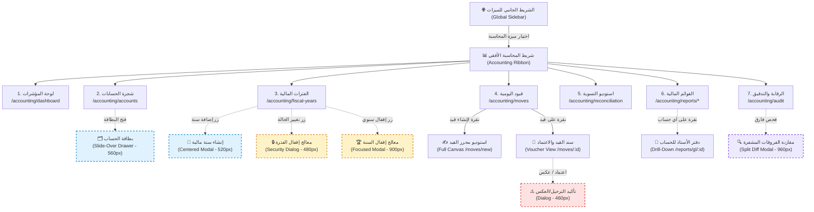

# الدليل المعماري لتصميم هياكل الشاشات والتنقل الداخلي (Layouts & Navigation Spec)

## ميزة المحاسبة المالية (Accounting Feature) - نظام Cashflow

> **مسار الوثيقة:** `docs/accounting_frontend_layouts.md`  
> **تاريخ الإصدار:** نوفمبر 2026  
> **المرجعية التحليلية:** متوافق بالكامل مع `docs/accounting_frontend_screens_analysis.md` ومعايير IFRS/IAS 7 و Clean Architecture.  
> **بيئة الاستخدام:** شاشات سطح المكتب عالية الكثافة (Desktop-First: $1920 \times 1080$ و $1440 \times 900$) مع دعم كامل للوضع الفاتح والداكن وثنائية اللغة (العربية RTL / الإنجليزية LTR).

---

## 1. المعمارية العامة للهيكل وتوزيع الأدوار (Global Shell Architecture)

وفق التوجيه الأساسي للمشروع، تم تصميم الهيكل العام للنظام ليكون قابلاً للتوسع واستيعاب ميزات متعددة حالياً ومستقبلاً (مثل: المبيعات، المشتريات، المخزون، النقدية والمصارف، الموارد البشرية، الإعدادات).

### 1.1. قاعدة الفصل الحتمي لشريط الملاحة الرئيسي (Global Sidebar vs. Feature Navigation)

> [!IMPORTANT]
> **قاعدة التصميم الجوهرية:**
>
> - **الشريط الجانبي الرئيسي (Global App Sidebar):** مخصص **حصراً** للتنقل بين الميزات والأنظمة الكبرى في البرنامج. **لا يحتوي نهائياً على أي عناصر أو شاشات فرعية خاصة بميزة المحاسبة**.
> - **التنقل الداخلي لميزة المحاسبة (Internal Feature Navigation):** يتم بالكامل داخل منطقة العمل (`Feature Workspace`) عبر شريط تنقل أفقي علوي للميزة (`Accounting Feature Header & Ribbon Tabs`)، ومسار التتبع (`Breadcrumbs`)، وبطاقات التوجيه السريع في لوحة المؤشرات (`Dashboard Hub-and-Spoke Navigation`).

```text
+-------------------------------------------------------------------------------------------------------------------------+
|                                                  الشريط العلوي العام (Global Topbar)                                    |
| [Logo] Cashflow  |  🏢 شركة التجارة الحديثة  |  🔍 بحث عام (Ctrl+K)  |  🌐 AR/EN  |  🌙 Dark/Light  |  🔔 (3)  |  👤 أسامة  |
+---------+---------------------------------------------------------------------------------------------------------------+
|         |                                    شريط ميزة المحاسبة (Accounting Feature Ribbon Header)                      |
|         | مسار التنقل: المحاسبة > قيود اليومية > محرر القيد                                        [+ قيد جديد] [⚡ تسوية] |
|         | [📊 المؤشرات] [🌳 دليل الحسابات] [📅 التقويم والفترات] [📑 القيود] [⚖️ التسوية] [📈 التقارير ▾] [🛡️ الرقابة]      |
| شريط    +---------------------------------------------------------------------------------------------------------------+
| الميزات |                                                                                                               |
| العامة  |                                                                                                               |
| (Global |                                                                                                               |
| Feature |                                        منطقة عرض الشاشة المحددة (Screen Canvas)                               |
| Sidebar)|                               (Full Desktop Work Area - High Density Grid)                                     |
|         |                                                                                                               |
| 📊 محـاسبة|                                                                                                               |
| 💰 نـقـدية|                                                                                                               |
| 🛒 مبيعات|                                                                                                               |
| 📦 مخـزون|                                                                                                               |
| ⚙️ إعدادات|                                                                                                               |
|         |                                                                                                               |
| [⬅️ طي] |                                                                                                               |
+---------+---------------------------------------------------------------------------------------------------------------+
```

---

## 2. خريطة وهيكل التنقل الداخلي لميزة المحاسبة (Internal Navigation Architecture)

### 2.1. المكونات الهيكلية لشريط ميزة المحاسبة (Accounting Ribbon Bar)

عند اختيار ميزة **المحاسبة (Accounting)** من الشريط الجانبي العام، تظهر منطقة العمل الخاصة بالمحاسبة، وتحتوي على شريط رأس الميزة الموحد (`Accounting Sub-Header`) بارتفاع ثابت $52\text{px}$، متضمناً:

1. **مسار التتبع الذكي (Dynamic Breadcrumbs):** يحدد موقع المحاسب بدقة مع روابط قابلة للنقر للعودة للمستوى الأعلى.
2. **تبويبات الأقسام الأفقية (Horizontal Module Tabs):**
   - **لوحة المؤشرات (`/accounting/dashboard`):** ملخص الأداء والرقابة والسيولة والمهام المعلقة.
   - **دليل الحسابات (`/accounting/accounts`):** الشجرة التفاعلية وبطاقات الحسابات.
   - **الفترات والسنوات (`/accounting/fiscal-years`):** التقويم المالي وحالات الفترات وإقفال السنة.
   - **قيود اليومية (`/accounting/moves`):** سجل القيود واستوديو تحرير القيد وسند القيد.
   - **التسوية والمطابقة (`/accounting/reconciliation`):** استوديو المطابقة وسجل فك التسوية.
   - **التقارير المالية (`/accounting/reports`):** قائمة منسدلة أو تبويبات فرعية:
     - ميزان المراجعة (`/trial-balance`)
     - قائمة الدخل (`/income-statement`)
     - المركز المالي (`/balance-sheet`)
     - التدفقات النقدية IAS 7 (`/cash-flow`)
     - دفتر الأستاذ العام (`/general-ledger`)
   - **الرقابة والتدقيق (`/accounting/audit`):** أحداث الدفاتر المساعدة وسلسلة النزاهة التشفيرية.
3. **أزرار الأوامر السريعة الثابتة (Action Buttons):** زر "إنشاء قيد جديد" وزر "إجراء تسوية".

### 2.2. مخطط مسارات التنقل والروابط العميقة (Navigation Flow Diagram)



---

## 3. تصنيف الشاشات والنوافذ المنبثقة (Screens vs. Popups & Drawers)

لضمان سلاسة وسرعة العمل للمحاسب المالي ومنع التشتت والانتقالات الكاملة المرهقة، تم تقسيم شاشات النظام إلى نوعين رئيسيين:

| النوع الهيكلي | النمط البرمجي في الواجهة | الحالات والشاشات التابعة له | مبرر التصميم (UX Rationale) |
| :--- | :--- | :--- | :--- |
| **شاشات كاملة (Full-Page Canvas)** | مسار صفحة مستقل داخل منطقة العمل | لوحة المؤشرات، شجرة الحسابات، سجل القيود، محرر القيد المالي، استوديو التسوية، التقارير المالية الخمسة، دفتر الأستاذ، سجل التدقيق. | تتطلب مساحة شاشة عريضة وجداول بيانات مكثفة واستعراض مزدوج وتمرير مستقل. |
| **بطاقات منزلقة (Slide-Over Drawers)** | نافذة تنزلق من جانب الشاشة (560px) مع إعتام خفيف للخلفية | بطاقة إنشاء وتعديل الحساب المحاسبي (`Account Drawer`). | تسمح للمحاسب برؤية الشجرة وموضع الحساب في الخلفية أثناء تحرير البيانات وتصنيفات IAS 7. |
| **نوافذ منبثقة مركزية (Centered Modal Dialogs)** | نوافذ حوارية مركزية بأحجام محددة (460px إلى 900px) | إنشاء سنة مالية، تغيير حالة الفترة، معالج إقفال السنة، تأكيد ترحيل/عكس القيد، مقارنة فروقات التدقيق، نافذة الأوامر السريعة `Ctrl+K`. | مهام محددة وبؤرية تركز انتباه المستخدم وتتطلب تأكيداً حتمياً أو حقولاً محدودة قبل الإرسال. |

---

## 4. التصميم التفصيلي لهياكل الشاشات الـ 14 (Layout Wireframes & Specs)

---

### شاشة 1: لوحة المؤشرات المالية العامة (Accounting Dashboard)

- **المسار:** `/accounting/dashboard`
- **نوع التخطيط:** شبكة بطاقات متعددة الأعمدة (Responsive 4-Column Metric Grid) عالية الكثافة.
- **التصميم التخطيطي (Wireframe):**

```text
+---------------------------------------------------------------------------------------------------------+
| [مسار: المحاسبة > لوحة المؤشرات]                                      [تاريخ اليوم: 2026-11-06] [🔄 تحديث] |
+---------------------------------------------------------------------------------------------------------+
| [ بطاقة 1: الفترة المالية ] | [ بطاقة 2: الحوكمة ]     | [ بطاقة 3: اتزان النظام ] | [ بطاقة 4: النقدية ]       |
| نوفمبر 2026 (مفتوحة 🟢)    | 3 قيود معلقة تنتظر       | ميزان المراجعة متزن 100%   | 4,250,800.00 SAR          |
| متبقي 24 يوماً على الإقفال | الاعتماد (> الحد الرقابي)| فرق الميزان: 0.00 SAR     | ↑ 12.4% عن الشهر السابق   |
| [عرض التقويم]              | [مراجعة واعتماد]        | [فحص ميزان المراجعة]      | [كشف حركة النقدية]        |
+-------------------------------------------------------+-------------------------------------------------+
| مخطط الإيرادات مقابل المصروفات (12 شهراً متتالياً)    | آخر القيود المرحلة مؤخراً (Recent Moves)       |
|                                                       | - GEN/2026/001 | سداد مورد | 15,000 SAR 🟢      |
| [ الرسم البياني المتوافق مع الوضعين الفاتح والداكن ]    | - SAL/2026/012 | رواتب     | 85,000 SAR 🟢      |
|                                                       | - ADJ/2026/003 | تسوية عهد |  3,200 SAR 🟢      |
|                                                       | [استعراض كل القيود...]                           |
+-------------------------------------------------------+-------------------------------------------------+
| اختصارات الوصول السريع المحاسبية (Quick Shortcuts):                                                      |
| [ ➕ إنشاء قيد يومية (Ctrl+N) ]  [ ⚖️ مطابقة وتسوية كشف حساب ]  [ 🌳 استعراض شجرة الحسابات ]  [ 📄 ميزان المراجعة ] |
+---------------------------------------------------------------------------------------------------------+
```

---

### شاشة 2: شجرة الحسابات والدليل المحاسبي (Chart of Accounts Tree View)

- **المسار:** `/accounting/accounts`
- **نوع التخطيط:** عرض منقسم بعمودين متجاورين (`Desktop Split-Pane Layout` بنسبة 35% / 65%).
- **التصميم التخطيطي (Wireframe):**

```text
+---------------------------------------------------------------------------------------------------------+
| [مسار: المحاسبة > الدليل المحاسبي]   [بحث: كود أو اسم...] [فلاتر: أصول | خصوم | ملكية | إيراد | مصروف] [+ حساب جديد] |
+------------------------------------+--------------------------------------------------------------------+
| لوحة الشجرة المتفرعة (Tree Pane - 35%)| لوحة تفاصيل الحساب المحدد والفرعيات (Account Data Grid - 65%)        |
|                                    | الحساب النشط: 10101 - الصندوق الرئيسي (Main Vault)                 |
| ▼ 100000 الأصول (Assets)           +--------------------------------------------------------------------+
|   ▼ 101000 الأصول المتداولة         | كود: 1010101 | العملة: SAR | الطبيعة: مدين | تصنيف IAS 7: نقد وما في حكمه|
|     ► 101010 الصندوق الرئيسي 📁    +--------------------------------------------------------------------+
|     ► 101020 البنك الأهلي الجاري 🏦| كود الحساب  | اسم الحساب        | طبيعة الرصيد | الرصيد الحالي  | إجراءات  |
|     ► 101030 ذمم المدينين 👥        +-------------+------------------+--------------+----------------+----------+
|   ► 102000 الأصول غير المتداولة    | 1010101     | الصندوق الفرعي 1 | مدين (Debit) |  25,400.00 SAR | [تعديل]  |
| ► 200000 الخصوم (Liabilities)      | 1010102     | الصندوق الفرعي 2 | مدين (Debit) |  12,150.00 SAR | [تعديل]  |
| ► 300000 حقوق الملكية (Equity)     | 1010103     | صندوق العهد      | مدين (Debit) |   8,000.00 SAR | [تعديل]  |
| ► 400000 الإيرادات (Income)        +-------------+------------------+--------------+----------------+----------+
| ► 500000 المصروفات (Expenses)      | الإجمالي التراكمي للفرع:                        45,550.00 SAR    |          |
|                                    +--------------------------------------------------------------------+
| [اختصار: الأسهم للتنقل، F2 للتعديل]| [زر: عرض دفتر الأستاذ للحساب]  [زر: إضافة حساب فرعي تابع]           |
+------------------------------------+--------------------------------------------------------------------+
```

---

### شاشة 3: إدارة الفترات والتقويم المالي (Fiscal Calendar & Periods)

- **المسار:** `/accounting/fiscal-years`
- **نوع التخطيط:** شبكة بطاقات الفترات الشهرية الـ 12 بنمط ($4 \times 3$ Cards Responsive Grid).
- **التصميم التخطيطي (Wireframe):**

```text
+---------------------------------------------------------------------------------------------------------+
| [مسار: المحاسبة > الفترات المالية]   [السنة المالية: 2026 ▾]   [+ إنشاء سنة مالية جديدة]   [🏆 إقفال السنة] |
+---------------------------------------------------------------------------------------------------------+
| [ ملخص السنة: 2026 ]  الحالة: نشطة 🟢  |  الفترات المفتوحة: 2  |  الفترات المقفلة: 10  |  نهاية السنة: 2026-12-31|
+---------------------------------------------------------------------------------------------------------+
| [ بطاقة: شهر 1 - يناير ]   | [ بطاقة: شهر 2 - فبراير ]  | [ بطاقة: شهر 3 - مارس ]   | [ بطاقة: شهر 4 - إبريل ]  |
| الحالة: مقفلة نهائياً 🔴   | الحالة: مقفلة نهائياً 🔴   | الحالة: مقفلة نهائياً 🔴  | الحالة: مقفلة نهائياً 🔴  |
| القيود: 142 مرحل | 0 مسودة | القيود: 120 مرحل | 0 مسودة | القيود: 198 مرحل | 0 مسودة| القيود: 165 مرحل | 0 مسودة|
| [🔒 مقفل نهائياً]          | [🔒 مقفل نهائياً]          | [🔒 مقفل نهائياً]         | [🔒 مقفل نهائياً]         |
+----------------------------+----------------------------+---------------------------+---------------------------+
| [ بطاقة: شهر 5 - مايو ]    | [ بطاقة: شهر 6 - يونيو ]   | [ بطاقة: شهر 7 - يوليو ]  | [ بطاقة: شهر 8 - أغسطس ]  |
| الحالة: مقفلة نهائياً 🔴   | الحالة: مقفلة نهائياً 🔴   | الحالة: مقفلة نهائياً 🔴  | الحالة: مقفلة نهائياً 🔴  |
+----------------------------+----------------------------+---------------------------+---------------------------+
| [ بطاقة: شهر 9 - سبتمبر ]  | [ بطاقة: شهر 10 - أكتوبر ] | [ بطاقة: شهر 11 - نوفمبر] | [ بطاقة: شهر 12 - ديسمبر ]|
| الحالة: مقفلة نهائياً 🔴   | الحالة: مقفلة مؤقتاً 🟡    | الحالة: مفتوحة 🟢 (الحالية)| الحالة: مفتوحة 🟢         |
| [🔒 مقفل نهائياً]          | [⚙️ تغيير: إقفال نهائي]    | [⚙️ إقفال شهري مؤقت]       | [⚙️ تغيير الحالة]          |
+---------------------------------------------------------------------------------------------------------+
```

---

### شاشة 4: سجل واستكشاف القيود المحاسبية (Journal Entries Explorer)

- **المسار:** `/accounting/moves`
- **نوع التخطيط:** جدول بيانات عالي الكثافة (`Desktop High-Density Grid`) برأس ثابت وشريط فلاتر مدمج.
- **التصميم التخطيطي (Wireframe):**

```text
+---------------------------------------------------------------------------------------------------------+
| [مسار: المحاسبة > قيود اليومية]                                                      [➕ قيد جديد (Ctrl+N)] |
+---------------------------------------------------------------------------------------------------------+
| شريط الفلاتر السريع: [دفتر: الكل ▾] [الحالة: الكل ▾] [من: 2026-11-01] [إلى: 2026-11-30] [بحث في المرجع/البيان...]|
+---------------------------------------------------------------------------------------------------------+
|  رقم القيد   | الدفتر  |   التاريخ   | البيان / المرجع            |  إجمالي المدين  |  إجمالي الدائن  | الحالة  | نزاهة | إجراءات |
+--------------+---------+-------------+---------------------------+-----------------+-----------------+---------+-------+---------+
| GEN/2026/045 | العام   | 2026-11-05  | إثبات مبيعات نقدية معرض 1 |   14,500.00 SAR |   14,500.00 SAR | مرحل 🟢 |  🛡️   | [عرض] [🖨️]|
| BNK/2026/012 | البنك   | 2026-11-05  | سداد دفعة مورد شركة الهدى |   35,000.00 SAR |   35,000.00 SAR | مرحل 🟢 |  🛡️   | [عرض] [🖨️]|
| GEN/2026/046 | العام   | 2026-11-04  | قيد تسوية إهلاك شهري     |    8,200.00 SAR |    8,200.00 SAR | مسودة🟡 |  ⚪   | [تعديل] [🗑️]|
| SAL/2026/011 | الرواتب | 2026-11-01  | مسير رواتب موظفي الإدارة  |  120,000.00 SAR |  120,000.00 SAR | معتمد 🔵 |  🛡️   | [اعتماد Checker]|
+--------------+---------+-------------+---------------------------+-----------------+-----------------+---------+-------+---------+
| صف المجاميع المثبت (Sticky Totals):       | عدد القيود: 4 قيود    |  177,700.00 SAR |  177,700.00 SAR | متزن 100% 🟢      |
+---------------------------------------------------------------------------------------------------------+
| عرض الصفحات: [السابق] [1] [2] [3] ... [التالي]                           عرض: [25] [50] [100] صفاً لكل صفحة  |
+---------------------------------------------------------------------------------------------------------+
```

---

### شاشة 5: استوديو محرر القيد المالي المزدوج (Double-Entry Move Studio)

- **المسار:** `/accounting/moves/new` أو `/accounting/moves/:id/edit`
- **نوع التخطيط:** مساحة عمل كاملة ومستقلة مع شريط سفلي عائم ومثبت لحالة الاتزان (`Sticky Floating Balanced Footer`).
- **التصميم التخطيطي (Wireframe):**

```text
+---------------------------------------------------------------------------------------------------------+
| [مسار: المحاسبة > قيود اليومية > محرر القيد المزدوج]                    [رقم تسلسلي متوقع: GEN/2026/047] |
+---------------------------------------------------------------------------------------------------------+
| رأس القيد (Header Form Bar):                                                                            |
| دفتر اليومية: [الدفتر العام ▾]  |  تاريخ القيد: [2026-11-06 📅]  |  المرجع/البيان: [سداد إيجار المقر السنوي      ] |
+---------------------------------------------------------------------------------------------------------+
| جدول أسطر القيد المالي (Lines Data Grid - Full Width Canvas):                                           |
| # | الحساب المحاسبي (AR/EN) | الشريك / العميل | مركز التكلفة | المبلغ المدين | المبلغ الدائن | ملاحظات السطر | إجراءات|
+---+-------------------------+-----------------+--------------+---------------+---------------+---------------+--------+
| 1 | 501020 - مصروف الإيجار  | شركة العقارية   | الإدارة (CC1)| 60,000.00 SAR |          0.00 | إيجار 2027    | [🗑️ Alt+D]|
| 2 | 101020 - البنك الأهلي   | —               | —            |          0.00 | 60,000.00 SAR | تحويل بنكي    | [🗑️ Alt+D]|
| 3 | [اكتب كود أو اسم...]     | —               | —            |          0.00 |          0.00 |               |        |
+---+-------------------------+-----------------+--------------+---------------+---------------+---------------+--------+
| [ ➕ إضافة سطر جديد (Alt+A) ]   [ ⚡ موازنة تلقائية للقيد (Ctrl+Shift+B) ]   [ 🔄 عكس المدين والدائن ]         |
+---------------------------------------------------------------------------------------------------------+
| الشريط السفلي المثبت للاتزان (Sticky Balanced Footer):                                                   |
| ∑ المدين: 60,000.00 SAR   |   ∑ الدائن: 60,000.00 SAR   |   Δ الفارق: 0.00 SAR ✅   | [💾 حفظ مسودة (Ctrl+S)]  |
| الحالة: متزن تماماً بنسبة 100% (جاهز للترحيل المالي)                                 | [🚀 ترحيل القيد (Ctrl+Enter)]|
+---------------------------------------------------------------------------------------------------------+
```

---

### شاشة 6: تفاصيل وسند القيد المحاسبي والاعتماد (Move Details & Governance View)

- **المسار:** `/accounting/moves/:id`
- **نوع التخطيط:** عرض سند رسمي قابل للطباعة (`Printable Document Voucher Canvas`) مع شريط حوكمة Maker-Checker وشريط بصمة مشفر.
- **التصميم التخطيطي (Wireframe):**

```text
+---------------------------------------------------------------------------------------------------------+
| [مسار: المحاسبة > قيود اليومية > سند القيد GEN/2026/045]                    [🖨️ طباعة سند] [🔄 عكس القيد] [عودة] |
+---------------------------------------------------------------------------------------------------------+
| شريط الحوكمة والرقابة (Maker-Checker Bar):                                                              |
| المنشئ (Maker): أحمد المحاسب (2026-11-05 10:15)  |  المراجع (Checker): خالد المدير المالي (2026-11-05 11:30) 🟢 |
| الحالة: مرحل قانونياً (Posted & Immutable) - لا يمكن التعديل                                           |
+---------------------------------------------------------------------------------------------------------+
|                                          سند قيد محاسبي رسمي                                            |
|                                       شركة التجارة الحديثة المحدودة                                     |
| رقم السند: GEN/2026/045                التاريخ: 2026-11-05                دفتر اليومية: العمليات العامة  |
| البيان العام: إثبات مبيعات نقدية معرض 1 - الفاتورة رقم INV-9921                                          |
+---------------------------------------------------------------------------------------------------------+
| كود الحساب  | اسم الحساب المحاسبي        | مركز التكلفة | البيان التفصيلي       | المدين (SAR)  | الدائن (SAR)  |
+-------------+----------------------------+--------------+-----------------------+---------------+---------------+
| 1010101     | الصندوق الرئيسي            | مبيعات       | توريد نقدي مبيعات     |     14,500.00 |          0.00 |
| 4010101     | إيرادات مبيعات المعارض     | مبيعات       | قيمة بضاعة مباعة      |          0.00 |     14,500.00 |
+-------------+----------------------------+--------------+-----------------------+---------------+---------------+
| الإجمالي العام المتزن:                                                          |     14,500.00 |     14,500.00 |
+---------------------------------------------------------------------------------------------------------+
| سلسلة النزاهة التشفيرية (Cryptographic Audit Block):                                                    |
| 🛡️ بصمة السجل الحالي: e3b0c44298fc1c149afbf4c8996fb92427ae41e4649b934ca495991b7852b855 (SHA-256)        |
| 🔗 بصمة السجل السابق: a7f8c12093edbc109efcf3a8901eb81226cd31e3538a823ba384880a6741a744                |
+---------------------------------------------------------------------------------------------------------+
```

---

### شاشة 7: استوديو التسوية والمطابقة المحاسبية (Account Reconciliation Studio)

- **المسار:** `/accounting/reconciliation`
- **نوع التخطيط:** شاشة منقسمة عمودياً ($50\% - 50\%$) مع شريط تحكم رأس وشريط تخصيص مركزي مثبت.
- **التصميم التخطيطي (Wireframe):**

```text
+---------------------------------------------------------------------------------------------------------+
| [مسار: المحاسبة > التسوية والمطابقة]                                      [📜 سجل التسويات السابقة وفك التسوية] |
| حساب التسوية: [101020 - البنك الأهلي الجاري ▾]  |  العملة: [SAR ▾]  |  تاريخ التسوية: [2026-11-06] [🔄 جلب الحركات] |
+----------------------------------------------------+----------------------------------------------------+
| اللوحة اليمنى: الحركات المدينة المعلقة (Debits 50%)| اللوحة اليسرى: الحركات الدائنة المعلقة (Credits 50%)|
+----------------------------------------------------+----------------------------------------------------+
| [ ] التاريخ   | رقم القيد    | الرصيد  | تخصيص      | [ ] التاريخ   | رقم القيد    | الرصيد  | تخصيص       |
+----------------------------------------------------+----------------------------------------------------+
| [✔] 2026-11-02| GEN/26/030  | 5,000   | [ 5,000.00]| [✔] 2026-11-04| BNK/26/010  | 5,000   | [ 5,000.00 ]|
| [ ] 2026-11-03| GEN/26/038  | 2,400   | [ 0.00    ]| [ ] 2026-11-05| BNK/26/011  | 1,200   | [ 0.00     ]|
| [ ] 2026-11-05| GEN/26/041  | 1,800   | [ 0.00    ]| [ ] 2026-11-05| BNK/26/012  | 8,000   | [ 0.00     ]|
+----------------------------------------------------+----------------------------------------------------+
| إجمالي الحركات غير المسواة:          9,200.00 SAR  | إجمالي الحركات غير المسواة:          14,200.00 SAR |
+----------------------------------------------------+----------------------------------------------------+
| شريط المطابقة وحساب فروق العملة المثبت (Central Sticky Matching & FX Bar):                              |
| ∑ مخصص مدين: 5,000.00 SAR  |  ∑ مخصص دائن: 5,000.00 SAR  |  Δ الفرق: 0.00 SAR ✅  |  💱 فروق الصرف: 0.00 SAR |
| [ زر: تنفيذ واعتماد التسوية المحاسبية (مُفعل الآن) ]                                                      |
+---------------------------------------------------------------------------------------------------------+
```

---

### شاشة 8: ميزان المراجعة التفاعلي (Interactive Trial Balance)

- **المسار:** `/accounting/reports/trial-balance`
- **نوع التخطيط:** جدول تقرير مالي ذو 6 أعمدة متراصفة رأسياً ومجاميع مثبتة تدعم التعمق الفوري لدفتر الأستاذ.
- **التصميم التخطيطي (Wireframe):**

```text
+---------------------------------------------------------------------------------------------------------+
| [مسار: المحاسبة > التقارير > ميزان المراجعة]   [من: 2026-01-01] [إلى: 2026-11-06] [مستوى العرض: المستوى 3 ▾] [🖨️] [📥 Excel]|
+---------------------------------------------------------------------------------------------------------+
| كود واسم الحساب المحاسبي | الرصيد الافتتاحي | حركات الفترة المالية | الرصيد الختامي الحالي | التعمق     |
| (Account Code & Name)    | مدين     | دائن   | مدين        | دائن   | مدين         | دائن   | (Drill-Down)|
+--------------------------+----------+--------+-------------+--------+--------------+--------+-------------+
| ▼ 100000 الأصول          | 450,000  |      0 |     180,000 | 65,000 |      565,000 |      0 | [استعراض]   |
|   ▼ 101000 المتداولة     | 300,000  |      0 |     150,000 | 50,000 |      400,000 |      0 | [استعراض]   |
|     101010 الصندوق       |  50,000  |      0 |      45,000 | 20,000 |       75,000 |      0 | [الأستاذ ↗️] |
|     101020 البنك الأهلي  | 250,000  |      0 |     105,000 | 30,000 |      325,000 |      0 | [الأستاذ ↗️] |
| ▲ 200000 الخصوم          |       0  | 200,000|      30,000 | 80,000 |            0 | 250,000| [استعراض]   |
| ▲ 300000 حقوق الملكية    |       0  | 250,000|           0 |      0 |            0 | 250,000| [استعراض]   |
| ▲ 400000 الإيرادات       |       0  |      0 |           0 |110,000 |            0 | 110,000| [استعراض]   |
| ▼ 500000 المصروفات       |       0  |      0 |      45,000 |      0 |       45,000 |      0 | [الأستاذ ↗️] |
+--------------------------+----------+--------+-------------+--------+--------------+--------+-------------+
| صف المجاميع المثبت:      | 450,000  | 450,000|     255,000 |255,000 |      610,000 | 610,000| متزن 100% 🟢|
+---------------------------------------------------------------------------------------------------------+
```

---

### شاشة 9: قائمة الدخل والأرباح والخسائر (Income Statement / P&L)

- **المسار:** `/accounting/reports/income-statement`
- **نوع التخطيط:** قائمة تقريرية هرمية مع بطاقة مميزة لصافي الربح/الخسارة في الأسفل.
- **التصميم التخطيطي (Wireframe):**

```text
+---------------------------------------------------------------------------------------------------------+
| [مسار: المحاسبة > التقارير > قائمة الدخل]   [السنة: 2026 ▾]   [الفترة: من يناير إلى نوفمبر ▾]   [🖨️ طباعة التقرير] |
+---------------------------------------------------------------------------------------------------------+
| البند المحاسبي المعياري (IFRS Financial Line)                           | المبلغ للفترة (SAR) | النسبة %|
+-------------------------------------------------------------------------+---------------------+---------+
| ▼ إيرادات النشاط التشغيلي والمبيعات (Revenue)                           |                     |         |
|     إيرادات مبيعات البضائع والخدمات                                     |        1,850,000.00 |   100 % |
|     (يُطرح) مردودات ومسموحات المبيعات                                  |         (45,000.00) |  -2.4 % |
| = صافي الإيرادات (Net Revenue)                                          |        1,805,000.00 |  97.6 % |
+-------------------------------------------------------------------------+---------------------+---------+
| ▼ تكلفة المبيعات (Cost of Goods Sold - COGS)                            |                     |         |
|     تكلفة البضاعة المباعة                                               |       (950,000.00)  | -51.3 % |
| = مجمل الربح التشغيلي (Gross Profit)                                    |          855,000.00 |  46.3 % |
+-------------------------------------------------------------------------+---------------------+---------+
| ▼ المصروفات التشغيلية والبيعية والإدارية (Opex)                          |                     |         |
|     رواتب وأجور البدلات                                                 |        (320,000.00) | -17.3 % |
|     مصروفات الإيجار والمرافق                                            |        (110,000.00) |  -5.9 % |
|     مصروفات استهلاك الأصول الثابتة (Depreciation)                        |         (35,000.00) |  -1.9 % |
| = إجمالي المصروفات التشغيلية                                            |        (465,000.00) | -25.1 % |
+-------------------------------------------------------------------------+---------------------+---------+
| = الربح التشغيلي قبل الفوائد والضرائب (Operating Profit - EBIT)         |          390,000.00 |  21.2 % |
|     إيرادات / (مصروفات) غير تشغيلية وفروق أسعار صرف محققة              |            8,500.00 |   0.5 % |
|     مخصص الزكاة والضريبة التقديري                                       |         (25,000.00) |  -1.3 % |
+-------------------------------------------------------------------------+---------------------+---------+
| بطاقة صافي الدخل الختامي للفترة (Net Income Card):                                                      |
| 🏆 صافي الربح للفترة (Net Profit for Period):               373,500.00 SAR (هامش صافي 20.4%) 🟢        |
+---------------------------------------------------------------------------------------------------------+
```

---

### شاشة 10: الميزانية العمومية والمركز المالي (Balance Sheet)

- **المسار:** `/accounting/reports/balance-sheet`
- **نوع التخطيط:** عرض منقسم بعمودين متقابلين في سطح المكتب (`Side-by-Side Dual Column`) للتحقق اللحظي من التوازن ($\text{Assets} = \text{Liabilities} + \text{Equity}$).
- **التصميم التخطيطي (Wireframe):**

```text
+---------------------------------------------------------------------------------------------------------+
| [مسار: المحاسبة > التقارير > المركز المالي]   [في تاريخ: 2026-11-06 📅]   [مقارنة مع سنة سابقة: 2025 ☐] [🖨️] |
+---------------------------------------------------------------------------------------------------------+
| شريط التحقق من توازن المركز المالي: الأصول = الخصوم + حقوق الملكية  |  فارق التوازن: 0.00 SAR ✅ متزن بنسبة 100%|
+----------------------------------------------------+----------------------------------------------------+
| العمود الأيمن: الأصول (Assets - 50%)               | العمود الأيسر: الخصوم وحقوق الملكية (L & E - 50%)  |
+----------------------------------------------------+----------------------------------------------------+
| ▼ الأصول المتداولة (Current Assets):                | ▼ الخصوم المتداولة (Current Liabilities):          |
|   - النقدية وما في حكمها:            1,250,000 SAR |   - ذمم الموردين والدائنين:            420,000 SAR |
|   - ذمم العملاء والمدينين:             680,000 SAR |   - مصروفات مستحقة وأرصدة دائنة:        95,000 SAR |
|   - المخزون السلعي:                    850,000 SAR |   - مخصص الزكاة والضريبة:               45,000 SAR |
| = إجمالي الأصول المتداولة:           2,780,000 SAR | = إجمالي الخصوم المتداولة:             560,000 SAR |
+----------------------------------------------------+----------------------------------------------------+
| ▼ الأصول غير المتداولة (Non-Current Assets):       | ▼ الخصوم غير المتداولة (Non-Current):              |
|   - الأصول الثابتة (التكلفة):        1,400,000 SAR |   - قروض وتسهيلات بنكية طويلة الأجل:   300,000 SAR |
|   - مجمع الإهلاك المتراكم:           (250,000) SAR | = إجمالي الخصوم الكلية:                860,000 SAR |
| = صافي الأصول غير المتداولة:         1,150,000 SAR +----------------------------------------------------+
|                                                    | ▼ حقوق الملكية (Equity):                           |
|                                                    |   - رأس المال المدفوع:               2,000,000 SAR |
|                                                    |   - الأرباح المحتجزة المدورة:           696,500 SAR |
|                                                    |   - أرباح الفترة الحالية غير المرحلة:  373,500 SAR |
|                                                    | = إجمالي حقوق الملكية:               3,070,000 SAR |
+----------------------------------------------------+----------------------------------------------------+
| إجمالي الأصول (Total Assets):        3,930,000 SAR | إجمالي الخصوم وحقوق الملكية:         3,930,000 SAR |
+----------------------------------------------------+----------------------------------------------------+
```

---

### شاشة 11: قائمة التدفقات النقدية معيار IAS 7 (Statement of Cash Flows)

- **المسار:** `/accounting/reports/cash-flow`
- **نوع التخطيط:** تقرير طولي مقسم إلى الأنشطة الثلاثة وفق الطريقة غير المباشرة لمعيار IAS 7 وبطاقة مطابقة نقدية ختامية.
- **التصميم التخطيطي (Wireframe):**

```text
+---------------------------------------------------------------------------------------------------------+
| [مسار: المحاسبة > التقارير > التدفقات النقدية IAS 7]   [عن الفترة من: 2026-01-01] [إلى: 2026-11-06]     [🖨️]|
+---------------------------------------------------------------------------------------------------------+
| 1. التدفقات النقدية من الأنشطة التشغيلية (Operating Activities):                                        |
|     صافي الربح قبل الزكاة والضريبة (من قائمة الدخل)                      |               398,500.00 SAR |
|     + تسويات البنود غير النقدية: مصروف استهلاك الأصول الثابتة          |                35,000.00 SAR |
|     (التغير في رأس المال العامل):                                       |                              |
|       - (الزيادة) / النقص في ذمم العملاء والمدينين                       |             (120,000.00) SAR |
|       - (الزيادة) / النقص في المخزون السلعي                             |              (85,000.00) SAR |
|       - الزيادة / (النقص) في ذمم الموردين والدائنين                     |                65,000.00 SAR |
| = صافي النقد المتولد من الأنشطة التشغيلية                                |               293,500.00 SAR |
+-------------------------------------------------------------------------+------------------------------+
| 2. التدفقات النقدية من الأنشطة الاستثمارية (Investing Activities):                                      |
|     - شراء آلات ومعدات جديدة (تدفق نقدي خارج)                           |             (150,000.00) SAR |
| = صافي النقد المستخدم في الأنشطة الاستثمارية                            |             (150,000.00) SAR |
+-------------------------------------------------------------------------+------------------------------+
| 3. التدفقات النقدية من الأنشطة التمويلية (Financing Activities):                                        |
|     - سداد أقساط قروض بنكية طويلة الأجل                                |              (40,000.00) SAR |
| = صافي النقد المستخدم في الأنشطة التمويلية                              |              (40,000.00) SAR |
+-------------------------------------------------------------------------+------------------------------+
| بطاقة مطابقة النقدية الختامية وفق معيار IAS 7 (Cash Reconciliation Card):                               |
|   - صافي التغير الكلي في النقدية خلال الفترة (1 + 2 + 3):                                103,500.00 SAR |
|   - رصيد النقدية وما في حكمها في بداية الفترة:                                         1,146,500.00 SAR |
| = رصيد النقدية وما في حكمها في نهاية الفترة (المطابق لحسابات الصندوق والبنوك):          1,250,000.00 SAR |
| الحالة: مطابقة تامة بنسبة 100% مع أرصدة المركز المالي 🟢                                                |
+---------------------------------------------------------------------------------------------------------+
```

---

### شاشة 12: دفتر الأستاذ العام وتدقيق الحساب (General Ledger Drill-Down View)

- **المسار:** `/accounting/reports/general-ledger` أو `/accounting/reports/general-ledger/:account_id`
- **نوع التخطيط:** بطاقة علوية لبيانات وأرصدة الحساب وجدول حركات تفصيلي بعمود الرصيد المتحرك (`Running Balance`).
- **التصميم التخطيطي (Wireframe):**

```text
+---------------------------------------------------------------------------------------------------------+
| [مسار: المحاسبة > التقارير > دفتر الأستاذ]   [الحساب: 101020 - البنك الأهلي الجاري ▾]   [الفترة: 2026-11-01 / 11-06]|
+---------------------------------------------------------------------------------------------------------+
| بطاقة ملخص الحساب:                                                                                      |
| الرصيد الافتتاحي: 250,000.00 SAR  |  إجمالي المدين: 105,000.00 SAR  |  إجمالي الدائن: 30,000.00 SAR    |
| الرصيد الختامي الحالي: 325,000.00 SAR (مدين 🟢)                     | العملة الأساسية: ريال سعودي (SAR) |
+---------------------------------------------------------------------------------------------------------+
|  تاريخ الحركة | رقم القيد   | البيان والتفاصيل            | المدين (SAR) | الدائن (SAR) | الرصيد المتحرك | السند   |
+---------------+-------------+-----------------------------+--------------+--------------+----------------+---------+
| 2026-11-01    | —           | رصيد افتتاحي منقول          |         0.00 |         0.00 | 250,000.00 SAR | —       |
| 2026-11-02    | GEN/2026/30 | توريد مبيعات نقدية معرض 1   |    25,000.00 |         0.00 | 275,000.00 SAR | [سند ↗️] |
| 2026-11-04    | BNK/2026/10 | سداد فاتورة مورد شركة النور |         0.00 |    30,000.00 | 245,000.00 SAR | [سند ↗️] |
| 2026-11-05    | BNK/2026/12 | تحصيل شيك عميل مؤسسة الأمل  |    80,000.00 |         0.00 | 325,000.00 SAR | [سند ↗️] |
+---------------+-------------+-----------------------------+--------------+--------------+----------------+---------+
```

---

### شاشة 13: مراقبة أحداث الدفاتر المساعدة (Subledger Event Ingest Monitor)

- **المسار:** `/accounting/audit/subledger-events`
- **نوع التخطيط:** جدول تدفق أحداث لحظي (Real-Time Ingestion Feed) مع كشف التكرار وحالة التحويل إلى قيود.
- **التصميم التخطيطي (Wireframe):**

```text
+---------------------------------------------------------------------------------------------------------+
| [مسار: المحاسبة > الرقابة > أحداث الدفتر المساعد]   [المصدر: الكل ▾] [الحالة: الكل ▾] [🔄 تحديث لحظي مفعّل] |
+---------------------------------------------------------------------------------------------------------+
| وقت الوصول | النظام المصدر | نوع الحدث    | مفتاح منع التكرار (Idempotency) | حالة المعالجة | القيد المولد| تفاصيل  |
+------------+---------------+--------------+---------------------------------+---------------+-------------+---------+
| 11:24:05   | POS-Branch-01 | sale_closed  | pos_order_99812_20261106        | منجز 🟢       | GEN/2026/48 | [عرض JSON]|
| 11:15:30   | Invoicing-App | inv_approved | inv_doc_33412_approved          | منجز 🟢       | GEN/2026/47 | [عرض JSON]|
| 10:48:12   | Inventory     | stock_adjust | inv_adj_count_20261105          | تكرار مهمل 🟡 | GEN/2026/40 | [عرض JSON]|
| 09:30:00   | Procurement   | po_received  | po_receipt_88190                | خطأ محاسبي 🔴 | —           | [إعادة 🔄]|
+---------------------------------------------------------------------------------------------------------+
```

---

### شاشة 14: سجل التدقيق وسلسلة النزاهة المشفرة (Audit Hash Chain Explorer)

- **المسار:** `/accounting/audit/hash-chain`
- **نوع التخطيط:** خط زمني لكتل التجزئة المشفرة مع أداة فحص النزاهة الشاملة وزر مقارنة الفروقات (`Split Diff`).
- **التصميم التخطيطي (Wireframe):**

```text
+---------------------------------------------------------------------------------------------------------+
| [مسار: المحاسبة > الرقابة > سجل التدقيق وسلسلة النزاهة]              [🛡️ فحص نزاهة السلسلة التشفيرية الآن] |
+---------------------------------------------------------------------------------------------------------+
| حالة السلسلة: سليمة بنسبة 100% 🟢 | آخر تدقيق: اليوم 11:00 AM | إجمالي القيود الموثقة: 1,420 قيداً مشفراً |
+---------------------------------------------------------------------------------------------------------+
| التسلسل | رقم القيد    | المستخدم     | وقت الترحيل      | بصمة السجل (SHA-256)        | تطابق الربط | الفروقات|
+---------+--------------+--------------+------------------+-----------------------------+-------------+---------+
| #1420   | GEN/2026/047 | أسامة المدير | 2026-11-06 11:24 | e3b0c44298fc1c149afbf4c...  | متطابق 🔗   | [مقارنة]|
| #1419   | GEN/2026/046 | خالد المحاسب | 2026-11-05 16:40 | a7f8c12093edbc109efcf3a...  | متطابق 🔗   | [مقارنة]|
| #1418   | BNK/2026/012 | أحمد المراجع | 2026-11-05 14:10 | 8c34f9a1012abde74039ec1...  | متطابق 🔗   | [مقارنة]|
+---------+--------------+--------------+------------------+-----------------------------+-------------+---------+
```

---

## 5. التشريح الكامل للبطاقات والنوافذ المنبثقة (Popups, Drawers & Modals Anatomy)

يُفصّل هذا القسم الشاشات والنوافذ التي تظهر في صورة **بطاقات منبثقة (Popups/Modals)** أو **ألواح منزلقة جانبية (Slide-Over Drawers)** دون مغادرة الشاشة الأم:

---

### 5.1. بطاقة إنشاء وتعديل الحساب المحاسبي (`Account Slide-Over Drawer`)

- **آلية الفتح والنوع:** نافذة جانبية منزلقة عريضة (`Side Slide-Over Drawer`) بعرض ثابت $560\text{px}$.
- **الاتجاه:** تنزلق من اليمين في الوضع العربي (RTL)، ومن اليسار في الوضع الإنجليزي (LTR).
- **التصميم التخطيطي للبطاقة المنزلقة:**

```text
+-------------------------------------------------------------+
| [✖ إغلاق]   بطاقة الحساب المحاسبي: إضافة / تعديل             |
+-------------------------------------------------------------+
| التبويبات: [ 1. البيانات العامة ]  [ 2. الرقابة ]  [ 3. تدفقات IAS 7 ]|
+-------------------------------------------------------------+
| [محتوى التبويب 1: البيانات العامة]                          |
| كود الحساب (فريد وغير مكرر):                                |
| [ 1010105                                     ] (Monospace) |
|                                                             |
| اسم الحساب بالعربية:             اسم الحساب بالإنجليزية:      |
| [ صندوق فرع الشمال             ] [ North Branch Vault       ]|
|                                                             |
| نوع الحساب:                      طبيعة الرصيد الافتراضية:   |
| [ أصول (Asset)              ▾ ]  [ مدين (Debit)           ▾ ]|
|                                                             |
| الحساب الأب (Parent Account):    عملة الحساب:               |
| [ 101010 - الصناديق الرئيسية ▾ ]  [ ريال سعودي (SAR)       ▾ ]|
+-------------------------------------------------------------+
| [محتوى التبويب 2: خصائص الرقابة والتسوية]                   |
| [✔] حساب قابل للمطابقة والتسوية (Reconcilable)               |
|     (يسمح بمطابقة الدفعات والقيود في استوديو التسوية)       |
| [✔] حساب نشط وجاهز للعمليات (Active)                         |
+-------------------------------------------------------------+
| [محتوى التبويب 3: تصنيف التدفقات النقدية معيار IAS 7]        |
| [✔] نقد وما في حكمه (Cash & Cash Equivalent)                |
|     (يقفل النشاط على none ويُدرج في مطابقة النقدية)         |
| [ ] تسوية بنود غير نقدية (Non-Cash Adjustment)             |
| نشاط التدفق النقدي: [ لا شيء - نقدية (None)               ▾ ]|
+-------------------------------------------------------------+
| أسفل البطاقة (Sticky Drawer Footer):                        |
| [ إلغاء (Esc) ]                         [ 💾 حفظ بطاقة الحساب ]|
+-------------------------------------------------------------+
```

---

### 5.2. نافذة إنشاء سنة مالية جديدة (`New Fiscal Year Modal`)

- **آلية الفتح والنوع:** نافذة منبثقة مركزية (`Centered Modal`) بعرض $520\text{px}$ مع طبقة تعتيم رمادية (`Backdrop blur`).
- **التصميم التخطيطي:**

```text
+---------------------------------------------------------+
| 📅 إنشاء سنة مالية جديدة (New Fiscal Year)     [✖ إغلاق] |
+---------------------------------------------------------+
| أدخل بيانات السنة المالية. سيقوم النظام آلياً بتوليد    |
| 12 فترة مالية شهرية بحالة مفتوحة (Open).                |
|                                                         |
| سنة التقويم (Calendar Year):                            |
| [ 2027                                      ] (Tabular) |
|                                                         |
| تاريخ البداية (Start Date):    تاريخ النهاية (End Date):|
| [ 2027-01-01 📅             ]  [ 2027-12-31 📅          ]|
|                                                         |
| ℹ️ تنبيه: تبدأ السنة مباشرة بعد نهاية السنة المالية السابقة|
+---------------------------------------------------------+
| [ إلغاء ]                      [ ➕ تأكيد إنشاء السنة المالية ] |
+---------------------------------------------------------+
```

---

### 5.3. نافذة معالج تغيير حالة الفترة الشهرية (`Period State Change Modal`)

- **آلية الفتح والنوع:** نافذة حوارية أمنية مركزية (`Security Confirmation Dialog`) بعرض $480\text{px}$.
- **الهدف:** تنفيذ الإقفال المحاسبي المرحلي (`soft_closed`) أو النهائي (`hard_closed`).
- **التصميم التخطيطي:**

```text
+---------------------------------------------------------+
| 🔒 تأكيد تغيير حالة الفترة المالية              [✖ إغلاق] |
+---------------------------------------------------------+
| الفترة المستهدفة: شهر نوفمبر 2026                       |
| الحالة الحالية: مفتوحة 🟢  -->  الحالة الجديدة: مقفلة نهائياً 🔴|
|                                                         |
| ⚠️ فحص القيود المعلقة داخل الفترة:                       |
| - قيود مسودة مفتوحة: 0 مسودة (سليم ✅)                   |
| - قيود مرحلة قانونياً: 185 قيداً                        |
|                                                         |
| تحذير: الإقفال النهائي يمنع تماماً تسجيل أي قيود إضافية  |
| في هذه الفترة من قِبل أي مستخدم.                        |
|                                                         |
| لتأكيد العملية، يرجى كتابة كلمة "إقفال" أو رمز الأمان:  |
| [ إقفال                                                ]|
+---------------------------------------------------------+
| [ تراجع ]                          [ 🔴 تأكيد الإقفال النهائي ] |
+---------------------------------------------------------+
```

---

### 5.4. معالج إقفال السنة المالية وترحيل الأرباح (`Year-End Closing Wizard Modal`)

- **آلية الفتح والنوع:** نافذة مركزية عريضة كاملة التركيز (`Focused Stepper Modal`) بعرض $900\text{px}$ وشريط تقدم خماسي الخطوات.
- **التصميم التخطيطي:**

```text
+-----------------------------------------------------------------------------------------+
| 🏆 معالج إقفال السنة المالية وترحيل الأرباح (Year-End Closing Wizard)          [✖ إلغاء] |
+-----------------------------------------------------------------------------------------+
| شريط الخطوات الخمس:                                                                     |
| (1) فحص الجاهزية 🟢 -> (2) تهيئة الحسابات 🔵 -> (3) الأثر ⚪ -> (4) المعاينة ⚪ -> (5) التنفيذ ⚪ |
+-----------------------------------------------------------------------------------------+
| الخطوة الحالية 2: تحديد حساب الأرباح المحتجزة ودفتر الإقفال                              |
|                                                                                         |
| حساب الأرباح المحتجزة المستهدف (Retained Earnings Account):                             |
| [ 302010 - الأرباح المحتجزة والمدورة (Retained Earnings)                              ▾ ] |
|                                                                                         |
| دفتر يومية عمليات الإقفال السنوية (Closing Journal):                                   |
| [ CLS - دفتر الإقفال والتسويات السنوية                                                ▾ ] |
|                                                                                         |
| ℹ️ ملخص تلقائي:                                                                         |
| سيتم تصفير جميع حسابات الإيرادات والمصروفات، وتوليد قيد إقفال الأرباح، وقيد افتتاحي     |
| للسنة التالية تلقائياً بالرقم التسلسلي القانوني.                                        |
+-----------------------------------------------------------------------------------------+
| [ السابق ]                                                     [ التالي: مراجعة الأثر ➡️ ]|
+-----------------------------------------------------------------------------------------+
```

---

### 5.5. نافذة تأكيد ترحيل أو عكس القيد المحاسبي (`Post / Reverse Move Dialog`)

- **آلية الفتح والنوع:** نافذة تأكيد مصغرة (`Confirmation Dialog`) بعرض $460\text{px}$.
- **الهدف:** التحقق المزدوج قبل قفل القيد نهائياً في الدفاتر أو توليد قيد عكسي تصحيحي.
- **التصميم التخطيطي:**

```text
+---------------------------------------------------------+
| ⚠️ تأكيد ترحيل القيد المحاسبي                 [✖ إغلاق] |
+---------------------------------------------------------+
| رقم القيد: GEN/2026/047                                 |
| إجمالي المدين والدائن: 60,000.00 SAR (متزن تماماً ✅)   |
|                                                         |
| هل أنت متأكد من ترحيل هذا القيد؟                        |
| بمجرد الترحيل، سيصبح القيد غير قابل للتعديل أو الحذف،   |
| وسيتم إدراجه في سلسلة التدقيق المشفرة وتحديث الأرصدة.   |
+---------------------------------------------------------+
| [ إلغاء الأمر ]                        [ 🚀 نعم، ترحيل القيد فوراً ]|
+---------------------------------------------------------+
```

---

### 5.6. نافذة فك التسوية المحاسبية التحذيرية (`Unreconcile Caution Dialog`)

- **آلية الفتح والنوع:** نافذة تحذيرية حمراء (`High-Hazard Caution Dialog`) بعرض $480\text{px}$.
- **الهدف:** فك مطابقة دفعات أو قيود تمت تسويتها مسبقاً وعكس قيود فروق العملة التلقائية إن وجدت.
- **التصميم التخطيطي:**

```text
+---------------------------------------------------------+
| ⚠️ تحذير: فك التسوية والمطابقة المحاسبية        [✖ إغلاق] |
+---------------------------------------------------------+
| رقم التسوية: REC/2026/089                               |
| الحساب: 101020 - البنك الأهلي الجاري                    |
| أطراف التسوية: حركة بنكية مقابل فاتورة مورد             |
|                                                         |
| 🔴 الأثر المحاسبي لفك التسوية:                          |
| 1. ستعود الحركات المعنية إلى حالة "غير مسواة".          |
| 2. سيتم تلقائياً عكس قيد فروق أسعار الصرف الناتج سابقاً |
|    (القيد FX/2026/004 بمبلغ 120.00 SAR).                 |
+---------------------------------------------------------+
| [ تراجع وإلغاء ]                     [ 🔴 تأكيد فك التسوية وعكس FX ]|
+---------------------------------------------------------+
```

---

### 5.7. نافذة مقارنة فروقات التدقيق وسلسلة النزاهة (`Audit Split-Diff Modal`)

- **آلية الفتح والنوع:** نافذة عريضة مركزية (`Centered Split-Diff Modal`) بعرض $960\text{px}$.
- **الهدف:** عرض المقارنة اللحظية بين نسختين من البيانات أو فحص سجل القيد قبل وبعد التعديل.
- **التصميم التخطيطي:**

```text
+-----------------------------------------------------------------------------------------+
| 🔍 فحص الفروقات والنزاهة لسجل القيد: GEN/2026/045                             [✖ إغلاق] |
+----------------------------------------------------+------------------------------------+
| النسخة الأصلية المسودة (Original Draft)             | النسخة المرحلة المعتمدة (Posted Move)   |
+----------------------------------------------------+------------------------------------+
| {                                                  | {                                  |
|   "date": "2026-11-04",                            |   "date": "2026-11-05",   <معدل 🟡> |
|   "journal_id": "J-GEN",                           |   "journal_id": "J-GEN",               |
|   "lines": [                                       |   "lines": [                           |
|     { "account": "1010101", "debit": 12000.00 },   |     { "account": "1010101", "debit":   |
|                                                    |        14500.00 },        <معدل 🟢> |
|     { "account": "4010101", "credit": 12000.00 }   |     { "account": "4010101", "credit":  |
|                                                    |        14500.00 }         <معدل 🟢> |
|   ]                                                |   ],                               |
| }                                                  |   "hash": "e3b0c44298fc1c149af..."     |
|                                                    | }                                  |
+----------------------------------------------------+------------------------------------+
| البصمة المسجلة مطابقة تماماً للمحتوى الرقمي ✅ | السلسلة متصلة بالسجل السابق دون انقطاع 🔗|
+-----------------------------------------------------------------------------------------+
| [ إغلاق النافذة (Esc) ]                                                                 |
+-----------------------------------------------------------------------------------------+
```

---

### 5.8. نافذة الأوامر السريعة العامة (`Command Palette / Ctrl+K`)

- **آلية الفتح والنوع:** نافذة بحث ذكية عائمة في أعلى منتصف الشاشة (`Floating Spotlight Modal`) بعرض $640\text{px}$.
- **الهدف:** وصول المحاسب لأي شاشة، أو حساب، أو قيد، أو تقرير في أقل من ثانيتين باستخدام لوحة المفاتيح.
- **التصميم التخطيطي:**

```text
+-----------------------------------------------------------------+
| 🔍 [ ابحث عن شاشة، كود حساب، رقم قيد، أو إجراء...         ] Esc |
+-----------------------------------------------------------------+
| الإجراءات السريعة (Quick Actions):                              |
| ➕ إنشاء قيد يومية جديد (New Journal Move)            [Ctrl + N] |
| ⚖️ الانتقال لاستوديو التسوية (Reconciliation Studio)             |
| 🌳 فتح شجرة الحسابات (Chart of Accounts)                        |
|                                                                 |
| الحسابات المحاسبية المقترحة:                                    |
| 1010101 - الصندوق الرئيسي (Main Cash Vault)          [SAR 25,400] |
| 1010201 - البنك الأهلي الجاري (NCB Operating)        [SAR 325,000]|
|                                                                 |
| التقارير المالية:                                               |
| 📊 ميزان المراجعة (Trial Balance)                               |
| 🏛️ المركز المالي / الميزانية العمومية (Balance Sheet)           |
+-----------------------------------------------------------------+
| [↑↓ للتنقل]   [Enter للاختيار]   [Esc للإغلاق]                  |
+-----------------------------------------------------------------+
```

---

## 6. جدول مصفوفة الشاشات والنوافذ وتوزيع المساحات (Dimensions & Layout Matrix)

| # | اسم الشاشة / المكون | نمط العرض (Display Mode) | الأبعاد المقترحة (Dimensions) | موقع الظهور (Positioning) | طريقة الإغلاق |
| :---: | :--- | :--- | :--- | :--- | :---: |
| **1** | لوحة المؤشرات المحاسبية | صفحة كاملة (Full Page) | 100% عرض منطقة العمل | مسار رئيسي | — |
| **2** | شجرة الحسابات والدليل | صفحة كاملة منقسمة | 35% شجرة / 65% جدول | مسار رئيسي | — |
| **3** | بطاقة إنشاء/تعديل الحساب | بطاقة منزلقة (Slide-Over) | عرض 560px ثابت | جانب الشاشة (يمين AR / يسار EN) | `Esc` أو زر إغلاق |
| **4** | إدارة الفترات والتقويم | صفحة كاملة (Grid) | 100% عرض منطقة العمل | مسار رئيسي | — |
| **5** | إنشاء سنة مالية جديدة | نافذة مركزية (Modal) | عرض 520px | منتصف الشاشة | `Esc` أو زر إلغاء |
| **6** | معالج تغيير حالة الفترة | نافذة تأكيد مركزية | عرض 480px | منتصف الشاشة | `Esc` أو زر إلغاء |
| **7** | معالج إقفال السنة المالية | نافذة معالج خطوات | عرض 900px | منتصف الشاشة | زر إلغاء |
| **8** | سجل وبحث القيود | صفحة كاملة عالية الكثافة | 100% عرض منطقة العمل | مسار رئيسي | — |
| **9** | استوديو محرر القيد المزدوج | استوديو كامل مستقل | 100% عرض مع شريط سفلي عائم | مسار رئيسي | زر حفظ / عودة |
| **10** | سند القيد والاعتماد | سند رسمي (Voucher View) | 100% عرض (قابلة للطباعة) | مسار رئيسي | زر عودة |
| **11** | تأكيد ترحيل/عكس القيد | نافذة تأكيد مركزية | عرض 460px | منتصف الشاشة | `Esc` أو زر إلغاء |
| **12** | استوديو التسوية والمطابقة | صفحة منقسمة 50/50 | 100% عرض مع شريط سفلي عائم | مسار رئيسي | — |
| **13** | فك التسوية وعكس FX | نافذة تحذيرية مركزية | عرض 480px | منتصف الشاشة | `Esc` أو زر إلغاء |
| **14** | التقارير المالية الخمسة | صفحة تقريرية كاملة | 100% عرض منطقة العمل | مسارات رئيسية | — |
| **15** | دفتر الأستاذ للحساب | صفحة تعمق تفصيلية | 100% عرض منطقة العمل | مسار رئيسي | رابط عودة للتقرير |
| **16** | مراقبة الدفاتر المساعدة | صفحة تدفق حي للأحداث | 100% عرض منطقة العمل | مسار رئيسي | — |
| **17** | سجل وسلسلة النزاهة | صفحة خط زمني للكتل | 100% عرض منطقة العمل | مسار رئيسي | — |
| **18** | مقارنة الفروقات المشفرة | نافذة منقسمة مركزية | عرض 960px | منتصف الشاشة | `Esc` أو زر إغلاق |
| **19** | لوحة الأوامر (Ctrl+K) | نافذة بحث عائمة | عرض 640px | أعلى المنتصف | `Esc` |

---

## 7. القواعد الصارمة لدعم الوضعين الفاتح والداكن وثنائية اللغة (Styling & Theming Rules)

### 7.1. قواعد المحاذاة والأرقام (Strict Alignment Rules)

1. **الأرقام والمبالغ المالية (Debit / Credit / Balances / Totals):**
   - **إلزامي:** محاذاة أفقية إلى النهاية (`text-align: end`).
   - **إلزامي:** اتجاه رقمي من اليسار لليمين دائماً (`direction: ltr`) حتى في الواجهة العربية.
   - **إلزامي:** تفعيل الأرقام الجدولية المتساوية في العرض:

     ```css
     font-variant-numeric: tabular-nums lining-nums;
     font-feature-settings: "tnum" 1, "lnum" 1;
     font-family: 'JetBrains Mono', 'Roboto Mono', monospace;
     ```

2. **النصوص والأسماء (Account Names, Descriptions, Partners):**
   - محاذاة إلى البداية (`text-align: start`): تبدأ من اليمين في العربية، ومن اليسار في الإنجليزية.
3. **الأكواد والمعرفات والرموز المشفرة (Codes, Sequences, Hashes):**
   - محاذاة في المنتصف (`text-align: center`) بخط أحادي العرض `monospace`.

### 7.2. مصفوفة ألوان الوضعين الفاتح والداكن (Semantic Color Tokens)

| العنصر المالي / الواجهي | رمز الفئة (Token) | الوضع الفاتح (Light Mode) | الوضع الداكن (Dark Mode) |
| :--- | :--- | :--- | :--- |
| **خلفية التطبيق الأساسية** | `bg-app` | `#F8FAFC` (Slate-50) | `#0B0F19` (Dark Navy) |
| **خلفية البطاقات والجداول** | `bg-surface` | `#FFFFFF` (Pure White) | `#111827` (Gray-900) |
| **الحدود والفواصل** | `border-subtle` | `#E2E8F0` (Slate-200) | `#1F2937` (Gray-800) |
| **النصوص الأساسية** | `text-primary` | `#0F172A` (Slate-900) | `#F9FAFB` (Gray-50) |
| **النصوص الثانوية والملاحظات** | `text-secondary` | `#64748B` (Slate-500) | `#9CA3AF` (Gray-400) |
| **المبلغ المدين (Debit)** | `financial-debit` | `#0369A1` (Sky-700) | `#38BDF8` (Sky-400) |
| **المبلغ الدائن (Credit)** | `financial-credit` | `#4338CA` (Indigo-700) | `#818CF8` (Indigo-400) |
| **التوازن والأرباح (Balanced/Profit)** | `financial-balanced` | `#059669` (Emerald-600) | `#34D399` (Emerald-400) |
| **الخلل والخسائر (Hazard/Loss)** | `financial-hazard` | `#DC2626` (Red-600) | `#F87171` (Red-400) |
| **حالة المسودة والتحذير (Warning)** | `financial-warning` | `#D97706` (Amber-600) | `#FBBF24` (Amber-400) |
| **الخلفية المعتمة للنوافذ** | `backdrop-overlay` | `rgba(15, 23, 42, 0.4)` | `rgba(0, 0, 0, 0.7)` |

---

## 8. الخلاصة

يقدم هذا الملف معمارية متكاملة لتجربة المستخدم (`UI/UX Layouts Architecture`) لميزة المحاسبة المالية في نظام **Cashflow**:

1. **شريط ميزات عام خارجي:** يضمن بقاء الشريط الجانبي مخصصاً لتبديل الميزات والأنظمة الكبرى في البرنامج مستقبلاً.
2. **تنقل أفقي داخلي ذكي:** عبر شريط رأس الميزة الموحد (`Accounting Ribbon Header`) ومسار التتبع والروابط المباشرة.
3. **تصميم عالي الإنتاجية لسطح المكتب:** يعتمد على الجداول المدمجة، الشاشات المنقسمة، الأشرطة السفلية المثبتة، والأرقام الجدولية المتراصفة.
4. **استخدام دقيق للنوافذ المنبثقة والبطاقات الجانبية:** لحفظ سياق عمل المحاسب وعدم إخراجه من الشاشة أثناء تحرير بطاقات الحسابات أو تأكيد الإقفالات وعمليات الحوكمة.
