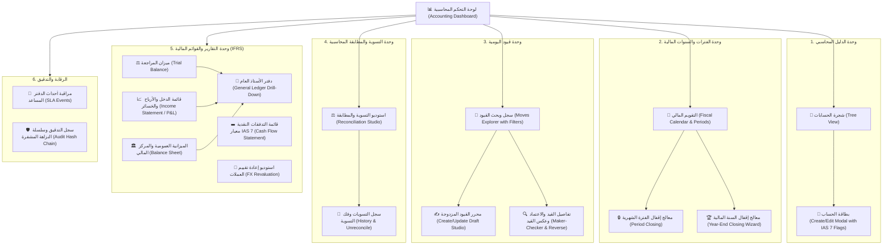
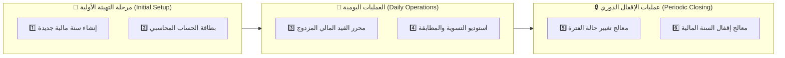

# تحليل وتوصيف شاشات الواجهة الأمامية (Frontend Screens Specification)

## ميزة المحاسبة المالية (Accounting Feature) - نظام Cashflow

> **مسار الوثيقة:** `docs/accounting_frontend_screens_analysis.md`  
> **تاريخ التحديث:** نوفمبر 2026  
> **الإصدار المعماري:** متوافق بنسبة 100% مع نواتج الخطة التنفيذية المكتملة ومواصفات معايير IFRS/IAS 7 و Clean Architecture.  
> **البيئة المستهدفة:** شاشات سطح المكتب (Desktop-First Enterprise Application) مع دعم كامل للوضع الفاتح والداكن (Light & Dark Modes) ودعم ثنائي اللغة (العربية RTL والإنجليزية LTR).

---

## 1. المقدمة ونظرة عامة على المعمارية

يعتمد محرك المحاسبة في نظام **Cashflow** على معايير المحاسبة المزدوجة الدولية (**IFRS/IAS** و **US GAAP**)، ويوفر محركاً مالياً صارماً يضمن:

- دقة الميزان الصفري للقيود المحاسبية ($\sum \text{Debit} = \sum \text{Credit}$).
- استحالة تعديل القيود بعد ترحيلها (**Immutability**)، والاعتماد على القيود العكسية (**Reversals**) للتصحيح.
- تسلسل قانوني غير قابل للتجاوز أو الثغرات في أرقام اليوميات القانونية (**Gapless Sequential Numbering**).
- حوكمة الفصل بين المهام للقيود الكبرى (**Maker-Checker Segregation of Duties**).
- تقويم مالي ثلاثي الحالات للفترات المالية (**Open**, **Soft Closed**, **Hard Closed**).
- سلسلة تدقيق مشفرة ومترابطة بقفل استشاري يمنع التفرع (**Cryptographic Audit Hash Chain**).
- محرك تسوية ومطابقة الحسابات والذمم واحتساب فروق أسعار الصرف المحققة آلياً (**Realized FX Reconciliation**).
- حزمة قوائم مالية معيارية متكاملة (ميزان المراجعة، الأرباح والخسائر، المركز المالي، وقائمة التدفقات النقدية وفق معيار **IAS 7**).
- معالج إقفال السنة المالية الآلي وتصفير الإيرادات والمصروفات إلى الأرباح المحتجزة (**Year-End Closing Wizard**).
- تكامل غير مقترن مع الأنظمة الاقتصادية عبر الدفاتر المساعدة (**Subledger Accounting - SLA**).

لتوفير تجربة مستخدم إنتاجية متفوقة للمحاسبين والمدراء الماليين والمراجعين، صُممت الواجهات وفق فلسفة **شاشات سطح المكتب عالية الكثافة (Desktop-First Data-Dense Design)**، مع مراعاة المعايير الرقابية والبصرية العالمية.

---

## 2. الهوية البصرية ونظام التصميم المالي لسطح المكتب (Visual Identity & Design System)

تم بناء الهوية البصرية لنظام **Cashflow** لتعكس الاحترافية، الدقة، والهدوء البصري المطلوب في البيئات المالية، مع التخلص من المشتتات والتركيز على مقروءية الأرقام وسلامة البيانات.

### 2.1. فلسفة الواجهة الموجهة لسطح المكتب (Desktop-First Ergonomics)

1. **كثافة البيانات (Data Density):** واجهات محاسبية مدمجة (Compact Rows: 36px–40px للأسطر العادية، 48px للرؤوس) تتيح للمحاسب رؤية أكبر قدر ممكن من أسطر القيود وموازين الحسابات دون الحاجة للتمرير المفرط.
2. **استغلال الشاشات العريضة (Full-Width Responsive Canvas):**
   - **الدقة المثالية المستهدفة:** $1920 \times 1080$ (Full HD) و $1440 \times 900$ (Standard Enterprise Laptop).
   - **الحد الأدنى المدعوم:** $1280 \times 800$ بكسل.
   - الشاشات مقسمة إلى لوحات متعددة متجاورة (Multi-Pane Layouts) بدلاً من التنقل عبر صفحات متتالية.
3. **أولوية لوحة المفاتيح (Keyboard-Centric Navigation):** تقليل الاعتماد على الفأرة للمحاسبين من خلال التنقل عبر مفاتيح الأسهم، التبويب السريع بالـ `Tab` و `Shift+Tab`، وإدخال البيانات السريع عبر لوحة الأرقام (Numpad).
4. **العناصر الثابتة (Sticky Elements):** تثبيت شريط أدوات الجدول ورؤوس الأعمدة (`Sticky Header`) وشريط مجاميع التوازن السفلي (`Sticky Footer Totals`) لضمان بقائها مرئية أثناء التمرير الرأسي في الجداول الطويلة.

### 2.2. نظام الخطوط والتنسيقات الرقمية (Typography & Tabular Numerals)

1. **الخطوط المعتمدة:**
   - **اللغة العربية:** خط **`IBM Plex Sans Arabic`** (أو `Cairo`) للنصوص والعناوين بفضل وضوحه الهندسي العالي وأطوال حروفه المتناسقة.
   - **اللغة الإنجليزية:** خط **`Inter`** لواجهات المستخدم والتسميات.
   - **الخط المالي للأرقام والأكواد المشفرة (Financial Monospace):** خط **`JetBrains Mono`** أو **`Roboto Mono`**.
2. **قاعدة الأرقام الجدولية (Tabular Figures):**
   - **إلزامي:** تفعيل خاصية الـ CSS:

     ```css
     font-variant-numeric: tabular-nums lining-nums;
     font-feature-settings: "tnum" 1, "lnum" 1;
     ```

   - **الهدف:** جعل جميع الأرقام من `0` إلى `9` ذات عرض أفقي متساوٍ بالمليمتر، مما يضمن تراصف الفواصل العشرية عمودياً فوق بعضها تماماً في الجداول وموازين المراجعة، ومنع تذبذب العين أثناء المقارنة والمراجعة المالية.
3. **تنسيقات الأرقام والعملات:**
   - فاصل الآلاف: فاصلة واضحة (مثال: `1,250,500.00`).
   - المنازل العشرية: خانتان عشريتان ثابتتان دائماً حتى لو كانتا أصفاراً (`.00`).
   - تمييز الأرقام السالبة:
     - استخدام التنسيق المحاسبي بالأقواس مع اللون الأحمر في القوائم المالية: `(15,200.00) SAR`.
     - أو استخدام إشارة السالب الملتصقة بالرقم بدقة: `-15,200.00 SAR`.

---

### 2.3. القواعد الحتمية للمحاذاة والاتجاه (Strict Alignment & RTL/LTR Rules)

تخضع جميع الجداول والنماذج في النظام لقواعد هندسية صارمة تضمن عدم تشوه البيانات المالية عند التبديل بين العربية والإنجليزية:

```text
+----------------------------------------------------------------------------------------------------+
|                                    معايير المحاذاة في الجداول المالية                               |
+----------------------+--------------------+---------------------+------------------+---------------+
| عمود الكود / المعرف  |   عمود النص والبيان |   الحالة والتواريخ  |   المبلغ المدين   | المبلغ الدائن |
| (Code / Reference)   | (Description/Name) |   (Status & Dates)  |     (Debit)      |   (Credit)    |
+----------------------+--------------------+---------------------+------------------+---------------+
|       CENTER         |       START        |       CENTER        |      END (LTR)   |   END (LTR)   |
|   1010101 (Mono)     | الصندوق الرئيسي AR |      🟢 Posted      |     1,500.00     |          0.00 |
|   GEN/2026/001       | Main Vault EN      |      2026-11-04     |             0.00 |     1,500.00 |
+----------------------+--------------------+---------------------+------------------+---------------+
```

1. **الأعمدة والمبالغ المالية (Debit, Credit, Balance, Totals):**
   - **المحاذاة:** **محاذاة دائمة إلى النهاية (`text-align: end`) مع اتجاه رقمي LTR إلزامي (`direction: ltr`)**.
   - **السبب الفني:** إبقاء الأرقام باتجاه رياضي LTR حتى داخل الواجهة العربية RTL يضمن عدم انقلاب الأقواس المحاسبية، عدم انعكاس فواصل الآلاف، وظهور رمز العملة بشكل منضبط وثابت في أقصى الطرف.
2. **البيانات الوصفية والنصوص (Account Names, Partner Names, Notes):**
   - **المحاذاة:** محاذاة إلى البداية المنطقية (`text-align: start`).
   - في الواجهة العربية (RTL): تبدأ من اليمين.
   - في الواجهة الإنجليزية (LTR): تبدأ من اليسار.
3. **الأكواد والمعرفات والتجزئات المشفرة (Account Codes, Move Numbers, Hashes):**
   - محاذاة في المنتصف (`text-align: center`) أو محاذاة إلى البداية بخط أحادي العرض (`font-family: monospace`)، مع توفير زر نسخ فوري بنقرة واحدة (`One-Click Copy`).
4. **التواريخ والشارات (Dates & Status Badges):**
   - محاذاة في المنتصف (`text-align: center`) للحفاظ على التوازن الهندسي للخلايا.
5. **أزرار الأوامر والإجراءات (Action Buttons):**
   - محاذاة إلى أقصى النهاية (`text-align: end`) في رؤوس الصفحات وخلايا الجداول.

---

### 2.5. اختصارات لوحة المفاتيح والإنتاجية لسطح المكتب (Global Desktop Shortcuts)

لتمكين المحاسبين والمدققين من تشغيل النظام بالكامل دون لمس الفأرة:

| الاختصار (Shortcut) | الوظيفة المحاسبية |
| :--- | :--- |
| **`Ctrl + N`** / **`Cmd + N`** | فتح استوديو إنشاء قيد يومية جديد فوراً |
| **`Ctrl + S`** / **`Cmd + S`** | حفظ مسودة القيد الحالي |
| **`Ctrl + Enter`** / **`Cmd + Enter`** | ترحيل القيد المالي المعتمد (Post Move) إذا كان متزناً |
| **`Ctrl + K`** / **`Cmd + K`** | فتح لوحة البحث السريع الشامل (Command Palette) للوصول لأي شاشة أو حساب |
| **`Ctrl + Shift + L`** | التبديل الفوري بين اللغة العربية والإنجليزية (AR / EN) |
| **`Ctrl + Shift + D`** | التبديل الفوري بين الوضع الفاتح والداكن (Light / Dark Theme) |
| **`Tab`** / **`Shift + Tab`** | التنقل الذكي بين خلايا جدول القيد سطر بسطر |
| **`F2`** | تحرير الخلية المحددة في جدول البيانات دون الحاجة للنقر عليها بالفأرة |
| **`Alt + A`** | إضافة سطر محاسبي جديد داخل محرر القيود |
| **`Alt + D`** | حذف السطر المحاسبي المحدد في محرر القيود |
| **`Esc`** | إغلاق النوافذ المنبثقة والقوائم الفرعية والعودة للجدول |

---

## 3. خريطة تدفق الشاشات وهيكل التنقل (Navigation & Desktop Layout Structure)

تم بناء الهوية البصرية لنظام **Cashflow** لتعكس الاحترافية، الدقة، والهدوء البصري المطلوب في البيئات المالية، مع التخلص من المشتتات والتركيز على مقروءية الأرقام وسلامة البيانات.

### 2.1. فلسفة الواجهة الموجهة لسطح المكتب (Desktop-First Ergonomics)

1. **كثافة البيانات (Data Density):** واجهات محاسبية مدمجة (Compact Rows: 36px–40px للأسطر العادية، 48px للرؤوس) تتيح للمحاسب رؤية أكبر قدر ممكن من أسطر القيود وموازين الحسابات دون الحاجة للتمرير المفرط.
2. **استغلال الشاشات العريضة (Full-Width Responsive Canvas):**
   - **الدقة المثالية المستهدفة:** $1920 \times 1080$ (Full HD) و $1440 \times 900$ (Standard Enterprise Laptop).
   - **الحد الأدنى المدعوم:** $1280 \times 800$ بكسل.
   - الشاشات مقسمة إلى لوحات متعددة متجاورة (Multi-Pane Layouts) بدلاً من التنقل عبر صفحات متتالية.
3. **أولوية لوحة المفاتيح (Keyboard-Centric Navigation):** تقليل الاعتماد على الفأرة للمحاسبين من خلال التنقل عبر مفاتيح الأسهم، التبويب السريع بالـ `Tab` و `Shift+Tab`، وإدخال البيانات السريع عبر لوحة الأرقام (Numpad).
4. **العناصر الثابتة (Sticky Elements):** تثبيت شريط أدوات الجدول ورؤوس الأعمدة (`Sticky Header`) وشريط مجاميع التوازن السفلي (`Sticky Footer Totals`) لضمان بقائها مرئية أثناء التمرير الرأسي في الجداول الطويلة.

---

### 2.3. نظام الخطوط والتنسيقات الرقمية (Typography & Tabular Numerals)

1. **الخطوط المعتمدة:**
   - **اللغة العربية:** خط **`IBM Plex Sans Arabic`** (أو `Cairo`) للنصوص والعناوين بفضل وضوحه الهندسي العالي وأطوال حروفه المتناسقة.
   - **اللغة الإنجليزية:** خط **`Inter`** لواجهات المستخدم والتسميات.
   - **الخط المالي للأرقام والأكواد المشفرة (Financial Monospace):** خط **`JetBrains Mono`** أو **`Roboto Mono`**.
2. **قاعدة الأرقام الجدولية (Tabular Figures):**
   - **إلزامي:** تفعيل خاصية الـ CSS:

     ```css
     font-variant-numeric: tabular-nums lining-nums;
     font-feature-settings: "tnum" 1, "lnum" 1;
     ```

   - **الهدف:** جعل جميع الأرقام من `0` إلى `9` ذات عرض أفقي متساوٍ بالمليمتر، مما يضمن تراصف الفواصل العشرية عمودياً فوق بعضها تماماً في الجداول وموازين المراجعة، ومنع تذبذب العين أثناء المقارنة والمراجعة المالية.
3. **تنسيقات الأرقام والعملات:**
   - فاصل الآلاف: فاصلة واضحة (مثال: `1,250,500.00`).
   - المنازل العشرية: خانتان عشريتان ثابتتان دائماً حتى لو كانتا أصفاراً (`.00`).
   - تمييز الأرقام السالبة:
     - استخدام التنسيق المحاسبي بالأقواس مع اللون الأحمر في القوائم المالية: `(15,200.00) SAR`.
     - أو استخدام إشارة السالب الملتصقة بالرقم بدقة: `-15,200.00 SAR`.

---

### 2.4. القواعد الحتمية للمحاذاة والاتجاه (Strict Alignment & RTL/LTR Rules)

تخضع جميع الجداول والنماذج في النظام لقواعد هندسية صارمة تضمن عدم تشوه البيانات المالية عند التبديل بين العربية والإنجليزية:

```text
+----------------------------------------------------------------------------------------------------+
|                                    معايير المحاذاة في الجداول المالية                               |
+----------------------+--------------------+---------------------+------------------+---------------+
| عمود الكود / المعرف  |   عمود النص والبيان |   الحالة والتواريخ  |   المبلغ المدين   | المبلغ الدائن |
| (Code / Reference)   | (Description/Name) |   (Status & Dates)  |     (Debit)      |   (Credit)    |
+----------------------+--------------------+---------------------+------------------+---------------+
|       CENTER         |       START        |       CENTER        |      END (LTR)   |   END (LTR)   |
|   1010101 (Mono)     | الصندوق الرئيسي AR |      🟢 Posted      |     1,500.00     |          0.00 |
|   GEN/2026/001       | Main Vault EN      |      2026-11-04     |             0.00 |     1,500.00 |
+----------------------+--------------------+---------------------+------------------+---------------+
```

1. **الأعمدة والمبالغ المالية (Debit, Credit, Balance, Totals):**
   - **المحاذاة:** **محاذاة دائمة إلى النهاية (`text-align: end`) مع اتجاه رقمي LTR إلزامي (`direction: ltr`)**.
   - **السبب الفني:** إبقاء الأرقام باتجاه رياضي LTR حتى داخل الواجهة العربية RTL يضمن عدم انقلاب الأقواس المحاسبية، عدم انعكاس فواصل الآلاف، وظهور رمز العملة بشكل منضبط وثابت في أقصى الطرف.
2. **البيانات الوصفية والنصوص (Account Names, Partner Names, Notes):**
   - **المحاذاة:** محاذاة إلى البداية المنطقية (`text-align: start`).
   - في الواجهة العربية (RTL): تبدأ من اليمين.
   - في الواجهة الإنجليزية (LTR): تبدأ من اليسار.
3. **الأكواد والمعرفات والتجزئات المشفرة (Account Codes, Move Numbers, Hashes):**
   - محاذاة في المنتصف (`text-align: center`) أو محاذاة إلى البداية بخط أحادي العرض (`font-family: monospace`)، مع توفير زر نسخ فوري بنقرة واحدة (`One-Click Copy`).
4. **التواريخ والشارات (Dates & Status Badges):**
   - محاذاة في المنتصف (`text-align: center`) للحفاظ على التوازن الهندسي للخلايا.
5. **أزرار الأوامر والإجراءات (Action Buttons):**
   - محاذاة إلى أقصى النهاية (`text-align: end`) في رؤوس الصفحات وخلايا الجداول.

---

### 2.5. معايير دعم اللغتين والتدويل (Bilingual Architecture: Arabic & English)

- **الخصائص المنطقية في التخطيط (CSS Logical Properties):**
  الاعتماد الحصري على الخصائص المنطقية لتفادي كتابة كود مكرر لكل لغة:
  - `margin-inline-start`, `margin-inline-end` بدلاً من `margin-left`, `margin-right`.
  - `padding-inline-start`, `padding-inline-end` بدلاً من `padding-left`, `padding-right`.
  - `border-inline-start` لأشرطة التمييز الرأسية.
  - `inset-inline-start`, `inset-inline-end` للمواضع العائمة.
- **تبديل اللغة السريع (Instant Locale Switcher):**
  - مفتاح تبديل في الشريط العلوي يغير اتجاه الصفحة فوراً (`dir="rtl"` أو `dir="ltr"`) وتغيير الـ `lang="ar"` أو `lang="en"` بدون إعادة تحميل كاملة للصفحة.
  - حفظ اللغة وتفضيل الوضع اللوني محلياً في `localStorage` ومزامنتهما مع ملف تعريف المستخدم بالخادم.
- **حقول الإدخال ثنائية اللغة (Dual-Language Inputs):**
  - في بطاقات الحسابات والدفاتر والشركاء: توفير حقلين متجاورين في سطح المكتب:
    - `اسم الحساب (عربي)` / `Account Name (Arabic)`
    - `اسم الحساب (إنجليزي)` / `Account Name (English)`

---

### 2.6. اختصارات لوحة المفاتيح والإنتاجية لسطح المكتب (Global Desktop Shortcuts)

لتمكين المحاسبين والمدققين من تشغيل النظام بالكامل دون لمس الفأرة:

| الاختصار (Shortcut) | الوظيفة المحاسبية |
| :--- | :--- |
| **`Ctrl + N`** / **`Cmd + N`** | فتح استوديو إنشاء قيد يومية جديد فوراً |
| **`Ctrl + S`** / **`Cmd + S`** | حفظ مسودة القيد الحالي |
| **`Ctrl + Enter`** / **`Cmd + Enter`** | ترحيل القيد المالي المعتمد (Post Move) إذا كان متزناً |
| **`Ctrl + K`** / **`Cmd + K`** | فتح لوحة البحث السريع الشامل (Command Palette) للوصول لأي شاشة أو حساب |
| **`Ctrl + Shift + L`** | التبديل الفوري بين اللغة العربية والإنجليزية (AR / EN) |
| **`Ctrl + Shift + D`** | التبديل الفوري بين الوضع الفاتح والداكن (Light / Dark Theme) |
| **`Tab`** / **`Shift + Tab`** | التنقل الذكي بين خلايا جدول القيد سطر بسطر |
| **`F2`** | تحرير الخلية المحددة في جدول البيانات دون الحاجة للنقر عليها بالفأرة |
| **`Alt + A`** | إضافة سطر محاسبي جديد داخل محرر القيود |
| **`Alt + D`** | حذف السطر المحاسبي المحدد في محرر القيود |
| **`Esc`** | إغلاق النوافذ المنبثقة والقوائم الفرعية والعودة للجدول |

---

## 3. خريطة تدفق الشاشات وهيكل التنقل (Navigation & Desktop Layout Structure)



## 4. التحليل والتوصيف المفصل للشاشات السبع (Detailed Screen Specifications)

---

### الوحدة الأولى: شجرة الحسابات والدليل المحاسبي (Chart of Accounts)

#### 1.1. شاشة شجرة الحسابات التفاعلية (`Chart of Accounts Tree View`)

- **الهدف الوظيفي:** استعراض وإدارة الهيكل التنظيمي المالي لجميع الحسابات وتصنيفاتها المعيارية وفق أصول المحاسبة الدولية.
- **تخطيط وتوزيع سطح المكتب (Desktop Layout Anatomy):**
  - **عرض منقسم بعمودين (Split Pane View):**
    - **العمود الأيمن (عرض 35%):** شجرة الحسابات المتفرعة التفاعلية مع دعم الطي والتوسيع ومؤشرات الأيقونات الملونة لكل نوع حساب.
    - **العمود الأيسر (عرض 65%):** جدول البيانات التفصيلي للحساب المحدد والحسابات الفرعية التابعة له، مع عرض الأرصدة التراكمية، ومفاتيح التحكم.
  - **شريط الفلاتر العلوي لسطح المكتب:** فلاتر أفقية سريعة بنقرة واحدة (أصول، خصوم، حقوق ملكية، إيرادات، مصروفات)، وفلتر خاص بحسابات تدفقات النقدية (IAS 7: نقدية، غير نقدية، تشغيلي، استثماري، تمويلي).
- **قواعد المحاذاة والاتجاه (Alignment & Direction):**
  - كود الحساب: في المنتصف (`center`) بخط `monospace`.
  - اسم الحساب: يبدأ من البداية (`start` - يمين في العربي، يسار في الإنجليزي).
  - الرصيد الحالي: أقصى النهاية (`end` مع `direction: ltr` و `font-variant-numeric: tabular-nums`).
  - شارة طبيعة الحساب (`Normal Balance`): في المنتصف (`center`).
- **تنسيقات الوضع الفاتح والداكن:**
  - أصول (`Asset`): إطار وشارة زرقاء خفيفة (`bg-blue-50 text-blue-700` في الفاتح / `bg-blue-950 text-blue-300` في الداكن).
  - خصوم (`Liability`): شارة كهرمانية (`bg-amber-50 text-amber-700` في الفاتح / `bg-amber-950 text-amber-300` في الداكن).
  - حقوق ملكية (`Equity`): شارة أرجوانية (`bg-purple-50 text-purple-700` في الفاتح / `bg-purple-950 text-purple-300` في الداكن).
  - إيرادات (`Income`): شارة خضراء زمردية (`bg-emerald-50 text-emerald-700` في الفاتح / `bg-emerald-950 text-emerald-300` في الداكن).
  - مصروفات (`Expense`): شارة برتقالية/حمراء (`bg-rose-50 text-rose-700` في الفاتح / `bg-rose-950 text-rose-300` في الداكن).
- **اختصارات سطح المكتب:**
  - `Arrow Up` / `Arrow Down`: التنقل بين أفرع الشجرة.
  - `Arrow Right` / `Arrow Left`: طي وتوسيع الفرع الحسابي.
  - `Ctrl + Shift + A`: فتح نافذة إضافة حساب جديد تحت الحساب المحدد حالياً.
- **واجهات الربط (Backend APIs):**
  - `GET /api/v1/accounting/accounts/tree`
  - `GET /api/v1/accounting/accounts`

#### 1.2. نافذة بطاقة الحساب - إنشاء وتعديل (`Account Slide-Over Drawer / Modal`)

- **الهدف الوظيفي:** تعريف حساب محاسبي جديد أو تعديل حساب قائم وتصنيفه وفق متطلبات الإفصاح ومعيار التدفقات النقدية IAS 7.
- **تخطيط سطح المكتب:**
  - تفتح كنافذة منزلقة جانبية عريضة (`Side Slide-Over Drawer` بعرض 560px على يمين الشاشة بالعربية، وعلى يسارها بالإنجليزية) تسمح برؤية الشجرة أثناء التعديل.
  - نموذج مقسم إلى 3 تبويبات أفقية:
    1. **البيانات العامة (General Details):** الكود، والاسم الثنائي (AR/EN)، والنوع، والحساب الأب، والعملة.
    2. **خصائص الرقابة والتسوية (Controls & Reconciliation):** مفتاح قابلية التسوية (`is_reconcilable`)، ومفتاح النشاط.
    3. **تصنيف التدفقات النقدية (IAS 7 Cash Flow):** مفاتيح نقد وما في حكمه، تسوية غير نقدية، ونوع النشاط المالي.
- **قواعد المحاذاة:**
  - التسميات (Labels): محاذاة للبداية (`start`) فوق حقول الإدخال.
  - الحقول ثنائية اللغة: تظهر متجاورة في عمودين متساويين في سطح المكتب.
- **واجهات الربط (Backend APIs):**
  - `POST /api/v1/accounting/accounts` (إنشاء).
  - `PUT /api/v1/accounting/accounts/{id}` (تعديل).

---

### الوحدة الثانية: الفترات والسنوات المالية (Fiscal Calendar & Periods)

#### 2.1. شاشة إدارة السنوات والفترات المالية (`Fiscal Calendar Management`)

- **الهدف الوظيفي:** إدارة دورة حياة التقويم المالي، فحص حالات الفترات الشهرية الـ 12، وإجراء الإقفالات المحاسبية.
- **تخطيط وتوزيع سطح المكتب:**
  - **القسم العلوي:** بطاقات مؤشرات سريعة (السنة المالية النشطة، عدد الفترات المفتوحة، عدد الفترات المقفلة، تاريخ الإقفال النهائي القادم).
  - **القسم الرئيسي:** شبكة بطاقات الفترات الشهرية الـ 12 (12-Month Responsive Grid) بنمط 4 أعمدة في 3 صفوف على شاشات سطح المكتب.
- **تنسيقات الوضع الفاتح والداكن لبطاقات الفترات:**
  - 🟢 **فترة مفتوحة (Open):**
    - الفاتح: خلفية بيضاء مع شريط علوي أخضر زمردي (`border-t-4 border-emerald-500`) وشارة خضراء.
    - الداكن: خلفية رمادية داكنة (`#111827`) مع إطار أخضر مائل للزرقة وتوهج ناعم.
  - 🟡 **فترة مقفلة مؤقتاً (Soft Closed):**
    - الفاتح: شريط علوي كهرماني (`border-t-4 border-amber-500`) مع تحذير: قيود التسويات فقط مسموحة.
    - الداكن: إطار كهرماني داكن مع شارة صفراء ذهبية.
  - 🔴 **فترة مقفلة نهائياً (Hard Closed):**
    - الفاتح: شريط علوي رمادي صلب أو أحمر داكن مع أيقونة قفل مغلق وإخفاء أزرار التعديل.
    - الداكن: خلفية داكنة معتمة تدل على حظر العمليات.
- **قواعد المحاذاة:**
  - اسم الفترة وتواريخ البداية والنهاية: محاذاة للبداية.
  - عدد القيود المسجلة والمرحلة: أرقام `tabular-nums` في أقصى النهاية.
  - زر تغيير الحالة: في أسفل كل بطاقة بمحاذاة كاملة العرض.
- **واجهات الربط (Backend APIs):**
  - `GET /api/v1/accounting/fiscal-years`
  - `POST /api/v1/accounting/fiscal-years`

#### 2.2. شاشة معالج إقفال السنة المالية وترحيل الأرباح (`Year-End Closing Wizard`)

- **الهدف الوظيفي:** معالج خماسي الخطوات لإقفال السنة المالية المنتهية وتصفير حسابات الأرباح والخسائر ونقل الصافي للأرباح المحتجزة.
- **تخطيط سطح المكتب:**
  - نافذة مركزية كاملة التركيز (Focused Desktop Modal بعرض 900px) أو صفحة مستقلة.
  - شريط تقدم أفقي للخطوات الـ 5 مع مؤشرات الحالة (تمت، جارية، معلقة).
  - جدول معاينة الأرصدة المصفرة والقيد الافتتاحي المقترح جنباً إلى جنب مع إمكانية التمرير الداخلي.
- **واجهات الربط (Backend APIs):**
  - `POST /api/v1/accounting/fiscal-years/{id}/close`

---

### الوحدة الثالثة: قيود اليومية ودفاتر القيود (Journal Entries & Moves)

#### 3.1. شاشة سجل وبحث القيود المحاسبية (`Journal Entries Explorer`)

- **الهدف الوظيفي:** استعراض، فلترة، وتدقيق كافة قيود اليومية المسودة والمرحلة والمعكوسة.
- **تخطيط سطح المكتب:**
  - **شريط الفلاتر المتقدم المدمج:** حقول بحث متجاورة (دفتر اليومية، نطاق التاريخ، حالة القيد، المستخدم، البحث النصي في المرجع).
  - **جدول القيود الكامل عالي الكثافة (Desktop High-Density Grid):**
    - رأس جدول ثابت (`Sticky Header`) مع إمكانية فرز الأعمدة بالنقر.
    - صفوف مدمجة بارتفاع 38px مع تمييز لوني رقيق للصف عند تمرير الفأرة (`row hover`).
- **جدول مصفوفة المحاذاة لأعمدة القيود:**

| اسم العمود | المحاذاة (Alignment) | اتجاه النص / الرقم | الخط المستخدم | التنسيق اللوني (Light / Dark) |
| :--- | :---: | :---: | :---: | :--- |
| **رقم القيد القانوني** | في المنتصف (`center`) | LTR | `JetBrains Mono` | أزرق غامق / سماوي مضيء مع رابط تفاصيل |
| **دفتر اليومية** | للبداية (`start`) | حسب لغة الواجهة | خط الواجهة الأساسي | رمادي داكن / رمادي فاتح |
| **التاريخ** | في المنتصف (`center`) | LTR | `tabular-nums` | نص محايد |
| **البيان / المرجع** | للبداية (`start`) | حسب النص | خط الواجهة الأساسي | نص أساسي عريض مع اقتطاع الفائض `truncate` |
| **إجمالي المدين** | للنهاية (`end`) | LTR إلزامي | `tabular-nums` | لون المدين (`financial-debit`) |
| **إجمالي الدائن** | للنهاية (`end`) | LTR إلزامي | `tabular-nums` | لون الدائن (`financial-credit`) |
| **الحالة** | في المنتصف (`center`) | حسب الواجهة | خط عريض صغير | شارات ملونة (مسودة: أصفر، مرحل: أخضر، معكوس: بنفسجي) |
| **بصمة النزاهة (Hash)** | في المنتصف (`center`) | LTR | `monospace` | أيقونة درع أخضر مصغر للموثق، رمادي للمسودة |
| **الإجراءات** | للنهاية (`end`) | حسب الواجهة | أيقونات سريعة | أزرار سريعة (عرض، تعديل، حذف، طباعة سند) |

- **واجهات الربط (Backend APIs):**
  - `GET /api/v1/accounting/moves`
  - `DELETE /api/v1/accounting/moves/{id}`

---

#### 3.2. شاشة محرر القيد المالي المزدوج (`Double-Entry Move Studio`)

- **الهدف الوظيفي:** استوديو عالي الكفاءة والإنتاجية لإدخال ومراجعة قيود اليومية المحاسبية المزدوجة بالعملات المحلية والأجنبية.
- **تخطيط وتوزيع سطح المكتب:**
  - **رأس القيد (Move Header Canvas):** صف أفقي مدمج يحتوي على: اختيار دفتر اليومية، تاريخ القيد، المرجع/البيان العام، ورقم التسلسل المتوقع.
  - **جدول أسطر القيد التفاعلي المتسع (Lines Data Grid):**
    - يأخذ 100% من عرض الشاشة المتاح لضمان رؤية جميع الحقول دون تمرير أفقي إن أمكن.
    - خلايا قابلة للتحرير الفوري بمجرد النقر أو الضغط على `Enter`.
  - **لوحة توازن القيد السفلية العائمة والمثبتة (Sticky Floating Balance Footer):**
    - شريط سفلي بعرض الشاشة يبقى مثبتاً في أسفل المتصفح دائماً.
    - يعرض في 3 أقسام رئيسية:
      1. إجمالي المدين: `Total Debit = 15,250.00 SAR`
      2. إجمالي الدائن: `Total Credit = 15,250.00 SAR`
      3. فارق الميزان: $\Delta = 0.00 \text{ SAR}$ (بضوء أخضر عريض عند الاتزان، وتنبيه أحمر بارز عند وجود فارق).
    - أزرار الحفظ والإجراءات في الطرف المقابل: "حفظ مسودة" و "حفظ وترحيل".
- **قواعد المحاذاة داخل جدول تحرير الأسطر:**
  - كود واسم الحساب: محاذاة للبداية (`start`) مع قائمة اقتراحات ذكية تفتح أثناء الكتابة تدعم البحث بالكود أو الاسم باللغتين.
  - مركز التكلفة والشريك: محاذاة للبداية (`start`).
  - العملة والمبلغ الأصلي: محاذاة للنهاية (`end`).
  - خانة المدين وخانة الدائن: محاذاة للنهاية (`end`) مع خط مالي أحادي العرض (`tabular-nums`).
- **محددات الوضع الفاتح والداكن:**
  - سطر القيد النشط المفتوح للتحرير: يتميز بخلفية زرقاء هادئة (`#EFF6FF` في الفاتح / `#1E293B` في الداكن) مع إطار تركيز بارز (`border-sky-500`).
  - عند التوازن التام: يتحول شريط التوازن السفلي للون الأخضر الزمردي الهادئ.
  - عند عدم التوازن: يتحول الشريط إلى اللون الوردي/الأحمر التحذيري مع تعطيل زر "الترحيل" نهائياً.
- **اختصارات سطح المكتب للإنتاجية:**
  - `Enter` في خانة الدائن: يضيف سطراً جديداً فوراً وينقل التركيز لحقل الحساب في السطر التالي.
  - كتابة مبلغ في خانة المدين ثم الضغط على `Tab`: يصفر خانة الدائن تلقائياً وينتقل للسطر التالي.
  - `Ctrl + Shift + B`: موازنة القيد التلقائية (احتساب الفرق ووضعه تلقائياً في خانة المدين أو الدائن للسطر الحالي).
- **واجهات الربط (Backend APIs):**
  - `POST /api/v1/accounting/moves`
  - `PUT /api/v1/accounting/moves/{id}`

---

#### 3.3. شاشة تفاصيل القيد والاعتماد والحوكمة (`Move Details & Governance View`)

- **الهدف الوظيفي:** عرض تفاصيل سند القيد المحاسبي المعتمد، رقابة الفصل بين المهام (Maker-Checker)، وعكس القيد.
- **تخطيط سطح المكتب:**
  - **تصميم سند القيد الرسمي (Document Voucher View):** يحاكي شكل السند المالي الرسمي القابل للطباعة مباشرة عبر الطابعة أو تصديره إلى PDF.
  - **شريط الحوكمة والاعتماد العلوي (Maker-Checker Action Bar):**
    - يوضح بوضوح اسم مدخل القيد وتاريخ الإنشاء، واسم المراجع المالي وتاريخ الترحيل.
    - إذا كان القيد فوق الحد الرقابي، يظهر صندوق بارز بلون أزرق موجه للمراجعين فقط: "هذا القيد يتطلب موافقة Checker لاعتماده".
  - **قسم البصمة المشفرة وسلسلة التدقيق:**
    - شريط مدمج أسفل السند يعرض رمز تجزئة الـ SHA-256 للقيد مع رمز بصمة السجل السابق لتوثيق سلامة السلسلة.
- **واجهات الربط (Backend APIs):**
  - `GET /api/v1/accounting/moves/{id}`
  - `POST /api/v1/accounting/moves/{id}/post`
  - `POST /api/v1/accounting/moves/{id}/reverse`

---

### الوحدة الرابعة: التسوية والمطابقة المحاسبية (Reconciliation & Matching Engine)

#### 4.1. شاشة استوديو التسوية والمطابقة (`Account Reconciliation Studio`)

- **الهدف الوظيفي:** مطابقة الحركات المدينة والدائنة المعلقة للبنوك وحسابات الذمم والوسيطة مع احتساب فروق أسعار الصرف آلياً.
- **تخطيط سطح المكتب الفريد (Desktop Dual-Split Screen Layout):**
  - استغلال الشاشة العريضة بعرض منقسم $50\% - 50\%$ مع رأس تحكم مركزي موحد:
    - **اللوحة اليمنى (الحركات المدينة غير المسواة - Unreconciled Debits):** جدول بالحركات المدينة مع تاريخ كل حركة، المرجع، الرصيد المتبقي، وحقل إدخال التخصيص (`allocated_amount`).
    - **اللوحة اليسرى (الحركات الدائنة غير المسواة - Unreconciled Credits):** جدول مماثل بالحركات الدائنة غير المسواة.
  - **شريط المطابقة المركزي المثبت (Central Matching & FX Widget):**
    - يقع في منتصف أسفل الشاشتين ويوضح:
      - إجمالي المخصص المدين المختار.
      - إجمالي المخصص الدائن المختار.
      - فارق المطابقة بالعملة الأصلية ($\Delta \text{Balance}$).
      - حاسبة فروق أسعار الصرف اللحظية: تحسب وتظهر الربح أو الخسارة الناتجة عن تفاوت سعر الصرف (`Realized FX Gain/Loss`).
    - زر "تنفيذ التسوية" يضاء فقط عند توازن المخصصات.
- **قواعد المحاذاة والاتجاه:**
  - في الوضع العربي (RTL): تظهر الحركات المدينة في اليمين، والدائنة في اليسار.
  - في الوضع الإنجليزي (LTR): تظهر الحركات المدينة في اليسار، والدائنة في اليمين.
  - خانات المبالغ والتخصيص: محاذاة دائمة إلى أقصى النهاية (`end`) بأرقام `tabular-nums`.
- **محددات الوضع الفاتح والداكن:**
  - السطور المحددة للمطابقة تضاء بلون مميز (`bg-sky-50` فاتح / `bg-sky-950` داكن).
  - خانة فروق العملة المحققة: تظهر باللون الأخضر في حال الربح وباللون الأحمر في حال الخسارة مع رمز العملة.
- **واجهات الربط (Backend APIs):**
  - `GET /api/v1/accounting/unreconciled-lines`
  - `POST /api/v1/accounting/reconcile`

---

### الوحدة الخامسة: التقارير والقوائم المالية الختامية (Financial Statements & Reports)

#### 5.1. شاشة ميزان المراجعة التفاعلي (`Interactive Trial Balance`)

- **الهدف الوظيفي:** استخراج ميزان المراجعة بالأرصدة والمجاميع، والتحقق التلقائي من توازن الحسابات والتعمق لدفتر الأستاذ.
- **تخطيط سطح المكتب:**
  - شريط أدوات علوي: محدد نطاق التاريخ، مفتاح تبديل (عرض بالأرصدة فقط / عرض بالأرصدة والمجاميع معاً)، ومستويات التوسع في الشجرة.
  - **جدول الأعمدة الستة المتراصفة بدقة (6-Column Financial Grid):**
    1. كود واسم الحساب (عرض 30%).
    2. الرصيد الافتتاحي - مدين (عرض 11%).
    3. الرصيد الافتتاحي - دائن (عرض 11%).
    4. حركات الفترة - مدين (عرض 11%).
    5. حركات الفترة - دائن (عرض 11%).
    6. الرصيد الختامي - مدين (عرض 13%).
    7. الرصيد الختامي - دائن (عرض 13%).
  - **صف المجاميع الختامي المثبت (Sticky Totals Row):** صف عريض في الأسفل يحتوي على مجاميع الأعمدة وشارة خضراء ضخمة: "الميزان متزن بنسبة 100%".
- **قواعد المحاذاة:**
  - أسماء الحسابات: محاذاة للبداية مع مسافات بادئة (`indentation`) تعكس المستوى الهرمي للحساب.
  - جميع خانات المبالغ: محاذاة للنهاية (`text-align: end; direction: ltr; font-variant-numeric: tabular-nums`).
- **واجهات الربط (Backend APIs):**
  - `GET /api/v1/accounting/reports/trial-balance`

---

#### 5.2. شاشة قائمة الدخل والأرباح والخسائر (`Income Statement / P&L`)

- **الهدف الوظيفي:** عرض تقرير الأرباح والخسائر المعياري وفق التصنيف المحاسبي المعتمد مع إمكانية التعمق لدفتر الأستاذ.
- **تخطيط سطح المكتب:**
  - عرض بنمط القائمة المالية التقريرية المعيارية ذات المسافات البادئة الهرمية.
  - تمييز الأسطر التجميعية الكبرى (مجمل الربح، الربح التشغيلي، صافي الربح النهائي) بصفوف عريضة وظلال متباينة.
  - سطر صافي الربح / الخسارة النهائي يظهر كبطاقة مميزة عريضة في أسفل التقرير.
- **تنسيقات الوضع الفاتح والداكن:**
  - إذا كان صافي الدخل ربحاً ($> 0$): خلفية خضراء هادئة وخط أخضر غامق.
  - إذا كان صافي الدخل خسارة ($< 0$): خلفية حمراء هادئة وخط أحمر غامق مع وضع المبلغ بين قوسين `( )`.
- **واجهات الربط (Backend APIs):**
  - `GET /api/v1/accounting/reports/income-statement`

---

#### 5.3. شاشة الميزانية العمومية والمركز المالي (`Balance Sheet`)

- **الهدف الوظيفي:** عرض تقرير المركز المالي في تاريخ محدد والتحقق من المعادلة الأساسية ($\text{Assets} = \text{Liabilities} + \text{Equity}$).
- **تخطيط سطح المكتب (خيارات العرض المزدوج):**
  - **الخيار الأول (Desktop Side-by-Side Dual Column):**
    - العمود الأيمن (بالعربية): **الأصول (Assets)** متداولة وغير متداولة مع إجمالي الأصول.
    - العمود الأيسر (بالعربية): **الخصوم وحقوق الملكية (Liabilities & Equity)** مع إجمالي الخصوم وحقوق الملكية متضمناً بند "أرباح الفترة الحالية غير المرحلة".
  - **الخيار الثاني:** العرض التقريري الرأسي الكلاسيكي المتتابع.
  - **شريط تحقق التوازن الدائم:** بطاقة علوية أو سفلية تعرض:
    $$\Delta = \text{Total Assets} - (\text{Total Liabilities} + \text{Total Equity}) = 0.00 \text{ SAR}$$
- **واجهات الربط (Backend APIs):**
  - `GET /api/v1/accounting/reports/balance-sheet`

---

#### 5.4. شاشة قائمة التدفقات النقدية معيار IAS 7 (`Statement of Cash Flows`)

- **الهدف الوظيفي:** إفصاح مالي عن مصادر واستخدامات النقدية وما في حكمها وفق الطريقة غير المباشرة لمعيار IAS 7.
- **تخطيط سطح المكتب:**
  - هيكل رأسي مقسم إلى 3 أقسام كبرى متمايزة بصرياً:
    1. **التدفقات النقدية من الأنشطة التشغيلية (Operating Activities)**.
    2. **التدفقات النقدية من الأنشطة الاستثمارية (Investing Activities)**.
    3. **التدفقات النقدية من الأنشطة التمويلية (Financing Activities)**.
  - **صندوق مطابقة النقدية الختامي (IAS 7 Cash Reconciliation Card):**
    - جدول مقارنة واضح: صافي التغير في النقدية من الأنشطة الثلاثة مقابل التغير الفعلي في أرصدة النقدية وما في حكمها في الدفاتر، مع شارة المطابقة التامة.
- **واجهات الربط (Backend APIs):**
  - `GET /api/v1/accounting/reports/cash-flow`

---

#### 5.5. شاشة دفتر الأستاذ العام وتدقيق الحساب (`General Ledger Drill-Down View`)

- **الهدف الوظيفي:** تتبع جميع الحركات المحاسبية التاريخية المؤثرة على حساب محدد مع الرصيد التراكمي المتحرك.
- **تخطيط سطح المكتب:**
  - بطاقة علوية توضح: كود الحساب، اسمه باللغتين، طبيعته، رصيده الافتتاحي، إجمالي المدين، إجمالي الدائن، والرصيد الختامي.
  - جدول تفصيلي للحركات يحتوي على عمود إضافي مميز: **الرصيد المتحرك (`Running Balance`)** بعد كل حركة.
- **قواعد المحاذاة:**
  - كل المبالغ والأرصدة المتحركة محاذاة للنهاية (`end`) بأرقام `tabular-nums`.
  - النقر على أي سطر يفتح سند القيد الأصلي في نافذة منبثقة أو علامة تبويب جديدة.
- **واجهات الربط (Backend APIs):**
  - `GET /api/v1/accounting/reports/general-ledger`

---

### الوحدة السادسة: تكامل الدفاتر المساعدة وسجلات التدقيق (Subledger & Audit)

#### 6.1. شاشة مراقبة أحداث الدفاتر المساعدة (`Subledger Event Ingest Monitor`)

- **الهدف الوظيفي:** مراقبة الأحداث المالية الواردة من نقاط البيع، الفواتير، والمخازن، ومتابعة تحويلها إلى قيود يومية بدون تكرار.
- **تخطيط سطح المكتب:** جدول لحظي يدعم التحديث الحي (WebSocket أو Polling)، مع عرض مفتاح منع التكرار (`Idempotency Key`) وحالة التحويل ورقم القيد المولد كرابط مباشر.

#### 6.2. شاشة سجل التدقيق وسلسلة النزاهة المشفرة (`Financial Audit & Integrity Chain`)

- **الهدف الوظيفي:** تمكين المدققين من فحص سلسلة التجزئة المشفرة، وتتبع التعديلات والعمليات الملغاة.
- **تخطيط سطح المكتب:**
  - **أداة مقارنة الفروقات المدمجة لسطح المكتب (Desktop Split Diff-Viewer):**
    - نافذة تعرض التغيير قبل وبعد جنباً إلى جنب مع إبراز الحقول المعدلة باللون الأخضر (إضافة) والأحمر (حذف/تعديل).
  - زر تشغيل فحص النزاهة الفوري للمدققين مع مؤشر تقدم وشارة نجاح السلسلة التشفيرية.

---

### الوحدة السابعة: لوحة المؤشرات المالية العامة للمحاسب (Accounting Dashboard)

- **الهدف الوظيفي:** شاشة القيادة اليومية للمدير المالي والمحاسبين لتقديم رؤية فورية عن الوضع الرقابي والمالي.
- **تخطيط سطح المكتب (Desktop Multi-Card Dashboard):**
  - شبكة لوحات معلوماتية تفاعلية (4 أعمدة في الشاشات العريضة $1920\text{px}$، و 3 أعمدة في $1440\text{px}$):
    1. **ودجت حالة الفترة المالية الحالية:** شارة خضراء للفترة المفتوحة مع عداد تنازلي للأيام المتبقية حتى الإقفال الشهري.
    2. **ودجت صندوق اعتماد الحوكمة (Pending Approvals):** عدد القيود المسودة التي تتجاوز الحد وتنتظر موافقة المدير المالي مع زر انتقال مباشر.
    3. **ودجت اتزان النظام اللحظي:** مؤشر تحقق فوري من اتزان القيود وميزان المراجعة والميزانية.
    4. **ودجت السيولة والنقدية (Cash Position):** رصيد النقدية وما في حكمها الإجمالي وتغيره خلال الشهر.
    5. **مخطط شريطي عريض:** توزيع الإيرادات مقابل المصروفات ومقارنتها بالشهر السابق.
- **محددات الوضع الفاتح والداكن:**
  - الرسوم البيانية تستخدم خطوط وألوان متوافقة تلقائياً مع الثيم المختار لمنع إجهاد العين أثناء العمل الليلي.

---

## 5. فهرس شاشات إدخال البيانات المحاسبية (Data Entry Screens Catalog)

يُصنّف هذا القسم جميع شاشات الإدخال والكتابة في النظام المحاسبي تصنيفاً هندسياً دقيقاً بحسب نوع الإدخال، درجة التعقيد، وتسلسل التشغيل المحاسبي. الشاشات مرتبة وفق التسلسل الطبيعي لتهيئة النظام المالي وتشغيله اليومي.

> [!IMPORTANT]
> شاشات الإدخال هي الشاشات التي تُرسل بيانات للخادم عبر طلبات `POST` أو `PUT` أو `DELETE`. بينما الشاشات المتبقية (التقارير المالية، دفتر الأستاذ، لوحة التحكم، سجل التدقيق) هي شاشات **عرض واستعراض فقط (Read-Only Views)** تستهلك بيانات عبر `GET` ولا تتضمن نماذج إدخال.

---

### 5.1. مصفوفة ملخص شاشات الإدخال (Data Entry Screens Summary Matrix)



| # | اسم الشاشة (AR) | اسم الشاشة (EN) | نوع النموذج | درجة التعقيد | الـ APIs | المرحلة التشغيلية |
| :---: | :--- | :--- | :---: | :---: | :--- | :---: |
| **1** | إنشاء سنة مالية جديدة | New Fiscal Year Form | نموذج بسيط | 🟢 منخفض | `POST /fiscal-years` | تهيئة أولية |
| **2** | بطاقة الحساب المحاسبي | Account Create/Edit Drawer | نافذة جانبية متبوبة | 🟡 متوسط | `POST /accounts` · `PUT /accounts/{id}` | تهيئة أولية |
| **3** | محرر القيد المالي المزدوج | Double-Entry Move Studio | استوديو تحرير ديناميكي | 🔴 عالي | `POST /moves` · `PUT /moves/{id}` | عملية يومية |
| **4** | استوديو التسوية والمطابقة | Reconciliation Studio | شاشة تخصيص منقسمة | 🔴 عالي | `POST /reconcile` | عملية يومية/دورية |
| **5** | معالج تغيير حالة الفترة | Period State Change Wizard | نافذة تأكيد مُقيدة | 🟢 منخفض | `POST /fiscal-periods/{id}/state` | إقفال دوري |
| **6** | معالج إقفال السنة المالية | Year-End Closing Wizard | معالج خماسي الخطوات | 🟡 متوسط | `POST /fiscal-years/{id}/close` | إقفال سنوي |

---

### 5.2. التوصيف المفصل لكل شاشة إدخال (Detailed Data Entry Screen Specifications)

---

#### شاشة الإدخال 1: إنشاء سنة مالية جديدة (`New Fiscal Year Form`)

- **المرحلة التشغيلية:** تهيئة أولية — تُنفذ مرة واحدة سنوياً عند بدء سنة مالية جديدة.
- **نوع العرض:** نافذة منبثقة مركزية (`Centered Desktop Modal` بعرض 520px).
- **حقول الإدخال وقواعد التحقق:**

| اسم الحقل (AR) | اسم الحقل (EN) | النوع | إلزامي | التحقق (Validation) | المحاذاة |
| :--- | :--- | :---: | :---: | :--- | :---: |
| سنة التقويم | Calendar Year | عدد صحيح | ✅ | سنة فريدة ≥ 2020 ولا تتكرر | `center` |
| تاريخ البداية | Start Date | تاريخ | ✅ | `YYYY-01-01` افتراضياً، يلي نهاية السنة السابقة مباشرة | `center` |
| تاريخ النهاية | End Date | تاريخ | ✅ | `YYYY-12-31` افتراضياً، بعد تاريخ البداية | `center` |

- **السلوك التلقائي عند الحفظ:**
  - يولد الخادم تلقائياً **12 فترة شهرية** مع حالة `open` لكل منها.
  - يُعاد توجيه المستخدم لشاشة إدارة الفترات المالية لمراجعة الفترات المولدة.
- **تنسيقات الوضع الفاتح والداكن:**
  - خلفية النافذة: `bg-surface` (أبيض صافي / رمادي داكن).
  - حقول التاريخ: خط `tabular-nums` بمحاذاة مركزية.
  - زر "إنشاء السنة المالية": لون أخضر زمردي أساسي (`financial-balanced`).
- **واجهة الربط:** `POST /api/v1/accounting/fiscal-years`

---

#### شاشة الإدخال 2: بطاقة الحساب المحاسبي (`Account Create/Edit Slide-Over Drawer`)

- **المرحلة التشغيلية:** تهيئة أولية ومستمرة — تُستخدم عند بناء الدليل المحاسبي وعند إضافة حسابات جديدة أثناء التشغيل.
- **نوع العرض:** نافذة منزلقة جانبية عريضة (`Side Slide-Over Drawer` بعرض 560px).
  - تنزلق من **الجهة اليمنى** في الوضع العربي (RTL)، ومن **الجهة اليسرى** في الوضع الإنجليزي (LTR).
  - تبقى شجرة الحسابات مرئية في الخلفية وتُحدث لحظياً عند الحفظ.
- **هيكل التبويبات الثلاث:**

  **التبويب الأول: البيانات العامة (General Details)**

  | اسم الحقل (AR) | اسم الحقل (EN) | المعرف | النوع | إلزامي | التحقق | المحاذاة |
  | :--- | :--- | :--- | :---: | :---: | :--- | :---: |
  | كود الحساب | Account Code | `code` | نص | ✅ | فريد، غير قابل للتعديل بعد وجود قيود مرحلة | `center` (mono) |
  | اسم الحساب (عربي) | Account Name (Arabic) | `name_ar` | نص | ✅ | 2–120 حرف | `start` (RTL) |
  | اسم الحساب (إنجليزي) | Account Name (English) | `name_en` | نص | ✅ | 2–120 حرف | `start` (LTR) |
  | نوع الحساب | Account Type | `account_type` | قائمة منسدلة | ✅ | `asset`, `liability`, `equity`, `income`, `expense` | `start` |
  | طبيعة الرصيد الافتراضية | Normal Balance | `normal_balance` | اقتراح تلقائي | ✅ | `debit` للأصول والمصروفات، `credit` للبقية | `center` |
  | الحساب الأب | Parent Account | `parent_id` | اختيار شجري | ❌ | يجب أن يكون من نفس نوع الحساب أو فارغ للحسابات الرئيسية | `start` |
  | عملة الحساب | Currency | `currency_id` | قائمة منسدلة | ✅ | افتراضياً `SAR` | `start` |

  **التبويب الثاني: خصائص الرقابة والتسوية (Controls & Reconciliation)**

  | اسم الحقل (AR) | اسم الحقل (EN) | المعرف | النوع | الافتراضي | الملاحظة |
  | :--- | :--- | :--- | :---: | :---: | :--- |
  | قابل للتسوية والمطابقة | Reconcilable | `is_reconcilable` | مفتاح تبديل | `false` | يُفعل لحسابات البنوك والذمم والوسيطة |
  | حالة النشاط | Active Status | `is_active` | مفتاح تبديل | `true` | إلغاء التفعيل يخفي الحساب من قوائم اختيار القيود |

  **التبويب الثالث: تصنيف التدفقات النقدية IAS 7 (Cash Flow Classification)**

  | اسم الحقل (AR) | اسم الحقل (EN) | المعرف | النوع | الافتراضي | التحقق |
  | :--- | :--- | :--- | :---: | :---: | :--- |
  | نقد وما في حكمه | Cash Equivalent | `is_cash_equivalent` | مفتاح تبديل | `false` | يُفعل فقط للصناديق والبنوك الجارية |
  | بند تسوية غير نقدي | Non-Cash Adjustment | `is_non_cash_adjustment` | مفتاح تبديل | `false` | يُفعل للإهلاك والمخصصات |
  | نشاط التدفق النقدي | Cash Flow Activity | `cash_flow_activity` | قائمة منسدلة | `unclassified` | `operating`, `investing`, `financing`, `none` (فقط إذا `is_cash_equivalent=true`), `unclassified` |

- **القواعد التبادلية بين الحقول (Cross-Field Rules):**
  - عند تفعيل `is_cash_equivalent = true`: يُقفل حقل `cash_flow_activity` تلقائياً على `none` ولا يمكن تغييره.
  - عند اختيار `cash_flow_activity = 'none'` يدوياً: يُمنع الحفظ إلا إذا كان `is_cash_equivalent = true`.
  - لا يمكن تفعيل `is_cash_equivalent` و `is_non_cash_adjustment` معاً في نفس الحساب.
- **واجهات الربط:**
  - إنشاء: `POST /api/v1/accounting/accounts`
  - تعديل: `PUT /api/v1/accounting/accounts/{id}`

---

#### شاشة الإدخال 3: محرر القيد المالي المزدوج (`Double-Entry Move Studio`)

- **المرحلة التشغيلية:** العملية اليومية الأساسية — الشاشة الأكثر استخداماً وحساسية في النظام بأكمله.
- **نوع العرض:** صفحة كاملة مستقلة (Full-Page Desktop Studio) تستغل 100% من عرض منطقة العمل.
- **وضع التشغيل المزدوج:** إنشاء قيد جديد (`Create Mode`) أو تعديل مسودة قائمة (`Edit Draft Mode`).

  **القسم الأول: رأس القيد (Move Header Bar)**

  | اسم الحقل (AR) | اسم الحقل (EN) | المعرف | النوع | إلزامي | التحقق | المحاذاة |
  | :--- | :--- | :--- | :---: | :---: | :--- | :---: |
  | دفتر اليومية | Journal | `journal_id` | قائمة منسدلة | ✅ | يجب أن يكون دفتراً نشطاً | `start` |
  | تاريخ القيد | Entry Date | `date` | تاريخ | ✅ | يجب أن يقع في فترة مالية `open` (تحقق لحظي) | `center` |
  | المرجع / البيان | Reference / Memo | `ref` | نص | ❌ | حر — وصف القيد المحاسبي | `start` |
  | الرقم التسلسلي المتوقع | Expected Sequence | — | عرض فقط | — | يُعرض تلقائياً بخط `monospace` لمعاينة الترقيم القانوني | `center` (mono) |

  **القسم الثاني: جدول أسطر القيد التفاعلي (Dynamic Lines Data Grid)**

  | اسم العمود (AR) | اسم العمود (EN) | المعرف | النوع | إلزامي | التحقق | المحاذاة |
  | :--- | :--- | :--- | :---: | :---: | :--- | :---: |
  | الحساب المحاسبي | Account | `account_id` | بحث واختيار ذكي | ✅ | يدعم البحث بالكود أو الاسم (AR/EN) | `start` |
  | الشريك / الطرف | Partner | `partner_id` | بحث واختيار | ❌ | عميل أو مورد مرتبط | `start` |
  | مركز التكلفة | Cost Center | `cost_center` | قائمة منسدلة | ❌ | — | `start` |
  | المبلغ المدين | Debit Amount | `debit` | رقم مالي | شرطي | ≥ `0.00`، إدخال قيمة يصفر الدائن تلقائياً | `end` (LTR, tabular-nums) |
  | المبلغ الدائن | Credit Amount | `credit` | رقم مالي | شرطي | ≥ `0.00`، إدخال قيمة يصفر المدين تلقائياً | `end` (LTR, tabular-nums) |
  | العملة الأجنبية | Foreign Currency | `currency_id` | قائمة منسدلة | ❌ | إذا اختير عملة مختلفة عن عملة الشركة يظهر حقل المبلغ الأصلي | `center` |
  | المبلغ بالعملة الأصلية | Amount in Currency | `amount_currency` | رقم مالي | شرطي | إلزامي فقط إذا كانت العملة أجنبية | `end` (LTR, tabular-nums) |
  | ملاحظة السطر | Line Note | `note` | نص | ❌ | وصف اختياري للسطر | `start` |

  **القسم الثالث: شريط التوازن المثبت (Sticky Balance Footer)**

  ```text
  +--------------------------------------------------------------------------------------------+
  | ∑ المدين: 15,250.00 SAR  |  ∑ الدائن: 15,250.00 SAR  |  Δ الفارق: 0.00 SAR ✅  | [💾 حفظ مسودة] [🚀 حفظ وترحيل] |
  +--------------------------------------------------------------------------------------------+
  ```

  - **حالات الشريط اللونية:**
    - ✅ **متزن ($\Delta = 0.00$):** خلفية `financial-balanced` — يُفعل زر "حفظ وترحيل".
    - ⚠️ **غير متزن ($\Delta \neq 0$):** خلفية `financial-hazard` — يُعطل زر "حفظ وترحيل" ويبقى زر "حفظ مسودة" متاحاً.

- **قواعد التحقق الحتمية قبل الحفظ:**
  1. يجب أن يحتوي القيد على سطرين محاسبيين على الأقل.
  2. لا يُسمح بأي مبلغ سالب في خانتي المدين أو الدائن.
  3. لا يمكن أن يحتوي سطر واحد على قيمة في المدين والدائن معاً.
  4. يجب أن يكون تاريخ القيد ضمن فترة مالية مفتوحة (`open`).
  5. لا يُسمح بترحيل القيد إذا كان $\sum \text{Debit} \neq \sum \text{Credit}$.
  6. لا يُسمح للمنشئ (Maker) بترحيل قيد يتجاوز الحد الرقابي (Maker-Checker).

- **اختصارات الإنتاجية الخاصة بمحرر القيود:**
  - `Tab` من خانة الدائن → ينتقل لحقل الحساب في السطر التالي.
  - `Enter` في خانة الدائن → يضيف سطراً جديداً فوراً.
  - `Alt + A` → إضافة سطر فارغ جديد.
  - `Alt + D` → حذف السطر المحدد حالياً.
  - `Ctrl + Shift + B` → موازنة تلقائية (يحسب الفرق ويضعه في آخر سطر).
  - `Ctrl + S` → حفظ مسودة.
  - `Ctrl + Enter` → حفظ وترحيل (إذا كان متزناً ومخولاً).

- **واجهات الربط:**
  - إنشاء مسودة: `POST /api/v1/accounting/moves`
  - تعديل مسودة: `PUT /api/v1/accounting/moves/{id}`
  - حذف مسودة: `DELETE /api/v1/accounting/moves/{id}`

---

#### شاشة الإدخال 4: استوديو التسوية والمطابقة (`Account Reconciliation Studio`)

- **المرحلة التشغيلية:** عملية يومية/دورية — تُستخدم لمطابقة كشوفات البنوك وتسوية حسابات الذمم والوسيطة.
- **نوع العرض:** صفحة كاملة منقسمة ($50\% - 50\%$) مع لوحة تحكم مركزية مثبتة.

  **القسم العلوي: رأس التحكم (Reconciliation Header)**

  | اسم الحقل (AR) | اسم الحقل (EN) | المعرف | النوع | إلزامي | التحقق | المحاذاة |
  | :--- | :--- | :--- | :---: | :---: | :--- | :---: |
  | الحساب المستهدف | Target Account | `account_id` | بحث واختيار | ✅ | يجب أن يكون `is_reconcilable = true` | `start` |
  | العملة | Currency | `currency_id` | قائمة منسدلة | ✅ | — | `start` |
  | تاريخ التسوية | Reconciliation Date | `reconciliation_date` | تاريخ | ✅ | — | `center` |

  **اللوحتان المتقابلتان (Dual Split Grid)**

  | لوحة | العنوان (AR) | العنوان (EN) | الحقول المعروضة | حقل الإدخال |
  | :---: | :--- | :--- | :--- | :--- |
  | **اليمنى** (RTL) | الحركات المدينة غير المسواة | Unreconciled Debits | التاريخ، رقم القيد، المرجع، الرصيد المتبقي | `allocated_amount` (مبلغ التخصيص) |
  | **اليسرى** (RTL) | الحركات الدائنة غير المسواة | Unreconciled Credits | التاريخ، رقم القيد، المرجع، الرصيد المتبقي | `allocated_amount` (مبلغ التخصيص) |

  > في الوضع الإنجليزي (LTR): تنعكس اللوحتان — المدينة يساراً والدائنة يميناً.

  **شريط المطابقة المركزي المثبت (Central Matching Widget)**

  ```text
  +-----------------------------------------------------------------------------------------------+
  | ∑ مخصص مدين: 5,000.00 SAR | ∑ مخصص دائن: 5,000.00 SAR | Δ: 0.00 ✅ | 💱 FX: 0.00 | [تنفيذ التسوية] |
  +-----------------------------------------------------------------------------------------------+
  ```

- **قواعد التحقق قبل تنفيذ التسوية:**
  1. يجب تحديد سطر مدين واحد على الأقل وسطر دائن واحد على الأقل.
  2. يجب أن يتساوى إجمالي المخصص المدين مع إجمالي المخصص الدائن بالعملة الأصلية.
  3. لا يتجاوز مبلغ التخصيص لأي سطر رصيده المتبقي (`allocated_amount ≤ residual_amount`).
  4. عند وجود فرق عملة أجنبية: يحسب النظام تلقائياً ويعرض الربح أو الخسارة المحققة قبل التأكيد.

- **واجهات الربط:**
  - استعلام الأسطر المفتوحة: `GET /api/v1/accounting/unreconciled-lines?account_id={uuid}&currency_id={code}`
  - تنفيذ التسوية: `POST /api/v1/accounting/reconcile`

---

#### شاشة الإدخال 5: معالج تغيير حالة الفترة المالية (`Period State Change Wizard`)

- **المرحلة التشغيلية:** إقفال دوري شهري — تُنفذ في نهاية كل شهر مالي.
- **نوع العرض:** نافذة تأكيد منبثقة مركزية (`Confirmation Dialog Modal` بعرض 480px).
- **التحولات المسموحة:**
  - `open` → `soft_closed` (إقفال تشغيلي: يسمح فقط بقيود التسويات الختامية).
  - `soft_closed` → `hard_closed` (إقفال قانوني نهائي: يمنع جميع القيود بلا استثناء).

  **محتوى نافذة التأكيد:**

  | العنصر | الوصف | التنسيق |
  | :--- | :--- | :--- |
  | اسم الفترة | الفترة المستهدفة (مثال: "نوفمبر 2026") | عنوان عريض |
  | الحالة الحالية | الحالة المصدر (`open` أو `soft_closed`) | شارة حالة ملونة |
  | الحالة المستهدفة | الحالة الهدف (`soft_closed` أو `hard_closed`) | شارة حالة ملونة |
  | تحذير القيود المعلقة | عدد القيود في حالة `draft` داخل الفترة | رقم أحمر تحذيري إذا > 0 |
  | حقل تأكيد الهوية | إعادة إدخال كلمة المرور أو رمز التأكيد | حقل نصي مُشفر |
  | زر التنفيذ | "تأكيد إقفال الفترة" | لون تحذيري كهرماني (soft) أو أحمر (hard) |

- **قاعدة حظر:** يُمنع الإقفال النهائي (`hard_closed`) إذا كانت هناك مسودات قيود مفتوحة غير مرحلة في الفترة. يجب ترحيلها أو حذفها أولاً.
- **واجهة الربط:** `POST /api/v1/accounting/fiscal-periods/{id}/state`

---

#### شاشة الإدخال 6: معالج إقفال السنة المالية وترحيل الأرباح (`Year-End Closing Wizard`)

- **المرحلة التشغيلية:** إقفال سنوي — تُنفذ مرة واحدة سنوياً بعد إقفال جميع الفترات الـ 12.
- **نوع العرض:** صفحة مستقلة أو نافذة مركزية كبيرة (Focused Desktop View بعرض 900px) مع شريط تقدم خطوات أفقي.
- **الخطوات الخمس ومدخلات كل خطوة:**

  **الخطوة 1: فحص الجاهزية النظامي (Pre-flight Checks) — لا إدخال، فحص فقط**

  | بند الفحص | الشرط المطلوب | المؤشر البصري |
  | :--- | :--- | :---: |
  | إقفال جميع الفترات الـ 12 | كل الفترات `hard_closed` | 🟢 / 🔴 |
  | خلو السنة من مسودات مفتوحة | 0 مسودات `draft` | 🟢 / 🔴 |
  | وجود السنة التالية مفتوحة | سنة لاحقة بحالة `open` تبدأ في اليوم التالي | 🟢 / 🔴 |

  > لا يمكن المتابعة للخطوة 2 إذا فشل أي فحص (جميع المؤشرات يجب أن تكون 🟢).

  **الخطوة 2: تهيئة حسابات الإقفال — إدخال**

  | اسم الحقل (AR) | اسم الحقل (EN) | المعرف | النوع | التحقق |
  | :--- | :--- | :--- | :---: | :--- |
  | حساب الأرباح المحتجزة | Retained Earnings Account | `retained_earnings_account_id` | بحث واختيار | يجب أن يكون حساب `equity` نشط — يُقترح تلقائياً من الإعدادات |
  | دفتر يومية الإقفال | Closing Journal | `closing_journal_id` | قائمة منسدلة | يجب أن يكون دفتراً نشطاً |

  **الخطوة 3: ملخص الأثر المحاسبي — عرض فقط، لا إدخال**

  | البند المعروض | التنسيق |
  | :--- | :--- |
  | إجمالي الإيرادات التي ستُصفر | رقم `tabular-nums` بلون أخضر |
  | إجمالي المصروفات التي ستُصفر | رقم `tabular-nums` بلون أحمر |
  | صافي الربح / الخسارة المحول | رقم كبير بارز — أخضر للربح، أحمر بأقواس للخسارة |

  **الخطوة 4: معاينة القيود المولدة — عرض فقط، لا إدخال**

  - معاينة قيد إقفال الأرباح والخسائر (`Closing Move`) في جدول أسطر مصغر.
  - معاينة قيد الرصيد الافتتاحي للسنة الجديدة (`Opening Balance Move`) في جدول مجاور.

  **الخطوة 5: التأكيد والتنفيذ النهائي — إدخال تأكيد**

  | العنصر | الوصف |
  | :--- | :--- |
  | رسالة تحذيرية نهائية | "هذا الإجراء غير قابل للتراجع. سيتم تصفير جميع حسابات الإيرادات والمصروفات وتحويل الصافي للأرباح المحتجزة." |
  | زر الإقفال النهائي | زر أحمر مُشدد يتطلب نقرتين (أو تأكيد كتابي): "تأكيد إقفال السنة المالية {year}" |

- **واجهة الربط:** `POST /api/v1/accounting/fiscal-years/{id}/close`

---

### 5.3. العمليات الإجرائية الكتابية غير النمطية (Non-Form Write Actions)

بالإضافة لشاشات الإدخال الست أعلاه، توجد عمليات كتابية تُنفذ بنقرة واحدة من شاشات العرض دون نماذج إدخال بيانات تقليدية:

| العملية (AR) | العملية (EN) | الشاشة المصدر | الـ HTTP Method | التفاصيل |
| :--- | :--- | :--- | :---: | :--- |
| ترحيل القيد | Post Move | تفاصيل القيد / محرر القيد | `POST /moves/{id}/post` | نقرة واحدة مع تأكيد — لا نموذج إدخال |
| عكس القيد المرحل | Reverse Move | تفاصيل القيد | `POST /moves/{id}/reverse` | نقرة واحدة مع تأكيد — يولد قيداً عكسياً آلياً |
| حذف مسودة القيد | Delete Draft | سجل القيود / محرر القيد | `DELETE /moves/{id}` | نقرة واحدة مع تأكيد حذف |
| فك التسوية | Unreconcile | سجل التسويات | `POST /unreconcile` | نقرة واحدة مع تأكيد تحذيري |
| إرسال حدث دفتر مساعد | Ingest SLA Event | خارجي (API فقط) | `POST /subledger/events` | لا يوجد شاشة إدخال — يُستقبل من الأنظمة الخارجية فقط |

---

## 6. مصفوفة الصلاحيات والحوكمة المحدثة لشاشات الإدخال والعرض (Updated Access Control Matrix)

| الشاشة / الإجراء | محاسب مدخل (Maker) | مراجع / مدير مالي (Checker) | مدقق مالي (Auditor) |
| :--- | :---: | :---: | :---: |
| استعراض شجرة الحسابات | ✅ قراءة | ✅ قراءة وتعديل | ✅ قراءة فقط |
| إنشاء وتعديل بطاقة الحساب (حقول IAS 7) | ❌ لا | ✅ نعم | ❌ لا |
| إنشاء وتعديل مسودات القيود | ✅ نعم | ✅ نعم | ❌ لا |
| حذف مسودات القيود غير المرحلة | ✅ نعم | ✅ نعم | ❌ لا |
| ترحيل قيد دون الحد الرقابي | ✅ نعم | ✅ نعم | ❌ لا |
| ترحيل قيد يتجاوز الحد الرقابي | ❌ محظور (MakerChecker) | ✅ مخول بالترحيل | ❌ لا |
| عكس قيد مرحل | ❌ يتطلب موافقة | ✅ نعم | ❌ لا |
| تنفيذ تسوية الحسابات (Reconcile) | ✅ نعم | ✅ نعم | ❌ لا |
| فك تسوية الحسابات (Unreconcile) | ❌ لا | ✅ نعم | ❌ لا |
| إقفال / إعادة فتح الفترات الشهرية | ❌ لا | ✅ نعم | ❌ لا |
| تنفيذ معالج إقفال السنة المالية | ❌ لا | ✅ نعم (صلاحية خاصة) | ❌ لا |
| استعراض القوائم المالية (P&L، الميزانية، التدفقات، الأستاذ) | ✅ نعم | ✅ نعم | ✅ نعم |
| استعراض سجل التدقيق وفحص النزاهة التشفيرية | ❌ لا | ✅ نعم | ✅ نعم |

---

## 7. ضوابط التحقق الأمامي وتجربة المستخدم (Frontend Client Validations & UX Rules)

1. **التحقق من توازن القيد المزدوج اللحظي:** تعطيل أزرار الحفظ إذا كان الفرق بين المدين والدائن لا يساوي صفراً أو كانت الأسطر أقل من 2.
2. **منع الأرقام السالبة والجمع بين المدين والدائن:** إدخال قيمة في المدين يصفر خانة الدائن تلقائياً ويمنع المبالغ السالبة.
3. **التحقق من تسوية المبالغ قبل الإرسال:** في شاشة التسوية، يُعطل زر "تنفيذ التسوية" إذا لم يتساو المخصص المدين مع الدائن بالعملة الأصلية.
4. **منع إقفال السنة المالية إلا بجاهزية تامة:** تعطيل زر الإقفال النهائي إذا كانت هناك قيود مسودة مفتوحة أو فترات غير مقفلة.
5. **التحقق من علامات معيار IAS 7:** منع اختيار `cash_flow_activity = 'none'` إلا إذا كان الحساب معلماً كـ `is_cash_equivalent = true`.
6. **منع النقر المزدوج (Idempotency Guard):** تعطيل الأزرار فور النقر لمنع إرسال طلبات متكررة بالخطأ.
7. **إدارة الحالة ومزامنة الثيم واللغة:** تطبيق الثيم المختار (Light/Dark) والاتجاه (RTL/LTR) على كامل شجرة مكونات الواجهة بدون أي وميض بصري (No Flash of Unstyled Content - FOUC) عند التحميل الأولي.
8. **مقروءية الأرقام والتمرير:** ضمان عدم قص أي رقم مالي طويل بواسطة `overflow: visible` أو تخصيص عرض كافٍ للخلايا مع أدوات التلميح الذكية (`Tooltips`).
