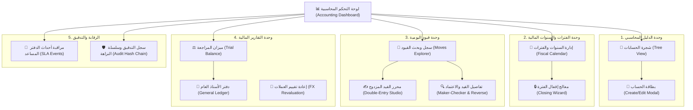

# تحليل وتوصيف شاشات الواجهة الأمامية (Frontend Screens Specification)

## ميزة المحاسبة المالية (Accounting Feature) - نظام Cashflow

---

## 1. المقدمة ونظرة عامة على المعمارية

يعتمد محرك المحاسبة في نظام **Cashflow** على معايير المحاسبة المزدوجة الدولية (**IFRS/IAS** و **US GAAP**)، ويوفر محركاً مالياً صارماً يضمن:

- دقة الميزان الصفري للقيود المحاسبية ($\sum \text{Debit} = \sum \text{Credit}$).
- استحالة تعديل القيود بعد ترحيلها (**Immutability**)، والاعتماد على القيود العكسية (**Reversals**) للتصحيح.
- تسلسل قانوني غير قابل للتجاوز في أرقام اليوميات القانونية (**Gapless Sequential Numbering**).
- حوكمة الفصل بين المهام (**Maker-Checker Segregation of Duties**).
- تقويم مالي ثلاثي الحالات للفترات المالية (**Open**, **Soft Closed**, **Hard Closed**).
- سلسلة تدقيق مشفرة ومترابطة (**Cryptographic Hash Chain**).
- تكامل غير مقترن مع الأنظمة الاقتصادية الخارجية عبر الدفاتر المساعدة (**Subledger Accounting - SLA**).

لتوفير تجربة مستخدم عالية الكفاءة للمحاسبين والمدراء الماليين والمراجعين، تم تقسيم متطلبات الـ Frontend إلى **6 وحدات وظيفية متكاملة**.

---

## 2. خريطة تدفق الشاشات وهيكل التنقل (Navigation & Sitemap)

---

## 3. التحليل المفصل للشاشات حسب الوحدات

### الوحدة الأولى: شجرة الحسابات والدليل المحاسبي (Chart of Accounts)

#### 1.1. شاشة شجرة الحسابات التفاعلية (`Chart of Accounts Tree View`)

- **الهدف:** عرض واستعراض الهيكل المالي التنظيمي وتصنيفات الحسابات.

- **مكونات الواجهة وتجربة المستخدم (UI/UX):**
  - **عرض مزدوج:** التبديل السلس بين:
    1. الهيكل الشجري المتفرع قابل للطي والتوسيع (`Collapsible Tree View`).
    2. جدول البيانات المسطح مع التصفح والفرز (`Paginated Data Grid`).
  - **شريط الفلاتر:**
    - تصنيف الحساب: أصول (`asset`)، خصوم (`liability`)، حقوق ملكية (`equity`)، إيرادات (`income`)، مصروفات (`expense`).
    - الحالة: نشط (`active`) / غير نشط (`inactive`).
    - العملة (`currency_id`).
    - بحث سريع بالاسم أو الكود المحاسبي.
  - **عقدة الحساب (Account Node Display):**
    - كود الحساب (مثال: `110101`).
    - اسم الحساب.
    - شارة طبيعة الحساب: مدين (`Debit`) باللون الأزرق، دائن (`Credit`) باللون البنفسجي.
    - شارة القابلية للتسوية والمطابقة (`Reconcilable`).
  - **شريط الإجراءات:**
    - زر "إضافة حساب فرعي" بجانب كل حساب أب.
    - زر "إضافة حساب رئيسي" في أعلى الصفحة.
    - تصدير الدليل المحاسبي بصيغ Excel و PDF.
- **واجهات الربط (Backend APIs):**
  - `GET /api/v1/accounting/accounts/tree`
  - `GET /api/v1/accounting/accounts`

#### 1.2. نافذة / نموذج بطاقة الحساب (`Account Details / Drawer Modal`)

- **الهدف:** تعريف حساب جديد في النظام أو تعديل الخصائص المسموح بتعديلها.

- **حقول الإدخال والتحقق (Form Fields & Validation):**
  - **كود الحساب (`code`):** نص إجباري فريد يتبع الترميز المحاسبي المعتمد.
  - **اسم الحساب (`name`):** إجباري (دعم لغتين عربي/إنجليزي).
  - **نوع الحساب (`account_type`):** اختيار إجباري من القائمة المحددة:
    - `asset` (أصل)
    - `liability` (خصم/التزام)
    - `equity` (حقوق ملكية)
    - `income` (إيراد)
    - `expense` (مصروف)
  - **طبيعة الحساب الافتراضية (`normal_balance`):** اقتراح تلقائي ذكي وفق النوع:
    - أصول ومصروفات $\rightarrow$ مدين (`debit`).
    - خصوم وحقوق ملكية وإيرادات $\rightarrow$ دائن (`credit`).
  - **الحساب الأب (`parent_id`):** اختيار الحساب الحاوي لربط الحساب بالشجرة هرمياً.
  - **عملة الحساب (`currency_id`):** قائمة منسدلة بالعملات المدعومة عالمياً ومحلياً (افتراضياً `SAR`).
  - **خيارات الرقابة:**
    - مفتاح تبديل: قابل للتسوية والمطابقة البنكية والذمم (`is_reconcilable`).
    - مفتاح تبديل: حالة النشاط (`is_active`).
- **واجهات الربط (Backend APIs):**
  - `POST /api/v1/accounting/accounts`

---

### الوحدة الثانية: الفترات والسنوات المالية (Fiscal Calendar & Periods)

#### 2.1. شاشة إدارة السنوات والفترات المالية (`Fiscal Calendar Management`)

- **الهدف:** ضبط التقويم المالي وتحديد حدود الفترات الزمنية لمنع التسجيل في الفترات المغلقة.

- **مكونات الواجهة وتجربة المستخدم (UI/UX):**
  - **سجل السنوات المالية:** قائمة بالأعوام المالية الحالية والسابقة (`Year`, `StartDate`, `EndDate`, `State`).
  - **نموذج إنشاء سنة مالية جديدة:** حقل إدخال السنة وتاريخ البداية والنهاية (يتم التحقق من أنها تغطي 12 شهراً ميلادياً متكاملاً، وتوليد 12 فترة شهرية تلقائياً).
  - **جدول الفترات الزمنية الشهرية (12 Periods Grid):**
    - رقم الفترة (`Period 1` إلى `Period 12`).
    - الاسم (مثال: January 2026).
    - تاريخ البداية وتاريخ النهاية.
    - مؤشر الحالة اللحظي (Status Badge):
      - 🟢 **Open:** مسموح بإنشاء وترحيل كافة القيود.
      - 🟡 **Soft Closed:** مقفلة تشغيلياً؛ تمنع إدخال الحركات اليومية وتسمح فقط لقيود التسويات الختامية أو لأصحاب صلاحيات الإدارة المالية.
      - 🔴 **Hard Closed:** إقفال قانوني قطعي؛ غير قابلة لإنشاء أو ترحيل أي قيود نهائياً.
    - بيانات المراجعة: تاريخ الإقفال (`closed_at`) والمستخدم الذي أجرى العملية (`closed_by`).
- **واجهات الربط (Backend APIs):**
  - `POST /api/v1/accounting/fiscal-years`

#### 2.2. معالج تغيير حالة الفترة المالية (`Change Period State Wizard`)

- **الهدف:** إدارة التحول الآمن بين حالات الفترة (`open -> soft_closed -> hard_closed`).

- **مكونات الواجهة:**
  - فحص أولي للقيود المسودة غير المرحلة (`Unposted Draft Moves`) وعرض تحذير بعددها قبل الإقفال.
  - تأكيد الهوية وطلب سبب الإجراء لأغراض التدقيق المالي.
- **واجهات الربط (Backend APIs):**
  - `POST /api/v1/accounting/fiscal-periods/{id}/state`

---

### الوحدة الثالثة: قيود اليومية ودفاتر القيود (Journal Entries & Moves)

#### 3.1. شاشة سجل وبحث القيود المحاسبية (`Journal Entries Explorer`)

- **الهدف:** البحث والاستعراض الشامل لجميع القيود مع تمييز مراحل حياتها.

- **مكونات الواجهة وتجربة المستخدم (UI/UX):**
  - **فلاتر متعددة الأبعاد:**
    - نوع دفتر اليومية (`Journal`: عام، بنك، صندوق، مبيعات، مشتريات).
    - نطاق التاريخ (`Date Range`).
    - الحالة: مسودة (`draft`)، مرحل (`posted`)، ملغى بعكس القيد (`reversed`).
    - رقم القيد أو المرجع (`Reference / Ref`).
  - **جدول القيود (Moves Data Grid):**
    - الرقم التسلسلي القانوني للقيد (`Name` مثل `GEN/2026/00001`).
    - دفتر اليومية (`Journal Name`).
    - تاريخ القيد (`Date`).
    - البيان / المرجع (`Ref`).
    - إجمالي القيد المالي.
    - حالة القيد (`State Badge`).
    - شارة التحقق من البصمة الرقمية (`Hash Integrity Verified`).
    - المستخدم المنشئ والمستخدم الذي رحّل القيد.
  - **إجراءات سريعة:** عرض التفاصيل، تعديل المسودة، ترحيل، عكس القيد، طباعة سند القيد.

#### 3.2. شاشة محرر القيد المالي المزدوج (`Double-Entry Move Studio`)

- **الهدف:** واجهة عالية الإنتاجية للمحاسب لإنشاء قيود اليومية اليدوية بسرعة ودقة.

- **مكونات الواجهة وتجربة المستخدم (UI/UX):**
  - **قسم رأس القيد (Move Header):**
    - اختيار دفتر اليومية (`Journal`).
    - تاريخ القيد (`Date`): نظام تحقق لحظي للتأكد من أن التاريخ يقع ضمن فترة مالية مفتوحة (`open`).
    - البيان / المرجع العام للقيد (`Reference / Description`).
  - **جدول أسطر القيد التفاعلي (Dynamic Lines Editor):**
    - دعم اختصارات لوحة المفاتيح (مثل `Tab` للانتقال، و `Enter` لإضافة سطر جديد).
    - حقول السطر:
      - اختيار الحساب (بحث فوري بالكود أو الاسم).
      - الشريك / العميل / المورد (`Partner ID` اختياري للذمم).
      - مركز التكلفة (`Cost Center ID`).
      - عمود المدين (`Debit`) وعمود الدائن (`Credit`) - تحقق أمامي صارم يمنع إدخال قيمتين معاً في نفس السطر ويمنع الأرقام السالبة.
      - دعم العملة الأجنبية: اختيار العملة (`currency_id`) ومبلغ العملة الأصلية (`amount_currency`).
      - رقم المطابقة والتسوية (`Matching Number`).
  - **لوحة توازن القيد اللحظية (Real-Time Balance Widget):**
    - شريط سفلي ثابت يوضح:
      - $\sum \text{Debit}$ (إجمالي المدين).
      - $\sum \text{Credit}$ (إجمالي الدائن).
      - $\Delta \text{Balance}$ (الفرق): يضيء باللون الأخضر عند وصول الفرق إلى $0.00$، وباللون الأحمر مع تنبيه نصي بقيمة الفارق عند عدم التوازن.
  - **أزرار الحفظ والتحكم:**
    - زر "حفظ كمسودة" (`Save as Draft`): متاح دائماً طالما تم إدخال سطرين على الأقل والقيد متوازن.
    - زر "حفظ وترحيل" (`Save & Post`): متاح فقط إذا استوفى القيد شروط الترحيل وصلاحيات المستخدم.
- **واجهات الربط (Backend APIs):**
  - `POST /api/v1/accounting/moves`

#### 3.3. شاشة تفاصيل القيد والاعتماد والحوكمة (`Move Details & Governance View`)

- **الهدف:** استعراض تفاصيل القيد، تطبيق رقابة Maker-Checker، والتعامل مع القيود المعكوسة.

- **مكونات الواجهة:**
  - عرض سند القيد بتنسيق رسمي قابل للطباعة والتصدير.
  - **صندوق اعتماد الحوكمة (Maker-Checker Approval Box):**
    - في حال تجاوز إجمالي القيد الحد المالي المحدد (`Threshold`):
      - يُمنع المستخدم الذي أنشأ القيد من ترحيله (`ErrMakerCheckerViolation`).
      - يظهر تنبيه: *"يتطلب هذا القيد اعتماداً من محاسب/مدير مالي آخر نظراً لتجاوز الحد الرقابي"*.
      - يتاح زر **"اعتماد وترحيل القيد"** للمستخدمين المخولين فقط.
  - **إجراء عكس القيد (`Reverse Move`):**
    - إذا كان القيد في حالة `posted`: يظهر زر "عكس القيد".
    - عند النقر، يفتح نافذة تأكيد لتوليد قيد عكسي مطابق ومترابط (`Reversal Move`) يقلب المدين دائناً والدائن مديناً، ويسجل الارتباط مع القيد الأصلي (`reversed_move_id`).
  - **بصمة النزاهة التشفيرية (`Hash Signature`):**
    - عرض كود الـ Hash المشفر للقيد لضمان عدم تعرضه للتعديل المباشر في قاعدة البيانات.
- **واجهات الربط (Backend APIs):**
  - `GET /api/v1/accounting/moves/{id}`
  - `POST /api/v1/accounting/moves/{id}/post`
  - `POST /api/v1/accounting/moves/{id}/reverse`

---

### الوحدة الرابعة: التقارير المالية والتحليل (Financial Reporting & Ledgers)

#### 4.1. شاشة ميزان المراجعة التفاعلي (`Interactive Trial Balance`)

- **الهدف:** استخراج ميزان المراجعة بالمجاميع والأرصدة خلال فترة مالية للتأكد من التوازن المالي العام.

- **مكونات الواجهة وتجربة المستخدم (UI/UX):**
  - **محدد الفترة الزمنية:** من تاريخ (`from_date`) إلى تاريخ (`to_date`).
  - **مؤشر التوازن العام (Health Check Indicator):**
    - شارة بارزة: ✅ **"الميزان متزن"** عند تطابق إجمالي المدين والدائن.
    - تنبيه تحذيري: ⚠️ **"يوجد خلل في التوازن"** إذا وُجد فارق حسابي.
  - **جدول ميزان المراجعة القياسي (6 أعمدة):**
    1. كود واسم الحساب.
    2. الرصيد الافتتاحي (`Initial Debit` / `Initial Credit`).
    3. حركات الفترة المحددة (`Period Debit` / `Period Credit`).
    4. الرصيد الختامي (`Ending Debit` / `Ending Credit`).
  - **التعمق التحليلي (Drill-Down):** إمكانية النقر على أي حساب في الميزان لفتح دفتر الأستاذ الخاص به مباشرةً.
- **واجهات الربط (Backend APIs):**
  - `GET /api/v1/accounting/reports/trial-balance?from=YYYY-MM-DD&to=YYYY-MM-DD`

#### 4.2. شاشة دفتر الأستاذ العام للحساب (`General Ledger Drill-Down View`)

- **الهدف:** تتبع وتدقيق جميع العمليات والحركات التي أثرت على حساب معين.

- **مكونات الواجهة:**
  - اختيار الحساب، ونطاق التاريخ.
  - جدول الحركات التاريخية:
    - تاريخ الحركة (`Date`).
    - رقم القيد المحاسبي (`Move Name`).
    - المرجع والبيان (`Ref`).
    - المبلغ المدين (`Debit`).
    - المبلغ الدائن (`Credit`).
    - **الرصيد التراكمي المتحرك (`Running Balance`):** يوضح حركة الرصيد بعد كل قيد.
  - روابط تشعبية سريعة تفتح تفاصيل القيد مباشرة عند النقر على رقم القيد.

#### 4.3. شاشة استوديو إعادة تقييم العملات الأجنبية (`FX Revaluation Studio`)

- **الهدف:** احتساب وإثبات فروقات أسعار الصرف غير المحققة للمراكز المالية النقدية بالعملات الأجنبية في نهاية الفترات المالية.

- **مكونات الواجهة:**
  - اختيار تاريخ الإقفال والتقييم (`As-of Date`).
  - جدول المراكز المالية الأجنبية: الحساب، الشريك، العملة، الرصيد بالعملة الأجنبية، الرصيد المسجل بالعملة الأساسية، وسعر الصرف الختامي (`Closing Rate`).
  - عمود الأثر المالي المتوقع: أرباح تقييم (`Gain`) أو خسائر تقييم (`Loss`).
  - زر **"توليد قيد إعادة التقييم الآلي"**: ينشئ قيد مسودة تلقائي يوازن فروقات الصرف مع حسابات الأرباح والخسائر المعتمدة.

---

### الوحدة الخامسة: تكامل الدفاتر المساعدة وسجلات التدقيق (Subledger & Audit)

#### 5.1. شاشة مراقبة أحداث الدفاتر المساعدة (`Subledger Event Ingest Monitor`)

- **الهدف:** مراقبة الأحداث الاقتصادية المتدفقة من الأنظمة الخارجية (نقاط البيع، المبيعات، الفواتير، المدفوعات البنكية) وتحويلها إلى قيود محاسبية.

- **مكونات الواجهة:**
  - جدول تدفق الأحداث:
    - مفتاح منع التكرار (`Idempotency Key`).
    - نوع الحدث (`EventType` مثل `invoice.issued`, `payment.received`).
    - التاريخ والمبلغ والعملة.
    - حالة المعالجة ورقم القيد المحاسبي الذي تم توليده تلقائياً.
  - نافذة استعراض حمولة البيانات (`Payload Inspector`): لفحص الـ JSON الأصلي للحدث وتتبع أي أخطاء مطابقة.
- **واجهات الربط (Backend APIs):**
  - `POST /api/v1/accounting/subledger/events`

#### 5.2. شاشة سجل التدقيق وسلسلة النزاهة المشفرة (`Financial Audit & Integrity Chain`)

- **الهدف:** تمكين المدققين والمراجعين القانونيين من التحقق من سلامة البيانات المحاسبية وعدم التلاعب بها.

- **مكونات الواجهة:**
  - جدول سجل التدقيق المالي (`Financial Audit Log`):
    - نوع الكيان والعملية (`Action`: إنشاء، ترحيل، عكس قيد).
    - المستخدم المسؤول وعنوان الـ IP ووقت العملية.
    - مقارنة الفروقات قبل وبعد (`Diff Viewer: Payload Before vs After`).
    - شاشة فحص نزاهة السلسلة التشفيرية (`Hash Chain Validator`): تفحص ترابط البصمات (`PreviousLogHash` مع `CurrentLogHash`) وتؤكد سلامة السجل بنسبة 100%.

---

### الوحدة السادسة: لوحة المؤشرات المالية العامة للمحاسب (Accounting Dashboard)

- **الهدف:** الصفحة الرئيسية الهابطة للمدير المالي والمحاسبين لتقديم ملخص لحظي للوضع المالي والرقابي.
- **مكونات الواجهة (Widgets & KPIs):**
  1. **بطاقة حالة الفترة المالية:** توضح الفترة الحالية وحالتها وعدد الأيام المتبقية حتى الإقفال الشهري.
  2. **بطاقة القيود المعلقة (Pending Approvals):** عدد القيود التي تتطلب اعتماد Maker-Checker قبل الترحيل.
  3. **بطاقة فحص التوازن اللحظي:** مؤشر تحقق فوري من اتزان القيود وميزان المراجعة.
  4. **مخطط تدفق العمليات اليومية:** رسم بياني يوضح حجم القيود المرحلة يومياً حسب نوع الدفتر.
  5. **شريط الوصول السريع:** أزرار سريعة لإنشاء قيد جديد، فتح شجرة الحسابات، أو استخراج ميزان المراجعة.

---

## 4. مصفوفة الصلاحيات والحوكمة في الشاشات (Access Control Matrix)

| الشاشة / الإجراء | محاسب مدخل (Maker) | مراجع / مدير مالي (Checker) | مدقق مالي (Auditor) |
| :--- | :---: | :---: | :---: |
| استعراض شجرة الحسابات | ✅ قراءة | ✅ قراءة وتعديل | ✅ قراءة فقط |
| إنشاء وتعديل مسودات القيود | ✅ نعم | ✅ نعم | ❌ لا |
| ترحيل قيد دون الحد الرقابي | ✅ نعم | ✅ نعم | ❌ لا |
| ترحيل قيد يتجاوز الحد الرقابي | ❌ محظور (ErrMakerChecker) | ✅ مخول بالترحيل | ❌ لا |
| عكس قيد مرحل | ❌ يتطلب موافقة | ✅ نعم | ❌ لا |
| إقفال / إعادة فتح الفترات المالية | ❌ لا | ✅ نعم | ❌ لا |
| استعراض سجل التدقيق وسلسلة النزاهة | ❌ لا | ✅ نعم | ✅ نعم |
| استخراج ميزان المراجعة ودفتر الأستاذ | ✅ نعم | ✅ نعم | ✅ نعم |

---

## 5. ضوابط التحقق الأمامي وتجربة المستخدم (Frontend Client Validations)

لضمان أقصى قدر من الموثوقية وتفادي أخطاء الإدخال قبل إرسالها إلى الـ Backend:

1. **منع الأرقام السالبة تماماً:** التحقق الفوري في خانات المدين والدائن بحيث لا تُقبل إلا مبالغ موجبة.
2. **منع الجمع بين المدين والدائن في سطر واحد:** بمجرد إدخال قيمة في خانة المدين، يتم تصفير خانة الدائن وتعطيلها والعكس.
3. **التحقق اللحظي من التوازن:** تعطيل أزرار الحفظ إذا كان عدد الأسطر أقل من 2 أو كان الفرق بين المدين والدائن لا يساوي صفراً.
4. **التحقق من الفترات المالية قبل الإرسال:** تنبيه المستخدم فور اختيار تاريخ يقع في فترة مقفلة (`soft_closed` أو `hard_closed`).
5. **منع النقر المزدوج (Idempotency):** تعطيل أزرار الحفظ والترحيل فور النقر عليها لمنع إرسال طلبات مكررة إلى الـ API.
