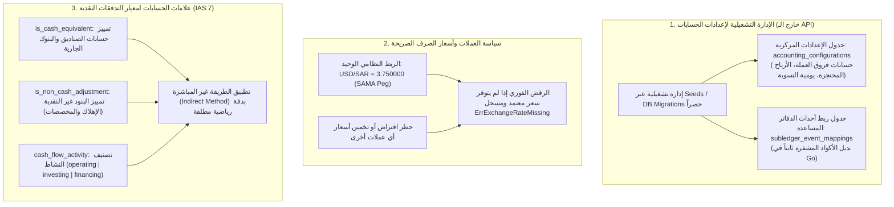
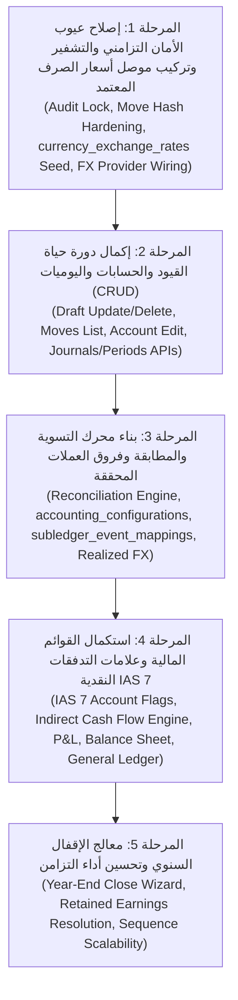

# الخطة التنفيذية لسد الفجوات والعيوب في وحدة المحاسبة المالية (Accounting Feature Remediation Plan)

> **مسار الوثيقة:** `docs/accounting_master_implementation_plan.md`  
> **تاريخ التحديث النهائي:** نوفمبر 2026  
> **النطاق الحصري:** كود وحدة المحاسبة المالية فقط (`internal/features/accounting/`) ومكتبات المنصة والتخزين التابعة لها (`migrations/`).  
> **الهدف الاستراتيجي:** حصر العمل بالكامل في إصلاح العيوب الهندسية والتزامنية وسد النواقص المحاسبية والتقارير داخل ميزة المحاسبة المجردة القائمة، **دون استحداث أي ميزات تجارية جديدة**، مع اعتماد الإدارة التشغيلية الصريحة للإعدادات وقاعدة أسعار الصرف غير المفترضة وضوابط معيار التدفقات النقدية (IAS 7).

---

## 1. حصر الفجوات والعيوب المستهدفة داخل ميزة المحاسبة (Gap & Defect Inventory)

بناءً على الفحص الفعلي للكود المصدري لوحدة المحاسبة (`internal/features/accounting`)، تم حصر العيوب والنواقص التي تحتاج لمعالجة جذرية في 7 محاور أساسية:

| م | المحور / العيب المكتشف داخل `accounting` | موقع العيب في الكود | مستوى الخطورة | التأثير التشغيلي والمحاسبي |
| --- | --- | --- | :---: | --- |
| **1** | **ثغرة سباق التزامن في سلسلة التدقيق** | [`internal/repository.go#L760`](internal/features/accounting/internal/repository.go#L760) | **حرج** | قراءة الـ Hash السابق بدون قفل تزامني تؤدي لانكسار السلسلة عند ترحيل قيدين متزامنين وظهور إنذار كاذب بالتلاعب (`tamper detected`). |
| **2** | **قصور في توقيع أمان القيد المحاسبي (`hashMove`)** | [`internal/repository.go#L835`](internal/features/accounting/internal/repository.go#L835) | **حرج** | تشفير المعرف والتاريخ واسم القيد فقط وتجاهل الأسطر والمبالغ، مما يتيح التلاعب بالمبالغ في قاعدة البيانات دون اكتشافه. |
| **3** | **غياب موصل أسعار صرف مركّب في جذر التهيئة** | [`wiring/postgres.go`](internal/features/accounting/wiring/postgres.go) و [`app.go`](internal/platform/app/app.go) | **عالي** | تمرير `nil` لـ `fxProvider` في `app.go` وغياب جدول الأسعار، مما يعطل إعادة تقييم العملات ويفسد استيعاب أحداث الـ Subledger بالعملات الأجنبية. |
| **4** | **غياب محرك التسوية والمطابقة وفروق العملة المحققة** | `account_move_lines.matching_number` | **عالي** | عدم وجود كود لمطابقة الأسطر المدينة بالدائنة، وغياب الاحتساب الآلي لأرباح/خسائر فروق الصرف المحققة، وغياب مصدر حسابات الفروق. |
| **5** | **نقص القوائم المالية الختامية وتصنيف معيار IAS 7** | [`report_handler.go`](internal/features/accounting/report_handler.go) و `accounts` | **عالي** | اقتصار النظام على ميزان المراجعة فقط؛ وغياب P&L والميزانية، وغياب علامات تحديد النقدية والتسويات غير النقدية في `accounts` المطلوب لمعيار IAS 7. |
| **6** | **غياب معالج إقفال السنة المالية ومصدر الأرباح المحتجزة** | `period_handler.go` | **متوسط** | لا يوجد كود لتصفير الإيرادات والمصروفات آلياً، وعدم وجود مصدر موثوق لحساب الأرباح المحتجزة مما يهدد بالترحيل لحساب خاطئ. |
| **7** | **نقص دورة حياة مسودات القيود والحسابات (CRUD)** | `move_handler.go`, `account_handler.go` | **متوسط** | لا يمكن تعديل أو حذف أي مسودة قيد بعد إنشائها، ولا توجد واجهة لتعديل الحسابات، ولا واجهات لاستعراض اليوميات والفترات. |

---

## 2. القرارات التشغيلية والمعمارية الحاكمة للخطة (Operational & Architectural Policies)

لتجنب أي ترحيل محاسبي خاطئ أو افتراض أسعار غير معتمدة، تم اعتماد السياسات التالية:



---

## 3. المراحل التنفيذية المتسلسلة لسد الفجوات (The 5 Remediation Phases)



---

## 4. التفصيل الدقيق لكل مرحلة تنفيذية

---

### المرحلة 1: إصلاح عيوب الأمان التزامني والتشفير وتركيب موصل أسعار الصرف (Security & FX Wiring)
>
> **الهدف:** القضاء على ثغرات النزاهة التشفيرية وسباق التزامن، وتركيب موصل أسعار صرف موثوق يلتزم بسعر الربط الرسمي الصريح فقط.

#### 1.1. معالجة سباق التزامن في سلسلة سجل التدقيق (`saveAuditLog`)

- **الملف المستهدف:** [`internal/features/accounting/internal/repository.go`](internal/features/accounting/internal/repository.go).
- **التنفيذ البرمجي:**
  - تطبيق قفل استشاري تزامني على مستوى معاملة Postgres:

    ```sql
    SELECT pg_advisory_xact_lock(hashtext('financial_audit_logs_lock'));
    ```

  - يتم تنفيذ القفل أثناء قراءة الـ Hash السابق وكتابة السجل الجديد داخل نفس المعاملة، لفرض تسلسل خطي أحادي ومنع تفرع السلسلة تحت الضغط العالي.
- **الاختبار:** اختبار ترحيل متزامن موازي (`Parallel Subtests`) يرحل 50 قيداً في نفس اللحظة والتحقق من نجاح `VerifyAuditIntegrity`.

#### 1.2. تقوية توقيع أمان القيد المحاسبي (`hashMove`)

- **الملف المستهدف:** [`internal/features/accounting/internal/repository.go`](internal/features/accounting/internal/repository.go).
- **التنفيذ البرمجي:**
  - تعديل دالة `hashMove` لتشمل محتويات الأسطر المالية الكاملة بدقة:
    $$\text{Payload} = \text{MoveID} + \text{Name} + \text{Date} + \text{JournalID} + \sum (\text{Line.AccountID} + \text{Line.Debit} + \text{Line.Credit}) + \text{PrevMoveHash}$$
  - منع التلاعب بالمبالغ أو تبديل الحسابات بعد الترحيل في قاعدة البيانات.

#### 1.3. إنشاء جدول أسعار الصرف وبناء `PostgresFXRateProvider` الصريح

- **ملف الهجرة:** إضافة جدول أسعار الصرف `currency_exchange_rates`:

  ```sql
  CREATE TABLE IF NOT EXISTS currency_exchange_rates (
      id UUID PRIMARY KEY DEFAULT gen_random_uuid(),
      currency VARCHAR(3) NOT NULL,
      base_currency VARCHAR(3) NOT NULL DEFAULT 'SAR',
      rate_date DATE NOT NULL,
      rate NUMERIC(18, 6) NOT NULL,
      created_at TIMESTAMPTZ NOT NULL DEFAULT NOW(),
      CONSTRAINT uq_currency_rate_date UNIQUE (currency, base_currency, rate_date)
  );
  CREATE INDEX IF NOT EXISTS idx_currency_rates_lookup ON currency_exchange_rates(currency, base_currency, rate_date DESC);

  -- التهيئة النظامية الوحيدة المعتمدة رسمياً (ساما):
  INSERT INTO currency_exchange_rates (currency, base_currency, rate_date, rate)
  VALUES ('USD', 'SAR', '1986-06-01', 3.750000)
  ON CONFLICT (currency, base_currency, rate_date) DO NOTHING;
  ```

- **بناء المحول:** إنشاء `internal/features/accounting/internal/fx_rates.go`:
  - ينفذ المنفذ `FXClosingRateProvider`:
    1. يبحث في `currency_exchange_rates` عن أقرب سعر تاريخي مسجل (`rate_date <= asOf ORDER BY rate_date DESC LIMIT 1`).
    2. إذا كان الزوج `USD/SAR` ولم يوجد سعر مخصص لتاريخ معين، يرجع سعر الربط النظامي الثابت `3.750000`.
    3. **قاعدة الرفض الفوري (Fail-Fast):** لأي عملة أخرى غير الدولار (مثل EUR أو GBP)، إذا لم يتوفر سعر مسجل صراحة في الجدول، **يرفض النظام المعاملة فوراً** بخطأ:
       `ErrExchangeRateMissing: no exchange rate registered for currency %s on date %s`.

#### 1.4. تركيب الموصل في جذر التطبيق وتصحيح الـ Subledger Ingestion

- **الملفات المستهدفة:**
  - [`internal/features/accounting/wiring/postgres.go`](internal/features/accounting/wiring/postgres.go)
  - [`internal/platform/app/app.go`](internal/platform/app/app.go)
  - [`internal/features/accounting/ingest_subledger_event_usecase.go`](internal/features/accounting/ingest_subledger_event_usecase.go)
- **التنفيذ البرمجي:**
  - في `app.go`: تهيئة `PostgresFXRateProvider` وحقنه في `UseCases`.
  - في `IngestSubledgerEventUseCase`: تحويل المبلغ الأجنبي إلى SAR بسعر الصرف المعتمد، وتسجيل `AmountCurrency` بالعملة الأصلية.

---

### المرحلة 2: استكمال دورة حياة القيود والحسابات واليوميات (CRUD Completeness & Explorer APIs)
>
> **الهدف:** توفير الواجهات المفقودة لإدارة مسودات القيود وتعديل الحسابات واستعراض البيانات للواجهة الأمامية.

#### 2.1. إدارة مسودات القيود (Draft Move Lifecycle)

- **الملفات المستهدفة:**
  - `update_draft_move_usecase.go`: تعديل بيان أو أسطر القيد طالما في حالة `draft` والتأكد من اتزانها وصلاحية الحسابات.
  - `delete_draft_move_usecase.go`: حذف مسودة القيد غير المرحل وتنظيف مراجعها.
  - `list_moves_usecase.go`: استعراض قائمة القيود مع دعم الفلاتر (نوع اليومية، نطاق التاريخ، الحالة `draft/posted/reversed`) والتصفح (`pagination`).
- **المسارات المضافة في [`handler.go`](internal/features/accounting/handler.go):**
  - `PUT /api/v1/accounting/moves/{id}`
  - `DELETE /api/v1/accounting/moves/{id}`
  - `GET /api/v1/accounting/moves`

#### 2.2. تعديل بطاقة الحساب واستعراض اليوميات والفترات

- **حالات الاستخدام الجديدة:**
  - `update_account_usecase.go`: تعديل اسم الحساب، حالته (`is_active`)، وقابليته للتسوية (`is_reconcilable`)، وعلامات التدفق النقدي، مع حظر تعديل النوع أو الكود إذا كان للحساب حركات مرحلة.
  - `list_journals_usecase.go`: استعراض دفاتر اليومية المتاحة (عام، بنك، صندوق، مبيعات، مشتريات).
  - `list_fiscal_years_usecase.go`: استعراض السنوات والفترات التابعة لها.
- **المسارات المضافة:**
  - `PUT /api/v1/accounting/accounts/{id}`
  - `GET /api/v1/accounting/journals`
  - `GET /api/v1/accounting/fiscal-years`

---

### المرحلة 3: بناء محرك التسوية وإدارة الإعدادات التشغيلية (Reconciliation & Operational Configs)
>
> **الهدف:** تفعيل محرك التسوية والمطابقة وفروق العملات المحققة، وإدارة الإعدادات النظامية تشغيلياً خارج الـ API.

#### 3.1. ترقية قاعدة البيانات وجداول الإعدادات والربط التشغيلي

- **ملف الهجرة:** `migrations/000004_accounting_reconciliation_and_config.up.sql`:

  ```sql
  -- 1. جدول الإعدادات المحاسبية المركزية (مُدار تشغيلياً خارج الـ API)
  CREATE TABLE IF NOT EXISTS accounting_configurations (
      id UUID PRIMARY KEY DEFAULT gen_random_uuid(),
      retained_earnings_account_id UUID NOT NULL REFERENCES accounts(id) ON DELETE RESTRICT,
      fx_gain_account_id UUID NOT NULL REFERENCES accounts(id) ON DELETE RESTRICT,
      fx_loss_account_id UUID NOT NULL REFERENCES accounts(id) ON DELETE RESTRICT,
      fx_reconciliation_journal_id UUID NOT NULL REFERENCES journals(id) ON DELETE RESTRICT,
      updated_at TIMESTAMPTZ NOT NULL DEFAULT NOW()
  );

  -- 2. جدول ربط أحداث الدفاتر المساعدة (مُدار تشغيلياً خارج الـ API)
  CREATE TABLE IF NOT EXISTS subledger_event_mappings (
      event_type VARCHAR(100) PRIMARY KEY,
      journal_id UUID NOT NULL REFERENCES journals(id) ON DELETE RESTRICT,
      debit_account_id UUID NOT NULL REFERENCES accounts(id) ON DELETE RESTRICT,
      credit_account_id UUID NOT NULL REFERENCES accounts(id) ON DELETE RESTRICT,
      description VARCHAR(255),
      is_active BOOLEAN NOT NULL DEFAULT TRUE,
      created_at TIMESTAMPTZ NOT NULL DEFAULT NOW(),
      updated_at TIMESTAMPTZ NOT NULL DEFAULT NOW()
  );

  -- 3. جداول التسوية والمطابقة
  CREATE TABLE IF NOT EXISTS account_reconciliations (
      id UUID PRIMARY KEY DEFAULT gen_random_uuid(),
      date DATE NOT NULL,
      created_by UUID,
      created_at TIMESTAMPTZ NOT NULL DEFAULT NOW()
  );

  CREATE TABLE IF NOT EXISTS account_reconciliation_items (
      id UUID PRIMARY KEY DEFAULT gen_random_uuid(),
      reconciliation_id UUID NOT NULL REFERENCES account_reconciliations(id) ON DELETE CASCADE,
      move_line_id UUID NOT NULL REFERENCES account_move_lines(id) ON DELETE RESTRICT,
      allocated_amount NUMERIC(28, 4) NOT NULL,
      currency_id VARCHAR(3) NOT NULL DEFAULT 'SAR',
      created_at TIMESTAMPTZ NOT NULL DEFAULT NOW()
  );

  ALTER TABLE account_move_lines 
      ADD COLUMN IF NOT EXISTS reconciled_amount NUMERIC(28, 4) NOT NULL DEFAULT 0;
  ```

#### 3.2. حالات الاستخدام ومنطق تحديد حسابات الفروق (Account Resolution)

- **`reconcile_move_lines_usecase.go`:**
  - في `ReconcileRequest`:
    - إمكانية التمرير الصريح لـ `GainAccountID` و `LossAccountID`.
    - إذا لم يُمررا، يقرأ المحرك الحسابات من جدول `accounting_configurations`.
    - إذا لم تكن مهيأة ونشأ فارق عملة، **يُرفض الطلب فوراً** بخطأ `ErrFXAccountsNotConfigured`.
  - **احتساب فروق أسعار الصرف المحققة (Realized FX):** عند اختلاف سعر الصرف بين تاريخ السطر الأصلي وتاريخ التسوية، يقوم المحرك تلقائياً بتوليد قيد تسوية مالي متزن يثبت الفارق في الحساب المحدد.
- **تحديث `IngestSubledgerEventUseCase`:**
  - قراءة ربط الأحداث ديناميكياً من جدول `subledger_event_mappings` بدلاً من الخريطة الثابتة في Go.
- **`unreconcile_move_lines_usecase.go`:**
  - فك التسوية وإلغاء الربط وعكس أي قيد فروق صرف ناتج عنها.
- **`list_unreconciled_lines_usecase.go`:**
  - استخراج الأسطر المفتوحة القابلة للتسوية مع المبالغ المتبقية (`residual_amount`).
- **المسارات المضافة في الـ API:**
  - `POST /api/v1/accounting/reconcile`
  - `POST /api/v1/accounting/unreconcile`
  - `GET /api/v1/accounting/unreconciled-lines`
  *(ملاحظة: جداول الإعدادات لا تفتح لها مسارات API عامة حمايةً لسلامة الدفاتر)*.

---

### المرحلة 4: استكمال القوائم المالية وعلامات التدفقات النقدية معيار IAS 7
>
> **الهدف:** توفير القوائم الختامية المعيارية واعتماد علامات صريحة على الحسابات لحساب التدفقات النقدية غير المباشرة بدقة حتمية.

#### 4.1. علامات الحسابات الصريحة لمعيار التدفقات النقدية (IAS 7)

- **ملف الهجرة:** تحديث جدول `accounts`:

  ```sql
  ALTER TABLE accounts 
      ADD COLUMN IF NOT EXISTS is_cash_equivalent BOOLEAN NOT NULL DEFAULT FALSE,
      ADD COLUMN IF NOT EXISTS is_non_cash_adjustment BOOLEAN NOT NULL DEFAULT FALSE,
      ADD COLUMN IF NOT EXISTS cash_flow_activity VARCHAR(20) NOT NULL DEFAULT 'unclassified',
      ADD CONSTRAINT chk_accounts_cash_flow_activity CHECK (
          cash_flow_activity IN ('operating', 'investing', 'financing', 'none', 'unclassified')
      );
  ```

#### 4.2. القوائم المالية الختامية المطلوبة

1. **قائمة التدفقات النقدية وفق معيار IAS 7 (Cash Flow Statement - Indirect Method):**
   - **الملف:** `generate_cash_flow_usecase.go`.
   - **المنهجية الرياضية المحاسبية:**
     1. **صافي الدخل (Net Income):** الناتج من قائمة الدخل ($\sum \text{Income} - \sum \text{Expense}$).
     2. **التسويات غير النقدية (Non-Cash Adjustments):** $\sum \text{Move Lines where is\_non\_cash\_adjustment = TRUE}$ (مثل مصروف ومجمع الإهلاك، يُضاف إلى صافي الدخل).
     3. **التغير في رأس المال العامل (Working Capital Changes):** التغير بين الرصيد الافتتاحي والختامي لجميع الحسابات حيث `cash_flow_activity = 'operating'` و `is_cash_equivalent = FALSE` (للأصول: $-\Delta$، وللخصوم: $+\Delta$).
     4. **صافي التدفقات من الأنشطة الاستثمارية:** التغير في حسابات `cash_flow_activity = 'investing'` ($-\Delta \text{Assets}$).
     5. **صافي التدفقات من الأنشطة التمويلية:** التغير في حسابات `cash_flow_activity = 'financing'` ($+\Delta \text{Liabilities/Equity}$).
     6. **المطابقة الحتمية (Reconciliation):**
        $$\text{Net Cash Change} = \text{Operating} + \text{Investing} + \text{Financing} \equiv \Delta \text{Accounts where is\_cash\_equivalent = TRUE}$$
   - **المسار:** `GET /api/v1/accounting/reports/cash-flow?from=YYYY-MM-DD&to=YYYY-MM-DD`.
2. **قائمة الدخل والأرباح والخسائر (Income Statement / P&L):**
   - **الملف:** `generate_income_statement_usecase.go`.
   - **المسار:** `GET /api/v1/accounting/reports/income-statement?from=YYYY-MM-DD&to=YYYY-MM-DD`.
3. **الميزانية العمومية والمركز المالي (Balance Sheet):**
   - **الملف:** `generate_balance_sheet_usecase.go`.
   - **المسار:** `GET /api/v1/accounting/reports/balance-sheet?as_of=YYYY-MM-DD`.
4. **تفعيل دفتر الأستاذ العام (General Ledger API):**
   - **الملف:** `generate_general_ledger_usecase.go` واستدعاء `GetGeneralLedgerLines`.
   - **المسار:** `GET /api/v1/accounting/reports/general-ledger?account_id={uuid}&from=YYYY-MM-DD&to=YYYY-MM-DD`.

---

### المرحلة 5: معالج الإقفال السنوي وتحسين أداء التزامن (Year-End Closing & Concurrency)
>
> **الهدف:** أتمتة إغلاق السنة المالية وتدوير الأرباح بالاعتماد على حساب أرباح محتجزة صريح، وفك اختناقات الأداء تحت الحمل العالي.

#### 5.1. معالج إقفال السنة المالية (Year-End Closing Wizard)

- **الملف المستهدف:** `close_fiscal_year_usecase.go`.
- **هيكل الطلب:**

  ```go
  type CloseFiscalYearRequest struct {
      FiscalYearID              uuid.UUID  `json:"fiscal_year_id"`
      RetainedEarningsAccountID *uuid.UUID `json:"retained_earnings_account_id,omitempty"`
      ClosingJournalID          *uuid.UUID `json:"closing_journal_id,omitempty"`
  }
  ```

- **خطوات المعالجة الآلية:**
  1. التحقق من إقفال الفترات الـ 12 السابقة وعدم وجود أي مسودات قيود مفتوحة.
  2. تحديد حساب الأرباح المحتجزة:
     - استخدام `RetainedEarningsAccountID` الممرر بالطلب، أو قراءته من `accounting_configurations`.
     - إذا لم يتوفر، **تفشل العملية فوراً** بخطأ `ErrRetainedEarningsAccountNotConfigured`.
  3. حساب إجمالي أرصدة الإيرادات والمصروفات.
  4. إنشاء وترحيل قيد إقفال الأرباح والخسائر الآلي (`Closing Move`):
     - تصفير جميع حسابات الإيرادات والمصروفات بجعل رصيدها صفراً.
     - ترحيل الفارق (صافي الربح أو الخسارة) إلى حساب **الأرباح المحتجزة المعتمد**.
  5. توليد قيد الافتتاح للسنة الجديدة (`Opening Move`) وتدوير أرصدة الميزانية العمومية فقط.
  6. تحويل حالة السنة المالية إلى `closed`.
- **المسار:** `POST /api/v1/accounting/fiscal-years/{id}/close`.

#### 5.2. تحسين ترقيم اليوميات تحت التزامن العالي (Sequence Scalability)

- **الملف المستهدف:** [`internal/repository.go`](internal/features/accounting/internal/repository.go).
- **التنفيذ:**
  - تقليص مدى القفل على سطر اليومية وفصله عن القفل الطويل لمعاملة كتابة أسطر القيد، أو اعتماد تسلسل Postgres متسق لكل دفتر يومية (`CREATE SEQUENCE IF NOT EXISTS journal_seq_<uuid>`).
  - ضمان عدم وجود فجوات في الترقيم القانوني (Gapless Sequential Integrity) دون التسبب في تجميد طلبات الترحيل المتزامنة.

#### 5.3. تشديد حوكمة الترحيل (Maker-Checker Strict Enforcement)

- إلزام التحقق من وجود معرف المنفذ (`actorID`) وتطبيق قواعد الفصل بين المهام (`Maker != Checker`) عند تجاوز حد الترحيل دون أي استثناءات، لمنع ترحيل القيود مجهولة المصدر.

---

## 5. جدول تتبع الملفات والمخرجات البرمجية (File & Artifact Inventory)

جميع الملفات المستحدثة أو المعدلة تقع **حصرياً** داخل النطاق الحالي لميزة المحاسبة ومجلد الهجرة:

| المرحلة | الملفات المستحدثة أو المعدلة في Go | مسارات الـ HTTP المسجلة | ملفات الهجرة في Postgres |
| :--- | :--- | :--- | :--- |
| **المرحلة 1: الأمان وموصل الأسعار** | `internal/repository.go`<br>`audit_chain.go`<br>`internal/fx_rates.go`<br>`ingest_subledger_event_usecase.go`<br>`wiring/postgres.go`<br>`internal/platform/app/app.go` | مسارات موجودة تم تصحيحها | جدول `currency_exchange_rates` وتهيئة `USD/SAR=3.75` |
| **المرحلة 2: إكمال الـ CRUD** | `update_draft_move_usecase.go`<br>`delete_draft_move_usecase.go`<br>`list_moves_usecase.go`<br>`update_account_usecase.go`<br>`list_journals_usecase.go`<br>`list_fiscal_years_usecase.go` | `PUT /moves/{id}`<br>`DELETE /moves/{id}`<br>`GET /moves`<br>`PUT /accounts/{id}`<br>`GET /journals`<br>`GET /fiscal-years` | لا تتطلب هجرة |
| **المرحلة 3: محرك التسوية والإعدادات** | `reconcile_move_lines_usecase.go`<br>`unreconcile_move_lines_usecase.go`<br>`list_unreconciled_lines_usecase.go`<br>`reconciliation_handler.go` | `POST /reconcile`<br>`POST /unreconcile`<br>`GET /unreconciled-lines` | جداول `account_reconciliations`،<br>`account_reconciliation_items`،<br>`accounting_configurations`،<br>`subledger_event_mappings` |
| **المرحلة 4: القوائم وعلامات IAS 7** | `generate_income_statement_usecase.go`<br>`generate_balance_sheet_usecase.go`<br>`generate_cash_flow_usecase.go`<br>`generate_general_ledger_usecase.go`<br>`report_handler.go` | `GET /reports/income-statement`<br>`GET /reports/balance-sheet`<br>`GET /reports/cash-flow`<br>`GET /reports/general-ledger` | إضافة أعمدة `is_cash_equivalent`، `is_non_cash_adjustment`، و `cash_flow_activity` في `accounts` |
| **المرحلة 5: الإقفال السنوي والتزامن** | `close_fiscal_year_usecase.go`<br>`period_handler.go`<br>`internal/repository.go` | `POST /fiscal-years/{id}/close` | تحديث قيود الفترات |

---

## 6. خطة التحقق والاختبارات الآلية (Verification & Test Strategy)

يلتزم تنفيذ كل مرحلة بالحفاظ على نسبة نجاح الاختبارات 100% وإضافة اختبارات جديدة تغطي الحالات التالية:

1. **اختبارات التزامن (Concurrency Tests):**
   - اختبار ترحيل متزامن مكثف يثبت استقرار سلسلة التدقيق وعدم انكسار الـ Hash تحت ضغط 50 قيداً متزامناً.
2. **اختبارات معالجة العملات الصريحة (Fail-Fast FX Tests):**
   - التحقق من تطبيق سعر `USD/SAR = 3.750000` بنجاح.
   - التحقق من رفض أي عملية بعملة أجنبية غير مسجلة صراحة في جدول الأسعار (`ErrExchangeRateMissing`).
3. **اختبارات التوازن والنزاهة الرياضية لمعيار IAS 7:**
   - التحقق من معادلة الميزانية العمومية ($\text{Assets} = \text{Liabilities} + \text{Equity}$).
   - مطابقة صافي التغير في قائمة التدفقات النقدية (IAS 7) مع رصيد حسابات `is_cash_equivalent = TRUE` بدقة متطابقة.
4. **اختبارات التحقق الصارم للحسابات (Fail-Fast Verification):**
   - التحقق من فشل طلب التسوية إذا نشأ فارق عملة ولم تكن حسابات الفروق ممررة بالطلب أو مهيأة في `accounting_configurations`.
   - التحقق من فشل طلب الإقفال السنوي إذا لم يتوفر حساب الأرباح المحتجزة.
   - التحقق من فشل حدث الدفتر المساعد إذا كان `event_type` غير معرف في `subledger_event_mappings`.

---

## 7. الخاتمة وخطة البدء المباشر

تمت مراجعة واعتماد وتثبيت هذه الخطة بدقة متناهية؛ لضمان أن كل حركة مالية موجهة بدقة صريحة، والبيانات المرجعية محمية تشغيلياً، ولا يوجد أي افتراض لأسعار أو حسابات غير معتمدة.

> [!TIP]
> **الخطوة التالية المباشرة:** الانطلاق في تنفيذ **المرحلة 1**:
>
> 1. تطبيق القفل الاستشاري `pg_advisory_xact_lock` في `saveAuditLog` لحل سباق التزامن في سلسلة التدقيق.
> 2. تقوية دالة `hashMove` لتشمل أسطر القيد والمبالغ والـ Hash السابق لليومية.
> 3. إنشاء جدول `currency_exchange_rates` وتهيئة سعر `USD/SAR = 3.750000` وبناء `PostgresFXRateProvider` وتركيبه في `app.go`.
> 4. تصحيح احتساب العملات الأجنبية في `IngestSubledgerEventUseCase`.
