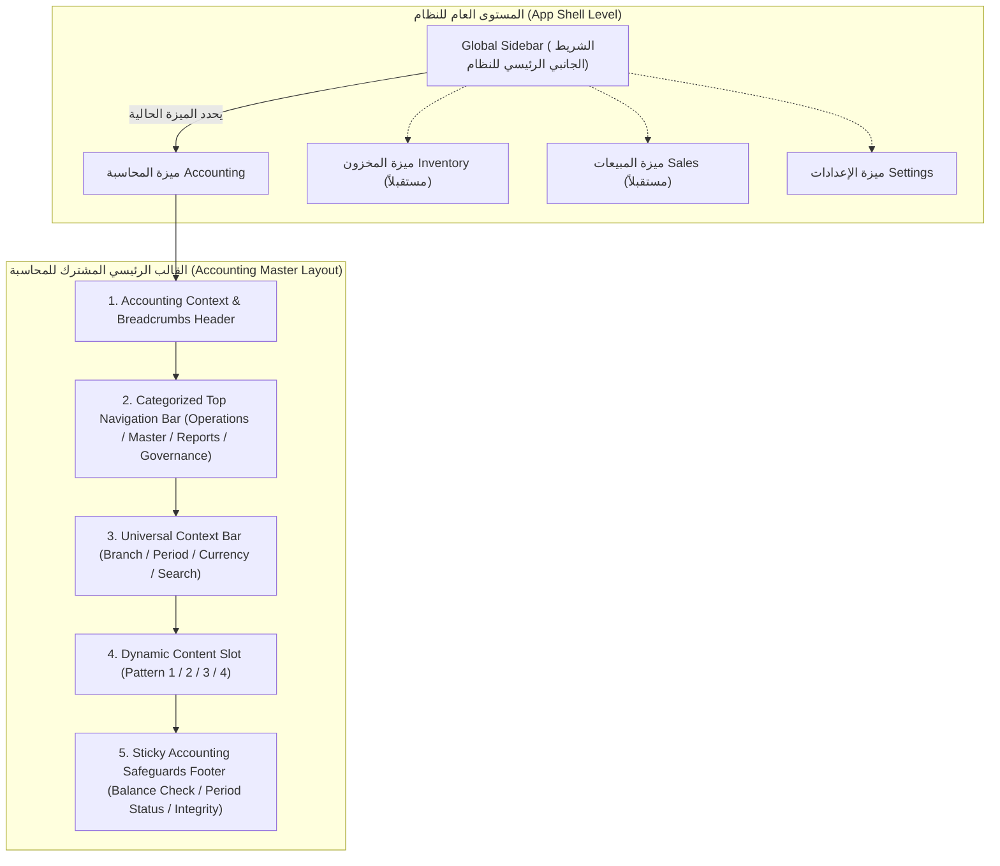
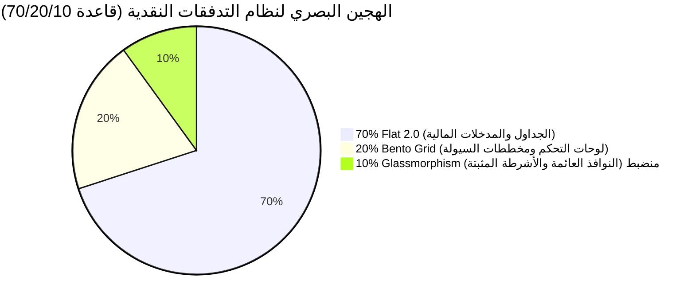
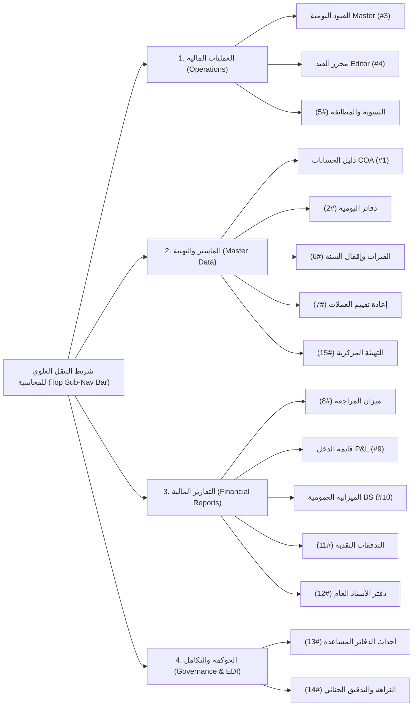
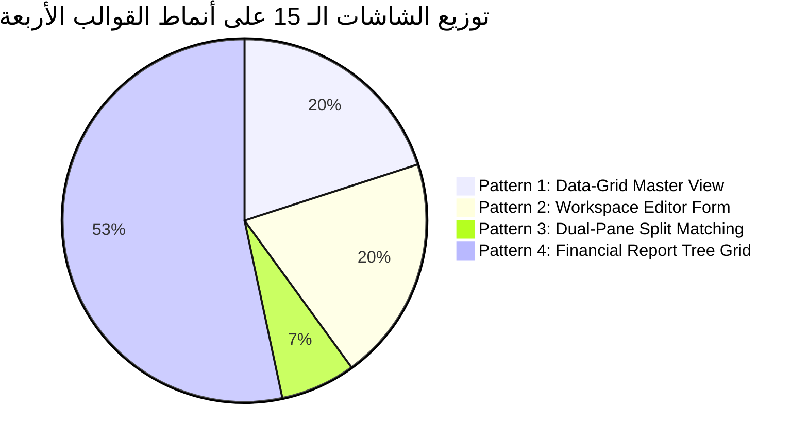
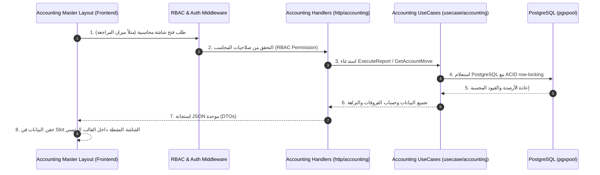

# التحليل المعمق والمهندَس للقالب الرئيسي المشترك لشاشات المحاسبة (Accounting Master Layout Architecture Analysis)

> **المشروع:** Cashflow System (`cashflow_backend`)  
> **الموديل / الميزة:** المحاسبة المالية المجرّدة (`Accounting Feature Module`)  
> **الوثيقة المرجعية للمدخلات:** [`docs/accounting_screens_comprehensive_analysis.md`](file:///home/osm/StudioProjects/cashflow_system/cashflow_backend/docs/accounting_screens_comprehensive_analysis.md)  
> **تاريخ التوثيق:** مارس 2026  
> **هدف الوثيقة:** تقديم تحليل معمق ودقيق لهيكلية وتصميم القالب الرئيسي المشترك (**Master Shell / Shared Layout Framework**) لجميع شاشات المحاسبة الـ 15، دون استخدام شريط جانبي فرعي مخصص للمحاسبة، مع الحفاظ على مرونة النظام للتكامل مع الميزات الكبرى المستقبلية (المخزون، المبيعات، المشتريات، الموارد البشرية، الإعدادات العامة).

---

## فهرس المحتويات

1. [الملخص التنفيذي والرؤية الهندسية للقالب الرئيسي](#1-الملخص-التنفيذي-والرؤية-الهندسية-للقالب-الرئيسي)
2. [فلسفة التصميم والهجين البصري المعتمد](#2-فلسفة-التصميم-والهجين-البصري-المعتمد)
   - [2.1. المبررات المعمارية لتجنب الشريط الجانبي الفرعي](#21-المبررات-المعمارية-لتجنب-الشريط-الجانبي-الفرعي-داخل-المحاسبة)
   - [2.2. الهجين البصري الموصى به لنظام التدفقات النقدية (قاعدة 70/20/10)](#22-الهجين-البصري-الموصى-به-لنظام-التدفقات-النقدية-قاعدة-702010)
3. [التشريح الهيكلي للقالب الرئيسي المشترك (Master Layout Anatomy)](#3-التشريح-الهيكلي-لقالب-المحاسبة-المشترك)
4. [مكونات وشرايين القالب الرئيسي الستة (The 6 Structural Layout Zones)](#4-مكونات-وشرايين-القالب-الرئيسي-الستة)
   - [4.1. شريط التطبيق والتنقل بين الميزات الرئيسية (Global App Bar & Feature Switcher)](#41-شريط-التطبيق-والتنقل-بين-الميزات-الرئيسية)
   - [4.2. ترويسة السياق والمسارات التفاعلية (Accounting Context & Breadcrumbs Header)](#42-ترويسة-السياق-والمسارات-التفاعلية)
   - [4.3. شريط التنقل العلوي المبوب والمصنف (Categorized Top Navigation Bar)](#43-شريط-التنقل-العلوي-المبوب-والمصنف)
   - [4.4. شريط الفلترة والسياق المالي الموحد (Universal Accounting Context & Filter Bar)](#44-شريط-الفلترة-والسياق-المالي-الموحد)
   - [4.5. منطقة المحتوى الديناميكي وأنماط القوالب الأربعة (Dynamic Screen Slot & 4 Layout Patterns)](#45-منطقة-المحتوى-الديناميكي-وأنماط-القوالب-الأربعة)
   - [4.6. شريط الضوابط والنزاهة المحاسبية السفلي الثابت (Sticky Safeguards & Status Bar)](#46-شريط-الضوابط-والنزاهة-المحاسبية-السفلي-الثابت)
5. [تصنيف شاشات المحاسبة الـ 15 ضمن أنماط القوالب الأربعة (Screen-to-Pattern Mapping Matrix)](#5-تصنيف-شاشات-المحاسبة-الـ-15-ضمن-أنماط-القوالب-الأربعة)
6. [نظام التفاعل والدعم بلوحة الأوامر المباشرة (`Command Palette` - `Ctrl+K`)](#6-نظام-التفاعل-والدعم-بلوحة-الأوامر-المباشرة)
7. [التصميم الاستجابي والتكيف مع أبعاد الشاشات (Responsive Adaptability)](#7-التصميم-الاستجابي-والتكيف-مع-أبعاد-الشاشات)
8. [مكتبة المكونات البصرية القابلة لإعادة الاستخدام (Reusable Accounting UI Component Palette)](#8-مكتبة-المكونات-البصرية-القابلة-لإعادة-الاستخدام)
9. [مخطط التكامل الفني مع النظام الخلفي (Backend REST API Wiring)](#9-مخطط-التكامل-الفني-مع-النظام-الخلفي)
10. [الخلاصة والتوصيات التنفيذية (Conclusion & Implementation Checklist)](#10-الخلاصة-والتوصيات-التنفيذية)

---

## 1. الملخص التنفيذي والرؤية الهندسية للقالب الرئيسي

تتطلب الأنظمة المالية والمحاسبية للمؤسسات (**Enterprise ERP Accounting Systems**) مساحة عرض أفقية ورأسية شاسعة لاحتواء الجداول المالية المعقدة (مثل دفتر الأستاذ العام بمقاييس 12+ عموداً، أو شجرة دليل الحسابات، أو جدول القيود اليومية المزدوج).

إن الهدف الأساسي من هذه الوثيقة هو **تصميم الهندسة المعمارية للقالب الرئيسي المشترك (Master Shell Layout)** الذي يُحضر ويستضيف كافة شاشات المحاسبة المحددة في [`docs/accounting_screens_comprehensive_analysis.md`](file:///home/osm/StudioProjects/cashflow_system/cashflow_backend/docs/accounting_screens_comprehensive_analysis.md)، بناءً على شرط جوهري صارم: **عدم إضافة شريط جانبي فرعي (Sub-Sidebar) داخل ميزة المحاسبة**.

### المبادئ الهندسية للقالب الرئيسي

1. **السيادة للشريط الجانبي العام (Global Feature Sidebar):** يتكفل الشريط الجانبي الرئيسي للنظام بالانتقال العالي المستوى بين الميزات الكبرى (المحاسبة، المخزون، المبيعات، المشتريات، الموارد البشرية، الإعدادات).
2. **شريط التنقل العلوي الأفقي المصنف (Categorized Horizontal Navigation):** استبدال الشريط الجانبي الداخلي بشريط تبويبات علوي ذكي ومنظم حسب التصنيفات المحاسبية (العمليات، البيانات الماستر، التقارير، الحوكمة والتكامل).
3. **أقصى كفاءة لاستغلال مساحة الشاشة (Screen Real-Estate Maximization):** توفير 250 إلى 300 بكسل أفقية كانت تُستهلك في الشريط الجانبي الفرعي، واستثمارها بالكامل لعرض البيانات المالية والجداول المزدوجة.
4. **شريط الفلترة والسياق المحاسبي الموحد (Universal Context Bar):** توحيد فلترة الشركة، الفرع، الفترة المالية، والعملة في كافة الشاشات ضمن ترويسة ثابتة وسلسة.
5. **لوحة ضوابط النزاهة والتوازن الثابتة (Sticky Accounting Footer):** شريط سفلي متوفر في جميع الشاشات يُظهر توازن المدين والدائن الحقيقي، حالة إقفال الفترة، والنزاهة التشفيرية.

---

## 2. فلسفة التصميم والهجين البصري المعتمد

### 2.1. المبررات المعمارية لتجنب الشريط الجانبي الفرعي داخل المحاسبة

| البعد الهيكلي | النمط التقليدي (شريط جانبي فرعي للمحاسبة) | النمط المعتمد (القالب الرئيسي العلوي والأفقي) |
| :--- | :--- | :--- |
| **استغلال المساحة (Real Estate)** | يستهلك 240px-300px أفقياً مما يضغط جداول المحاسبة المعقدة ويجبر المحاسب على التمرير الأفقي الشديد. | يمنح الشاشة عرضاً كاملاً (100% Canvas Width)، ممتاز للجداول ذات 10-15 عموداً. |
| **التسلسل الهرمي للميزات (Feature Hierarchy)** | يحدث تضارباً بوجود شريطين جانبيين (شريط للأنظمة وشريط للمحاسبة)، مما يربك المستخدم في التمييز بين التنقل بين الأنظمة والتنقل داخل المحاسبة. | يفصل بوضوح تام: الشريط الجانبي الخارجي = التنقل بين الميزات (المحاسبة/المخزون/المبيعات). القالب الداخلي العلوي = التنقل بين شاشات المحاسبة. |
| **الاستجابة للشاشات (Responsiveness)** | سيئ جداً على الشاشات المتوسطة والمحمولة لازدحام القوائم الجانبية. | يستجيب بسلاسة عبر طي التبويبات العلوية في قائمة منسدلة ذكية دون التأثير على المحتوى المالي. |
| **التنقل المعتمد على الكيبورد (Keyboard Nav)** | صعب الوصول والتركيز. | مدعوم بالكامل عبر التبويبات السريعة واختصارات `Alt+1..9` ولوحة الأوامر `Ctrl+K`. |



---

### 2.2. الهجين البصري الموصى به لنظام التدفقات النقدية (قاعدة 70/20/10)

لتحقيق التوازن الدقيق بين الدقة والصرامة المحاسبية، وسلاسة تجربة الاستخدام، والمظهر المؤسسي الفخم، يعتمد نظام التدفقات النقدية وقالب المحاسبة الموحد **هجيناً بصرياً ثلاثي الركائز (The 70/20/10 Visual Hybrid Model)**:



#### الركائز الثلاث للهجين البصري

1. **70% أساس متين من Flat 2.0:**
   - **الاستخدام المستهدف:** مخصص للجداول المالية ذات الكثافة العالية (مثل دفتر الأستاذ العام، ميزان المراجعة، جدول القيود اليومية)، وحقول الإدخال المحمية، ونماذج التحرير المحاسبية.
   - **الضوابط الصارمة:**
     - نسب تباين عالية تتجاوز **4.5:1** للتوافق الكامل مع معايير الوصولية العالمية (WCAG 2.1 AA/AAA)، وتوفير راحة تامة لعين المحاسب خلال ساعات العمل الطويلة.
     - حدود هندسية واضحة (Crisp Borders 1px) مع استبعاد الظلال الكثيفة (Drop Shadows) والضبابية التي قد تؤدي إلى غموض الفواصل بين الأسطر أو الأرقام.
     - استخدام خطوط أرقام ثابتة العرض (Monospace Tabular Numerals) لمحاذاة الفواصل العشرية عمودياً ومنع أي لبس حسابي.

2. **20% شبكات Bento Grid:**
   - **الاستخدام المستهدف:** لهيكلة لوحة التحكم الرئيسية (Executive Financial Dashboard) والمناطق التلخيصية التحليلية في ترويسات التقارير والقوائم المالية.
   - **الضوابط الصارمة:**
     - عرض الرصيد الإجمالي في بطاقة عريضة بارزة (Wide Hero Card)، بجانب مخطط تدفق السيولة والالتزامات القادمة في خلايا متناسقة وموزعة بنسب ذكية.
     - تجميع البيانات المالية الحيوية (KPIs) في كتل بصرية مستقلة سهلة المسح البصري (Scannable Cards).
     - تقسيم مرن يتكيف تلقائياً مع الشاشات العريضة والمتوسطة مع الحفاظ على تناسق المساحات وتتابع الأولويات المالية.

3. **10% Glassmorphism منضبط:**
   - **الاستخدام المستهدف:** للنوافذ المنبثقة العائمة (Modals)، والقوائم المنسدلة، وشريط التنقل العلوي المثبت (Sticky Top Navigation Bar)، وشريط الضوابط والنزاهة السفلي الثابت (Sticky Safeguards Footer).
   - **الضوابط الصارمة:**
     - تطبيق تأثير زجاجي معتم وخافت (`backdrop-filter: blur(12px)` مع عتامة لونية تتجاوز 85% وحواف دقيقة شبه شفافة `border: 1px solid rgba(..., 0.08)`).
     - توفير شعور عصري بالعمق الطبقي (Layered Depth) دون التضحية بالقراءة السريعة أو وضوح الأرقام خلف الطبقات العائمة.
     - حظر تطبيق التأثير الزجاجي نهائياً على خلايا الجداول المحاسبية أو حقول الإدخال منعاً لتشتيت المستخدم والحفاظ على الأداء الفائق.

---

## 3. التشريح الهيكلي للقالب الرئيسي المشترك (Master Layout Anatomy)

يُبنى القالب الرئيسي للمحاسبة كمكون غلاف عالمي (**Global Accounting Wrapper Component**) يلتف حول أي شاشة من الشاشات الـ 15 المحددة.

### المخطط الهيكلي لقالب المحاسبة الموحد (ASCII Wireframe Layout)

```text
+-------------------------------------------------------------------------------------------------------------------+
|  [Global Sidebar Trigger]  CASHFLOW ERP  /  [المحاسبة المالية]  /  [القيود اليومية]  / [JV-2026-00042]   (User Profile) |  <- Zone A & B
+-------------------------------------------------------------------------------------------------------------------+
|  [العمليات المالية v]     [البيانات الماستر v]     [التقارير المالية v]     [الحوكمة والتكامل v]      [CTRL+K بحث سريع] |  <- Zone C
+-------------------------------------------------------------------------------------------------------------------+
|  الشركة: [شركة الأمل v]  الفرع: [الفرع الرئيسي v]  الفترة: [Q1-2026 v]  العملة: [SAR v]  [تحديث] [فلترة متقدمة v] |  <- Zone D
+-------------------------------------------------------------------------------------------------------------------+
|                                                                                                                   |
|                                                                                                                   |
|                                        DYNAMIC SCREEN CONTENT SLOT (Zone E)                                       |
|                                 (Renders Pattern 1, Pattern 2, Pattern 3, or Pattern 4)                          |
|                                                                                                                   |
|                                                                                                                   |
+-------------------------------------------------------------------------------------------------------------------+
| 🟢 الفترة: مارس 2026 (مفتوحة) | ⚖️ توازن القيد: 15,000.00 SAR (مدين = دائن) | 🔒 النزاهة التشفيرية: مؤمنة | مسودات معلقة: 3 |  <- Zone F
+-------------------------------------------------------------------------------------------------------------------+
```

---

## 4. مكونات وشرايين القالب الرئيسي الستة (The 6 Structural Layout Zones)

---

### 4.1. شريط التطبيق والتنقل بين الميزات الرئيسية (Global App Bar & Feature Switcher)

- **المسؤولية:** ربط وحدة المحاسبة بالهيكل العام لتطبيق المؤسسة.
- **العناصر البصرية:**
  - **زر التحكم بالشريط الجانبي العام (Global Sidebar Collapse/Expand Toggle).**
  - **مؤشر الميزة الحالية (Active Module Indicator):** يعرض شعار المحاسبة المالية بشكل واضح لتمييزها عن المخزون والمبيعات.
  - **بدّال الشركات والفروع السريع (Multi-Tenant / Branch Selector).**
  - **مركز التنبيهات وشغف المستخدم (Notifications & User Profile).**

---

### 4.2. ترويسة السياق والمسارات التفاعلية (Accounting Context & Breadcrumbs Header)

- **المسؤولية:** منع تشتت المحاسب وإظهار موقعه الدقيق في الدورة المحاسبية مع إمكانية التنقل العكسي المباشر.
- **العناصر البصرية:**
  - **مسار التنقل التفاعلي (Interactive Breadcrumb Trail):**  
    مثال: `المحاسبة المالية / العمليات المالية / القيود اليومية / محرر القيد (JV-2026-00102)`.
  - **قائمة منسدلة داخل عقدة المسار (Breadcrumb Node Dropdown):** النقر على `القيود اليومية` يفتح قائمة سريعة لأحدث 5 قيود تمت معاينتها للوصول السريع إليها.
  - **وسام حالة المستند المحاسبي (Document State Badge):** يُظهر حالة العنصر الحالي مباشرة في الترويسة (`مسودة Draft`, `مرحّل Posted`, `معكوس Reversed`, `مقفل Locked`).

---

### 4.3. شريط التنقل العلوي المبوب والمصنف (Categorized Top Navigation Bar)

هذا الشريط هو البديل المباشر والكامل للشريط الجانبي الفرعي. يُقسم شاشات المحاسبة الـ 15 إلى **4 مجموعات وظيفية رئيسية (Categorized Mega-Tabs)** تُعرض بصورة أفقية مرنة:



#### تفاصيل المجموعات الأربع في شريط التبويبات العلوي

1. **مجموعة العمليات المالية (Operations Tab Group):**
   - جدول وقائمة القيود اليومية (`JournalEntriesMasterScreen` - #3).
   - محرر القيد المحاسبي والمسودة (`JournalEntryEditorScreen` - #4).
   - شاشة التسوية والمطابقة وفروق الصرف (`SubledgerReconciliationScreen` - #5).
2. **مجموعة البيانات الماستر والتهيئة (Master Data Tab Group):**
   - دليل الحسابات الشجري والمسطح (`ChartOfAccountsScreen` - #1).
   - إدارة دفاتر اليومية والترقيم (`JournalsManagementScreen` - #2).
   - الفترات والسنوات المالية وإقفال السنة (`FiscalLifecycleCloseScreen` - #6).
   - إعادة تقييم أصول والتزامات العملات الأجنبية (`FXRevaluationScreen` - #7).
   - التهيئة المحاسبية المركزية والإعدادات (`AccountingConfigurationsScreen` - #15).
3. **مجموعة التقارير والقوائم المالية (Financial Reports Tab Group):**
   - ميزان المراجعة التفاعلي (`TrialBalanceWorkspaceScreen` - #8).
   - قائمة الدخل / الأرباح والخسائر (`ProfitAndLossScreen` - #9).
   - الميزانية العمومية والمركز المالي (`BalanceSheetScreen` - #10).
   - قائمة التدفقات النقدية بالطريقة غير المباشرة (`CashFlowStatementScreen` - #11).
   - دفتر الأستاذ العام والتراكمي (`GeneralLedgerScreen` - #12).
4. **مجموعة الحوكمة والتكامل (Governance & Integration Tab Group):**
   - استيعاب ومراقبة أحداث الدفاتر المساعدة (`SubledgerEventIngestionScreen` - #13).
   - سجل التدقيق الجنائي والنزاهة التشفيرية (`AuditTrailIntegrityScreen` - #14).

---

### 4.4. شريط الفلترة والسياق المالي الموحد (Universal Accounting Context & Filter Bar)

يوفر هذا الشريط محددات مالية موحدة تُحقن تلقائياً في الشاشة النشطة داخل منطقة المحتوى:

- **مُحدد الكيان والفرع (Entity / Branch Selector):** تصفية البيانات حسب الفرع المحدد أو جميع الفروع الفعالة.
- **مُحدد الفترة المالية والتاريخ (Fiscal Period & Date Range Controller):**
  - اختيارات سريعة: `اليوم`، `هذا الأسبوع`، `هذا الشهر`، `الربع الحالي`، `السنة المالية الحالية`، أو `نطاق مخصص Custom Date Range`.
- **مُحدد وضع العرض والعملة (Currency Display Mode):**
  - العرض بالعملة المحلية (SAR).
  - العرض بحدث العملة الأصلية للمعاملة (Transaction Currency).
  - العرض المجمع المعادل بالعملة المرجعية (Reporting Currency).
- **مفتاح إظهار القيود غير المرحلة (Include Unposted Drafts Toggle):** مفتاح آمن يتيح للمحاسب تجربة ميزان المراجعة أو التقارير مع إدراج المسودات أو حصرها على المرحلة فقط (`Posted Only`).

---

### 4.5. منطقة المحتوى الديناميكي وأنماط القوالب الأربعة (Dynamic Screen Slot & 4 Layout Patterns)

تُمثل هذه المنطقة القلب النابض للقالب الرئيسي (`Content Slot`)، حيث يتم تحميل الشاشة المطلوبة بناءً على واحد من **أربعة أنماط هيكلية ديناميكية (4 Layout Patterns)** تم تصميمها لتغطي كل رغبات ومتطلبات الشاشات الـ 15:

```text
                          +-----------------------------------+
                          |  DYNAMIC CONTENT SLOT (ZONE E)    |
                          +-----------------------------------+
                                            |
         +--------------------+-------------+-------------+--------------------+
         |                    |                           |                    |
         v                    v                           v                    v
+------------------+ +------------------+       +------------------+ +------------------+
|    PATTERN 1     | |    PATTERN 2     |       |    PATTERN 3     | |    PATTERN 4     |
| Data-Grid Master | | Workspace Editor |       | Dual-Pane Split  | | Financial Report |
|   Slot Pattern   | |   Slot Pattern   |       | Matching Pattern | |   Tree Pattern   |
+------------------+ +------------------+       +------------------+ +------------------+
```

---

### 4.6. شريط الضوابط والنزاهة المحاسبية السفلي الثابت (Sticky Safeguards & Status Bar)

شريط سفلي ثنائي المقاصد يلتصق بأسفل الشاشة دائماً (Sticky Footer)، يضمن الامتثال المالي والأمني لحظة بلحظة:

1. **مُؤشر حالة الفترة المالية (Fiscal Period Lock Status):**
   - 🟢 `الفترة المالية مفتوحة (مارس 2026)` -> التعديل مسموح.
   - 🔴 `الفترة المالية مغلقة (فبراير 2026)` -> القراءة فقط حظر التعديل.
2. **حاسبة التوازن الحي المزدوج (Live Double-Entry Balance Validator):**
   - يظهر عند فتح أو تحرير قيد محاسبي أو إجراء تسوية:
     $$\text{Total Debit} = 150,000.00 \quad | \quad \text{Total Credit} = 150,000.00 \quad | \quad \Delta = 0.00 \quad \text{(Balanced 🟢)}$$
3. **رمز النزاهة التشفيرية وسلسلة الهەش (Cryptographic Audit Hash Badge):**
   - 🔒 `سلسلة SHA-256 سليمة 100%` -> يطمئن المحاسب أن سجلات التدقيق الجنائي لم تتعرض لأي تلاعب.
4. **عداد المسودات والعمليات المعلقة (Unposted Drafts Alert Counter):**
   - ⚠️ `يوجد 3 قيود مسودة بانتظار الاعتماد` (بالضغط عليها تفتح شاشة القيود مصفاة).

---

## 5. تصنيف شاشات المحاسبة الـ 15 ضمن أنماط القوالب الأربعة

تم ربط شاشات المحاسبة الـ 15 المحددة في المرجع بشكل دقيق مع أنماط القوالب الأربعة المشتقة من القالب الرئيسي:



### جدول التوزيع والتصميم التفصيلي لكل نمط

| رقم الشاشة | اسم الشاشة باللغة العربية | Technical Identifier | نمط الهيكل المعتمد (Layout Pattern) | مكونات المحتوى داخل Slot القالب |
| :---: | :--- | :--- | :--- | :--- |
| **1** | شاشة دليل الحسابات | `ChartOfAccountsScreen` | **Pattern 4:** Report & Tree Grid | عرض شجري/مسطح + Drawer تفاصيل الحساب الجانبي + أزرار التوسع والطي. |
| **2** | شاشة إدارة دفاتر اليومية والترقيم | `JournalsManagementScreen` | **Pattern 2:** Workspace Editor Form | قائمة الدفاتر المفعلة + نموذج إعداد التسلسلات وبنود الحسابات الافتراضية. |
| **3** | شاشة جدول وقائمة القيود | `JournalEntriesMasterScreen` | **Pattern 1:** Data-Grid Master | جدول بيانات شامل لجميع القيود + شريط الفلاتر المتقدمة + إجراءات التجميع والترحيل. |
| **4** | شاشة محرر تفاصيل القيد | `JournalEntryEditorScreen` | **Pattern 2:** Workspace Editor Form | ترويسة القيد + جدول البنود التفاعلي (مدين/دائن/ضرائب) + حاسبة التوازن الحية. |
| **5** | شاشة التسوية والمطابقة المحاسبية | `SubledgerReconciliationScreen` | **Pattern 3:** Dual-Pane Split Matching | لوح أيسر (بنود البنك/المكشوف) + لوح أيمن (بنود الأستاذ) + محرك التطابق التلقائي. |
| **6** | شاشة الفترات وإقفال السنة | `FiscalLifecycleCloseScreen` | **Pattern 4:** Report & Tree Grid | الخط الزمني للفترات + مفاتيح القفل/الفتح + معالج إقفال السنة المالية السلسلي. |
| **7** | شاشة إعادة تقييم العملات | `FXRevaluationScreen` | **Pattern 4:** Report & Tree Grid | نموذج مدخلات سعر الصرف + جدول معاينة فروق التقييم غير المحققة + زر إنشاء قيد FX. |
| **8** | شاشة ميزان المراجعة | `TrialBalanceWorkspaceScreen` | **Pattern 4:** Report & Tree Grid | جدول ميزان المراجعة بمستوياته + أعمود الحركة والأرصدة + الحفر العكسي لدفتر الأستاذ. |
| **9** | شاشة قائمة الدخل | `ProfitAndLossScreen` | **Pattern 4:** Report & Tree Grid | هيكل قائمة الدخل (الإيرادات، التكلفة، المصاريف) + أعمدة المقارنة للفترات + التصدير. |
| **10** | شاشة الميزانية العمومية | `BalanceSheetScreen` | **Pattern 4:** Report & Tree Grid | قائمة المركز المالي (الأصول = الالتزامات + الملكية) + التحقق الآلي من المعادلة. |
| **11** | شاشة التدفقات النقدية | `CashFlowStatementScreen` | **Pattern 4:** Report & Tree Grid | الأنشطة التشغيلية والأستثمارية والتمويلية + تسوية الصافي غير النقدي. |
| **12** | شاشة دفتر الأستاذ العام | `GeneralLedgerScreen` | **Pattern 4:** Report & Tree Grid | جدول الأستاذ حسب الحساب + الرصيد التراكمي المتحرك + فلترة الحسابات المزدوجة. |
| **13** | شاشة استيعاب الأحداث الفرعية | `SubledgerEventIngestionScreen` | **Pattern 1:** Data-Grid Master | جدول أحداث الأنظمة الفرعية (المبيعات/المخزون) + معاين Payload الـ JSON + زر إعادة المحاولة. |
| **14** | شاشة سجل التدقيق والنزاهة | `AuditTrailIntegrityScreen` | **Pattern 1:** Data-Grid Master | خط زمني لأحداث الحوكمة + فاحص التشفير SHA-256 + عارض الفروقات للقيود. |
| **15** | شاشة التهيئة المحاسبية المركزية | `AccountingConfigurationsScreen` | **Pattern 2:** Workspace Editor Form | تبويبات الإعدادات المركزية (القواعد المحاسبية، تواريخ القفل الصارم، تقريب العملات). |

---

## 6. نظام التفاعل والدعم بلوحة الأوامر المباشرة (`Command Palette` - `Ctrl+K`)

لتعويض سرعة الوصول التي كان يوفرها الشريط الجانبي وتفوقاً عليه، يتضمن القالب الرئيسي لوحة أوامر ذكية تعمل بختصار الكيبورد العالمي (`Ctrl+K` أو `⌘K`):

### ميزات لوحة الأوامر المباشرة داخل المحاسبة

1. **القفز السريع بين الشاشات الـ 15 (Instant Screen Navigation):**
   - كتابة "ميزان" -> انتقال مباشر لـ `TrialBalanceWorkspaceScreen`.
   - كتابة "قيد جديد" -> فتح `JournalEntryEditorScreen` بحالة مسودة جديدة.
2. **الاستعلام السريع عن الحسابات (Quick Account Search):**
   - كتابة كود الحساب (مثلاً `101001`) يُظهر رصيد حساب البنك الرئيسي وحركاته الأخيرة مباشرة داخل اللوحة دون مغادرة الشاشة الحالية.
3. **تنفيذ الإجراءات المحاسبية السريعة (Quick Accounting Actions):**
   - `إنشاء قيد عكسي` (Reverse Current Move).
   - `تصدير التقارير إلى Excel/PDF`.
   - `تغيير الفترة المالية الحالية`.

---

## 7. التصميم الاستجابي والتكيف مع أبعاد الشاشات (Responsive Adaptability)

تم تصميم القالب الرئيسي ليتكيف بسلاسة مع مختلف أبعاد الشاشات وأجهزة المحاسبين:

```text
[Ultra-Wide Desktop (2K/4K)] ---> عرض كامل بنسبة 100%، إظهار التبويبات العلوية كاملة والجداول بـ 15 عموداً.
[Standard Laptop (1080p)]   ---> طي التبويبات الثانوية في قائمة "المزيد v"، الجداول بـ 10 أعمدة مع شريط تمرير ناعم.
[Tablet / Mobile View]      ---> تحويل التبويبات العلوية إلى Dropdown Select موحد، فتح المعاينات والـ Drawers بكامل الشاشة (Full-screen Modal).
```

---

## 8. مكتبة المكونات البصرية القابلة لإعادة الاستخدام (Reusable Accounting UI Component Palette)

لتأمين الاتساق الكامل في جميع الشاشات الـ 15 داخل القالب الرئيسي وتجسيد قواعد **الهجين البصري (70/20/10)**، يُلزم القالب استخدام مكتبة المكونات وتنسيقات التصميم الموحدة التالية:

```typescript
// 1. مكون مدخل المبالغ المالية مع تنسيق العملة (Flat 2.0 Component)
<AccountingAmountInput 
  value={amount} 
  currency="SAR" 
  type="debit" // Applies green/blue theme for debit, neutral for credit
  onChange={(val) => handleAmountChange(val)} 
/>

// 2. مكون شارة توازن القيد المحاسبي
<DoubleEntryBalanceBadge 
  totalDebit={15000} 
  totalCredit={15000} 
  allowUnbalanced={false} 
/>

// 3. مكون شجرة دليل الحسابات التفاعلي
<AccountTreeSelect 
  selectedAccountId={accId} 
  filterByTypes={['asset', 'expense']} 
  onSelect={(account) => setAccount(account)} 
/>

// 4. مكون شارة حالة الفترة المالية
<FiscalPeriodStatusBadge 
  periodDate="2026-03" 
  isLocked={false} 
/>
```

### محددات التنسيق البرمجي لقواعد الهجين البصري (Design Tokens & CSS Implementation)

```css
/* 1. Flat 2.0 (70%): الجداول المحاسبية عالية الكثافة والمدخلات المحمية */
.accounting-data-table {
  border-collapse: separate;
  border-spacing: 0;
  border: 1px solid var(--border-neutral, #cbd5e1);
  background-color: var(--bg-surface, #ffffff);
  color: #0f172a; /* نسبة تباين تتجاوز 7:1، أعلى بكثير من الحد الأدنى 4.5:1 */
}
.accounting-input-protected {
  border: 1px solid #94a3b8;
  background-color: #f8fafc;
  font-family: ui-monospace, SFMono-Regular, Menlo, Monaco, Consolas, monospace;
  font-variant-numeric: tabular-nums;
}

/* 2. Bento Grid (20%): لوحة التحكم الرئيسية وهيكلة مؤشرات السيولة */
.bento-dashboard-grid {
  display: grid;
  grid-template-columns: repeat(12, minmax(0, 1fr));
  gap: 1.25rem;
}
.bento-hero-balance-card {
  grid-column: span 8 / span 8; /* بطاقة الرصيد الإجمالي العريضة */
  border-radius: 1rem;
  border: 1px solid #e2e8f0;
  background: linear-gradient(135deg, #ffffff 0%, #f8fafc 100%);
}
.bento-cashflow-trend-card {
  grid-column: span 4 / span 4; /* مخطط تدفق السيولة والالتزامات */
  border-radius: 1rem;
  border: 1px solid #e2e8f0;
}

/* 3. Glassmorphism منضبط (10%): النوافذ العائمة، القوائم وشريط التنقل المثبت */
.glass-sticky-topbar {
  position: sticky;
  top: 0;
  backdrop-filter: blur(12px);
  -webkit-backdrop-filter: blur(12px);
  background-color: rgba(255, 255, 255, 0.88);
  border-bottom: 1px solid rgba(226, 232, 240, 0.7);
  z-index: 50;
}
.glass-floating-modal {
  backdrop-filter: blur(16px);
  -webkit-backdrop-filter: blur(16px);
  background-color: rgba(255, 255, 255, 0.94);
  border: 1px solid rgba(255, 255, 255, 0.3);
  box-shadow: 0 20px 25px -5px rgba(0, 0, 0, 0.1), 0 8px 10px -6px rgba(0, 0, 0, 0.05);
}
```

---

## 9. مخطط التكامل الفني مع النظام الخلفي (Backend REST API Wiring)

يرتبط القالب الرئيسي المشترك بمركز خدمات المحاسبة الخلفية في `cashflow_backend` (`internal/adapters/http/accounting`) للحصول على البيانات اللحظية:



### خريطة النقاط النهائية المرتبطة بالقالب الرئيسي

- **بيانات السياق والترويسة:**  
  `GET /api/v1/accounting/configuration` -> جلب تواريخ الإقفال، العملة الرئيسية، وتفضيلات المحاسبة.
- **عداد المسودات والتحقق:**  
  `GET /api/v1/accounting/moves?state=draft&count_only=true` -> لتحديث شريط الضوابط السفلي.
- **فحص النزاهة والتجميع:**  
  `GET /api/v1/accounting/integrity/verify` -> لتحديث وسام النزاهة التشفيرية في الشريط السفلي.

---

## 10. الخلاصة والتوصيات التنفيذية (Conclusion & Implementation Checklist)

يقدم هذا التحليل المعمق حلاً معمارياً متكاملاً وفخماً لبناء **واجهة المستخدم الخاصة بميزة المحاسبة المالية** في نظام `Cashflow`؛ حيث يحل معضلة استبعاد الشريط الجانبي الفرعي عن طريق اعتماد **القالب الرئيسي المشترك العلوي (Top-Nav Master Layout)** الذي يوفر:

1. **أقصى كفاءة أفقية** لعرض الجداول المحاسبية المعقدة.
2. **فصلاً معمارياً ناصعاً** بين الشريط الجانبي العام للتطبيق (المخصص للانتقال بين الميزات الكبرى مثل المحاسبة والمخزون والمبيعات) وبين التنقل الداخلي بين شاشات المحاسبة الـ 15.
3. **تجربة مستخدم سريعة وموجهة للمحاسبين** تعتمد على الكيبورد ولوحة الأوامر (`Ctrl+K`).
4. **حماية وأماناً محاسبياً متوافقاً مع المعايير الدولية (IFRS / ZATCA)** عبر شريط الضوابط السفلي الثابت.

---

### قائمة التحقق الذهبية لبناء القالب المشترك (Pre-Flight Layout Checklist)

- [x] عدم إنشاء أي شريط جانبي فرعي داخل ميزة المحاسبة.
- [x] دعم التبويبات العلوية المصنفة الأربعة (العمليات، الماستر، التقارير، الحوكمة).
- [x] ربط كافة الشاشات الـ 15 بأنماط القوالب الأربعة (Pattern 1 to Pattern 4).
- [x] تزويد القالب بشريط سياق موحد (الشركة، الفرع، الفترة المالية، العملة).
- [x] توفير شريط النزاهة والضوابط المحاسبية الثابت بأسفل الشاشة (Sticky Safeguards Footer).
- [x] تفعيل لوحة الأوامر المباشرة (`Ctrl+K`) للتنقل السريع بدون ماوس.
- [x] تطبيق قواعد الهجين البصري الموصى به (70% Flat 2.0 للجداول والمدخلات، 20% Bento Grid للوحات التحكم، 10% Glassmorphism للنوافذ العائمة والأشرطة المثبتة).
- [x] ضمان جاهزية القالب للتوسع والتكامل المستقبلي مع ميزات المخزون والمبيعات.
