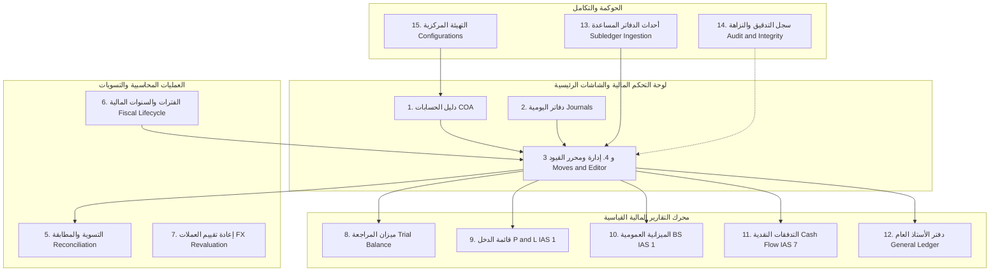
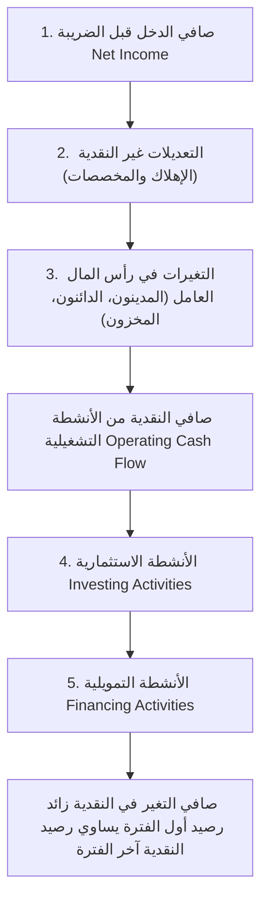

# التحليل الشامل والمعمق والدقيق لشاشات ومكونات ميزة المحاسبة المالية (Financial Accounting Screens & UI/UX Architecture Analysis)

> **المشروع:** Cashflow System (`cashflow_backend`)  
> **الوحدة:** ميزة المحاسبة المالية المجرّدة (`internal/features/accounting`)  
> **تاريخ التوثيق:** مارس 2026  
> **هدف الوثيقة:** تقديم تحليل تفصيلي وهيكلي شامل لكافة الشاشات، الأدوات، العناصر البصرية، والعمليات التشغيلية المطلوبة لبناء واجهة المستخدم (Frontend User Interface) لميزة المحاسبة المالية، مع ربط كل شاشة بدقة مع خدمات وواجهات المحرك المحاسبي الخلفي (`Pure Accounting Engine`) والمواصفات المعيارية الدولية (**IFRS / IAS / ZATCA / OECD SAF-T / SOC 1 & 2**).

---

## فهرس المحتويات

1. [الملخص التنفيذي والرؤية الهندسية لشاشات المحاسبة](#1-الملخص-التنفيذي-والرؤية-الهندسية-لشاشات-المحاسبة)
2. [الهيكلية الموحدة وشجرة شاشات النظام المحاسبي (Screen Taxonomy & Hierarchy)](#2-الهيكلية-الموحدة-وشجرة-شاشات-النظام-المحاسبي)
3. [التحليل التفصيلي الشامل للشاشات والعمليات والأدوات](#3-التحليل-التفصيلي-الشامل-للشاشات-والعمليات-والأدوات)
   - [3.1. شاشة دليل الحسابات (Chart of Accounts - COA Screen)](#31-شاشة-دليل-الحسابات-chart-of-accounts---coa-screen)
   - [3.2. شاشة إدارة دفاتر اليومية والترقيم التسلسلي (Journals & Sequences Screen)](#32-شاشة-إدارة-دفاتر-اليومية-والترقيم-التسلسلي-journals--sequences-screen)
   - [3.3. شاشة إدارة القيود اليومية (Journal Entries / Account Moves Master View)](#33-شاشة-إدارة-القيود-اليومية-journal-entries--account-moves-master-view)
   - [3.4. شاشة محرر القيد المحاسبي والمسودة (Journal Entry Editor & Workspace Screen)](#34-شاشة-محرر-القيد-المحاسبي-والمسودة-journal-entry-editor--workspace-screen)
   - [3.5. شاشة التسوية والمطابقة المحاسبية وفروق الصرف المحققة (Subledger Reconciliation & Matching Screen)](#35-شاشة-التسوية-والمطابقة-المحاسبية-وفروق-الصرف-المحققة-subledger-reconciliation--matching-screen)
   - [3.6. شاشة إدارة الفترات والسنوات المالية وإقفال السنة (Fiscal Lifecycle & Year-End Close Screen)](#36-شاشة-إدارة-الفترات-والسنوات-المالية-وإقفال-السنة-fiscal-lifecycle--year-end-close-screen)
   - [3.7. شاشة إعادة تقييم أصول والتزامات العملات الأجنبية (FX Unrealized Revaluation Screen)](#37-شاشة-إعادة-تقييم-أصول-والتزامات-العملات-الأجنبية-fx-unrealized-revaluation-screen)
   - [3.8. شاشة ميزان المراجعة (Trial Balance Workspace Screen)](#38-شاشة-ميزان-المراجعة-trial-balance-workspace-screen)
   - [3.9. شاشة قائمة الدخل / الأرباح والخسائر (Profit & Loss / Income Statement Screen - IAS 1)](#39-شاشة-قائمة-الدخل--الأرباح-والخسائر-profit--loss--income-statement-screen---ias-1)
   - [3.10. شاشة الميزانية العمومية والوضع المالي (Balance Sheet / Financial Position Screen - IAS 1)](#310-شاشة-الميزانية-العمومية-والوضع-المالي-balance-sheet--financial-position-screen---ias-1)
   - [3.11. شاشة قائمة التدفقات النقدية بالطريقة غير المباشرة (IAS 7 Cash Flow Statement Screen)](#311-شاشة-قائمة-التدفقات-النقدية-بالطريقة-غير-المباشرة-ias-7-cash-flow-statement-screen)
   - [3.12. شاشة دفتر الأستاذ العام والتراكمي (General Ledger Workspace Screen)](#312-شاشة-دفتر-الأستاذ-العام-والتراكمي-general-ledger-workspace-screen)
   - [3.13. شاشة مراقبة أحداث الدفاتر المساعدة ومصفوفة التعيين (Subledger Ingestion & Event Mapping Screen)](#313-شاشة-مراقبة-أحداث-الدفاتر-المساعدة-ومصفوفة-التعيين-subledger-ingestion--event-mapping-screen)
   - [3.14. شاشة النزاهة التشفيرية وسجل التدقيق الجنائي (Forensic Audit Trail & Integrity Screen)](#314-شاشة-النزاهة-التشفيرية-وسجل-التدقيق-الجنائي-forensic-audit-trail--integrity-screen)
   - [3.15. شاشة التهيئة المحاسبية المركزية والإعدادات (Central Accounting Configuration Screen)](#315-شاشة-التهيئة-المحاسبية-المركزية-والإعدادات-central-accounting-configuration-screen)
4. [مصفوفة الربط بين الشاشات وخدمات النظام الخلفي (Backend Endpoints Mapping)](#4-مصفوفة-الربط-بين-الشاشات-وخدمات-النظام-الخلفي)
5. [ضوابط تجربة المستخدم وتصاميم الأمان المحاسبي (UX Accounting Safeguards & Controls)](#5-ضوابط-تجربة-المستخدم-وتصاميم-الأمان-المحاسبي)
6. [الخاتمة والتوصيات البرمجية لبناء الواجهات](#6-الخاتمة-والتوصيات-البرمجية-لبناء-الواجهات)

---

## 1. الملخص التنفيذي والرؤية الهندسية لشاشات المحاسبة

تتطلب ميزة المحاسبة المالية في تطبيق المؤسسات (**Enterprise Financial Accounting System**) واجهات مستخدم متخصصة بدقة فائقة، توازن بين **سهولة الاستخدام السرعة التشغيلية** من جهة، وبين **الامتثال الصارم للضوابط المحاسبية والنزاهة الرقمية** من جهة أخرى.

تستند كافة الشاشات الموضحة في هذا التحليل إلى مبدأ **التجريد المحاسبي الخالص (Pure Ledger Abstraction)** الموجود في كود النظام الخلفي (`internal/features/accounting`)؛ حيث تتعامل الواجهات مع **مفاهيم قيود، حسابات، دفاتر يومية، فترات، وتسويات مالية** دون الانخراط في المعاملات التجارية المباشرة (التي تُحقن عبر أحداث الدفاتر المساعدة `Subledger Events`).



---

## 2. الهيكلية الموحدة وشجرة شاشات النظام المحاسبي

تم تقسيم الواجهات المالية المطلوبة لبنائها إلى **15 شاشة مركزية ومستقلة** تغطي كافة مجالات الدورة المحاسبية (Accounting Cycle):

| رقم الشاشة | اسم الشاشة باللغة العربية | Screen Technical Identifier | التصنيف المحاسبي | الواجهة الخلفية المرتبطة (Backend Handler) |
| :---: | :--- | :--- | :--- | :--- |
| **1** | شاشة دليل الحسابات | `ChartOfAccountsScreen` | الماستر / البيانات التأسيسية | `handler_account.go` |
| **2** | شاشة دفاتر اليومية والترقيم | `JournalsManagementScreen` | الماستر / التهيئة | `handler_account.go` |
| **3** | شاشة جدول وقائمة القيود | `JournalEntriesMasterScreen` | العمليات المالية | `handler_move.go` |
| **4** | شاشة محرر تفاصيل القيد | `JournalEntryEditorScreen` | العمليات المالية | `handler_move.go` |
| **5** | شاشة التسوية والمطابقة | `SubledgerReconciliationScreen` | التسويات والفروق | `handler_reconciliation.go` |
| **6** | شاشة الفترات وإقفال السنة | `FiscalLifecycleCloseScreen` | الإقفال والدورة المالية | `handler_period.go` |
| **7** | شاشة إعادة تقييم الصرف | `FXRevaluationScreen` | التسويات الدورية | `usecase_revalue_fx.go` |
| **8** | شاشة ميزان المراجعة | `TrialBalanceWorkspaceScreen` | التقارير المالية | `handler_report.go` |
| **9** | شاشة قائمة الدخل | `ProfitAndLossScreen` | التقارير المالية (IAS 1) | `handler_report.go` |
| **10** | شاشة الميزانية العمومية | `BalanceSheetScreen` | التقارير المالية (IAS 1) | `handler_report.go` |
| **11** | شاشة التدفقات النقدية | `CashFlowStatementScreen` | التقارير المالية (IAS 7) | `handler_report.go` |
| **12** | شاشة دفتر الأستاذ العام | `GeneralLedgerScreen` | التقارير والتدقيق | `handler_report.go` |
| **13** | شاشة استيعاب الأحداث الفرعية | `SubledgerEventIngestionScreen` | التكامل والمراقبة | `handler_subledger.go` |
| **14** | شاشة التدقيق والنزاهة الرقمية | `AuditTrailIntegrityScreen` | الحوكمة والأمان | `governance.go` |
| **15** | شاشة التهيئة الإدارية المركزية | `AccountingConfigurationsScreen` | إعدادات النظام | `GetAccountingConfiguration` |

---

## 3. التحليل التفصيلي الشامل للشاشات والعمليات والأدوات

---

### 3.1. شاشة دليل الحسابات (Chart of Accounts - COA Screen)

#### أ. الهدف والوظيفة الأساسية

تُعتبر هذه الشاشة المركز الرئيسي لتصميم، عرض، وتعديل هيكل دليل الحسابات (Chart of Accounts Tree). تتيح للمحاسبين والمدراء الماليين إدارة الحسابات المالية وفق التصنيف الدولي الخماسي (Asset, Liability, Equity, Income, Expense).

#### ب. مكونات الواجهة والعناصر البصرية (UI Components)

1. **لوحة العرض الثنائية (Dual View Mode):**
   - **الواجهة الهرمية (Tree View):** عرض تفاعلي شجري يُظهر العلاقات بين الحسابات الرئيسية والحسابات الفرعية مع إمكانية التوسيع والطي (Expand/Collapse All).
   - **الواجهة المسطحة (Flat Grid View):** جدول بيانات قابل للفرز والفلترة حسب أي عمود.
2. **شريط الفلاتر والبحث المتقدم (Filter Bar):**
   - حقل بحث سريع بالكود الصريح أو اسم الحساب (`Code` / `Name`).
   - قائمة منسدلة لتصفية نوع الحساب (`Asset`, `Liability`, `Equity`, `Income`, `Expense`).
   - مفاتيح تصفية الشارات الإلزامية:
     - حسابات قابلة للتسوية (`IsReconcilable`).
     - حسابات النقدية وما في حكمها (`IsCashEquivalent`).
     - حسابات التسويات غير النقدية (`IsNonCashAdjustment`).
     - تصنيف نشاط التدفق النقدي (`CashFlowActivity`: Operating, Investing, Financing, None).
3. **بطاقة تفاصيل الحساب المباشرة (Account Detail Drawer / Modal):**
   - جانب تفاعلي يظهر عند النقر على أي حساب لبحث حركاته الأخيرة، رصيده الحالي، وبياناته التأسيسية.

#### ج. العمليات المحاسبية المتاحة (Operations)

- **إنشاء حساب جديد (`CreateAccount`):** إدخال الكود، الاسم، النوع، الرصيد الطبيعي (`Debit`/`Credit`)، العملة (`ISO 4217`)، الحساب الأب (`ParentID`).

- **تعديل بيانات الحساب (`UpdateAccount`):** تعديل المسميات والعلامات النقدية أو التجميد.
- **تجميد / تنشيط الحساب (`Toggle Active State`):** منع استخدام الحساب في القيود الجديدة مع الحفاظ على حركاته التاريخية.
- **استيراد وتصدير الدليل (Import/Export):** تصدير الدليل بصيغ **Excel, PDF, JSON, OECD SAF-T**.

#### د. الأدوات والضوابط المحاسبية (Tools & Controls)

- **أداة حظر تعديل الحسابات المستعملة (Immutable Code & Type Safeguard):** فحص النظام الخلفي (`ErrAccountHasPostedMoves`)؛ يمنع تعديل كود الحساب أو نوعه نهائياً في حال وجود قيود مرحلة مرتبطة به.

- **أداة الفحص التلقائي للرصيد الطبيعي (Normal Balance Auto-Suggester):** تعيين الرصيد مدين تائباً للأصول والمصروفات، ودائن للالتزامات وحقوق الملكية والإيرادات بشكل آلي مع إمكانية التجاوز اليدوي عند الحاجة.
- **مؤشر التوزان التجميعي الهرمي (Hierarchical Roll-up Balance Calculator):** حساب إجمالي رصيد الحساب الأب تلقائياً من مجموع أرصدة أبنائه المباشرين غير المجمّدين.

---

### 3.2. شاشة إدارة دفاتر اليومية والترقيم التسلسلي (Journals & Sequences Screen)

#### أ. الهدف والوظيفة الأساسية

إدارة وتخصيص دفاتر اليومية المالية (Journals) التي تُقسّم الحركات المحاسبية إلى قطاعات تنظيمية (مثل: يومية المبيعات، المشتريات، المقبوضات النقدية، التسويات المصرفية، اليومية العامة)، مع ضبط الترقيم التسلسلي القانوني غير المنقطع لكل دفتر.

#### ب. مكونات الواجهة والعناصر البصرية (UI Components)

1. **جدول دفاتر اليومية (Journals Master Grid):**
   - كود اليومية (`Code` - مثال: `INV1`, `BILL`, `BNK1`, `MISC`).
   - اسم اليومية (`Name`).
   - نوع اليومية (`Type`: `sales`, `purchase`, `cash`, `bank`, `general`).
   - بادئة الترقيم التسلسلي (`SequencePrefix` - مثال: `INV/2026/`).
   - رقم القيد القادم (`NextNumber` - مثال: `000042`).
   - شارة الحالة (`Active` / `Inactive`).
2. **نافذة إعدادات الترقيم والبادئة (Sequence Configuration Dialog):**
   - أداة لتعديل البادئة وصيغة الترقيم التسلسلي ورقم البداية.

#### ج. العمليات المحاسبية المتاحة (Operations)

- **إنشاء دفتر يومية جديد (`Create Journal`):** تعريف كود وبادئة يومية مخصصة.

- **تعديل بادئة الترقيم والاسم:** تحديث الصيغة للسنوات المالية الجديدة.
- **تعطيل دفتر اليومية:** منع ترحيل قيود جديدة في هذا الدفتر.

#### د. الأدوات والضوابط المحاسبية (Tools & Controls)

- **أداة قفل الترقيم التزامني (Atomic Lock Indicator):** يعرض للمستخدم ترحيل الأرقام بأمان كامل عبر قفل Postgres Advisory Lock المطبق خلفياً (`GetNextSequenceWithLock`) لمنع تكرار الثغرات التسلسلية أثناء الضغط المتزامن.

- **مانع التكرار الصارم (Unique Prefix Safeguard):** منع إنشاء بادئتين متطابقتين في نفس السنة المالية لتجنب انكسار التسلسل القانوني للقيود.

---

### 3.3. شاشة إدارة القيود اليومية (Journal Entries / Account Moves Master View)

#### أ. الهدف والوظيفة الأساسية

الشاشة الرئيسية لاستعراض، تصفية، تتبع، وإدارة جميع القيود اليومية في النظام (المسودات، القيود المرحلة، والقيود المعكوسة).

#### ب. مكونات الواجهة والعناصر البصرية (UI Components)

1. **شريط البطاقات التجميعية (KPIS Summary Cards Bar):**
   - إجمالي القيود المسودة (`Draft Count`).
   - إجمالي القيود المرحلة (`Posted Count`).
   - إجمالي حركات المدين والدائن للشهر الحالي.
2. **جدول القيود المركزية (Account Moves Master Table):**
   - رقم القيد التسلسلي النهائي (`Move Name / Number`).
   - المرجع التشغيلي (`Ref`).
   - تاريخ القيد (`Date`).
   - دفتر اليومية (`Journal`).
   - حالة القيد (`Draft`, `Posted`, `Reversed`) بألوان مميزة.
   - إجمالي المبلغ بالعملة الوطنية.
   - الفاعل/المستخدم المحرر (`Created By` / `Posted By`).
3. **أدوات التصفية والبحث (Advanced Query Builder):**
   - فلترة حسب نطاق التاريخ (من - إلى).
   - فلترة حسب دفتر اليومية وحالة القيد.
   - البحث بالرقم التسلسلي أو البيان أو الشريك.

#### ج. العمليات المحاسبية المتاحة (Operations)

- **إنشاء قيد جديد:** الانتقال لمحرر القيود (`JournalEntryEditorScreen`).

- **ترحيل القيد الذري الجماعي أو الفردي (`PostMoveAtomic`):** اعتماد مسودة قيد تحولها إلى قيد دائم ومرحل.
- **إنشاء قيد عكسي قانوني (`ReverseMoveAtomic` / Storno):** إبطال أثر قيد مرحل مسبقاً وإنشاء قيد عكسي آلياً.
- **حذف مسودة قيد (`DeleteDraftMove`):** حذف المسودة قبل ترحيلها حصراً.
- **طباعة سند القيد وتصدير ملف التتبع.**

#### د. الأدوات والضوابط المحاسبية (Tools & Controls)

- **حذر الحذف والعدل للقيود المرحلة (Posted Move Protection):** إخفاء وزر الحذف والعدل تماماً بمجرد اكتساب القيد حالة `Posted` وإتاحة زر "عكس القيد" فقط وفق المعايير الدولية (**IAS 8 / ASC 250**).

- **مؤشر اعتماد صانع القرار (Maker-Checker Approval Badge):** إظهار شارة تنبيه إذا كان القيد يتجاوز الحد المالي المشترط لاعتماد مستخدم آخر (`ErrMakerCheckerViolation`).

---

### 3.4. شاشة محرر القيد المحاسبي والمسودة (Journal Entry Editor & Workspace Screen)

#### أ. الهدف والوظيفة الأساسية

واجهة العمل اليومية لمدخلي البيانات والمحاسبين لإنشاء وتعديل سطور القيود اليومية المركبة بدقة ودون أخطاء توازن.

#### ب. مكونات الواجهة والعناصر البصرية (UI Components)


1. **قسم رأس القيد (Header Panel):**
   - اختيار دفتر اليومية (`JournalID`).
   - تاريخ المحاسبة (`Accounting Date`).
   - البيان العام / المرجع (`Reference / Description`).
   - العملة الأصلية للقيد وسعر الصرف المعتمد.
2. **شبكة السطور المالية التفاعلية (Dynamic Move Lines Grid):**
   - العمود 1: اختيار كود/اسم الحساب (`AccountID` مع بحث فوري).
   - العمود 2: البيان الفرعي للسطر (`Label`).
   - العمود 3: الشريك / العميل / المورد (`Partner`).
   - العمود 4: العملة الأصلية والمبلغ بالعملة الأجنبية (`Amount Currency` / `Currency ID`).
   - العمود 5: سطر مدين بالعملة الوظيفية (`Debit`).
   - العمود 6: سطر دائن بالعملة الوظيفية (`Credit`).
3. **شريط توازن القيد الحي (Live Imbalance Meter Footer):**
   - إجمالي المدين ($\sum \text{Debit}$).
   - إجمالي الدائن ($\sum \text{Credit}$).
   - قيمة فارق التوازن ($\Delta = |\sum \text{Debit} - \sum \text{Credit}|$) يظهر باللون الأخضر عند التوازن الصحيح ($0.00$) وباللون الأحمر التنبيهي عند الاختلال.

#### ج. العمليات المحاسبية المتاحة (Operations)

- **إضافة / حذف سطر قيد جديد.**

- **استيراد سطور من ملف Excel/CSV.**
- **حفظ كمسودة (`SaveDraftMove`):** حفظ العمل الجاري مع السماح بالاختلال المؤقت أثناء الإعداد.
- **تحديث مسودة قائمة (`UpdateDraftMove`).**
- **الترحيل المباشر (`PostMoveAtomic`):** تحويل المسودة لقيد مرحل نهائي.

#### د. الأدوات والضوابط المحاسبية (Tools & Controls)

- **مانع الترحيل الاختلالي الصارم (Strict Balance Validator):** تعطيل زر الترحيل برمجياً ومنع إرسال الطلب للنظام الخلفي إذا كان القيد غير متوازن ($\Delta \neq 0.00$) استناداً للقاعدة الرياضياتية الصارمة (`ErrUnbalancedMove`).

- **أداة الموازنة التلقائية لآخر سطر (Auto-Balance Keyboard Shortcut):** أداة تضغط بزي زر اختصار لملء قيمة السطر الأخير تلقائياً بالفارق المتبقي لتصفير الاختلال.
- **حظر الأرقام السلبية (Prohibition of Negative Amounts):** رفض إدخال قيم سلبية في خانتي المدين أو الدائن فرضاً لمعايير النطاق (`ErrNegativeAmountsNotAllowed`).

---

### 3.5. شاشة التسوية والمطابقة المحاسبية وفروق الصرف المحققة (Subledger Reconciliation & Matching Screen)

#### أ. Objetivo والوظيفة الأساسية

مطابقة السطور المدينة مع السطور الدائنة للحسابات القابلة للتسوية (`IsReconcilable` مثل حسابات العملاء، الموردين، والحسابات الوسيطة)، مع التوليد الآلي لقيود أرباح أو خسائر فروق الصرف المحققة (**Realized FX Gains/Losses**).

#### ب. مكونات الواجهة والعناصر البصرية (UI Components)

1. **لوحة اختيار الحساب والشريك (Account & Partner Selector):**
   - اختيار الحساب المراد تسويته (مثل: `120000 - AR Trade Debtors`).
   - تصفية حسب الشريك (العميل أو المورد).
2. **العرض المزدوج المتقابل (Side-by-Side Split Reconciliation View):**
   - **الجانب الأيمن:** جدول السطور المدينة غير المطابقة (`Unreconciled Debits`).
   - **الجانب الأيسر:** جدول السطور الدائنة غير المطابقة (`Unreconciled Credits`).
3. **لوحة توزيع التسوية والفروق (Allocation & Difference Widget):**
   - إجمالي المدين المختار.
   - إجمالي الدائن المختار.
   - قيمة فارق الصرف المحقق الناتجة عن تغير سعر العملة بين تاريخ الفاتورة وتاريخ السداد.

#### ج. العمليات المحاسبية المتاحة (Operations)

- **عرض السطور غير المطابقة (`ListUnreconciledLines`).**

- **تنفيذ المطابقة والتسوية (`ReconcileMoveLines`):** مطابقة السطور الفردية أو المتعددة وإصدار رقم مطابقة فريد (`Reconciliation ID`).
- **إلغاء مطابقة سابقة (`UnreconcileMoveLines`):** التراجع عن تسوية سابقة وإعادة فتح السطور.

#### د. الأدوات والضوابط المحاسبية (Tools & Controls)

- **محرك المطابقة التلقائي الذكي (Smart Auto-Match Engine):** أداة تقترح مطابقة السطور ذات المراجع أو المبالغ المتطابقة بضغطة زر واحدة.

- **مولد قيود فروق الصرف المحققة الآلي (Realized FX Entry Generator):** عند قيام المستخدم بمطابقة فاتورة بسعر صرف قديم مع دفعة بسعر صرف جديد، يقوم النظام تلقائياً بإنشاء قيد تسوية خلفي لحساب أرباح/خسائر فروق العملات المحققة دون تدخل يدوي من المحاسب.

---

### 3.6. شاشة إدارة الفترات والسنوات المالية وإقفال السنة (Fiscal Lifecycle & Year-End Close Screen)

#### أ. الهدف والوظيفة الأساسية

التحكم الكامل في دورة حياة السنوات المالية والإغلاق الدوري المحاسبي (الشرياني/الشهري/السنوي)، وإدارة معالج الإقفال السنوي القياسي لحسابات الإيرادات والمصروفات.

#### ب. مكونات الواجهة والعناصر البصرية (UI Components)

1. **جدول السنوات المالية (Fiscal Years Grid):**
   - السنة المالية (مثال: `2026`).
   - تاريخ البداية والنهاية (`StartDate` - `EndDate`).
   - حالة السنة (`Open` / `Closed`).
2. **جدول الفترات المحاسبية الفرعية (Fiscal Periods Timeline):**
   - رقم الفترة واسمها (مثال: `P01 - Jan 2026`).
   - حالة الفترة بالشارات الملونة:
     - **مفتوحة (`Open`):** مسموح بالترحيل.
     - **إغلاق مؤقت (`Soft Closed`):** تمنع مدخلي البيانات وتسمح للمدراء الماليين فقط.
     - **إغلاق نهائي (`Hard Closed`):** تمنع أي تريحيل تماماً وبشكل دائم.
3. **معالج الإقفال السنوي (Year-End Closing Wizard Modal):**
   - خطوات متسلسلة تعين دفتر يومية الإغلاق، وحساب الأرباح المحتجزة المستهدف (`Retained Earnings Account`).

#### ج. العمليات المحاسبية المتاحة (Operations)

- **إنشاء سنة مالية جديدة وتوليد الفترات تلقائياً (`CreateFiscalYear`).**

- **تغيير حالة الفترة المحاسبية (`ChangePeriodState`).**
- **تشغيل الإقفال السنوي الآلي (`CloseFiscalYear`):** تصفير جميع حسابات قائمة الدخل ونقل الصافي إلى الأرباح المحتجزة عبر قيد إقفال معتمد.

#### د. الأدوات والضوابط المحاسبية (Tools & Controls)

- **فاحص المسودات غير المرحلة (Draft Entry Pre-Close Auditor):** يمنع النظام تقنياً وبنائياً إغلاق أي سنة مالية إذا كانت تحتوي على مسودات قيود غير معتمدة، ويُعرض واجهة تحتوي على قائمة القيود التي تتطلب الترحيل أو الحذف أولاً.

- **أداة قفل التاريخ التلقائي (Date Locking Safeguard):** فحص خلفي (`ErrPeriodClosed`) لرفض ترحيل أي قيد محاسبي تاريخه يقع ضمن فترة مغلقة.

---

### 3.7. شاشة إعادة تقييم أصول والتزامات العملات الأجنبية (FX Unrealized Revaluation Screen)

#### أ. الهدف والوظيفة الأساسية

تطبيق المعايير المالية الدولية (**IAS 21 / ASC 830**) لإعادة تقييم الحسابات النقدية والبنكية وأرصدة الأصول والالتزامات الم مقومة بالعملات الأجنبية في نهاية الفترة المالي بناءً على سعر الصرف السائد في تاريخ الميزانية.

#### ب. مكونات الواجهة والعناصر البصرية (UI Components)

1. **جدول مركز العملات الأجنبية (FX Foreign Positions Summary):**
   - الحساب النقدي / البنكي.
   - العملة الأجنبية والرصيد بالعملة الأجنبية.
   - سعر الصرف الدفتري السابق مقابل سعر الإغلاق الحالي (`Closing Rate`).
   - الرصيد الحالي بالعملة الوطنية مقابل الرصيد المعاد تقييمه.
   - الأرباح/الخسائر غير المحققة المتوقعة (`Unrealized FX Gain/Loss`).
2. **نافذة معاينة قيد إعادة التقييم (Revaluation Draft Preview Drawer).**

#### ج. العمليات المحاسبية المتاحة (Operations)

- **جلب لقطة التقييم النقدي (`GetFXRevaluationSnapshot`).**

- **إنشاء مسودة قيد تسوية إعادة التقييم غير المحققة (`PostFXRevaluationDraft`).**

#### د. الأدوات والضوابط المحاسبية (Tools & Controls)

- **مستورد أسعار الصرف الرسمي (Official FX Rates Integration Tool):** الربط المباشر مع جداول أسعار الصرف المعتمدة (مثل أسعار البنك المركزي/SAMA) لرفض التقييم بأسعار وهمية.

- **أداة العكس التلقائي في بداية الفترة التالية (Auto-Reversal Flag):** علم يُضاف لقيد التقييم ليعكس نفسه آلياً في اليوم الأول من الفترة المالية التالية لتجنب ازدواجية الاحتساب عند المطابقة الفعلية.

---

### 3.8. شاشة ميزان المراجعة (Trial Balance Workspace Screen)

#### أ. الهدف والوظيفة الأساسية

التقرير المحاسبي الركيزي الذي يعرض الأرصدة والحركات لكافة حسابات دليل الحسابات خلال فترة زمنية محددة للتحقق من التوازن الشامل للدفاتر.

#### ب. مكونات الواجهة والعناصر البصرية (UI Components)

```text
+--------------------------------------------------------------------------------------------------------+
|  ميزان المراجعة (Trial Balance Workspace)                                  [من: 2026-01-01] [إلى: 2026-03-31] |
+--------------------------------------------------------------------------------------------------------+
| كود الحساب  | اسم الحساب       | رصيد بداية (مدين) | رصيد بداية (دائن) | حركات (مدين) | حركات (دائن) | رصيد نهاية |
+--------------------------------------------------------------------------------------------------------+
| 101000     | الصندوق الرئيسي  | 50,000.00         | 0.00             | 10,000.00    | 5,000.00     | 55,000.00  |
| 201000     | الموردون         | 0.00              | 20,000.00        | 5,000.00     | 10,000.00    | 25,000.00  |
+--------------------------------------------------------------------------------------------------------+
| الإجمالي الموزون              | 50,000.00         | 20,000.00        | 15,000.00    | 15,000.00    | ZERO DIFF  |
+--------------------------------------------------------------------------------------------------------+
```

1. **شريط التحكم في التقارير (Report Controls Header):**
   - من تاريخ / إلى تاريخ (`From Date` - `To Date`).
   - زر التحديث والإنتاج الآلي للتقرير.
   - خيارات الفلترة: إخفاء الحسابات ذات الأرصدة الصفرية، العرض حسب المستوى الهرمي.
2. **جدول ميزان المراجعة السداسي Columns:**
   - كود اسم الحساب.
   - رصيد الفتح (مدين / دائن).
   - حركات الفترة (مدين / دائن).
   - رصيد الإغلاق النهائي (مدين / دائن).
3. **صف الإجمالي التوازني السفلي (Zero Difference Imbalance Audit Row).**

#### ج. العمليات المحاسبية المتاحة (Operations)

- **توليد التقرير المباشر (`GenerateTrialBalance`).**

- **التعميق الفوري (Drill-Down to General Ledger):** النقر على أي سطر للانتقال المباشر لشاشة دفتر الأستاذ العام لهذا الحساب محدداً بنفس الفترة.
- **تصدير الميزان بصيغة Excel / PDF / SAF-T.**

#### د. الأدوات والضوابط المحاسبية (Tools & Controls)

- **فاحص التوازن الرياضياتي اللحظي:** فحص مطابقة إجمالي حركات المدين مع الدائن بدقة مطلقة ($\sum \text{Debit} = \sum \text{Credit}$).

---

### 3.9. شاشة قائمة الدخل / الأرباح والخسائر (Profit & Loss / Income Statement Screen - IAS 1)

#### أ. Objetivo والوظيفة الأساسية

عرض الأداء المالي للمؤسسة ونتائج الأعمال من إيرادات ومصروفات لحساب صافي الربح أو الخسارة للفترة المالية وفق المعيار الدولي **IAS 1**.

#### ب. مكونات الواجهة والعناصر البصرية (UI Components)

1. **هيكل العرض التجميعي المبوب (Financial Grouping Layout):**
   - **المبيعات والإيرادات التشغيلية (Operating Revenues).**
   - **تكلفة البضاعة المباعة / المباشرة (Cost of Goods Sold - COGS).**
   - **مجمل الربح (Gross Profit Indicator).**
   - **المصروفات البيعية والأدارية والعمومية (OPEX).**
   - **الأرباح قبل الفوائد والضرائب (EBIT).**
   - **الإيرادات والمصروفات الأخرى والأرباح غير المحققة.**
   - **صافي الربح / الخسارة النهائي (Net Profit / Loss).**
2. **لوحة المقارنة الزمانية (Comparative Periods Toggle):**
   - مقارنة الفترة الحالية بالفترة المماثلة من العام السابق أو الربع السابق مع عرض نسبة التغير %.

#### ج. العمليات المحاسبية المتاحة (Operations)

- **إنشاء التقرير المحاسبي (`GenerateIncomeStatement`).**

- **التعميق لحسابات اليومية الفردية.**
- **طباعة القائمة المالية الرسمية المعتمدة.**

#### د. الأدوات والضوابط المحاسبية (Tools & Controls)

- **أداة التصفية التلقائية لحسابات قائمة الدخل (Account Type Filter Safeguard):** تجميع الحسابات من نوع `Income` و `Expense` حصراً واستبعاد باقي أنواع الحسابات لضمان سلامة القائمة.

---

### 3.10. شاشة الميزانية العمومية والوضع المالي (Balance Sheet / Financial Position Screen - IAS 1)

#### أ. الهدف والوظيفة الأساسية

عرض المركز المالي للمؤسسة في لحظة زمنية محددة (**As of Date**) مفصلة إلى أصول، التزامات، وحقوق ملكية مع الإدراج الآلي للأرباح المحتجزة وفق معيار **IAS 1**.

#### ب. مكونات الواجهة والعناصر البصرية (UI Components)

1. **العرض المتبوب الثنائي الجانب (Two-Column / Vertical Balance Sheet Layout):**
   - **قسم الأصول (Assets):** الأصول المتداولة (النقدية، المدينون، المخزون) والأصول غير المتداولة (الأصول الثابتة، الإهلاك المجمع).
   - **قسم الالتزامات (Liabilities):** الالتزامات المتداولة (الدائنون، القروض قصيرة الأجل) والالتزامات غير المتداولة.
   - **قسم حقوق الملكية (Equity):** رأس المال، الاحتياطيات، والأرباح المحتجزة التراكمية.
2. **مؤشر المعادلة المحاسبية الصارمة (Fundamental Accounting Equation Meter):**
   $$\text{Assets} = \text{Liabilities} + \text{Equity}$$
   يظهر شريط باللون الأخضر يثبت تحقق التوازن المالي التام.

#### ج. العمليات المحاسبية المتاحة (Operations)

- **إنشاء تقرير الميزانية العمومية (`GenerateBalanceSheet`).**

- **معاينة أثر الأرباح المحتجزة غير المرحلة حياً.**
- **التصدير الرسمي المعتمد للميزانية.**

#### د. الأدوات والضوابط المحاسبية (Tools & Controls)

- **أداة المحاكاة اللحظية للأرباح المحتجزة (Dynamic Unposted Retained Earnings Calculator):** تحسب الشاشة خلفياً صافي دخل الفترة الحالية وتدرجه ضمن حقوق الملكية تلقائياً حتى قبل إجراء قيد الإقفال السنوي، لضمان ميزانية متوازنة دائماً لحظياً.

---

### 3.11. شاشة قائمة التدفقات النقدية بالطريقة غير المباشرة (IAS 7 Cash Flow Statement Screen)

#### أ. الهدف والوظيفة الأساسية

عرض حركة النقدية وما يعادلها مقسمة إلى ثلاثة أنشطة رئيسية (تشغيلية، استثمارية، تمويلية) بالتوافق الصارم مع معيار المحاسبة الدولي **IAS 7 (Indirect Method)**.

#### ب. مكونات الواجهة والعناصر البصرية (UI Components)



1. **جدول الأنشطة النقدية الثلاثية:**
   - **الأنشطة التشغيلية (Operating Activities):** تبدأ بصافي الدخل، ثم إضافة البنود غير النقدية (الإهلاك والمخصصات `IsNonCashAdjustment`) والتغيرات في رأس المال العامل.
   - **الأنشطة الاستثمارية (Investing Activities):** شراء/بيع الأصول والمعدات.
   - **الأنشطة التمويلية (Financing Activities):** القروض، زيادة رأس المال، وتوزيعات الأرباح.
2. **شريط مطابقة النقدية النهائي (Cash Equivalents Reconciliation Bar):**
   - رصيد النقدية وما في حكمها في بداية الفترة.
   - صافي التغير في النقدية خلال الفترة.
   - رصيد النقدية وما في حكمها في نهاية الفترة المطباق تماماً لحسابات النقدية (`IsCashEquivalent`) في الميزانية العمومية.

#### ج. العمليات المحاسبية المتاحة (Operations)

- **إنشاء التقرير المحاسبي للتدفقات النقدية (`GenerateCashFlow`).**

- **استعراض أسباب الحركات غير المصنفة (`HasUnclassified` Alert).**

#### د. الأدوات والضوابط المحاسبية (Tools & Controls)

- **أداة كشف الحسابات غير المصنفة (Unclassified Activity Warning Badge):** تنبيه المحاسب فوراً في حال وجود حركة على حساب لم يتم تحديد تصنيف نشاطه النقدي (`CashFlowActivity` = `unclassified`) لتصحيحه من دليل الحسابات.

---

### 3.12. شاشة دفتر الأستاذ العام والتراكمي (General Ledger Workspace Screen)

#### أ. الهدف والوظيفة الأساسية

عرض التقرير التفصيلي والحركات التاريخية الكاملة لحساب معين أو مجموعة حسابات مع الاحتساب الآلي للرصيد التراكمي المتحرك (**Running Balance**).

#### ب. مكونات الواجهة والعناصر البصرية (UI Components)

1. **جدول حركات دفتر الأستاذ (General Ledger Rows Grid):**
   - تاريخ الحركة (`Move Date`).
   - رقم القيد اليومية واليومية المحددة.
   - البيان المالي والشريك.
   - المبلغ المدين والمبلغ الدائن.
   - **الرصيد التراكمي المتحرك (Running Balance Column):** يحسب رصيد الحساب بعد كل حركة متسلسلة.
   - شارة المطابقة (أرقام التسوية `Matching Numbers`).

#### ج. العمليات المحاسبية المتاحة (Operations)

- **توليد تقرير الأستاذ العام (`GenerateGeneralLedger`).**

- **الانتقال المباشر للقيد المصدر بضغطة زر.**
- **تصدير كشف الحساب المعتمد.**

#### د. الأدوات والضوابط المحاسبية (Tools & Controls)

- **حاسبة الرصيد التراكمي التدفقي (Running Balance Calculator Engine):** احتساب دقيق للرصيد التراكمي يراعي الرصيد الطبيعي للحساب (`Debit` أو `Credit`).

---

### 3.13. شاشة مراقبة أحداث الدفاتر المساعدة ومصفوفة التعيين (Subledger Ingestion & Event Mapping Screen)

#### أ. الهدف والوظيفة الأساسية

إدارة ومراقبة استيعاب الأحداث المالية الموجهة من الأنظمة التشغيلية (المبيعات، المشتريات، الرواتب، المخزون) وضبط قواعد التعيين المحاسبي (`subledger_event_mappings`) لمنع تلوث النطاق المحاسبي.

#### ب. مكونات الواجهة والعناصر البصرية (UI Components)

1. **جدول الأحداث المالية المستلمة (Subledger Ingested Events Log Grid):**
   - مفتاح عدم التكرار (`Idempotency Key`).
   - نوع الحدث التشغيلي (مثال: `customer_invoice_created`, `payroll_disbursed`).
   - المرجع التشغيلي الخارجي.
   - رقم القيد المحاسبي المولد تلقائياً.
   - حالة المعالجة (`Processed`, `Failed`, `Pending`).
2. **جدول مصفوفة التعيين المحاسبي (Subledger Event Mappings Matrix):**
   - نوع الحدث (`EventType`).
   - كود الحساب المدين الموجه (`DebitAccountCode`).
   - كود الحساب الدائن الموجه (`CreditAccountCode`).
   - دفتر اليومية الموجه (`JournalCode`).

#### ج. العمليات المحاسبية المتاحة (Operations)

- **استيعاب حدث فرعي يدوي/اختباري (`IngestSubledgerEvent`).**

- **إعادة محاولة معالجة الأحداث العالقة (Retry Failed Events).**
- **تحديث قواعد مصفوفة التعيين المحاسبي.**

#### د. الأدوات والضوابط المحاسبية (Tools & Controls)

- **أداة التدقيق لعدم التكرار (Idempotency Safeguard Viewer):** إظهار القيد السابق مباشرة ومنع توليد قيود مكررة للحدث التشغيلي الواحد بناءً على `Idempotency Key`.

---

### 3.14. شاشة النزاهة التشفيرية وسجل التدقيق الجنائي (Forensic Audit Trail & Integrity Screen)

#### أ. الهدف والوظيفة الأساسية

أحد أهم شاشات الحوكمة المالية والأمان؛ تتيح للمدققين والجهات الرقابية فحص ومراجعة سلسلة التوقيع التشفيري (**Cryptographic Hash Chain**) لسجلات التدقيق المالي واكتشاف أي تلاعب مباشر في قاعدة البيانات.

#### ب. مكونات الواجهة والعناصر البصرية (UI Components)

1. **لوحة مؤشر النزاهة التشفيرية (Chain Integrity Badge Status):**
   - **شارة خضراء:** السلسلة التشفيرية سليمة 100% ولا يوجد أي تلاعب.
   - **شارة حمراء تنبيهية:** اكتشاف تلاعب بالبيانات (`TAMPER DETECTED`) مع تحديد رقم القيد والسطر المعدل بدقة.
2. **جدول سجل التدقيق الجنائي (Financial Audit Logs Grid):**
   - معرف السجل الترقيمي (`ID`).
   - القيد المحاسبي المرتبط (`Account Move ID`).
   - نوع العملية (`POST_MOVE`, `REVERSE_MOVE`, `CLOSE_PERIOD`).
   - الهاش التشفيري الحالي (`Move Hash / Current Hash`).
   - الهاش السابق لسلسلة الكتل (`Previous Audit Hash`).
   - الفاعل والتاريخ الزمني الدقيق.

#### ج. العمليات المحاسبية المتاحة (Operations)

- **تشغيل الفحص الشامل للنزاهة التشفيرية (`VerifyAuditIntegrity`).**

- **تصدير ملف التدقيق الموحد الضريبي المعياري (`OECD SAF-T Export`).**

#### د. الأدوات والضوابط المحاسبية (Tools & Controls)

- **محرك التشفير SHA-256 المتسلسل (Chain Hash Verification Tool):** فحص رياضياتي خلفي يعيد حساب التوقيعات لسلسلة القيود للتأكد من عدم قيام أي شخص بتعديل مبالغ القيود مباشرة في Postgres (`Advisory Lock Protected`).

---

### 3.15. شاشة التهيئة المحاسبية المركزية والإعدادات (Central Accounting Configuration Screen)

#### أ. الهدف والوظيفة الأساسية

الشاشة الإدارية الفائقة لضبط وتعيين الحسابات النظامية المركزية للمؤسسة، التي يستخدمها المحرك المحاسبي تلقائياً في التسويات والإقفالات.

#### ب. مكونات الواجهة والعناصر البصرية (UI Components)

1. **نماذج تعيين الحسابات النظامية (System Accounts Mapping Form):**
   - اختيار حساب الأرباح المحتجزة (`Retained Earnings AccountID`).
   - اختيار حساب أرباح فروق الصرف (`FX Gain AccountID`).
   - اختيار حساب خسائر فروق الصرف (`FX Loss AccountID`).
   - اختيار حساب تسوية فروق التجميع (`Rounding Difference AccountID`).
   - اختيار دفتر يومية التسويات العامة المستهدفة.

#### ج. العمليات المحاسبية المتاحة (Operations)

- **استعراض وحفظ التشكيل المحاسبي المركزي (`GetAccountingConfiguration` / Update).**

#### د. الأدوات والضوابط المحاسبية (Tools & Controls)

- **مانع غياب الحسابات المركزية (Missing Configuration Audit):** تنبيه فوري يمنع النظام من إغلاق السنة المالية أو إجراء تسويات العملات إذا لم تكن هذه الحسابات معينة ومحددة مسبقاً (`ErrAccountingConfigurationMissing`).

---

### 3.16. المواصفات التفصيلية لدليل نماذج إدخال البيانات (Data Entry Forms & Field Controls Specifications)

يقدم هذا القسم تفصيلاً ميكروسكوبياً شاملاً لجميع **نماذج وإسطوانات إدخال البيانات (Data Entry Forms)** المعتمدة بالنظام، مع تحديد كود الحقل البرمجي، نوع عنصر التحكم بصرياً، شروط التحقق والصحة، وأكواد الأخطاء الخلفية المرتبطة بها:

#### 1. نموذج إدخال وتعديل الحسابات (`AccountCreateEditForm`)

- **مجال التطبيق:** شاشة دليل الحسابات (COA Screen - 3.1)

- **المسار في Backend:** `CreateAccountRequest` & `UpdateAccountRequest` في [`dto.go`](file:///home/osm/StudioProjects/cashflow_system/cashflow_backend/internal/features/accounting/dto.go)

| اسم الحقل البرمجي | نوع عنصر التحكم (UI Control) | القيود وضوابط التحقق (Validation Rules) | رمز الخطأ في حال الفشل (Error Code) |
| :--- | :--- | :--- | :--- |
| `code` | حقل نصي (Text Input) | ممتلئ، فريد، حظر التعديل بعد التترحيل | `ErrDuplicateAccountCode` / `ErrAccountHasPostedMoves` |
| `name` | حقل نصي (Text Input) | ممتلئ، لا يقل عن 2 حرف | `errors.New("name is required")` |
| `account_type` | قائمة منسدلة (Dropdown) | `asset`, `liability`, `equity`, `income`, `expense` | `errors.New("invalid account_type")` |
| `normal_balance` | أزرار اختيار (Radio) | `debit` أو `credit` | `errors.New("normal_balance must be debit or credit")` |
| `currency_id` | قائمة عملات (ISO 4217) | كود عملة دولي معتمد (مثل `SAR`) | `errors.New("currency_id must be supported ISO 4217")` |
| `parent_id` | شجرة إكمال (Auto-complete) | معرف حساب قائم أو `nil` | `ErrAccountNotFound` |
| `is_reconcilable` | مفتاح تشغيل (Toggle Switch) | Boolean (`true`/`false`) | N/A |
| `is_cash_equivalent` | مفتاح تشغيل (Toggle Switch) | Boolean (`true`/`false`) - IAS 7 | N/A |
| `is_non_cash_adjustment` | مفتاح تشغيل (Toggle Switch) | Boolean (`true`/`false`) - IAS 7 | N/A |
| `cash_flow_activity` | قائمة منسدلة (Dropdown) | `operating`, `investing`, `financing`, `none`, `unclassified` | `errors.New("cash_flow_activity must be...")` |

#### 2. نموذج محرر القيد المحاسبي وتصميم السطور (`JournalEntryEditorForm`)

- **مجال التطبيق:** شاشة محرر القيود اليومية (Journal Entry Editor - 3.4)

- **المسار في Backend:** `CreateDraftMoveRequest` & `UpdateDraftMoveRequest` في [`dto.go`](file:///home/osm/StudioProjects/cashflow_system/cashflow_backend/internal/features/accounting/dto.go)

| اسم الحقل البرمجي | نوع عنصر التحكم (UI Control) | القيود وضوابط التحقق (Validation Rules) | رمز الخطأ في حال الفشل (Error Code) |
| :--- | :--- | :--- | :--- |
| `journal_id` | قائمة منسدلة (Dropdown) | معرف دفتر يومية نشط | `ErrJournalNotFound` |
| `date` | محدد تاريخ (DatePicker) | تاريخ يقع ضمن فترة مالية مفتوحة | `ErrPeriodClosed` / `ErrPeriodNotFound` |
| `reference` | حقل نصي عريض (Text Area) | اختياري (وصف العملية أو الرقم المرجعي) | N/A |
| `currency_id` | قائمة عملات (Dropdown) | عملة القيد الأصلية | `ErrExchangeRateMissing` |
| `exchange_rate` | حقل رقمي (Decimal Input) | سعر الصرف مقابل العملة الوطنية | N/A |
| **سطور القيد Grid (`lines`)** | جدول ديناميكي (Dynamic Grid) | سطرين على الأقل، حظر القيم السلبية | `ErrMoveRequiresAtLeastTwoLines` / `ErrNegativeAmountsNotAllowed` |
| `lines[i].account_id` | محدد كود (Auto-complete) | معرف حساب نشط وقائم | `ErrAccountNotFound` |
| `lines[i].label` | حقل نصي (Text Input) | بيان السطر المحاسبي الفرعي | N/A |
| `lines[i].debit` | حقل رقمي (Decimal Input) | $\ge 0.00$ | `ErrNegativeAmountsNotAllowed` |
| `lines[i].credit` | حقل رقمي (Decimal Input) | $\ge 0.00$ | `ErrNegativeAmountsNotAllowed` |
| **ميزان التوازن الحي** | مؤشر شريط سفلي (Live Meter) | $\sum \text{Debit} = \sum \text{Credit} \quad (\Delta = 0.00)$ | `ErrUnbalancedMove` |

#### 3. نموذج مطابقة وتسوية السطور المحاسبية (`ReconciliationForm`)

- **مجال التطبيق:** شاشة التسوية والمطابقة (Subledger Reconciliation - 3.5)

- **المسار في Backend:** `ReconcileMoveLinesRequest` في [`dto.go`](file:///home/osm/StudioProjects/cashflow_system/cashflow_backend/internal/features/accounting/dto.go)

| اسم الحقل البرمجي | نوع عنصر التحكم (UI Control) | القيود وضوابط التحقق (Validation Rules) | رمز الخطأ في حال الفشل (Error Code) |
| :--- | :--- | :--- | :--- |
| `account_id` | محدد حساب (Auto-complete) | يجب أن يكون الحساب قابلاً للتسوية | `ErrAccountNotReconcilable` |
| `date` | محدد تاريخ (DatePicker) | تاريخ إجراء المطابقة | N/A |
| `currency_id` | قائمة عملات (Dropdown) | عملة تسوية السطور | N/A |
| `allocations` | جدول مربعات اختيارات وحقول | $\le$ الرصيد المتاح لكل سطر | `ErrReconciliationNotFound` |

#### 4. نموذج إنشاء السنة المالية وتقسيم الفترات (`CreateFiscalYearForm`)

- **مجال التطبيق:** شاشة إدارة الفترات والسنوات المالية (Fiscal Lifecycle - 3.6)

- **المسار في Backend:** `CreateFiscalYearRequest` في [`dto.go`](file:///home/osm/StudioProjects/cashflow_system/cashflow_backend/internal/features/accounting/dto.go)

| اسم الحقل البرمجي | نوع عنصر التحكم (UI Control) | القيود وضوابط التحقق (Validation Rules) | رمز الخطأ في حال الفشل (Error Code) |
| :--- | :--- | :--- | :--- |
| `year` | حقل رقمي (Number Input) | رقم سنة غير مكرر (مثل `2026`) | `errors.New("year is required")` |
| `start_date` | محدد تاريخ البداية | تاريخ بداية السنة المالية | `errors.New("start_date is required")` |
| `end_date` | محدد تاريخ النهاية | تاريخ النهاية $\gt$ تاريخ البداية | `errors.New("end_date must be after start_date")` |
| `period_type` | قائمة منسدلة (Dropdown) | `monthly` (12 فترة) / `quarterly` (4 فترات) | N/A |

#### 5. نموذج معالج الإقفال السنوي (`CloseFiscalYearWizardForm`)

- **مجال التطبيق:** شاشة إدارة الفترات وإقفال السنة (Fiscal Lifecycle - 3.6)

- **المسار في Backend:** `CloseFiscalYearRequest` في [`dto.go`](file:///home/osm/StudioProjects/cashflow_system/cashflow_backend/internal/features/accounting/dto.go)

| اسم الحقل البرمجي | نوع عنصر التحكم (UI Control) | القيود وضوابط التحقق (Validation Rules) | رمز الخطأ في حال الفشل (Error Code) |
| :--- | :--- | :--- | :--- |
| `fiscal_year_id` | قائمة اختيار سنة (Dropdown) | سنة مالية غير مغلقة مسبقاً | `ErrFiscalYearNotClosable` |
| `journal_id` | قائمة اختيار يومية (Dropdown) | يومية عامة للإغلاق | `ErrJournalNotFound` |
| `retained_earnings_account_id` | محدد حساب حقوق ملكية | حساب من نوع `equity` | `ErrAccountNotFound` |
| `confirm_acknowledgement` | مربع إقرار (Checkbox) | إجباري للموافقة وتأكيد عدم وجود مسودات | N/A |

#### 6. نموذج إعدادات التهيئة المحاسبية المركزية (`AccountingConfigurationsForm`)

- **مجال التطبيق:** شاشة التهيئة المحاسبية المركزية (Configuration Screen - 3.15)

- **المسار في Backend:** `AccountingConfiguration` في [`entity.go`](file:///home/osm/StudioProjects/cashflow_system/cashflow_backend/internal/features/accounting/entity.go)

| اسم الحقل البرمجي | نوع عنصر التحكم (UI Control) | القيود وضوابط التحقق (Validation Rules) | رمز الخطأ في حال الفشل (Error Code) |
| :--- | :--- | :--- | :--- |
| `retained_earnings_account_id` | محدد حساب (Auto-complete) | حساب الأرباح المحتجزة المعتمد | `ErrAccountingConfigurationMissing` |
| `fx_gain_account_id` | محدد حساب (Auto-complete) | حساب إيرادات فروق الصرف | `ErrAccountingConfigurationMissing` |
| `fx_loss_account_id` | محدد حساب (Auto-complete) | حساب مصروفات فروق الصرف | `ErrAccountingConfigurationMissing` |
| `rounding_difference_account_id` | محدد حساب (Auto-complete) | حساب تسوية الفروق الصغرى | `ErrAccountingConfigurationMissing` |

---

## 4. مصفوفة الربط بين الشاشات وخدمات النظام الخلفي (Backend Endpoints Mapping)

توضح المصفوفة التالية الربط المباشر بين الشاشات الـ 15 المحددة ونقاط النهاية في واجهة برمجة التطبيقات REST API والنطاق المحاسبي في `cashflow_backend`:

| رقم الشاشة | اسم الشاشة | Backend HTTP Endpoint | Handler & UseCase Target |
| :---: | :--- | :--- | :--- |
| **1** | دليل الحسابات | `POST /api/v1/accounting/accounts`<br>`GET /api/v1/accounting/accounts`<br>`GET /api/v1/accounting/accounts/tree`<br>`PUT /api/v1/accounting/accounts/{id}` | `handler_account.go`<br>`usecase_create_account.go`<br>`usecase_list_accounts.go`<br>`usecase_list_accounts_tree.go`<br>`usecase_update_account.go` |
| **2** | دفاتر اليومية والترقيم | `GET /api/v1/accounting/journals`<br>`POST /api/v1/accounting/journals`<br>`PUT /api/v1/accounting/journals/{id}` | `handler_period.go`<br>`usecase_list_journals.go`<br>`usecase_create_journal.go`<br>`usecase_update_journal.go` |
| **3** | جدول وقائمة القيود | `GET /api/v1/accounting/moves`<br>`GET /api/v1/accounting/moves/{id}`<br>`POST /api/v1/accounting/moves/{id}/post`<br>`POST /api/v1/accounting/moves/{id}/reverse`<br>`POST /api/v1/accounting/moves/bulk-post` | `handler_move.go`<br>`usecase_list_moves.go`<br>`usecase_get_move.go`<br>`usecase_post_move.go`<br>`usecase_reverse_move.go`<br>`usecase_bulk_post_moves.go` |
| **4** | محرر القيد والمسودة | `POST /api/v1/accounting/moves`<br>`PUT /api/v1/accounting/moves/{id}`<br>`DELETE /api/v1/accounting/moves/{id}`<br>`POST /api/v1/accounting/moves/{id}/post` | `handler_move.go`<br>`usecase_create_draft_move.go`<br>`usecase_update_draft_move.go`<br>`usecase_delete_draft_move.go`<br>`usecase_post_move.go` |
| **5** | التسوية والمطابقة | `GET /api/v1/accounting/unreconciled-lines`<br>`POST /api/v1/accounting/reconcile`<br>`POST /api/v1/accounting/unreconcile` | `handler_reconciliation.go`<br>`usecase_list_unreconciled_lines.go`<br>`usecase_reconcile_move_lines.go`<br>`usecase_unreconcile_move_lines.go` |
| **6** | الفترات وإقفال السنة | `GET /api/v1/accounting/fiscal-years`<br>`POST /api/v1/accounting/fiscal-years`<br>`POST /api/v1/accounting/fiscal-years/{id}/close`<br>`POST /api/v1/accounting/fiscal-periods/{id}/state` | `handler_period.go`<br>`usecase_list_fiscal_years.go`<br>`usecase_create_fiscal_year.go`<br>`usecase_close_fiscal_year.go`<br>`usecase_change_period_state.go` |
| **7** | إعادة تقييم العملات | `POST /api/v1/accounting/fx/revalue` | `handler_move.go`<br>`usecase_revalue_fx.go` |
| **8** | ميزان المراجعة | `GET /api/v1/accounting/reports/trial-balance` | `handler_report.go`<br>`usecase_generate_trial_balance.go` |
| **9** | قائمة الدخل | `GET /api/v1/accounting/reports/income-statement` | `handler_report.go`<br>`usecase_generate_income_statement.go` |
| **10** | الميزانية العمومية | `GET /api/v1/accounting/reports/balance-sheet` | `handler_report.go`<br>`usecase_generate_balance_sheet.go` |
| **11** | قائمة التدفقات النقدية | `GET /api/v1/accounting/reports/cash-flow` | `handler_report.go`<br>`usecase_generate_cash_flow.go` |
| **12** | دفتر الأستاذ العام | `GET /api/v1/accounting/reports/general-ledger` | `handler_report.go`<br>`usecase_generate_general_ledger.go` |
| **13** | أحداث الدفاتر المساعدة | `POST /api/v1/accounting/subledger/events`<br>`GET /api/v1/accounting/subledger/events`<br>`GET /api/v1/accounting/subledger/mappings`<br>`POST /api/v1/accounting/subledger/mappings` | `handler_subledger.go`<br>`usecase_ingest_subledger_event.go`<br>`usecase_list_subledger_events.go`<br>`usecase_list_subledger_mappings.go`<br>`usecase_save_subledger_mapping.go` |
| **14** | النزاهة التشفيرية والتدقيق | `GET /api/v1/accounting/governance/verify-integrity`<br>`GET /api/v1/accounting/governance/audit-logs` | `handler_governance.go`<br>`usecase_verify_audit_integrity.go`<br>`usecase_list_audit_logs.go` |
| **15** | التهيئة الإدارية المركزية | `GET /api/v1/accounting/configurations`<br>`PUT /api/v1/accounting/configurations` | `handler_config.go`<br>`usecase_get_accounting_configuration.go`<br>`usecase_update_accounting_configuration.go` |

---

## 5. ضوابط تجربة المستخدم وتصاميم الأمان المحاسبي (UX Accounting Safeguards & Controls)

لتحقيق الأمان المالي المطلق، تم تضمين مصفوفة ضوابط تجربة المستخدم (**UX Accounting Control Invariants**) التي يجب الالتزام بها عند بناء الواجهات:

1. **مبدأ الحصانة التامة للسجلات المعتمدة (Posted Immutability Invariant):**
   - لا تجوز إتاحة أي عناصر تحرير أو حقول إدخال نشطة عند عرض قيد في حالة `posted` أو `reversed`. الواجهة يجب أن تتحول تلقائياً إلى وضع القراءة فقط (**Read-Only Enforcement Mode**).
2. **المنع الفوري للترحيل الاختلالي (Zero Imbalance Block):**
   - زر "ترحيل القيد" يجب أن يكون معطلاً برمجياً (`disabled`) بصورة تفاعلية فوريّة طالما أن $\Delta \neq 0.00$.
3. **التظليل التنبيهي للفترات المغلقة (Closed Period Visual Shield):**
   - عند اختيار تاريخ قيد يقع في فترة محاسبية مغلقة (`soft_closed` أو `hard_closed`)، تظهر الواجهة شريط تنبيه أحمر يوضح سبب المنع وفقاً للخطأ الخلفي (`ErrPeriodClosed`).
4. **شريط التدقيق وتتبع المستخدمين (Maker-Checker & Audit Visibility):**
   - تلتزم كافة الشاشات بإظهار هوية المستخدم الذي أنشأ الحركة والمستخدم الذي قام بترحيلها، مع التاريخ والوقت الدقيق لمنع التملص من المسؤولية المالية.

---

### 5.1. دليل ترجمة وتبسيط المصطلحات المعيارية والتقنية للمستخدم العادي (User-Friendly Terminology Guide)

بهدف تقديم تجربة مستخدم سلسة ومفهومة حتى لغير المختصين بالمحاسبة، يحدد هذا القسم مصفوفة استبدال وترجمة المصطلحات الفنية المعقدة والمعايير الدولية بمسميات وتلميحات مبسطة تظهر للمستخدم العادي داخل واجهات التطبيق (Tooltips, Field Labels, & Microcopy):

| المصطلح الفني المعياري (Technical / Standard Term) | المسمى المبسط في الواجهة (User-Friendly UI Label) | التفسير والتلميح المساعد للمستخدم (Tooltip / Microcopy Explanation) |
| :--- | :--- | :--- |
| **IAS 1 Presentation of Financial Statements** | **عرض القوائم المالية القياسية** | طريقة تنظيم وتصنيف الأرباح والمصروفات والمركز المالي لشركتك بأسلوب قياسي واضح. |
| **IAS 7 Cash Flow Statement** | **تقرير حركات وسجل السيولة النقدية** | متابعة الأموال النقدية التي دخلت وخرجت من البنك والصندوق وتقسيمها حسب نوع النشاط. |
| **IAS 21 / ASC 830 FX Foreign Exchange** | **تعديل وتقييم مبالغ العملات الأجنبية** | تحديث قيمة أموالك المقومة بالعملات الأجنبية (مثل الدولار) بناءً على سعر الصرف الحالي في البنك. |
| **Chart of Accounts (COA)** | **دليل الحسابات المالية** | القائمة والشجرة التي تحتوي على كافة الحسابات المالية بالشركة (أصول، مصاريف، ديون، إيرادات). |
| **Subledger Event Ingestion** | **ربط وتلقيم المعاملات التشغيلية** | جلب العمليات المالية تلقائياً من الأقسام الأخرى (مثل المبيعات، المشتريات، والمخزون) دون إدخال يدوي. |
| **Journal Entry / Account Move** | **قيد مالي / حركة محاسبية** | السجل الذي يدون تفاصيل أي حركة مالية (مثل بيع، شراء، أو دفع) مع تحديد أطرافها. |
| **Draft Entry** | **مسودة غير معتمدة** | عملية مالية قيد الإعداد؛ يمكنك تعديلها أو حذفها ولن تؤثر على تقاريرك الماليّة حتى تقوم باعتمدها. |
| **Posted Entry** | **حركة مالية معتمدة نهائياً** | عملية مالية نهائية تم ترحيلها؛ لا يمكن تعديلها أو حذفها مباشرة لضمان أمان ودقة الحسابات. |
| **Storno / Reversal Move** | **إلغاء وعكس الحركة المالية** | طريقة التراجع عن قيد اعتمد بالخطأ عن طريق إنشاء قيد عكسي يلغي أثره بدلاً من مسحه سرياً. |
| **Reconciliation / Matching** | **مطابقة وتسوية الديون والفواتير** | ربط الفاتورة بالدفعة المسددة لمعرفة ما تم سداده وما المتبقي على العميل أو للمورد. |
| **Realized FX Gain/Loss** | **أرباح/خسائر فروق العملة الفعلية** | الربح أو الخسارة الناتجة عن تفاوت سعر صرف العملة الأجنبية بين تاريخ الفاتورة وتاريخ السداد الفعلي. |
| **Unrealized FX Gain/Loss** | **أرباح/خسائر فروق العملة التقديرية** | التغير التقديري في قيمة أرصدتك بالعملة الأجنبية بالبنك بسبب تغير سعر الصرف دون صرفها فعلياً بعد. |
| **Hard Closed / Soft Closed Period** | **إغلاق الفترة المالية (مؤقت / نهائي)** | إغلاق إمكانية إدخال أو تعديل الحسابات عن فترة زمنية انتهت (مثل شهر أو سنة) لحفظ النتائج. |
| **Maker-Checker Approval Workflow** | **نظام الاعتماد المزدوج (صانع ومراجع)** | ضابط أمان يتطلب موافقة مسؤول آخر لترحيل القيود المالية الكبيرة بدلاً من شخص واحد. |
| **Audit Trail & Cryptographic Hash Chain** | **سجل التتبع والتوقيع التشفيري الأمني** | سجل أمان يوثق جميع التغيرات والمنفذين مع توقيع رقمي لمنع أي تلاعب في البيانات المالية. |
| **Idempotency Safeguard** | **مانع تكرار العملية تلقائياً** | حماية ذكية تضمن عدم تكرار إضافة نفس العملية مرتين بالخطأ عند الضغط السريع أو بطء الإنترنت. |
| **Retained Earnings** | **الأرباح المحتجزة / المتبقية من السنوات السابقة** | صافي أرباح الشركة التراكمية المتبقية من السنوات المالية السابقة التي لم يتم توزيعها. |
| **IsCashEquivalent** | **حساب نقدي أو بنكي سريع** | تعليم الحساب بأنه يمثل نقوداً سائلة جاهزة للاستخدام في البنك أو الخزينة. |
| **IsNonCashAdjustment** | **تسوية غير نقدية** | تسويات محاسبية لا تتضمن خروج نقود فعلية (مثل الإهلاك والتنسيقات). |

---

## 6. الخاتمة والتوصيات البرمجية لبناء الواجهات

يقدم هذا التحليل الشامل والمرجعي خريطة طريق كاملة ودقيقة لتطوير كافة الواجهات وشاشات ميزة المحاسبة المالية بالنظام. بناءً على هذا التحليل، نوصي بفريق تطوير واجهات المستخدم بالتالي:

1. **الالتزام بالبناء النمطي للمكونات (Modular Component-Driven Architecture):** استخدام مكتبات مكونات خفيفة ومستقلة لكل شاشة من الشاشات الـ 15 المحددة.
2. **إدارة الحالة المركزية الصارمة (Strict State Management):** الاعتماد على محرك إدارة حالة مركزية يضمن تحديث التوازن الحي وشارات الحقول الفورية.
3. **التكامل المباشر مع واجهات REST API الخاصة بـ `internal/features/accounting`:** استخدام كائنات DTO المصممة بدقة في النظام الخلفي (`dto.go`) دون فرض اختراعات تشغيلية جديدة.
4. **تفعيل الفحص المحلي والقبلي (Client-Side Validation Mirroring):** تطبيق نفس قواعد التحقق والقيود الرياضياتية الموجودة في النظام الخلفي على الواجهة الأمامية لتحسين سرعة الاستجابة وتجربة المستخدم.

---
> **تم بحمد الله إعداد التحليل المعماري الشامل والدقيق لشاشات المحاسبة المالية داخل `docs/accounting_screens_comprehensive_analysis.md`.**
