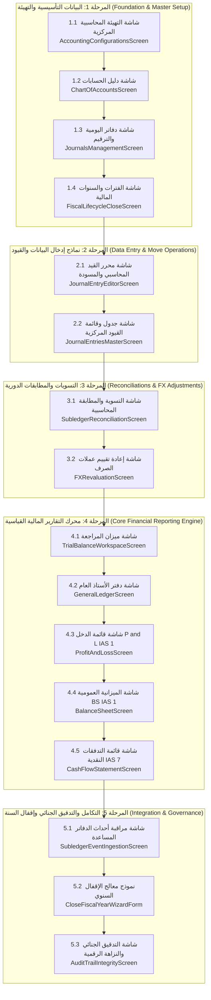

# خريطة الطريق التفصيلية لبناء وتطوير شاشات ميزة المحاسبة المالية (Accounting Screens Phased Implementation Roadmap)

> **المشروع:** Cashflow System (`cashflow_backend`)  
> **المجال:** ميزة المحاسبة المالية المجرّدة (`internal/features/accounting`)  
> **تاريخ التوثيق:** مارس 2026  
> **مسار الوثيقة:** `docs/accounting_screens_implementation_roadmap.md`  
> **الهدف:** توفير خريطة طريق متسلسلة، معمارية، ومفصلة دقيقة 100% تحدد خطة العمل والترتيب الهندي الصارم لبناء وتطوير كافة شاشات ونماذج إدخال البيانات لميزة المحاسبة المالية من البداية وحتى الإقفال والتدقيق الرقمي.

---

## فهرس المحتويات

1. [الملخص التنفيذي ورؤية تسلسل البناء الهيكلي](#1-الملخص-التنفيذي-ورؤية-تسلسل-البناء-الهيكلي)
2. [مخطط التبعيات والمعمارية المتسلسلة لبناء الشاشات (Screen Construction Dependency Graph)](#2-مخطط-التبعيات-والمعمارية-المتسلسلة-لبناء-الشاشات)
3. [التحليل التفصيلي لمراحل البناء الخمس (The 5 In-Depth Construction Phases)](#3-التحليل-التفصيلي-لمراحل-البناء-الخمس)
   - [المرحلة 1: البيانات التأسيسية والتهيئة المحاسبية (Foundation & Master Setup Phase)](#المرحلة-1-البيانات-التأسيسية-والتهيئة-المحاسبية-foundation--master-setup-phase)
   - [المرحلة 2: نماذج إدخال البيانات والعمليات المالية اليومية (Data Entry & Move Operations Phase)](#المرحلة-2-نماذج-إدخال-البيانات-والعمليات-المالية-اليومية-data-entry--move-operations-phase)
   - [المرحلة 3: التسويات والمطابقات الدورية وإعادة التقييم (Reconciliations & FX Adjustments Phase)](#المرحلة-3-التسويات-والمطابقات-الدورية-وإعادة-التقييم-reconciliations--fx-adjustments-phase)
   - [المرحلة 4: محرك التقارير المالية القياسية القائمة على المعايير (Core Financial Reporting Engine Phase)](#المرحلة-4-محرك-التقارير-المالية-القياسية-القائمة-على-المعايير-core-financial-reporting-engine-phase)
   - [المرحلة 5: التكامل التشغيلي والإقفال السنوي والحوكمة التشفيرية (Integration, Year-End Closing & Governance Phase)](#المرحلة-5-التكامل-التشغيلي-والإقفال-السنوي-والحوكمة-التشفيرية-integration-year-end-closing--governance-phase)
4. [مصفوفة المتطلبات والمخرجات ومعايير القبول لكل شاشة (Prerequisites & Acceptance Criteria Matrix)](#4-مصفوفة-المتطلبات-والمخرجات-ومعايير-القبول-لكل-شاشة)
5. [جدول أولويات البناء وتخزين الأرصدة وإدارة الحالة (Build Priority & State Management Checklist)](#5-جدول-أولويات-البناء-وتخزين-الأرصدة-وإدارة-الحالة)
6. [الخاتمة والتوصيات التنفيذية لفرق التطوير](#6-الخاتمة-والتوصيات-التنفيذية-لفرق-التطوير)

---

## 1. الملخص التنفيذي ورؤية تسلسل البناء الهيكلي

تعتمد المحاسبة المالية بالنظم البرمجية على **سلسلة من التبعيات المنطقية والمعمارية (Financial & Technical Dependencies)**؛ حيث يمنع النظام تقنياً ومحاسبياً إدخال قيد مالي أو إنشاء فاتورة دون وجود دليل حسابات نشط، أو ترحيل قيد دون وجود سنة مالية مفتوحة، أو عرض تقرير مالي قبل إدخال ومطابقة الحسابات.

بناءً على هذا المبدأ الهيكلي، تم تصميم هذه الوثيقة لتكون **المرجع التنفيذي المستقل والعملي** لفرق التطوير والتصميم (Frontend Engineers & UI/UX Designers) لتوجيه خطوات البناء بالتتابع الدقيق عبر **5 مراحل تنفيذية متسلسلة**.

---

## 2. مخطط التبعيات والمعمارية المتسلسلة لبناء الشاشات

توضح الرسمة المعمارية التالية الترتيب الهيكلي لبناء الشاشات وتدفق البيانات والتبعيات بين الشاشات الـ 15 المعتمدة بالنظام:



---

## 3. التحليل التفصيلي لمراحل البناء الخمس

---

### المرحلة 1: البيانات التأسيسية والتهيئة المحاسبية (Foundation & Master Setup Phase)

> **مبرر البداية:** هذه المرحلة تمثل البنية التحتية؛ وبدونها لا يمكن إجراء أي قيد مالي أو فتح أي صفحة إدخال بالنظام.

```text
الترتيب التنفيذي للمرحلة 1:
[1.1 التهيئة المركزية] ----> [1.2 دليل الحسابات] ----> [1.3 دفاتر اليومية] ----> [1.4 الفترات المالية]
```

#### 1.1. شاشة التهيئة المحاسبية المركزية (`AccountingConfigurationsScreen`)

- **الهدف والضرورة:** تحديد وتعيين الحسابات القيادية المركزية التي يعتمد عليها المحرك الآلي في التسويات والتسلسلات.

- **الواجهة المربوطة في Backend:** `GET /api/v1/accounting/configurations` & `GetAccountingConfiguration`
- **المخرجات المعتمدة:**
  - حساب الأرباح المحتجزة (`Retained Earnings Account`).
  - حسابات أرباح وخسائر فروق الصرف المحققة وغير المحققة (`FX Gain/Loss Accounts`).
  - حساب تسوية الفروق العشيرية الصغرى (`Rounding Difference Account`).
- **خطورة عدم وجودها:** يرفض النظام الخلفي أي تسوية أو إغلاق سنة مالية ويُرجع الخطأ الصريح (`ErrAccountingConfigurationMissing`).

#### 1.2. شاشة دليل الحسابات (`ChartOfAccountsScreen` & `AccountCreateEditForm`)

- **الهدف والضرورة:** إنشاء وتصميم شجرة دليل الحسابات الخماسية المعتمدة (الأصول، الالتزامات، حقوق الملكية، الإيرادات، المصروفات).

- **الواجهات المربوطة في Backend:**
  - `GET /api/v1/accounting/accounts/tree` (`usecase_list_accounts_tree.go`)
  - `POST /api/v1/accounting/accounts` (`usecase_create_account.go`)
  - `PUT /api/v1/accounting/accounts/{id}` (`usecase_update_account.go`)
- **المخرجات المعتمدة:**
  - شجرة الحسابات التفاعلية القابلة للتوسيع والطي.
  - نموذج إدخال وتعديل بيانات الحساب وتحديد علامات النقدية والأنشطة (`IsCashEquivalent`, `IsNonCashAdjustment`, `CashFlowActivity`).
- **ضوابط الأمان:** تطبيق مانع تعديل الكود والنوع للحسابات المرحلة (`ErrAccountHasPostedMoves`).

#### 1.3. شاشة إدارة دفاتر اليومية والترقيم التسلسلي (`JournalsManagementScreen`)

- **الهدف والضرورة:** إعداد دفاتر اليوميات المالية (مبيعات، مشتريات، بنك، صندوق، يومية عامة) وضبط الترقيم القانوني الصارم.

- **الواجهات المربوطة في Backend:** `GET /api/v1/accounting/journals` (`usecase_list_journals.go`)
- **المخرجات المعتمدة:**
  - جدول دفاتر اليومية وتخصيص بادئات الترقيم (`SequencePrefix` مثل `INV/2026/`).
  - نافذة ضبط رقم القيد القادم وتنشيط/تجميد اليومية.

#### 1.4. شاشة السنة والفترات المالية (`FiscalLifecycleCloseScreen`)

- **الهدف والضرورة:** تعريف السنة المالية (مثل `2026`) وتقسيم الفترات الشهرية والتحكم في حالتها (`Open`, `Soft Closed`, `Hard Closed`).

- **الواجهات المربوطة في Backend:**
  - `GET /api/v1/accounting/fiscal-years` (`usecase_list_fiscal_years.go`)
  - `POST /api/v1/accounting/fiscal-years` (`usecase_create_fiscal_year.go`)
  - `PUT /api/v1/accounting/periods/{id}/state` (`usecase_change_period_state.go`)
- **المخرجات المعتمدة:**
  - جدول الفترات وشارات الأمان الملونة لحالة الترحيل المسموحة.

---

### المرحلة 2: نماذج إدخال البيانات والعمليات المالية اليومية (Data Entry & Move Operations Phase)

> **مبرر المرحلة:** بعد توفر البيانات التأسيسية، يتم بناء النماذج والشاشات التي يدخل بها المحاسبون القيود اليومية المسودة والمرحّلة.

#### 2.1. شاشة ومحرر القيد المحاسبي والمسودة (`JournalEntryEditorScreen` & `JournalEntryEditorForm`)

- **الهدف والضرورة:** نموذج العمل الرئيسي اليومي لإنشاء القيود المركبة وإدخال السطور وتعديل المسودات.

- **الواجهات المربوطة في Backend:**
  - `POST /api/v1/accounting/moves/draft` (`usecase_create_draft_move.go`)
  - `PUT /api/v1/accounting/moves/{id}/draft` (`usecase_update_draft_move.go`)
  - `POST /api/v1/accounting/moves/{id}/post` (`usecase_post_move.go`)
- **المخرجات المعتمدة:**
  - هيدر البيانات العامة (التاريخ، اليومية، المرجع، العملة وسعر الصرف).
  - شبكة السطور المالية التفاعلية (Dynamic Move Lines Grid) مع إكمال تلقائي لكود الحساب والشريك والمدين والدائن.
  - شريط التوازن الحي الذي يثبت رياضياتياً التوازن التام ($\Delta = 0.00$).

#### 2.2. شاشة جدول وقائمة القيود اليومية المركزية (`JournalEntriesMasterScreen`)

- **الهدف والضرورة:** استعراض، تصفية، تتبع، وإدارة كافة القيود اليومية بالمؤسسة.

- **الواجهات المربوطة في Backend:**
  - `GET /api/v1/accounting/moves` (`usecase_list_moves.go`)
  - `POST /api/v1/accounting/moves/{id}/reverse` (`usecase_reverse_move.go`)
  - `DELETE /api/v1/accounting/moves/{id}/draft` (`usecase_delete_draft_move.go`)
- **المخرجات المعتمدة:**
  - جدول القيود الشامل مع الفلترة الذكية بحالة القيد (`Draft`, `Posted`, `Reversed`) والتاريخ واليومية.
  - أزرار إجراء التراجع القانوني والقيد العكسي (Storno Entry) وإلغاء المسودات.

---

### المرحلة 3: التسويات والمطابقات الدورية وإعادة التقييم (Reconciliations & FX Adjustments Phase)

> **مبرر المرحلة:** بعد ترحيل القيود اليومية، تأتي مرحلة مطابقة الديون والفواتير وإجراء إعادة التقييم الدوري للعملات الأجنبية.

#### 3.1. شاشة التسوية والمطابقة المحاسبية (`SubledgerReconciliationScreen` & `ReconciliationForm`)

- **الهدف والضرورة:** مطابقة السطور المدينة والدائنة للحسابات القابلة للتسوية (`IsReconcilable`) واحتساب أرباح وخسائر فروق الصرف المحققة.

- **الواجهات المربوطة في Backend:**
  - `GET /api/v1/accounting/reconciliation/unreconciled` (`usecase_list_unreconciled_lines.go`)
  - `POST /api/v1/accounting/reconciliation/reconcile` (`usecase_reconcile_move_lines.go`)
  - `POST /api/v1/accounting/reconciliation/unreconcile` (`usecase_unreconcile_move_lines.go`)
- **المخرجات المعتمدة:**
  - واجهة منقسمة عرضياً (السطور المدينة غير المطابقة مقابل السطور الدائنة).
  - أداة التوزيع الفروق المحققة والتوليد الآلي لقيد فروق العملة.

#### 3.2. شاشة إعادة تقييم عملات الأصول والالتزامات الأجنبية (`FXRevaluationScreen`)

- **الهدف والضرورة:** تنفيذ المعيار الدولي **IAS 21** لإعادة تقييم الحسابات النقدية والبنكية بالعملات الأجنبية في نهاية كل شهر.

- **الواجهات المربوطة في Backend:** `POST /api/v1/accounting/fx/revalue` (`usecase_revalue_fx.go`)
- **المخرجات المعتمدة:**
  - جدول مراكز العملات الأجنبية وأسعار الإغلاق السائدة.
  - توليد مسودة قيد التقييم غير المحقق مع خاصية العكس التلقائي في بداية الفترة التالية.

---

### المرحلة 4: محرك التقارير المالية القياسية القائمة على المعايير (Core Financial Reporting Engine Phase)

> **مبرر المرحلة:** بعد ضبط الحسابات وتصحيح التسويات، يُبنى محرك التجميع والتقارير المالية لاستعراض المخرجات والقوائم الختامية.

```text
تسلسل بناء التقارير:
[4.1 ميزان المراجعة] ----> [4.2 دفتر الأستاذ العام] ----> [4.3 قائمة الدخل] ----> [4.4 الميزانية العمومية] ----> [4.5 التدفقات النقدية]
```

#### 4.1. شاشة ميزان المراجعة (`TrialBalanceWorkspaceScreen`)

- **الهدف:** التقرير التوازني الأساسي للحسابات (رصيد بداية، حركات الفترة، رصيد نهاية).

- **الواجهة في Backend:** `GET /api/v1/accounting/reports/trial-balance` (`usecase_generate_trial_balance.go`)
- **المخرجات:** جدول التوازن الموزون والتأكد اللحظي من $\sum \text{Debit} = \sum \text{Credit}$.

#### 4.2. شاشة دفتر الأستاذ العام والتراكمي (`GeneralLedgerScreen`)

- **الهدف:** كشف الحساب التفصيلي مع الرصيد التراكمي المتحرك (Running Balance).

- **الواجهة في Backend:** `GET /api/v1/accounting/reports/general-ledger` (`usecase_generate_general_ledger.go`)
- **المخرجات:** جدول الحركات والرصيد المتدفق والتعميق المباشر للقيد المصدر.

#### 4.3. شاشة قائمة الدخل / الأرباح والخسائر (`ProfitAndLossScreen` - IAS 1)

- **الهدف:** عرض نتائج الأعمال والأداء المالي (إيرادات، تكلفة مبيعات، مصروفات، صافي الربح).

- **الواجهة في Backend:** `GET /api/v1/accounting/reports/income-statement` (`usecase_generate_income_statement.go`)
- **المخرجات:** هيكل العرض الهرمي ومقارنة الفترات الزمانية وفق المعيار الدولي IAS 1.

#### 4.4. شاشة الميزانية العمومية والوضع المالي (`BalanceSheetScreen` - IAS 1)

- **الهدف:** عرض الأصول، الالتزامات، وحقوق الملكية في تاريخ محدد.

- **الواجهة في Backend:** `GET /api/v1/accounting/reports/balance-sheet` (`usecase_generate_balance_sheet.go`)
- **المخرجات:** عرض جانبي وتجميع آلي للأرباح المحتجزة غير المرحلة لضمان التوازن التام.

#### 4.5. شاشة قائمة التدفقات النقدية بالطريقة غير المباشرة (`CashFlowStatementScreen` - IAS 7)

- **الهدف:** عرض حركات النقدية وما يعادلها مقسمة حسب الأنشطة الثلاثية (تشغيلية، استثمارية، تمويلية).

- **الواجهة في Backend:** `GET /api/v1/accounting/reports/cash-flow` (`usecase_generate_cash_flow.go`)
- **المخرجات:** جدول الأنشطة النقدية وشريط مطابقة النقدية مع حسابات `IsCashEquivalent`.

---

### المرحلة 5: التكامل التشغيلي والإقفال السنوي والحوكمة التشفيرية (Integration, Year-End Closing & Governance Phase)

> **مبرر المرحلة:** هذه المرحلة النهائية تُعنى بربط المحرك بالأنظمة الخارجية، وتنفيذ الإقفال السنوي والدورية المالية، والتدقيق التشفيري لأمان النظام.

#### 5.1. شاشة مراقبة وتلقيم أحداث الدفاتر المساعدة (`SubledgerEventIngestionScreen`)

- **الهدف:** جلب ومراقبة الأحداث المالية الموجهة من المبيعات والمشتريات والرواتب ومتابعة منع التكرار (`Idempotency Key`).

- **الواجهة في Backend:** `POST /api/v1/accounting/subledger/events` (`usecase_ingest_subledger_event.go`)

#### 5.2. نموذج معالج الإقفال السنوي (`CloseFiscalYearWizardForm`)

- **الهدف:** تصفير جميع حسابات قائمة الدخل ونقل صافي الدخل آلياً إلى حساب الأرباح المحتجزة.

- **الواجهة في Backend:** `POST /api/v1/accounting/fiscal-years/close` (`usecase_close_fiscal_year.go`)

#### 5.3. شاشة النزاهة التشفيرية وسجل التدقيق الجنائي (`AuditTrailIntegrityScreen`)

- **الهدف:** فحص سلسلة التوقيع الرقمي SHA-256 للقيود واكتشاف أي تلاعب بقاعدة البيانات وتصدير ملف **OECD SAF-T**.

- **الواجهة في Backend:** `GET /api/v1/accounting/governance/verify-integrity` (`governance.go`)

---

## 4. مصفوفة المتطلبات والمخرجات ومعايير القبول لكل شاشة

توضح المصفوفة التالية الشروط المسبقة ومعايير القبول الفنية (Acceptance Criteria) لبناء واختبار كل شاشة:

| رقم الشاشة | اسم الشاشة | الشروط المسبقة للبناء (Prerequisites) | معايير القبول للواجهة (Acceptance Criteria) |
| :---: | :--- | :--- | :--- |
| **1.1** | التهيئة المركزية | تجهيز قاعدة البيانات وجدول الإعدادات | نجاح تعيين الحسابات الأربعة الأساسية وحفظها |
| **1.2** | دليل الحسابات | إكمال التهيئة المركزية | بناء الشجرة التفاعلية، منع تعديل الكود للحساب المستعمل |
| **1.3** | دفاتر اليومية | إكمال دليل الحسابات | تخصيص البادئات التسلسلية وعرض رقم القيد القادم |
| **1.4** | السنوات والفترات | وجود الدفاتر الأساسية | توليد 12 فترة شهرية والتحكم التام في شارات القفل |
| **2.1** | محرر القيود | إكمال دليل الحسابات اليومية والفترات | الموازنة الحيّة $\Delta=0.00$ وتفعيل حظر الترحيل الاختلالي |
| **2.2** | قائمة القيود | وجود قيود مسودة ومرحّلة | نجاح الفلترة والعكس القانوني (Storno) وحذف المسودة |
| **3.1** | التسوية والمطابقة | وجود قيود مرحلة على حسابات قابلة للتسوية | التوليد الآلي لقيد أرباح/خسائر فروق العملة المحققة |
| **3.2** | إعادة تقييم العملات | وجود أسعار صرف معتمدة وأرصدة أجنبية | إنشاء مسودة التقييم غير المحقق بنجاح مع العكس الآلي |
| **4.1** | ميزان المراجعة | ترحيل مجموعة قيود تجريبية | مطابقة $\sum \text{Debit} = \sum \text{Credit}$ والتعميق للأستاذ |
| **4.2** | دفتر الأستاذ العام | اختيار حساب محدد | احتساب الرصيد التراكمي المتحرك بدقة مطابقة للنطاق |
| **4.3** | قائمة الدخل | اكتمال دليل الحسابات وتصنيف المصروفات | حساب مجمل وصافي الربح بدقة تامة لفق معيار IAS 1 |
| **4.4** | الميزانية العمومية | احتساب صافي دخل الفترة | توازن الأصول مع الالتزامات وحقوق الملكية لحظياً |
| **4.5** | التدفقات النقدية | تعيين علامات الحسابات `IAS 7` | مطابقة النقدية مع رصيد حسابات `IsCashEquivalent` |
| **5.1** | أحداث الدفاتر | ضبط مصفوفة التعيين المحاسبي | عدم تكرار ترحيل الحدث عند إعادة الإرسال (`Idempotency`) |
| **5.2** | معالج الإقفال السنوي | خلو السنة المالية من مسودات قيود | إنشاء قيد الإغلاق الذري وتصفير حسابات الأرباح/المصروفات |
| **5.3** | النزاهة والتدقيق | ترحيل قيود وتوليد الهاش التشفيري | ظهور الشارة الخضراء للسلسلة وإمكانية تصدير SAF-T |

---

## 5. جدول أولويات البناء وتخزين الأرصدة وإدارة الحالة

لضمان سهولة التطوير بدون أخطاء تزامن أو تعارض في الواجهة الأمامية، نوصي باتباع جدول الأولويات وإدارة الحالة الموحد:

```text
+--------------------------------------------------------------------------------------------------------+
| أولويات بناء الشاشات وإدارة الحالة (Build Priority & State Management Checklist)                         |
+--------------------------------------------------------------------------------------------------------+
| الأولوية  | مرحلة البناء    | الشاشات المستهدفة                         | حالة Store المطلوبة (State)       |
+--------------------------------------------------------------------------------------------------------+
| P0 (حرجة) | المرحلة 1       | 1.1, 1.2, 1.3, 1.4                        | SystemConfigStore, COATreeStore    |
| P1 (عالية) | المرحلة 2       | 2.1, 2.2                                  | MoveDraftStore, MoveListStore      |
| P2 (متوسطة)| المرحلة 3       | 3.1, 3.2                                  | ReconciliationStore, FXStore      |
| P3 (قياسية)| المرحلة 4       | 4.1, 4.2, 4.3, 4.4, 4.5                   | FinancialReportsStore              |
| P4 (متقدمة)| المرحلة 5       | 5.1, 5.2, 5.3                             | SubledgerEventsStore, AuditStore   |
+--------------------------------------------------------------------------------------------------------+
```

---

## 6. الخاتمة والتوصيات التنفيذية لفرق التطوير

توفر هذه الوثيقة خريطة الطريق الرسمية والمكتملة لبناء كافة شاشات ومكونات ميزة المحاسبة المالية بالنظام. نلخص التوصيات التنفيذية لفرق التطوير بالتالي:

1. **الالتزام بالترتيب التسلسلي الصارم (Sequential Order Enforcement):** البدء فوراً بالمرحلة 1 (البيانات التأسيسية والتهيئة) وعدم القفز لبناء القيود والتقارير قبل اكتمال شجرة الحسابات والدفاتر.
2. **الربط المباشر مع DTOs النظام الخلفي:** استخدام كائنات الإدخال المعرفة في `dto.go` بالباك إند دون ابتكار حقول غير مدعومة.
3. **تطبيق الفحص التفاعلي الحي (Real-time Imbalance Meter):** بناء شريط ميزان التوازن الحي في شاشة محرر القيود لتنبيه المحاسب فوراً عند الاختلال قبل الترحيل.
4. **تفعيل الشارات التنبيهية وإرشادات التبسيط:** اعتماد دليل تبسيط المصطلحات الموضح في التوثيق لتسهيل الاستخدام على غير المختصين.

---
> **تم بحمد الله إنشاء خريطة الطريق التفصيلية والمستقلة لبناء الشاشات داخل `docs/accounting_screens_implementation_roadmap.md`.**
