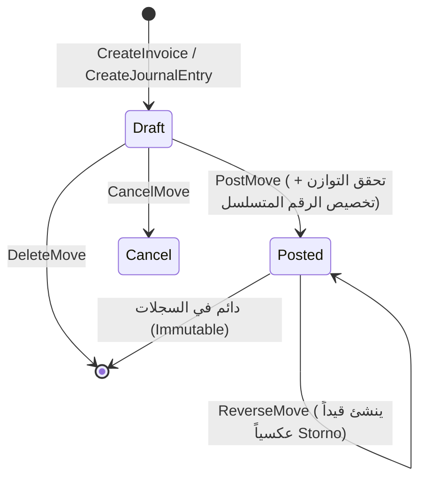
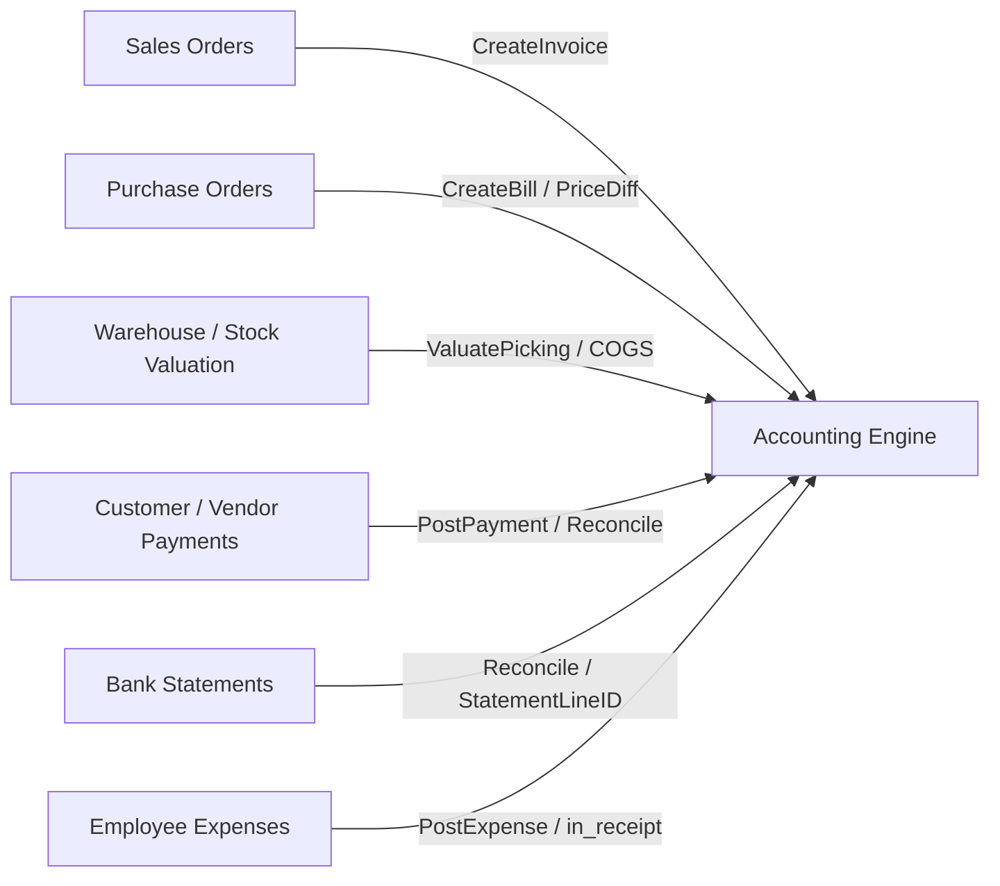

# التحليل الشامل والمفصل لوحدة المحاسبة (Accounting Engine) في Cashflow Backend

> **مسار المشروع محل التحليل:** `/home/osm/StudioProjects/cashflow/cashflow_backend/internal/`  
> **تاريخ التوثيق:** 2026-11-03  
> **الحالة:** مكتمل ومختبر بنجاح 100% (All Unit & Integration Tests Passed)  
> **التوافق المعياري:** متوافق بدقة مع معايير المحاسبة الدولية (IFRS/GAAP)، ونموذج القيود المزدوجة (Double-Entry Bookkeeping)، ونظام **Odoo 19 Accounting**، ومتطلبات هيئة الزكاة والضريبة والجمارك السعودية (**ZATCA E-Invoicing Phase 1 & 2**).

---

## فهرس المحتويات

1. [المقدمة والرؤية الهندسية العامة (Architectural Overview)](#1-المقدمة-والرؤية-الهندسية-العامة)
2. [هيكل المجلدات وتوزيع الطبقات (Clean / Hexagonal Architecture)](#2-هيكل-المجلدات-وتوزيع-الطبقات)
3. [طبقة النطاق: الكيانات وقواعد العمل الصارمة (Domain Layer & Invariants)](#3-طبقة-النطاق-الكيانات-وقواعد-العمل-الصارمة)
   - [3.1 دليل الحسابات (Account & Account Types)](#31-دليل-الحسابات-account--account-types)
   - [3.2 دفاتر اليومية والترقيم التسلسلي (Journals & Sequences)](#32-دفاتر-اليومية-والترقيم-التسلسلي)
   - [3.3 القيود اليومية وحركات الحسابات (Account Move & Move Lines)](#33-القيود-اليومية-وحركات-الحسابات)
   - [3.4 محرك الضرائب وقواعد الحساب (Taxes & Computation Engine)](#34-محرك-الضرائب-وقواعد-الحساب)
   - [3.5 شروط السداد واستحقاق الفواتير (Payment Terms & Due Dates)](#35-شروط-السداد-واستحقاق-الفواتير)
   - [3.6 التوطين السعودي (Saudi Localization l10n)](#36-التوطين-السعودي-saudi-localization-l10n)
4. [طبقة حالات الاستخدام ومنطق الأعمال (Use Cases & Application Logic)](#4-طبقة-حالات-الاستخدام-ومنطق-الأعمال)
   - [4.1 دورة حياة الفاتورة والقيد (Draft -> Posted -> Reverse)](#41-دورة-حياة-الفاتورة-والقيد)
   - [4.2 معالجة الفواتير وحسابات المدينين والدائنين (AR / AP Invoicing)](#42-معالجة-الفواتير-وحسابات-المدينين-والدائنين)
   - [4.3 المحاسبة الأنجلو-ساكسونية وتكلفة البضاعة المباعة (Anglo-Saxon COGS)](#43-المحاسبة-الأنجلو-ساكسونية-وتكلفة-البضاعة-المباعة)
   - [4.4 الفوترة الإلكترونية ومنظومة زاتكا (ZATCA Phase 1 & Phase 2 EDI)](#44-الفوترة-الإلكترونية-ومنظومة-زاتكا)
5. [محرك التقارير المالية والقوائم الختامية (Financial Reports Engine)](#5-محرك-التقارير-المالية-والقوائم-الختامية)
   - [5.1 ميزان المراجعة (Trial Balance)](#51-ميزان-المراجعة-trial-balance)
   - [5.2 قائمة الدخل (Profit and Loss / Income Statement)](#52-قائمة-الدخل-profit-and-loss)
   - [5.3 الميزانية العمومية والأرباح المحتجزة (Balance Sheet & Retained Earnings)](#53-الميزانية-العمومية-والأرباح-المحتجزة)
   - [5.4 دفتر الأستاذ العام (General Ledger)](#54-دفتر-الأستاذ-العام-general-ledger)
6. [التكامل والتفاعل بين المحاسبة والأنظمة الفرعية (Inter-Module Integration)](#6-التكامل-والتفاعل-بين-المحاسبة-والأنظمة-الفرعية)
   - [6.1 التسوية البنكية (Bank Statements & Reconciliation)](#61-التسوية-البنكية-bank-statements--reconciliation)
   - [6.2 المقبوضات والمدفوعات وتقارير الأعمار (Payments & Aged Partner Balance)](#62-المقبوضات-والمدفوعات-وتقارير-الأعمار)
   - [6.3 تقييم المخزون والتكاليف الإضافية (Stock Valuation & Landed Costs)](#63-تقييم-المخزون-والتكاليف-الإضافية)
   - [6.4 فواتير المبيعات والمشتريات (Sales & Purchase Invoicing)](#64-فواتير-المبيعات-والمشتريات)
7. [طبقة التخزين وقواعد البيانات (Persistence & PostgreSQL Schema)](#7-طبقة-التخزين-وقواعد-البيانات)
   - [7.1 المخطط العلائقي (Relational Schema & Migrations)](#71-المخطط-العلائقي-relational-schema)
   - [7.2 سلامة المعاملات وعمليات القفل (ACID Transactions & Row Locking)](#72-سلامة-المعاملات-وعمليات-القفل)
8. [واجهة برمجة التطبيقات ونظام الصلاحيات (REST API & RBAC Security)](#8-واجهة-برمجة-التطبيقات-ونظام-الصلاحيات)
9. [مصفوفة الاختبارات والتحقق البرمجي (Testing Matrix)](#9-مصفوفة-الاختبارات-والتحقق-البرمجي)
10. [التقييم الفني، الفجوات، والتوصيات المستقبلية (Gap Analysis & Roadmap)](#10-التقييم-الفني-الفجوات-والتوصيات-المستقبلية)

---

## 1. المقدمة والرؤية الهندسية العامة

تمثل وحدة **المحاسبة (Accounting Engine)** في مشروع `cashflow_backend` العمود الفقري والقلب النابض للنظام المالي بالكامل. بُنيت الوحدة باتباع مبادئ **التصميم الموجه بالنطاق (Domain-Driven Design - DDD)** والمعمارية السداسية (**Hexagonal / Ports and Adapters Architecture**).

### المبادئ المالية الأساسية المطبقة في النظام

1. **نظام القيد المزدوج الإلزامي (Strict Double-Entry Bookkeeping):** لا يمكن ترحيل أي معاملة مالية ما لم يتساوى إجمالي المدين مع إجمالي الدائن بدقة:
   $$\sum \text{Debit} = \sum \text{Credit} \quad (\Delta \le 0.01)$$
2. **حصانة القيود المرحلة ضد التعديل (Immutability of Posted Records):** بمجرد اعتماد القيد المالي وترحيله (`State = posted`)، يمنع النظام منعاً باتاً تعديله أو حذفه من قاعدة البيانات، والطريقة الوحيدة لمعالجته محاسبياً هي عبر إنشاء **قيد عكسي (Reversal Move / Storno Entry)** أو إصدار إشعار دائن/مدين (**Credit/Debit Note**).
3. **الفصل التام بين مسودة القيد والاعتماد (Draft vs. Posted Workflow):** تُنشأ الفواتير والحركات كمسودات قابلة للتعديل والتحقق، وتكتسب الرقم التسلسلي القانوني الدائم فقط عند الترحيل.
4. **دعم المحاسبة الأنجلو-ساكسونية (Anglo-Saxon Accounting Model):** تسجيل تكلفة البضاعة المباعة (COGS) وتخفيض حساب المخزون بشكل آلي متزامن عند إصدار فواتير العملاء.
5. **الامتثال للفوترة الإلكترونية (ZATCA E-Invoicing):** الامتثال الكامل للمرحلتين الأولى والثانية لهيئة الزكاة والضريبة والجمارك في المملكة العربية السعودية مع إنشاء أكواد QR المشفرة بتقنية TLV ومطابقة معيار UBL 2.1 XML.

```mermaid
graph TD
    subgraph Primary Adapters
        HTTP[REST API / Chi Router]
    end

    subgraph Application Layer
        UC[Accounting UseCase]
        Zatca[ZATCA EDI Processor]
    end

    subgraph Domain Layer
        Move[AccountMove & MoveLine]
        Account[Account & Chart of Accounts]
        Journal[Journal & Sequences]
        Tax[Tax Calculation Engine]
        Term[Payment Terms]
        Reports[Financial Reports Engine]
    end

    subgraph Secondary Adapters
        PG[PostgreSQL Repository / pgxpool]
        Mem[In-Memory Mock Repo]
    end

    HTTP --> UC
    UC --> Domain Layer
    Zatca --> Domain Layer
    UC --> PG
    UC -.-> Mem
```

---

## 2. هيكل المجلدات وتوزيع الطبقات

تتوزع ملفات المحاسبة بدقة واحترافية عبر مجلدات المشروع كالتالي:

```text
internal/
├── domain/accounting/               # طبقة النطاق الخالصة (Pure Domain)
│   ├── account.go                  # نموذج شجرة الحسابات والأنواع
│   ├── accounting_test.go          # اختبارات النطاق والتأكد من التوازن
│   ├── edi.go                      # نماذج الفوترة الإلكترونية وشهادات الأمان
│   ├── journal.go                  # دفاتر اليومية والترقيم المتسلسل
│   ├── move.go                     # القيود وحركات البنود والحصانة
│   ├── payment_term.go             # شروط الدفع ومواعيد الاستحقاق
│   ├── ports.go                    # واجهات المنافذ (Repository Interface)
│   ├── reports.go                  # نماذج وتجميع القوائم المالية
│   ├── tax.go                      # محرك الضرائب وشامليتها
│   └── l10n/
│       └── sa.go                   # دليل الحسابات وضريبة القيمة المضافة للسعودية
│
├── usecase/accounting/              # طبقة حالات الاستخدام ومنطق التطبيق
│   ├── accounting_usecase.go       # إدارة الحسابات، الدفاتر، الضرائب، شروط الدفع
│   ├── accounting_usecase_test.go  # اختبارات التحقق الشاملة لحالات الاستخدام
│   ├── edi_processor.go            # واجهة معالجات التبادل الإلكتروني
│   ├── edi_processor_test.go       # اختبارات معالجة EDI
│   ├── edi_usecase.go              # توليد الوثائق الإلكترونية والتوقيع
│   ├── landed_cost_flags_test.go   # اختبارات علامات التكاليف الإضافية
│   ├── move_usecase.go             # إنشاء الفواتير، الترحيل، العكس، والربط
│   ├── reports_usecase.go          # تشغيل ميزان المراجعة، الأرباح والخسائر، المركز المالي
│   ├── reports_usecase_test.go     # اختبارات صحة تقارير القوائم الختامية
│   ├── zatca_processor.go          # معالج زاتكا لتوليد UBL 2.1 و TLV QR Base64
│   ├── zatca_processor_test.go     # اختبارات مطابقة مواصفات زاتكا
│   └── zatca_templates.go          # قوالب XML وفق المعيار الدولي UBL 2.1
│
├── adapters/
│   ├── http/accounting/            # محول بروتوكول HTTP والويب
│   │   ├── dto.go                  # كائنات نقل البيانات (Requests & Responses)
│   │   ├── edi_handler.go          # معالجة طلبات الفوترة الإلكترونية
│   │   ├── handler.go              # معالجة طلبات REST للعمليات المحاسبية
│   │   ├── handler_test.go         # اختبارات التكامل للـ Endpoints
│   │   └── routes.go               # تسجيل المسارات وحمايتها بصلاحيات RBAC
│   │
│   └── storage/accounting/         # محول التخزين وقواعد البيانات
│       ├── memory_repo.go          # مستودع ذاكري لاختبارات الوحدات
│       ├── memory_repo_test.go     # اختبارات مستودع الذاكرة
│       ├── postgres_repo.go        # مستودع PostgreSQL المعتمد على pgxpool
│       └── postgres_move_line_null_test.go # اختبارات البنود وقيم NULL
```

---

## 3. طبقة النطاق: الكيانات وقواعد العمل الصارمة

الملف المرجعي: [`internal/domain/accounting/`](file:///home/osm/StudioProjects/cashflow/cashflow_backend/internal/domain/accounting)

### 3.1 دليل الحسابات (Account & Account Types)

تمت نمذجة الحساب المحاسبي بما يماثل `account.account` في Odoo:

- **التصنيفات الرئيسية (5 أصول محاسبية):**
  1. **الأصول (Assets):**
     - `asset_receivable`: مدينو التجارة (العملاء).
     - `asset_cash`: النقدية وما في حكمها (الصندوق والبنك).
     - `asset_current`: الأصول المتداولة (المخزون، عهد، مصفوفات مقدمة).
     - `asset_non_current`: الأصول غير المتداولة (الأصول الثابتة).
  2. **الالتزامات (Liabilities):**
     - `liability_payable`: دائنو التجارة (الموردين).
     - `liability_current`: التزامات متداولة (ضريبة القيمة المضافة المستحقة، مستحقات).
     - `liability_non_current`: التزامات غير متداولة (قروض طويلة الأجل).
  3. **حقوق الملكية (Equity):**
     - `equity`: رأس المال، الأرباح المبقاة.
  4. **الإيرادات (Income):**
     - `income`: إيرادات النشاط الرئيسي للمبيعات.
     - `income_other`: إيرادات أخرى وعوائد تمويلية.
  5. **المصروفات (Expenses):**
     - `expense`: المصروفات العمومية والإدارية والتشغيلية.
     - `expense_depreciation`: مجمع وإهلاك الأصول الثابتة.
     - `expense_direct_cost`: تكلفة المبيعات المباشرة (COGS).

- **تحديد طبيعة الرصيد التلقائية (Normal Balance):**

  ```go
  func (t AccountType) NormalBalance() string {
      if t.IsAsset() || t.IsExpense() {
          return "debit"
      }
      return "credit"
  }
  ```

- **حماية الشجرة من العلاقات الدائرية:**
  تتحقق الدالة `Validate()` من عدم تعيين الحساب كأب لنفسه (`*a.ParentID == a.ID`).
- **دعم التعدد اللغوي والشركات:**
  حقل اسم الحساب هو `i18n.TranslationString` لتوفير الاسم بالعربية والإنجليزية تلقائياً، مع دعم تعدد الشركات (`CompanyID *int64`).

---

### 3.2 دفاتر اليومية والترقيم التسلسلي (Journals & Sequences)

تمت النمذجة بمطابقة `account.journal`:

- **أنواع الدفاتر:**
  - `sale`: مخصص لفواتير العملاء وإشعارات دائن المبيعات.
  - `purchase`: مخصص لفواتير الموردين ومردودات المشتريات.
  - `bank`: حسابات البنوك والشيكات تحت التحصيل.
  - `cash`: صناديق النقدية والعهد.
  - `general`: قيود اليومية العامة، التسويات، الرواتب والإهلاك.
  - `stock`: العمليات المخزنية وتقييم البضاعة.
- **توليد الأرقام التسلسلية القانونية (`FormatSequence`):**
  يدعم نمط القالب السنوي مثل:
  $$\text{INV/\%Y/} \longrightarrow \text{INV/2026/00001}$$
  $$\text{BILL/\%Y/} \longrightarrow \text{BILL/2026/00001}$$
  $$\text{BNK1/\%Y/} \longrightarrow \text{BNK1/2026/00001}$$

---

### 3.3 القيود اليومية وحركات الحسابات (Account Move & Move Lines)

تمثل حجر الزاوية للمنظومة المالية:

- **أنواع الحركات (`MoveType`):**
  - `entry`: قيد يومية عام / تسوية.
  - `out_invoice`: فاتورة مبيعات لعميل (Customer Invoice).
  - `out_refund`: إشعار دائن لعميل / مردودات مبيعات (Credit Note).
  - `in_invoice`: فاتورة مشتريات من مورد (Vendor Bill).
  - `in_refund`: إشعار مدين لمورد / مردودات مشتريات (Debit Note).
  - `in_receipt`: إيصال استلام نفقات الموظفين.

- **حالات دورة الحياة (`MoveState`):**
  `draft` (مسودة) $\longrightarrow$ `posted` (مرحل ومعتمد) $\longrightarrow$ `cancel` (ملغى).

- **حالات السداد (`PaymentState`):**
  `not_paid` (غير مسدد) $\longrightarrow$ `partial` (مسدد جزئياً) $\longrightarrow$ `in_payment` (قيد التحصيل) $\longrightarrow$ `paid` (مسدد بالكامل) $\longrightarrow$ `reversed` (معكوس).

- **مواصفات سطر القيد (`AccountMoveLine`):**
  - الرصيد: $\text{Balance} = \text{Debit} - \text{Credit}$.
  - التسوية المحاسبية: `Reconcile` (هل الحساب يقبل المطابقة)، `Reconciled` (تمت التسوية)، `AmountResidual` (المبلغ المتبقي المعلق)، `MatchingNumber` (رقم قفل التسوية مثل `P-REC-00123`).
  - الربط البنكي: `StatementLineID` لربط السطر مباشرة بسطر كشف الحساب البنكي.
  - محاسبة المخزون: `DisplayType = "cogs"` لأسطر تكلفة المبيعات، مع حقل `CogsOriginID` الذي يشير إلى سطر الفاتورة الأصلي.
  - التكاليف الإضافية: `IsLandedCostsLine` للإشارة إلى القيود الناتجة عن توزيع مصاريف الشحن والجمارك على المخزون.

- **قاعدة التوازن الصارمة (`ValidateBalance`):**
  يجب توفر سطرين على الأقل في القيد، ويجب ألا يتجاوز الفرق بين المدين والدائن قرشاً واحداً ($0.01$):

  ```go
  diff := math.Abs(m.TotalDebit() - m.TotalCredit())
  if diff > 0.01 {
      return platformerrors.Validation("unbalanced journal entry", ...)
  }
  ```

- **حصانة القيود المرحلة وحظر التعديل أو الحذف:**

  ```go
  func (m *AccountMove) CanEdit() error {
      if m.State == MoveStatePosted {
          return platformerrors.Conflict("cannot edit a posted journal entry; create a reversal or credit note instead")
      }
      return nil
  }
  ```

- **العكس المحاسبي النظيف (`CreateReverseMove`):**
  تقوم الدالة بتوليد قيد جديد يقلب كل قيم المدين إلى دائن والدائن إلى مدين مع ربط القيد الجديد بالقيد الأصلي عبر `ReversedEntryID`.

---

### 3.4 محرك الضرائب وقواعد الحساب (Taxes & Computation Engine)

الملف المرجعي: [`internal/domain/accounting/tax.go`](file:///home/osm/StudioProjects/cashflow/cashflow_backend/internal/domain/accounting/tax.go)

يدعم النظام نوعين من الضرائب:

1. **النسبة المئوية (`percent`):** مثل 15% ضريبة القيمة المضافة.
2. **المبلغ الثابت (`fixed`):** مبلغ نقدي محدد لكل وحدة.

مع دعم نطاق استخدام الضريبة: `sale`، `purchase`، أو `none`.

#### معادلات الاحتساب الدقيقة

- **الحالة الأولى: السعر غير شامل الضريبة (`PriceInclude = false`):**
  $$\text{TaxAmount} = \text{BaseAmount} \times \left(\frac{\text{TaxRate}}{100}\right)$$
  $$\text{TotalAmount} = \text{BaseAmount} + \text{TaxAmount}$$

- **الحالة الثانية: السعر شامل الضريبة (`PriceInclude = true`):**
  $$\text{UntaxedAmount} = \frac{\text{BaseAmount}}{1 + \left(\frac{\text{TaxRate}}{100}\right)}$$
  $$\text{TaxAmount} = \text{BaseAmount} - \text{UntaxedAmount}$$
  $$\text{TotalAmount} = \text{BaseAmount}$$

*مثال عملي مدعوم في الاختبارات:* مبلغ $115$ مع ضريبة $15\%$ شاملة ينتج عنه: أصل غير خاضع = $100.00$، الضريبة = $15.00$، الإجمالي = $115.00$.

---

### 3.5 شروط السداد واستحقاق الفواتير (Payment Terms & Due Dates)

الملف المرجعي: [`internal/domain/accounting/payment_term.go`](file:///home/osm/StudioProjects/cashflow/cashflow_backend/internal/domain/accounting/payment_term.go)

يتيح تعريف شروط سداد ممتدة للأقساط والدفعات:

- أنواع القيم: `balance` (الرصيد المتبقي)، `percent` (نسبة مئوية)، `fixed` (دفعة نقدية ثابتة).
- حساب تاريخ الاستحقاق التلقائي (`ComputeDueDate`):
  يحسب أقصى عدد أيام محدد في شروط السداد ويضيفها إلى تاريخ إصدار الفاتورة:
  $$\text{InvoiceDueDate} = \text{InvoiceDate} + \max(\text{Line.Days})$$

---

### 3.6 التوطين السعودي (Saudi Localization l10n)

الملف المرجعي: [`internal/domain/accounting/l10n/sa.go`](file:///home/osm/StudioProjects/cashflow/cashflow_backend/internal/domain/accounting/l10n/sa.go)

يوفر قالباً جاهزاً ومطابقاً لدليل الحسابات السعودي الموحد والضريبة:

| رمز الحساب (Code) | اسم الحساب (Account Name) | النوع (Type) | الطبيعة (Balance) |
| --- | --- | --- | --- |
| `101000` | النقدية في الصندوق (Cash on Hand) | `asset_cash` | مدين (Debit) |
| `102000` | الحساب الجاري البنكي (Bank Current Account) | `asset_cash` | مدين (Debit) |
| `105000` | العملاء / الذمم المدينة (Accounts Receivable) | `asset_receivable` | مدين (Debit) |
| `201000` | الموردون / الذمم الدائنة (Accounts Payable) | `liability_payable` | دائن (Credit) |
| `205000` | ضريبة القيمة المضافة المستحقة (VAT Payable 15%) | `liability_current` | دائن (Credit) |
| `401000` | إيرادات المبيعات (Sales Revenue) | `income` | دائن (Credit) |
| `501000` | تكلفة البضاعة المباعة (Cost of Goods Sold) | `expense_direct_cost` | مدين (Debit) |

---

## 4. طبقة حالات الاستخدام ومنطق الأعمال

الملفات المرجعية:

- [`internal/usecase/accounting/accounting_usecase.go`](file:///home/osm/StudioProjects/cashflow/cashflow_backend/internal/usecase/accounting/accounting_usecase.go)
- [`internal/usecase/accounting/move_usecase.go`](file:///home/osm/StudioProjects/cashflow/cashflow_backend/internal/usecase/accounting/move_usecase.go)
- [`internal/usecase/accounting/zatca_processor.go`](file:///home/osm/StudioProjects/cashflow/cashflow_backend/internal/usecase/accounting/zatca_processor.go)

### 4.1 دورة حياة الفاتورة والقيد



1. **الإنشاء كمسودة (`CreateJournalEntry` أو `CreateInvoice`):** تُحفظ المعاملة بالاسم المؤقت `"/"` دون حجز رقم تسلسلي حتى لا تنشأ ثغرات تسلسلية (Sequence Gaps) في حال حذفت المسودة.
2. **الترحيل والاعتماد (`PostMove`):**
   - استدعاء `ValidateBalance()` لضمان التوازن التام.
   - استدعاء `repo.GetNextSequence(journalID, year)` للحصول على الرقم التالي بقفل ذري.
   - تحويل الحالة إلى `posted` واعتماد التاريخ والرقم.
3. **العكس المحاسبي (`ReverseMove`):**
   - التحقق من أن القيد بحالة `posted`.
   - توليد القيد المعاكس فورياً بالرقم المرجعي `"Reversal of INV/2026/00001"`.

---

### 4.2 معالجة الفواتير وحسابات المدينين والدائنين (AR / AP Invoicing)

تقوم دالة `CreateInvoice` بتجميع المعاملة المالية المعقدة في قيد متكامل تلقائياً:

1. **حساب البنود والخصومات:**
   $$\text{LineTotal} = \text{Quantity} \times \text{PriceUnit} \times (1 - \frac{\text{Discount}}{100})$$
2. **تجميع الضرائب وحساباتها:** توزيع مبالغ الضرائب على حسابات الضرائب المعنية (`taxMap`).
3. **تحديد حساب الإيراد أو المصروف:** تخصيص حساب مبيعات المنتجات (`10` / `Sales Revenue`) أو تكلفة البضاعة.
4. **توليد سطر المقابل (Counterpart Partner Line):**
   - لفواتير المبيعات (`out_invoice`): يضاف سطر مدين لحساب العملاء (`120000` / `Accounts Receivable`) بكامل قيمة الفاتورة شاملة الضريبة.
   - لفواتير المشتريات (`in_invoice`): يضاف سطر دائن لحساب الموردين (`210000` / `Accounts Payable`) بكامل القيمة.

---

### 4.3 المحاسبة الأنجلو-ساكسونية وتكلفة البضاعة المباعة (Anglo-Saxon COGS)

في معايير Odoo 19 والمحاسبة الدولية، لا يكفي تسجيل إيراد المبيعات فقط عند فوترة العميل، بل يتم الاعتراف بتكلفة البضاعة المباعة تزامناً مع الفاتورة:
عند تزويد `InvoiceLineItemInput` بقيمة `CogsAmount > 0`:

1. يولد النظام تلقائياً زوجاً متطابقاً من الأسطر بنوع عرض `display_type = "cogs"`:
   - **مدين:** حساب تكلفة البضاعة المباعة (COGS Account: `500000` / `12`).
   - **دائن:** حساب المخزون وتقييم البضاعة (Stock Valuation Account: `140000` / `5`).
2. ربط السطرين بسطر الفاتورة الأصلي عبر الحقل `cogs_origin_id` لضمان إمكانية تتبع تكلفة كل صنف منفصلاً.

```text
قيد فاتورة مبيعات أنجلو-ساكسونية نموذجية (مثال: بيع بضاعة بـ 1000 ريال تكلفتها 600 ريال وضريبتها 150 ريال):
-----------------------------------------------------------------------------------------
الحساب                             | مدين (Debit) | دائن (Credit) | نوع السطر (Type)
-----------------------------------------------------------------------------------------
العملاء (Accounts Receivable)      |    1,150.00  |         -     | Counterpart
إيرادات المبيعات (Sales Revenue)     |         -    |     1,000.00  | Product Line
ضريبة المبيعات المستحقة (VAT 15%)   |         -    |       150.00  | Tax Line
تكلفة البضاعة المباعة (COGS)        |      600.00  |         -     | COGS (DisplayType)
تقييم المخزون (Stock Inventory)     |         -    |       600.00  | COGS (DisplayType)
-----------------------------------------------------------------------------------------
الإجمالي                           |    1,750.00  |     1,750.00  | متوازن بدقة (Balanced)
```

---

### 4.4 الفوترة الإلكترونية ومنظومة زاتكا (ZATCA Phase 1 & Phase 2 EDI)

الملف المرجعي: [`internal/usecase/accounting/zatca_processor.go`](file:///home/osm/StudioProjects/cashflow/cashflow_backend/internal/usecase/accounting/zatca_processor.go)

تم تضمين محرك متكامل للفاتورة الإلكترونية وفق متطلبات هيئة الزكاة والضريبة والجمارك (السعودية):

- **أنواع المعاملات:**
  - `standard` (B2B): كود الفاتورة `0100000` ونوع الوثيقة `388`.
  - `simplified` (B2C): كود الفاتورة `0200000` ونوع الوثيقة `388`.
  - `refund` (Credit Note): نوع الوثيقة `381`.
- **سلسلة التشفير والربط (Invoice Chaining):**
  استخدام حقل `PreviousHash` (PIH) لربط كل فاتورة بالفاتورة التي تسبقها لمنع التلاعب في تسلسل السجلات.
- **توليد رمز الاستجابة السريعة (ZATCA TLV Base64 QR Code):**
  تطبيق معيار **Tag-Length-Value (TLV)** بدقة بايت-بايت:
  - **Tag 1:** اسم المنشأة / المورد (Seller Name).
  - **Tag 2:** الرقم الضريبي (Seller VAT Registration Number).
  - **Tag 3:** الطابع الزمني لإصدار الفاتورة بصيغة ISO-8601 / RFC3339.
  - **Tag 4:** إجمالي الفاتورة مع الضريبة.
  - **Tag 5:** إجمالي مبلغ الضريبة.
  - **Tag 6 (Phase 2):** تجزئة SHA256 للوثيقة (XML Hash).
  - **Tag 7 (Phase 2):** التوقيع الرقمي (ECDSA Signature).
  - **Tag 8 (Phase 2):** المفتاح العام (Public Key).
  - **Tag 9 (Phase 2):** شهادة التشفير (X.509 Certificate).
- **إدارة الشهادات الرقمية (`EDICertificate`):**
  تخزين وإدارة طلبات توقيع الشهادات (CSR) ومفاتيح التشفير الثنائية والـ CSID وربطها بالشركات والمؤسسات.

---

## 5. محرك التقارير المالية والقوائم الختامية

الملفات المرجعية:

- [`internal/domain/accounting/reports.go`](file:///home/osm/StudioProjects/cashflow/cashflow_backend/internal/domain/accounting/reports.go)
- استعلامات SQL: [`internal/adapters/storage/accounting/postgres_repo.go`](file:///home/osm/StudioProjects/cashflow/cashflow_backend/internal/adapters/storage/accounting/postgres_repo.go#L990-L1230)

تم بناء استعلامات تجميعية عالية الأداء تحسب المؤشرات المالية مباشرة من واقع أسطر القيود المرحلة (`account_move_lines WHERE state = 'posted'`).

### 5.1 ميزان المراجعة (Trial Balance)

- يقوم الاستعلام بحساب الرصيد الافتتاحي (`Initial Balance`) لكل حساب قبل تاريخ البداية:
  $$\text{InitialBal} = \sum_{\text{date} < \text{fromDate}} (\text{Debit} - \text{Credit})$$
- حساب حركات الفترة المحددة:
  $$\text{PeriodDebit} = \sum_{\text{fromDate} \le \text{date} \le \text{toDate}} \text{Debit}$$
  $$\text{PeriodCredit} = \sum_{\text{fromDate} \le \text{date} \le \text{toDate}} \text{Credit}$$
- حساب الرصيد الختامي:
  $$\text{EndingBalance} = \text{InitialBal} + \text{PeriodDebit} - \text{PeriodCredit}$$
- التحقق الرياضي التلقائي:

  ```go
  r.IsBalanced = (math.Abs(r.TotalDebit - r.TotalCredit) <= 0.01)
  ```

### 5.2 قائمة الدخل (Profit and Loss / Income Statement)

- تجميع إيرادات النشاط والإيرادات الأخرى من الحسابات ذات النوع `income` و `income_other`:
  $$\text{TotalIncome} = \sum (\text{Credit} - \text{Debit})$$
- تجميع المصروفات وتكلفة البضاعة والإهلاك من الحسابات ذات النوع `expense` و `expense_depreciation` و `expense_direct_cost`:
  $$\text{TotalExpenses} = \sum (\text{Debit} - \text{Credit})$$
- حساب صافي الربح / الخسارة:
  $$\text{NetProfit} = \text{TotalIncome} - \text{TotalExpenses}$$

### 5.3 الميزانية العمومية والأرباح المحتجزة (Balance Sheet & Retained Earnings)

تطبيق المعادلة المحاسبية الأساسية للميزانية:
$$\text{Total Assets} = \text{Total Liabilities} + \text{Total Equity} + \text{Retained Earnings}$$

- **الأرباح المحتجزة التلقائية (Dynamic Retained Earnings):**
  يقوم النظام بحساب الأرباح المحتجزة تلقائياً من خلال استعلام تراكمي لجميع الإيرادات والمصروفات السابقة حتى تاريخ الميزانية (`asOfDate`):

  ```sql
  SELECT COALESCE(SUM(
      CASE
          WHEN a.type IN ('income', 'income_other') THEN l.credit - l.debit
          WHEN a.type IN ('expense', 'expense_depreciation', 'expense_direct_cost') THEN -(l.debit - l.credit)
          ELSE 0
      END
  ), 0)
  FROM account_accounts a
  INNER JOIN account_move_lines l ON l.account_id = a.id
  INNER JOIN account_moves m ON m.id = l.move_id AND m.active = true AND m.state = 'posted'
  WHERE a.active = true AND m.date <= $1
  ```

- **فحص التوازن الآلي:**
  يتأكد التقرير من أن إجمالي الأصول يساوي بدقة إجمالي الالتزامات وحقوق الملكية مع الأرباح المبقاة (`IsBalanced: true`).

### 5.4 دفتر الأستاذ العام (General Ledger)

يوفر كشف حساب تحليلي تفصيلي لأي حساب أو شريك تجاري مع حساب الرصيد التراكمي المتحرك (`RunningBalance`) سطراً بسطر مرتبة زمنياً.

---

## 6. التكامل والتفاعل بين المحاسبة والأنظمة الفرعية

تم ربط المحاسبة بجميع وحدات الـ ERP عبر واجهات خفيفة ونظيفة تحقق مبدأ **عكس التبعية (Dependency Inversion Principle)**:



### 6.1 التسوية البنكية (Bank Statements & Reconciliation)

الملف المرجعي: [`internal/usecase/bankstatement/reconcile_usecase.go`](file:///home/osm/StudioProjects/cashflow/cashflow_backend/internal/usecase/bankstatement/reconcile_usecase.go)

- عند استيراد أو إنشاء كشف حساب بنكي وترحيله، يقوم بإنشاء قيد يومية بنكي.
- تقوم دالة التسوية بالبحث في أسطر الفواتير المفتوحة عبر `accountingSvc.ListReconcilableMoveLines`.
- عند مطابقة سطر البنك مع سطر الفاتورة:
  1. يتم توليد رقم تسوية مطابق (`matching_number`).
  2. تحديث الرصيد المتبقي المعلق `AmountResidual`.
  3. تعيين سطر البنك `statement_line_id`.
  4. استدعاء `recomputeMovePaymentState` لتحديث حالة سداد الفاتورة تلقائياً (`paid`, `partial`, `not_paid`).
- يدعم النظام ميزة **إلغاء التسوية (Unreconcile)** واستعادة الأرصدة المعلقة وحالة الفاتورة بكل سلاسة وأمان.

### 6.2 المقبوضات والمدفوعات وتقارير الأعمار (Payments & Aged Partner Balance)

الملف المرجعي: [`internal/usecase/payment/payment_usecase.go`](file:///home/osm/StudioProjects/cashflow/cashflow_backend/internal/usecase/payment/payment_usecase.go)

- عند اعتماد سند قبض أو صرف (`PostPayment`):
  - سند قبض عميل: مدين البنك/الصندوق، دائن حساب العملاء (`120000`).
  - سند صرف مورد: مدين حساب الموردين (`210000`)، دائن البنك/الصندوق.
- تسوية السند فورياً مع الفواتير المحددة وتخفيض `amount_residual`.
- توليد **تقارير أعمار الديون (Aged Receivables & Aged Payables)** من واقع القيود المرحلة برصيد متبقي وتقسيمها حسب فترات الاستحقاق (0-30 يوماً، 31-60 يوماً، 61-90 يوماً، أكثر من 90 يوماً).

### 6.3 تقييم المخزون والتكاليف الإضافية (Stock Valuation & Landed Costs)

الملف المرجعي: [`internal/usecase/stock/stock_account_service.go`](file:///home/osm/StudioProjects/cashflow/cashflow_backend/internal/usecase/stock/stock_account_service.go) و[`valuation_usecase.go`](file:///home/osm/StudioProjects/cashflow/cashflow_backend/internal/usecase/stock/valuation_usecase.go)

- دعم طريقتي التقييم: الفوري المستمر (**Real-Time / Perpetual**) والدوري (**Periodic**).
- عند تأكيد استلام بضاعة في المستودع:
  - مدين: حساب المخزون (`140000` / Stock Valuation).
  - دائن: حساب وسيط استلام البضائع غير المفوترة (`Stock Interim Received`).
- دعم **التكاليف الإضافية (Landed Costs):** توزيع مصاريف الشحن والتأمين والجمارك على قيمة المخزون عبر أسطر مميزة بالعلامة `IsLandedCostsLine = true`.

### 6.4 فواتير المبيعات والمشتريات (Sales & Purchase Invoicing)

- **المبيعات (`sale`):** تحويل أمر البيع المؤكد إلى فاتورة مبيعات (`out_invoice`) عبر `saleusecase.CreateInvoiceFromOrder`.
- **المشتريات (`purchase`):** تحويل أمر الشراء المستلم إلى فاتورة مورد (`in_invoice`) عبر `purchaseusecase.CreateBillFromOrder`.
  - معالجة فروقات أسعار الشراء (**Purchase Price Variance**): إذا اختلف سعر الشراء الفعلي بالفاتورة عن السعر المعياري المقيم بالمخزون، يولد النظام تلقائياً أسطر فروقات أسعار على حساب `Price Difference` (`510000`).

---

## 7. طبقة التخزين وقواعد البيانات

الملفات المرجعية:

- [`internal/adapters/storage/accounting/postgres_repo.go`](file:///home/osm/StudioProjects/cashflow/cashflow_backend/internal/adapters/storage/accounting/postgres_repo.go)
- الهجرة التأسيسية: [`migrations/000004_create_accounting_schema.up.sql`](file:///home/osm/StudioProjects/cashflow/cashflow_backend/migrations/000004_create_accounting_schema.up.sql)
- هجرة المخزون: [`migrations/000018_create_stock_account_schema.up.sql`](file:///home/osm/StudioProjects/cashflow/cashflow_backend/migrations/000018_create_stock_account_schema.up.sql)
- هجرة زاتكا 2: [`migrations/000058_edi_phase2.up.sql`](file:///home/osm/StudioProjects/cashflow/cashflow_backend/migrations/000058_edi_phase2.up.sql)

### 7.1 المخطط العلائقي (Relational Schema)

تتضمن قاعدة البيانات الجداول الأساسية التالية:

```text
┌───────────────────────┐       ┌───────────────────────┐
│   account_accounts    │◄──┐   │   account_journals    │
├───────────────────────┤   │   ├───────────────────────┤
│ id (PK)               │   │   │ id (PK)               │
│ code (VARCHAR 64)     │   │   │ code (VARCHAR 20)     │
│ name (VARCHAR 255)    │   │   │ type (VARCHAR 20)     │
│ type (VARCHAR 30)     │   │   │ default_account_id    │
│ reconcile (BOOLEAN)   │   │   │ sequence_prefix       │
│ active (BOOLEAN)      │   │   │ next_number (INT)     │
└───────────────────────┘   │   └───────────────────────┘
            ▲               │               ▲
            │               │               │
┌───────────┴───────────┐   │   ┌───────────┴───────────┐
│  account_move_lines   │   └───┤     account_moves     │
├───────────────────────┤       ├───────────────────────┤
│ id (PK)               │       │ id (PK)               │
│ move_id (FK) ─────────┼──────►│ name (VARCHAR 100)    │
│ account_id (FK)       │       │ move_type (VARCHAR 30)│
│ partner_id (FK)       │       │ journal_id (FK)       │
│ debit (NUMERIC 15,4)  │       │ state (VARCHAR 20)    │
│ credit (NUMERIC 15,4) │       │ date (DATE)           │
│ balance (NUMERIC 15,4)│       │ amount_total (NUMERIC)│
│ reconcile (BOOLEAN)   │       │ amount_residual       │
│ matching_number       │       └───────────────────────┘
│ display_type          │                   ▲
│ cogs_origin_id        │                   │
└───────────────────────┘       ┌───────────┴───────────┐
                                │     edi_documents     │
                                ├───────────────────────┤
                                │ id (PK)               │
                                │ move_id (FK)          │
                                │ format, qr_code, hash │
                                └───────────────────────┘
```

### 7.2 سلامة المعاملات وعمليات القفل (ACID Transactions & Row Locking)

- جميع عمليات إنشاء وتعديل القيود والبنود تنفذ داخل معاملات ذرية مشددة باستخدام `database.WithTx(ctx, r.pool, func(tx pgx.Tx) error)`.
- ترقيم القيود التسلسلي في `GetNextSequence`:

  ```sql
  SELECT sequence_prefix, next_number 
  FROM account_journals 
  WHERE id = $1 AND active = true 
  FOR UPDATE;
  ```

  استخدام `FOR UPDATE` يضمن القفل الحصري لصف دفتر اليومية لمنع حالات التعارض والسباق (**Race Conditions**) تحت الضغط العالي وضمان عدم تكرار أي رقم تسلسلي لفاتورة.

---

## 8. واجهة برمجة التطبيقات ونظام الصلاحيات

الملف المرجعي: [`internal/adapters/http/accounting/routes.go`](file:///home/osm/StudioProjects/cashflow/cashflow_backend/internal/adapters/http/accounting/routes.go)

تعتمد جميع نهايات API على إطار عمل **Chi Router** ومحمية بنظام أذونات متوافق مع Odoo RBAC Model Access:

| المسار (Endpoint) | الطريقة (Method) | الوصف (Description) | نموذج الصلاحية (Model & Action) |
| --- | --- | --- | --- |
| `/api/v1/accounts` | `POST` | إنشاء حساب في الدليل | `account.account` / `create` |
| `/api/v1/accounts` | `GET` | استعلام شجرة الحسابات (فلترة وترقيم) | `account.account` / `read` |
| `/api/v1/accounts/{id}` | `GET` | جلب تفاصيل حساب | `account.account` / `read` |
| `/api/v1/accounts/{id}` | `PUT` | تعديل حساب | `account.account` / `write` |
| `/api/v1/accounts/{id}` | `DELETE` | تعطيل / حذف حساب | `account.account` / `unlink` |
| `/api/v1/journals` | `POST` | إنشاء دفتر يومية | `account.journal` / `create` |
| `/api/v1/journals` | `GET` | قائمة دفاتر اليومية | `account.journal` / `read` |
| `/api/v1/taxes` | `POST` | إنشاء معدل ضريبي | `account.tax` / `create` |
| `/api/v1/taxes` | `GET` | قائمة الضرائب مع إمكانية الفلترة | `account.tax` / `read` |
| `/api/v1/taxes/compute` | `POST` | احتساب الضريبة لمبلغ معين | `account.tax` / `read` |
| `/api/v1/payment-terms` | `POST` | إنشاء شروط سداد | `account.payment_term` / `create` |
| `/api/v1/payment-terms` | `GET` | قائمة شروط السداد | `account.payment_term` / `read` |
| `/api/v1/moves` | `POST` | إنشاء مسودة قيد يومية عام | `account.move` / `create` |
| `/api/v1/moves` | `GET` | استعلام القيود اليومية والفواتير | `account.move` / `read` |
| `/api/v1/moves/{id}` | `GET` | جلب القيد مع كافة أسطره | `account.move` / `read` |
| `/api/v1/moves/{id}` | `PUT` | تعديل مسودة القيد | `account.move` / `write` |
| `/api/v1/moves/{id}` | `DELETE` | حذف مسودة قيد | `account.move` / `unlink` |
| `/api/v1/moves/{id}/post` | `POST` | ترحيل واعتماد القيد وتوليد التسلسل | `account.move` / `write` |
| `/api/v1/moves/{id}/cancel` | `POST` | إلغاء قيد غير مرحل | `account.move` / `write` |
| `/api/v1/moves/{id}/reverse` | `POST` | إنشاء قيد عكسي لقيد مرحل | `account.move` / `write` |
| `/api/v1/moves/{id}/edi/process` | `POST` | توليد وثيقة الفوترة الإلكترونية وزاتكا | `account.edi.document` / `write` |
| `/api/v1/moves/{id}/edi` | `GET` | استرجاع وثائق الـ EDI الخاصة بالحركة | `account.edi.document` / `read` |
| `/api/v1/invoices` | `POST` | نقطة نهاية مبسطة لإنشاء الفواتير والضرائب | `account.move` / `create` |
| `/api/v1/accounting/reports/trial-balance` | `GET` | استخراج تقرير ميزان المراجعة | `account.report` / `read` |
| `/api/v1/accounting/reports/profit-loss` | `GET` | استخراج قائمة الدخل (الأرباح والخسائر) | `account.report` / `read` |
| `/api/v1/accounting/reports/balance-sheet` | `GET` | استخراج تقرير المركز المالي (الميزانية) | `account.report` / `read` |
| `/api/v1/accounting/reports/general-ledger` | `GET` | استخراج دفتر الأستاذ العام | `account.report` / `read` |

---

## 9. مصفوفة الاختبارات والتحقق البرمجي

تم تشغيل حزمة الاختبارات بالكامل عبر الأمر:

```bash
go test -v ./internal/domain/accounting/... ./internal/usecase/accounting/... ./internal/adapters/http/accounting/...
```

وكانت النتيجة **نجاح بنسبة 100% (PASS)** لجميع الاختبارات:

```text
=== RUN   TestAccountValidation
--- PASS: TestAccountValidation (valid_account, missing_code, missing_name, invalid_type, circular_parent_reference)
=== RUN   TestJournalSequenceFormat
--- PASS: TestJournalSequenceFormat (تحقق تنسيق الأرقام التسلسلية القانونية)
=== RUN   TestTaxCalculations
--- PASS: TestTaxCalculations (tax_excluded_from_price_15%, tax_included_in_price_15%)
=== RUN   TestPaymentTermDueDate
--- PASS: TestPaymentTermDueDate (حساب مواعيد الاستحقاق الدقيقة)
=== RUN   TestMoveBalanceAndPosting
--- PASS: TestMoveBalanceAndPosting (balanced_entry_posts_successfully, unbalanced_entry_rejected, reversal_swaps_debits_and_credits, Posted_Move_Immutability)
=== RUN   TestAccountUseCase
--- PASS: TestAccountUseCase (create_and_get, duplicate_code_rejection)
=== RUN   TestInvoiceCreationAndPosting
--- PASS: TestInvoiceCreationAndPosting (إنشاء الفاتورة وتوليد الضرائب وترحيلها)
=== RUN   TestInvoiceCOGSBooking
--- PASS: TestInvoiceCOGSBooking (التحقق من إنشاء أسطر COGS وتكلفة المبيعات الأنجلو-ساكسونية)
=== RUN   TestFinancialReportsUseCase
--- PASS: TestFinancialReportsUseCase (Trial_Balance, Profit_and_Loss, Balance_Sheet)
=== RUN   TestZatcaProcessor_GenerateXML
--- PASS: TestZatcaProcessor_GenerateXML (Standard_Invoice_XML, Simplified_Credit_Note_XML)
=== RUN   TestZatcaProcessor_GetTransactionType
--- PASS: TestZatcaProcessor_GetTransactionType (Standard, Simplified, Self_Billing, Third_Party)
=== RUN   TestZatcaProcessor_GenerateQRCode
--- PASS: TestZatcaProcessor_GenerateQRCode (توليد QR وفق مواصفات هيئة الزكاة TLV)
=== RUN   TestZatcaReality_TLVStructure
--- PASS: TestZatcaReality_TLVStructure (التحقق من صحة بايتات التاجات 1 إلى 6)
=== RUN   TestHandler_AccountEndpoints
--- PASS: TestHandler_AccountEndpoints (اختبار كامل نهايات HTTP للحسابات)
=== RUN   TestHandler_InvoiceFlowAndReports
--- PASS: TestHandler_InvoiceFlowAndReports (دورة الفاتورة والتقارير عبر REST API)
```

---

## 10. التقييم الفني، الفجوات، والتوصيات المستقبلية

### أبرز نقاط القوة في المنظومة الحالية

1. **صلابة التصميم المحاسبي (Accounting Robustness):** الالتزام الصارم بمبدأ القيد المزدوج، استحالة ترحيل أي قيد غير متوازن، وحصانة القيود ضد التلاعب والحذف بعد الترحيل.
2. **المعمارية النظيفة (Clean Architecture):** استقلالية تامة لطبقة النطاق عن قواعد البيانات والأطر الخارجية، مع توفير `MemoryRepo` يمكن من إجراء اختبارات سريعة جداً في أجزاء من الثانية.
3. **التكامل العضوي بين الوحدات (Seamless ERP Integration):** ربط أوتوماتيكي متقن مع المخزون (COGS & Landed Costs)، والمبيعات، والمشتريات، والمقبوضات، والتسوية البنكية.
4. **توطين متقدم للفاتورة الإلكترونية السعودية (ZATCA Compliance):** بناء بنية تحتية متكاملة لـ UBL 2.1 XML و TLV QR Code مع مفاتيح التشفير وسلسلة التجزئة.

### الفجوات وفرص التطوير المستقبلية (Roadmap)

1. **استكمال التوقيع الرقمي للمرحلة الثانية من زاتكا (ZATCA Phase 2 XAdES-BES):**
   - حالياً دالتي `SignXML` و `ValidateXML` في `zatca_processor.go` ترجعان `platformerrors.NotImplemented`. يوصى بربطهما بمكتبة تشفير تدعم توقيع XML عبر `ECDSA secp256k1` وشهادات X.509.
2. **فروقات أسعار الصرف غير المحققة (Unrealized Foreign Exchange Gains/Losses):**
   - على الرغم من دعم العملات المختلفة (`Currency VARCHAR(10)`)، يحتاج النظام إلى عملية معالجة دورية آلية في نهاية كل شهر لإعادة تقييم الأرصدة بالعملات الأجنبية وتوليد قيود أرباح/خسائر فروق تقييم العملة.
3. **تواريخ إغلاق الفترات المالية (Fiscal Closing & Lock Dates):**
   - إضافة قفل مالي يمنع المستخدمين العاديين من تسجيل أو عكس أي قيد في فترات مالية مقفلة ومراجعة من المحاسب القانوني.
4. **إهلاك الأصول الثابتة الآلي (Asset Management & Automated Depreciation):**
   - أرقام وأنواع الحسابات الخاصة بالإهلاك متوفرة (`expense_depreciation`)، وينقص فقط جدول زمني آلي لحساب وتوليد أقساط الإهلاك الشهرية تلقائياً.

---

## الخلاصة

يمتلك مشروع `cashflow_backend` محركاً محاسبياً متطوراً ومتماسكاً للغاية يضاهي الأنظمة العالمية مثل Odoo في دقة معالجة البيانات، ونظافة الكود، وسلامة العمليات المالية، والامتثال للتشريعات الضريبية المحلية والدولية.
