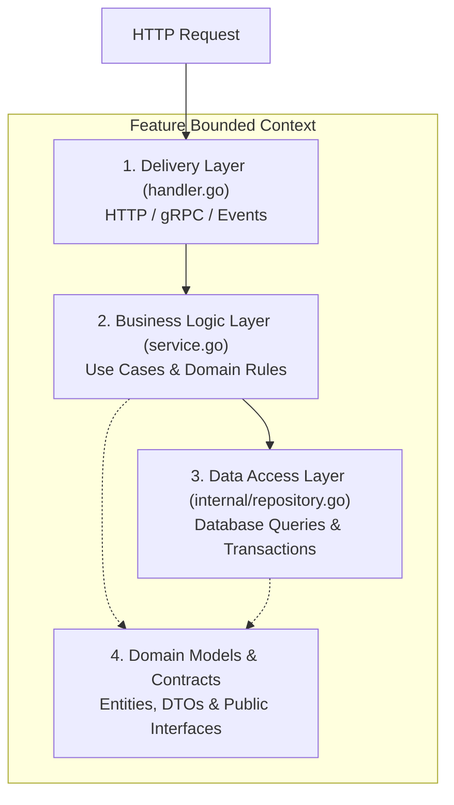
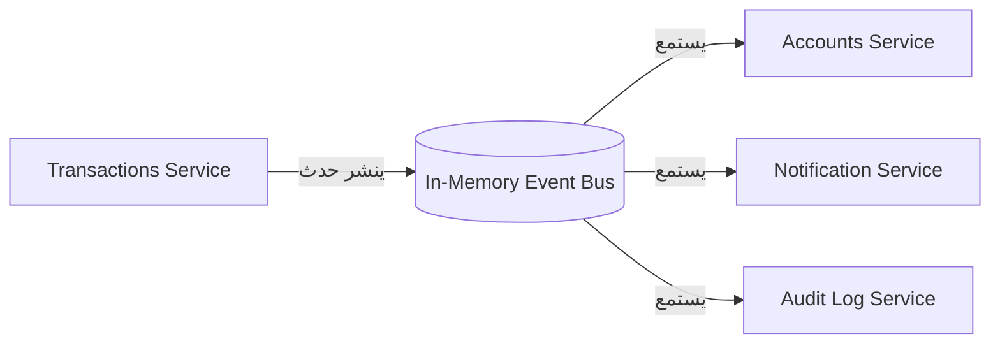
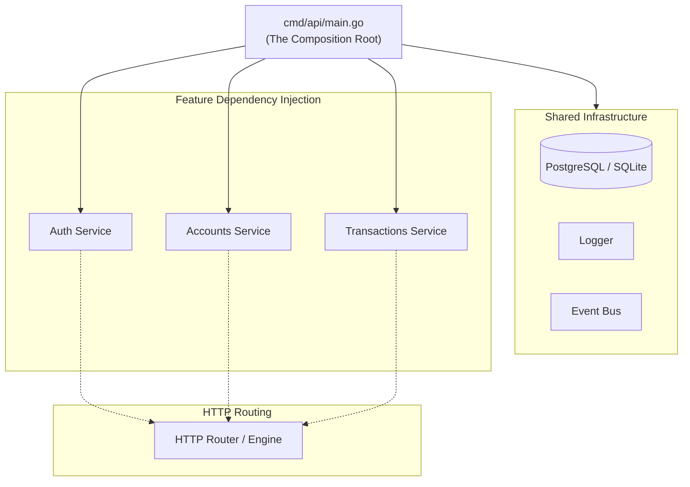

# التحليل المعماري الشامل: هيكلة مشاريع Go حسب الميزات (Package by Feature / Modular Monolith)

> **إعداد وتحليل فني مبني على المصادر الرسمية والتجارب العالمية لمهندسي لغة Go**  
> **تاريخ التقرير:** نوفمبر 2026  
> **حالة الوثيقة:** معتمدة وموجهة لبناء وتطوير المشاريع البرمجية بنظام Modular Monolith في Go

---

## فهرس المحتويات

1. [المقدمة والخلفية الهندسية](#1-المقدمة-والخلفية-الهندسية)
2. [المصادر والمراجع العالمية والرسمية المعتمدة](#2-المصادر-والمراجع-العالمية-والرسمية-المعتمدة)
3. [الهيكل المعماري للمشروع وتشريح الميزة الواحدة (Feature Anatomy)](#3-الهيكل-المعماري-للمشروع-وتشريح-الميزة-الواحدة-feature-anatomy)
4. [التعامل مع المكونات المشتركة (Shared & Cross-Cutting Concerns)](#4-التعامل-مع-المكونات-المشتركة-shared--cross-cutting-concerns)
5. [حدود كل ميزة واستقلاليتها (Feature Boundaries & Encapsulation)](#5-حدود-كل-ميزة-واستقلاليتها-feature-boundaries--encapsulation)
6. [إدارة الاعتماديات وآليات التواصل بين الميزات (Inter-Feature Communication)](#6-إدارة-الاعتماديات-وآليات-التواصل-بين-الميزات-inter-feature-communication)
7. [تجميع المكونات وتشغيل النظام (Wiring & Composition Root)](#7-تجميع-المكونات-وتشغيل-النظام-wiring--composition-root)
8. [مقارنة معمارية في Go: موديول واحد بحزم داخلية أم مساحة عمل `go.work`؟](#8-مقارنة-معمارية-في-go-موديول-واحد-بحزم-داخلية-أم-مساحة-عمل-gowork)
9. [خارطة طريق وتوصيات عملية لمشروع Cashflow Backend](#9-خارطة-طريق-وتوصيات-عملية-لمشروع-cashflow-backend)

---

## 1. المقدمة والخلفية الهندسية

في تطوير الأنظمة الحديثة بلغة **Go**، يواجه المهندسون معضلة كلاسيكية في هيكلة الشيفرة المصدرية (Codebase Organization):

### التقسيم الأفقي التقليدي (Package by Layer / N-Tier)

في لغات مثل Java أو PHP، اعتاد المطورون وضع المكونات في مجلدات حسب نوعها التقني:

```text
├── controllers/
├── models/
├── services/
└── repositories/
```

**لماذا يُعد هذا النمط كارثياً ومضاداً لفلسفة Go (Anti-Pattern)؟**

1. **تدمير التماسك (Low Cohesion):** إضافة ميزة جديدة أو تعديلها يتطلب القفز بين 4 أو 5 حزم مختلفة.
2. **الاعتماديات الدائرية (Import Cycles):** بما أن لغة Go تمنع منعاً باتاً استيراد الحزم بشكل دائري على مستوى المترجم (`import cycle not allowed`)، فإن وضع النماذج في حزمة `models` والخدمات في `services` يؤدي حتماً إلى دورات اعتماد مغلقة بمجرد تشابك العلاقات.
3. **مخالفة فلسفة Go للحزم:** في لغة Go: **"Packages provide, they do not contain"** (الحزمة تقدم خدمة أو قدرة وظيفية محددة، وليست وعاءً لتجميع ملفات من نفس النوع التقني).

### التقسيم العمودي حسب الميزة (Package by Feature / Vertical Slice Architecture)

النهج الأفضل عالمياً هو **تقسيم النظام إلى ميزات وظيفية مستقلة (Modular Monolith)**؛ بحيث تحتوي كل ميزة (`feature`) على كافة طبقاتها الخاصة:

- واجهة الدخول (Transport / Handler).
- منطق الأعمال وقواعد النطاق (Business Domain / Use Cases).
- الوصول إلى البيانات (Repository / Store).
- نماذج البيانات والتحقق الخاصة بها (Models / DTOs).

كل ميزة تشكل وحدة وظيفية مكتملة (Self-Contained Bounded Context)، ما يتيح:

- سهولة الفهم والاختبار.
- سرعة النقل مستقبلاً إلى خدمة مصغرة (Microservice) دون إعادة هيكلة جذرية.
- انعدام التداخل غير المصرح به بين الميزات.

---

## 2. المصادر والمراجع العالمية والرسمية المعتمدة

استند هذا التحليل إلى كبرى المرجعيات والمؤلفات الهندسية المعترف بها في مجتمع Go الدولي:

1. **إرشادات Go الرسمية وإعلانات اللغة:**
   - **Rob Pike & Russ Cox:** مدونات Go الرسمية، وتحديداً مبدأ تصميم الحزم، وتقديم مجلد `internal/` (الذي تم تضمينه رسمياً بدءاً من Go 1.4 لفرض خصوصية الحزم على مستوى المترجم).
   - **Effective Go & Go Code Review Comments:** توصيات التسمية المباشرة للحزم، وتجنب الأسماء المبهمة مثل `utils` و`common`.
   - **Go Proverbs:** الحكمة الشهيرة من Rob Pike: *"A little copying is better than a little dependency"* ومبدأ *"Accept interfaces, return structs"*.

2. **Package-Oriented Design (POD) - Bill Kennedy (Ardan Labs):**
   - المعمارية الرائدة المعتمدة لدى **Ardan Labs**، والتي تضع قواعد صارمة لفصل مشاريع التطبيق (`Application Projects`) عن المكونات التأسيسية (`Kit / Platform`)، ومنع أي استدعاء عابر بين النطاقات غير المصرح بها.

3. **How Do You Structure Your Go Apps - Kat Zień (GopherCon):**
   - المحاضرة العالمية الشهيرة في مؤتمر GopherCon، والتي فندت فيها عيوب التقسيم الطبقي (Flat & Layered) لصالح التقسيم المبني على النطاق والوظائف (Domain/Feature-Driven Design).

4. **Standard Package Layout - Ben Johnson:**
   - أحد أشهر المراجع الهندسية في Go، والذي يركز على تعريف النطاقات الصريحة وعزل البنية التحتية عن منطق التطبيق.

5. **Modular Monolith & DDD in Go - Three Dots Labs (Wild Workouts):**
   - سلسلة متقدمة وتطبيق مرجعي مفتوح المصدر يشرح كيفية بناء Modular Monolith في Go باستخدام مبادئ Clean Architecture وDomain-Driven Design (DDD)، والتواصل بين الميزات عبر الأحداث الداخلية (In-Memory Events) أو واجهات المستهلك.

6. **Uber Go Style Guide:**
   - إرشادات شركة Uber الرسمية في تنظيم المشاريع البرمجية، وتطبيق Dependency Injection، وحظر استخدام الحالة المشتركة العامة (Global State).

---

## 3. الهيكل المعماري للمشروع وتشريح الميزة الواحدة (Feature Anatomy)

### 3.1 الهيكل العام للمشروع (Project Tree)

```text
cashflow_backend/
├── cmd/ (أو apps/)
│   └── api/
│       └── main.go                 # نقطة التجميع والتشغيل (Composition Root)
│
├── internal/                       # كود خاص بالمشروع يمنع المترجم استيراده من خارجه
│   │
│   ├── shared/                     # المكونات الفنية المشتركة فقط (Technical Kernel)
│   │   ├── config/                 # إعدادات النظام وقراءة البيئة
│   │   ├── database/               # اتصال قاعدة البيانات (Connection Pool & Migrations)
│   │   ├── logger/                 # نظام التسجيل المنظم (Structured Logging)
│   │   ├── response/               # استجابات HTTP والأخطاء الموحدة
│   │   └── eventbus/               # ناقل الأحداث الداخلي بالذاكرة (In-Memory Event Bus)
│   │
│   └── features/                   # ميزات النظام الوظيفية (Vertical Slices)
│       ├── auth/                   # ميزة المصادقة
│       │   ├── internal/           # تفاصيل داخلية خاصة بميزة المصادقة فقط
│       │   │   └── repository.go   # تنفيذ استعلامات DB للمستخدمين
│       │   ├── user.go             # الكيانات ونماذج النطاق العامة
│       │   ├── service.go          # منطق الأعمال (Use Cases)
│       │   ├── handler.go          # نقاط نهاية HTTP
│       │   ├── contracts.go        # الواجهات أو الـ DTOs التي تتيح للآخرين طلب خدمات
│       │   └── service_test.go
│       │
│       ├── accounts/               # ميزة الحسابات المالية
│       │   ├── internal/
│       │   │   └── repository.go
│       │   ├── account.go
│       │   ├── service.go
│       │   ├── handler.go
│       │   ├── contracts.go
│       │   └── service_test.go
│       │
│       └── transactions/           # ميزة المعاملات المالية
│           ├── internal/
│           │   └── repository.go
│           ├── transaction.go
│           ├── service.go
│           ├── handler.go
│           └── service_test.go
│
├── go.mod                          # أو go.work في حالة المعمارية المتعددة
└── Makefile
```

### 3.2 التشريح الداخلي للميزة (Feature Anatomy)

تحتوي كل ميزة على طبقاتها المعمارية الخاصة التي تعمل معاً كوحدة متكاملة:



1. **طبقة التوصيل والاستقبال (Delivery / Transport Layer):**
   - تمثل `handler.go`. وظيفتها تحويل بروتوكول النقل (HTTP JSON، أو gRPC، أو CLI) إلى نداءات دوال نقية وتمريرها لمنطق الأعمال.
   - تقوم بالتحقق المبدئي من صحة المدخلات (Validation).

2. **طبقة منطق الأعمال والنطاق (Business Domain / Use Cases):**
   - تمثل `service.go`. تحتوي على جوهر العمليات: قواعد فتح الحساب، القيود المالية، تسجيل المعاملة، وتطبيق سياسات النظام.
   - لا تعتمد على HTTP ولا تعرف نوع قاعدة البيانات المستخدمة (SQL، Mongo، إلخ).

3. **طبقة الوصول إلى البيانات (Data Access / Repository):**
   - تمثل `internal/repository.go`. مسؤولة عن استعلامات SQL، وحفظ الكيانات واسترجاعها.
   - توضع داخل مجلد `internal` التابع للميزة حتى لا تتمكن أي ميزة أخرى من الوصول المباشر لقاعدة البيانات أو استدعاء الاستعلامات المباشرة.

---

## 4. التعامل مع المكونات المشتركة (Shared & Cross-Cutting Concerns)

أحد أكبر الأخطاء التي تدمر مشاريع Go مع الوقت هو **"مكب النفايات المشترك" (The Shared Garbage Dump Anti-Pattern)**.

### 4.1 ماذا يوضع في المشترك (`shared` / `platform`)؟

يُسمح بوضع **البنية التحتية الفنية فقط (Technical Infrastructure Kernel)**، وهي الأشياء العامة التي لا تحتوي على أي منطق أعمال تجاري:

| المكون المشترك | أمثلة مقبولة | الوصف |
| :--- | :--- | :--- |
| **قاعدة البيانات** | `database.Connect()`, `*sql.DB` | إنشاء الـ Connection Pool وإدارته |
| **السجلات والمراقبة** | `logger.New()`, Prometheus Metrics | تهيئة الـ Structured Logger وتتبع الأداء |
| **مساعدات الاستجابة** | `response.JSON()`, `response.Error()` | توحيد شكل خرج الـ API |
| **الإعدادات والبيئة** | `config.Load()` | قراءة متغيرات البيئة `.env` وملفات YAML |
| **الأمن والتشفير العام** | `hasher.Bcrypt()`, `jwt.TokenManager` | خوارزميات عامة لا تخص مستخدماً بعينه |
| **باص الأحداث الداخلي** | `eventbus.Bus` | واجهة لنشر واستقبال الأحداث داخل الذاكرة |

### 4.2 ما الذي يُحظر قطيعاً وضعه في المشترك؟

1. **نماذج الأعمال (Domain Entities):** حظر إنشاء حزمة عامة باسم `models` تحوي `User` و`Account` و`Transaction`. كل كيان ينتمي حصراً لميزته.
2. **منطق التحقق التجاري (Business Validation):** شروط مثل "الرصيد لا يمكن أن يكون سالباً" مكانها ميزة `accounts` وليس كوداً مشتركاً.
3. **مستودعات البيانات (Repositories):** لا توجد عمليات مشتركة للبيانات تخص كيانات مختلفة.

> [!IMPORTANT]
> **قاعدة بيل كينيدي (Bill Kennedy) الصارمة:**  
> *"إذا كان لديك حزمة باسم `utils` أو `helpers` أو `common`، فهذا اعتراف ضمني بضعف التصميم. قسّم الوظائف حسب ما تقدمه (`package hasher`, `package jsonwriter`)."*

---

## 5. حدود كل ميزة واستقلاليتها (Feature Boundaries & Encapsulation)

لضمان ألا تتحول المنظومة إلى "كرة طين متشابكة" (Big Ball of Mud)، تفرض الممارسات العالمية ثلاث قواعد صارمة:

### 5.1 عزل مخطط قاعدة البيانات (Schema Isolation)

- كل ميزة تملك جداولها الخاصة في قاعدة البيانات.
- **ممنوع تماماً:** كتابة استعلام `JOIN` في ميزة `transactions` يربط مباشرة مع جدول `users` التابع لميزة `auth`.
- **البديل الهيكلي:** تخزين المفتاح الأجنبي كمعرّف فقط (`UserID uuid.UUID`). إذا احتاجت ميزة المعاملات للتحقق من هوية المستخدم، يتم ذلك عبر واجهة خدمة الميزة الأخرى أو عبر مصفوفة أحداث مسبقة.

```text
[Auth Feature]           [Accounts Feature]           [Transactions Feature]
       ↓                         ↓                              ↓
 Table: users             Table: accounts               Table: transactions
 (لا يسمح بالربط           (لا يسمح بالربط                 (يحتوي AccountID
  المباشر عبر SQL)          المباشر عبر SQL)                فقط كمعرف خارجي)
```

### 5.2 عزل النماذج ومبدأ الحماية (Information Hiding)

- نماذج قاعدة البيانات (Database Row Structs) داخل الميزة يجب أن تكون **غير مصدّرة (Unexported / Lowercase)** أو موجودة داخل مجلد `internal/` الخاص بالميزة.
- إذا احتاجت ميزة أخرى بيانات، تصدر الميزة DTO مخصص وخفيف (Data Transfer Object) يحمل فقط ما يحتاجه الطرف الآخر، وليس الكيان الكامل ببياناته الحساسة.

---

## 6. إدارة الاعتماديات وآليات التواصل بين الميزات (Inter-Feature Communication)

هذا هو الجانب الأكثر حساسية وأهمية في هندسة النظم البرمجية بلغة Go.

### 6.1 معضلة الاعتماديات الدائرية (Circular Dependencies / Import Cycles)

في Go، إذا استوردت حزمة `transactions` حزمة `accounts`، واستوردت حزمة `accounts` حزمة `transactions`، سيرفض المترجم بناء النظام فوراً برسالة:

```text
package cashflow/features/transactions
    imports cashflow/features/accounts
    imports cashflow/features/transactions: import cycle not allowed
```

لحل هذه المعضلة وإدارة الاعتماديات بين الميزات، تعتمد الشركات العالمية الأنماط الأربعة التالية:

---

### النمط 1: واجهات يحددها المستهلك (Consumer-Driven Interfaces)

**المبدأ الذهبي في Go:**
> *"Accept interfaces, return structs. Interfaces belong to the consumer, not the producer."*

بدلاً من أن تقوم ميزة `transactions` باستيراد ميزة `accounts` بالكامل، تقوم ميزة `transactions` بتعريف **واجهة محلية وصغيرة جداً** تحدد فيها فقط ما تحتاجه للقيام بعملها.

#### مثال عملي وتطبيقي

**1. داخل ميزة المعاملات (`features/transactions/service.go`):**

```go
package transactions

import "context"

// Consumer-driven interface:
// ميزة المعاملات هي التي تعرف هذه الواجهة داخل حزمتها الخاصة!
// لا تستورد حزمة accounts إطلاقاً!
type AccountBalanceUpdater interface {
    VerifyAndDeductBalance(ctx context.Context, accountID string, amount float64) error
}

type Service struct {
    repo           Repository
    accountService AccountBalanceUpdater // اعتمادية عبر Interface محلي
}

func NewService(repo Repository, accUpdater AccountBalanceUpdater) *Service {
    return &Service{
        repo:           repo,
        accountService: accUpdater,
    }
}

func (s *Service) CreateTransaction(ctx context.Context, accountID string, amount float64) error {
    // التحقق من الرصيد وخصمه دون معرفة أي تفاصيل عن بنية الحسابات
    if err := s.accountService.VerifyAndDeductBalance(ctx, accountID, amount); err != nil {
        return err
    }
    return s.repo.SaveTransaction(ctx, accountID, amount)
}
```

**2. داخل ميزة الحسابات (`features/accounts/service.go`):**

```go
package accounts

import "context"

type Service struct {
    repo Repository
}

// Service تعيد Struct حقيقي وليس Interface
func NewService(repo Repository) *Service {
    return &Service{repo: repo}
}

// هذه الدالة تطابق تلقائياً توقيع الواجهة المطلوبة في transactions
// بفضل نظام Go للـ Structural Subtyping، دون أن تعرف accounts شيئاً عن transactions
func (s *Service) VerifyAndDeductBalance(ctx context.Context, accountID string, amount float64) error {
    // منطق التحقق والخصم
    return s.repo.UpdateBalance(ctx, accountID, -amount)
}
```

**3. التوصيل في نقطة التجميع (`cmd/api/main.go`):**

```go
// في main.go
accService := accounts.NewService(accRepo)

// نقوم بحقن accService داخل transactionsService مباشرة
// لأن Go يتأكد وقت الترجمة (Compile-time) من تطابق الدوال
txService := transactions.NewService(txRepo, accService)
```

**النتيجة المعمارية:**

- ميزة `transactions` لا تعتمد على `accounts`.
- ميزة `accounts` لا تعتمد على `transactions`.
- **صفر ارتباط مباشر (Zero Direct Coupling)، واستحالة حدوث دورة استيراد (No Import Cycles).**

---

### النمط 2: حزمة العقود العامة الخفيفة (Public Contracts / Anti-Corruption Layer)

إذا كانت ميزة تقدم خدمات متعددة وتود تعريف العقود بشكل موحد دون تسريب تفاصيلها الداخلية، يمكن للميزة إنشاء ملف أو حزمة فرعية عامة `contracts`:

```text
features/accounts/
├── contracts/          # متاح للاستيراد الخارجي فقط
│   └── contract.go     # يحتوي على DTOs نقية والواجهات المصرح بها
├── internal/           # تفاصيل التخزين والكيانات الداخلية المشفرة
├── service.go
└── handler.go
```

بهذه الطريقة، تستورد الميزات الأخرى `accounts/contracts` الخفيف فقط، والذي لا يستورد بدوره أي شيء آخر، ما يضمن أحادية اتجاه شجرة الاعتماديات (Strict DAG - Directed Acyclic Graph).

---

### النمط 3: التواصل غير المتزامن بالأحداث (In-Memory Domain Events)

وهو النمط الأكثر نضجاً في معماريات الـ Modular Monolith والأنظمة المالية الكبرى (مثل Stripe أو Uber).

بدلاً من أن تنادي ميزة المعاملات ميزة الحسابات أو ميزة التقارير أو الإشعارات بشكل متزامن مباشر، تقوم بنشر حدث (`Domain Event`):



#### كيف يُنفذ هذا النمط في Go؟

باستخدام ناقل أحداث داخلي خفيف في الذاكرة (سواء عبر Go Channels أو مكتبة مثل `github.com/ThreeDotsLabs/watermill`):

```go
// في shared/eventbus/bus.go
type Event interface {
    EventName() string
}

type HandlerFunc func(ctx context.Context, evt Event) error

type EventBus interface {
    Publish(ctx context.Context, event Event) error
    Subscribe(eventName string, handler HandlerFunc)
}
```

عند حدوث عملية تحويل مالي داخل `transactions`:

```go
event := TransactionCompletedEvent{
    TransactionID: tx.ID,
    AccountID:     tx.AccountID,
    Amount:        tx.Amount,
}
s.eventBus.Publish(ctx, event)
```

ميزات الإشعارات، الحسابات، أو سجل المراجعة (Audit Log) تشترك في هذا الحدث وتنفذ مهامها باستقلالية تامة، دون أن تعرف ميزة `transactions` من يستمع لها.

---

### النمط 4: المعاملات العابرة للحدود (Cross-Boundary Transactions)

في الأنظمة المالية، ماذا لو خصمنا الرصيد من الحساب في ميزة `accounts` لكن فشل تسجيل المعاملة في ميزة `transactions`؟

لدينا خياران معتمدان:

1. **في مرحلة الـ Monolith (نفس قاعدة البيانات):**
   - تمرير سياق المعاملة `context` أو واجهة معاملة موحدة `shared/database.AtomicTransaction` تضمن تنفيذ الاستعلامين داخل نفس الـ DB Transaction (`BEGIN ... COMMIT`).
2. **المعمارية الموزعة (Saga Pattern / Compensating Transactions):**
   - استخدام المنسق (Orchestrator) في طبقة الخدمة لتنفيذ خطوة تعويضية في حال فشل أي عملية لاحقة (مثلاً: استرجاع الرصيد تلقائياً إذا فشلت عملية القيد).

---

## 7. تجميع المكونات وتشغيل النظام (Wiring & Composition Root)

### 7.1 مفهوم الـ Composition Root

في فلسفة Go، يجب ألا تقوم أي ميزة بتهيئة نفسها بنفسها مع البنية التحتية، ولا يجوز استخدام متغيرات عامة (Global Singletons).

المكان الوحيد المسموح له بإنشاء الاتصالات وحقن التبعيات وربط النظام هو:  
**`cmd/api/main.go` (أو `apps/api/main.go`)** ويُعرف بـ **Composition Root**.



### 7.2 نموذج شيفرة الـ Composition Root الكامل

```go
package main

import (
    "context"
    "log"
    "net/http"
    "os"
    "os/signal"
    "syscall"
    "time"

    "cashflow/internal/shared/config"
    "cashflow/internal/shared/database"
    "cashflow/internal/shared/eventbus"
    "cashflow/internal/shared/logger"

    "cashflow/internal/features/accounts"
    "cashflow/internal/features/auth"
    "cashflow/internal/features/transactions"
)

func main() {
    // 1. تهيئة الإعدادات المشتركة
    cfg := config.Load()
    appLogger := logger.New(cfg.LogLevel)

    // 2. إنشاء مجمع اتصالات قاعدة البيانات
    db, err := database.Connect(cfg.DatabaseURL)
    if err != nil {
        appLogger.Fatal("failed to connect to db", "error", err)
    }
    defer db.Close()

    // 3. تهيئة باص الأحداث الداخلي
    bus := eventbus.NewInternalBus()

    // 4. تهيئة ميزة المصادقة (Auth)
    authRepo := auth.NewRepository(db)
    authService := auth.NewService(authRepo, cfg.JWTSecret)
    authHandler := auth.NewHandler(authService)

    // 5. تهيئة ميزة الحسابات (Accounts)
    accRepo := accounts.NewRepository(db)
    accService := accounts.NewService(accRepo, bus)
    accHandler := accounts.NewHandler(accService)

    // 6. تهيئة ميزة المعاملات (Transactions) وحقن خدمة الحسابات وباص الأحداث
    txRepo := transactions.NewRepository(db)
    txService := transactions.NewService(txRepo, accService, bus)
    txHandler := transactions.NewHandler(txService)

    // 7. إعداد موجه الـ HTTP وتسجيل مسارات كل ميزة
    mux := http.NewServeMux()
    
    // Register Feature Routes
    authHandler.RegisterRoutes(mux)
    accHandler.RegisterRoutes(mux)
    txHandler.RegisterRoutes(mux)

    // 8. تشغيل السيرفر مع الإغلاق الآمن (Graceful Shutdown)
    server := &http.Server{
        Addr:         ":" + cfg.Port,
        Handler:      mux,
        ReadTimeout:  10 * time.Second,
        WriteTimeout: 10 * time.Second,
    }

    go func() {
        appLogger.Info("server running", "port", cfg.Port)
        if err := server.ListenAndServe(); err != nil && err != http.ErrServerClosed {
            log.Fatalf("server error: %v", err)
        }
    }()

    // انتظار إشارة إنهاء التشغيل
    quit := make(chan os.Signal, 1)
    signal.Notify(quit, syscall.SIGINT, syscall.SIGTERM)
    <-quit

    ctx, cancel := context.WithTimeout(context.Background(), 5*time.Second)
    defer cancel()
    server.Shutdown(ctx)
    appLogger.Info("server exited cleanly")
}
```

---

## 8. مقارنة معمارية في Go: موديول واحد بحزم داخلية أم مساحة عمل `go.work`؟

يمتلك مطورو Go أسلوبين لتنظيم الميزات:

### الأسلوب الأول: Single Module with `internal/features/` (الأكثر شيوعاً واستقراراً عالمياً)

يكون في جذر المشروع ملف `go.mod` واحد، وتكون الميزات عبارة عن Go Packages تحت `internal/features/`.

- **المزايا:**
  - تطابق تلقائي مع أدوات لغة Go القياسية (`go build ./...`, `go test ./...`, `golangci-lint`).
  - سهولة استدعاء واجهات المستهلك المشتركة وتمرير الـ Structs.
  - إدارة موحدة ومبسطة للتبعيات الخارجية (نسخة واحدة لكل مكتبة في المشروع).
- **العيوب:**
  - قد يغري المطورين المبتدئين باستيراد حزم الميزات عشوائياً إذا لم يلتزموا بوضع المستودعات في `internal/`.

### الأسلوب الثاني: Multi-Module Workspace عبر `go.work` (المستخدم حالياً في المشروع)

كل ميزة تملك ملف `go.mod` خاص بها، ويربطها ملف `go.work` في الجذر.

- **المزايا:**
  - عزل تام واستقلالية تقنية كاملة لكل ميزة.
  - جاهزية فورية بنسبة 100% لنقل أي ميزة إلى مستودع منفصل وخدمة مصغرة (Microservice) في دقائق.
  - يفرض المترجم قيوداً صارمة جداً تمنع التداخل غير المباشر.
- **العيوب والمحاذير التي يجب الانتباه لها:**
  - إذا احتاجت ميزة `transactions` خدمة من `accounts`، يجب تعريف المسار محلياً عبر `replace` أو `go.work`.
  - إدارة نسخ المكتبات تتطلب مواءمة عبر الـ `go.mod` المختلفة لتفادي تعارض الإصدارات.

> [!TIP]
> **الخلاصة المعمارية:**  
> كِلا الأسلوبين صالح ومعتمد، ولكن النمط المعتمد على **Consumer-Driven Interfaces** و**In-Memory Events** يجعل أسلوب الـ `go.work` الحالي في مشروع `cashflow_backend` ممتازاً وقوياً جداً لأنه يمنع التبعيات الدائرية على مستوى الموديولات نفسها.

---

## 9. خارطة طريق وتوصيات عملية لمشروع Cashflow Backend

بناءً على الكود الحالي للمشروع (`cashflow_backend`) والتحليل الهندسي أعلاه، نوصي باتباع الخطوات التالية:

1. **الالتزام بمبدأ "واجهات المستهلك" في المعاملات والحسابات:**
   - عدم استيراد `cashflow.local/accounts` مباشرة داخل ميزة `transactions` كبنية داخلية.
   - تعريف واجهة `AccountManager` محلية داخل `features/transactions/service.go`.
   - في `apps/api/main.go`، يتم تمرير `accountService` إلى `transactionsService`.

2. **عزل استعلامات قاعدة البيانات:**
   - نقل دوال التعامل مع البيانات في كل ميزة إلى مجلد `features/<name>/internal/` لضمان عدم وصول أي ميزة أخرى لقاعدة بيانات الميزة المجاورة.

3. **إضافة باص أحداث داخلي (In-Memory Event Bus):**
   - إنشاء موديول بسيط داخل `shared/eventbus` يتيح بث الأحداث (مثل: `TransactionCreated` و`AccountOverdrawn`).
   - يتيح هذا لباقي الميزات الاستجابة تلقائياً دون ربط مباشر في الشيفرة.

4. **توحيد عقود الاستجابة والخطأ في `shared/response`:**
   - استخدام الـ DTOs الخاصة بكل ميزة عند الإرجاع، وتوحيد مغلف الـ JSON (`status`, `data`, `error`).

---

### مراجع إضافية للقراءة والاطلاع

- [Ardan Labs: Package Oriented Design](https://www.ardanlabs.com/blog/2017/02/package-oriented-design.html)
- [Three Dots Labs: Modern Business Software in Go](https://threedots.tech/)
- [Dave Cheney: Practical Go: Real world advice for writing maintainable Go programs](https://dave.cheney.net/practical-go/presentations/qcon-china.html)
- [Ben Johnson: Standard Package Layout](https://www.gobeyond.dev/standard-package-layout/)
- [GopherCon 2018: Kat Zień - How Do You Structure Your Go Apps](https://www.youtube.com/watch?v=oL6JBUk6tj0)
