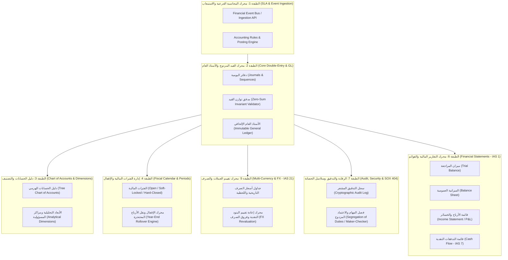
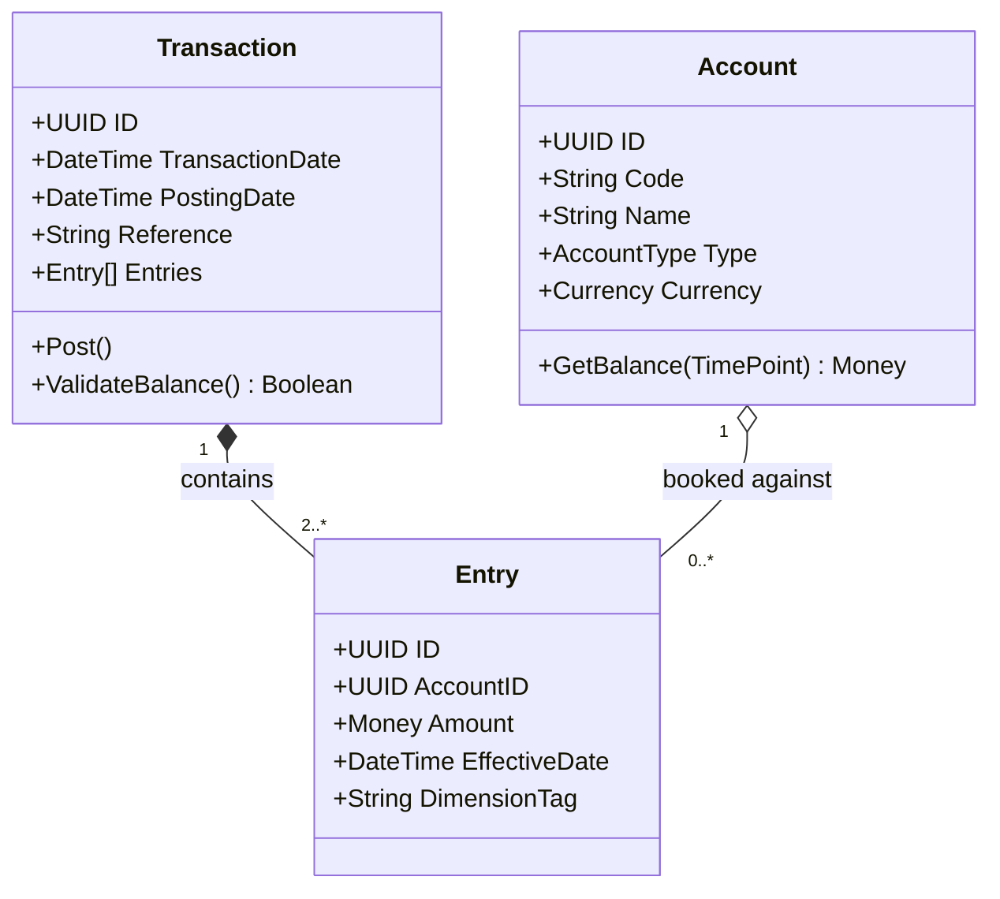
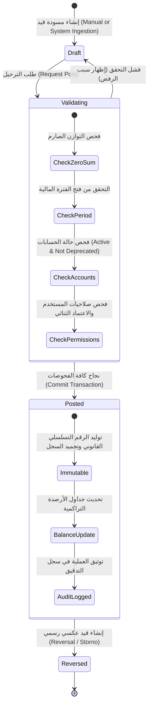

# التحليل الشامل والمعماري لوحدة المحاسبة في النظام المالي وفق المعايير العالمية الرسمية

## (Pure Financial Accounting Engine & Core General Ledger Architecture)

> **طبيعة الوثيقة:** مرجع معماري وتحليلي مستقل وشامل  
> **نطاق التحليل:** المحاسبة المالية البحتة (Financial Accounting / Core Ledger Engine) مع العزل التام عن العمليات التجارية والتشغيلية (Decoupled from Commercial & Operational Systems).  
> **المرجعيات الرسمية العالمية:** معايير التقارير المالية الدولية (IFRS / IASB)، مبادئ المحاسبة المقبولة عموماً (US GAAP / FASB)، معايير الرقابة والتدقيق (AICPA / SOX 404 / SOC 1 Type II)، المعايير الدولية للمعاملات المالية (ISO 20022 / ISO 4217)، وأنماط تصميم الأنظمة المالية لمارتن فاولر (Martin Fowler Accounting Patterns).

---

## فهرس المحتويات

1. [المقدمة والرؤية التأسيسية: المحاسبة المالية البحتة مقابل العمليات التجارية](#1-المقدمة-والرؤية-التأسيسية-المحاسبة-المالية-البحتة-مقابل-العمليات-التجارية)
2. [المصادر والمعايير العالمية الرسمية الحاكمة (Global Standards & Compliance Framework)](#2-المصادر-والمعايير-العالمية-الرسمية-الحاكمة)
   - 2.1 معايير المحاسبة الدولية (IFRS / IAS)
   - 2.2 معايير المحاسبة الأمريكية (US GAAP / FASB)
   - 2.3 معايير الامتثال والرقابة والتدقيق (SOX / AICPA SOC 1 / Basel)
   - 2.4 معايير البيانات والمراسلات المالية الدولية (ISO 20022 & ISO 4217)
3. [مصفوفة الفصل الصارم: المحاسبة المالية مقابل الأنظمة التجارية (Separation of Concerns Matrix)](#3-مصفوفة-الفصل-الصارم-المحاسبة-المالية-مقابل-الأنظمة-التجارية)
4. [البنية المعمارية الشاملة ومخطط الطبقات (Architectural Blueprint & Layered Architecture)](#4-البنية-المعمارية-الشاملة-ومخطط-الطبقات)
   - 4.1 الطبقة الأولى: استيعاب الأحداث المالية وقواعد المحاسبة الفرعية (Financial Event Ingestion & SLA)
   - 4.2 الطبقة الثانية: محرك القيد المزدوج والأستاذ العام (Core Double-Entry & General Ledger Engine)
   - 4.3 الطبقة الثالثة: دليل الحسابات وهيكل التصنيف المالي (Chart of Accounts & Dimensional Framework)
   - 4.4 الطبقة الرابعة: إدارة الفترات المالية والإقفال الدوري والسنوي (Fiscal Period & Period-End Closing Engine)
   - 4.5 الطبقة الخامسة: العملات المتعددة وتقييم فروق الصرف (Multi-Currency & FX Valuation Engine - IAS 21)
   - 4.6 الطبقة السادسة: محرك القوائم المالية والتقارير القانونية (Financial Statement & Reporting Engine - IAS 1)
   - 4.7 الطبقة السابعة: سجل التدقيق، عدم القابلية للتعديل، والرقابة الداخلية (Audit Trail, Immutability & SOX Controls)
5. [النماذج الرياضية والأنماط المعمارية للقيود (Mathematical Invariants & Design Patterns)](#5-النماذج-الرياضية-والأنماط-المعمارية-للقيود)
   - 5.1 معادلة التوازن المحاسبي الإلزامية (Zero-Sum Invariant)
   - 5.2 أنماط مارتن فاولر المحاسبية (Account, Entry, Transaction, Balance Derivation)
   - 5.3 نمط تجميع الأحداث وفصل الاستعلام (Event Sourcing & CQRS in Financial Ledgers)
   - 5.4 معالجة التعديلات والأخطاء المحاسبية (Compensating Entries / Storno vs Reversals)
6. [دورة حياة المعاملة المحاسبية (Financial Transaction Lifecycle)](#6-دورة-حياة-المعاملة-المحاسبية)
7. [نموذج البيانات المعياري المقترح (Canonical Financial Data Model)](#7-نموذج-البيانات-المعياري-المقترح)
8. [الخلاصة والتوصيات الهندسية لنظام مالي فائق الاعتمادية](#8-الخلاصة-والتوصيات-الهندسية-لنظام-مالي-فائق-الاعتمادية)

---

## 1. المقدمة والرؤية التأسيسية: المحاسبة المالية البحتة مقابل العمليات التجارية

في هندسة الأنظمة المؤسسية الحديثة (Enterprise & Fintech Architecture)، يقع الكثير من المطورين ومهندسي البرمجيات في خطأ جوهري يتمثل في خلط **المحاسبة المالية (Financial Accounting)** مع **العمليات التجارية والتشغيلية (Commercial & Operational Operations)**.

### ما هي العمليات التجارية والتشغيلية (Commercial/Operational Systems)؟

هي الأنظمة والوحدات المسؤولة عن إدارة النشاط اليومي للعمل التجاري:
- إدارة علاقات العملاء (CRM) ومراحل الفرص البيعية.
- أوامر البيع (Sales Orders) وعروض الأسعار (Quotations).
- أوامر الشراء (Purchase Orders) واختيار الموردين.
- إدارة المستودعات والمخزون الحركي (Physical Inventory Tracking, Warehouse Bins, Lots, Serial Numbers).
- عمليات التصنيع وخطوط الإنتاج (MRP, BOM).
- نقاط البيع (POS) وتفاعل الكاشير المباشر.

### ما هي وحدة المحاسبة للنظام المالي البحت (Pure Financial Accounting Engine)؟

هي المحرك الحسابي والرقابي التجريدي المسؤول حصرًا عن **تسجيل، تصنيف، تلخيص، والتحقق من الأثر المالي للقيمة الاقتصادية**، بهدف تقديم صورة صادقة وعادلة للمركز المالي والأداء المالي للمنشأة وفقاً للقوانين والمعايير الدولية.
- **لا تعرف وحدة المحاسبة شيئاً عن طريقة شحن البضاعة أو مسار الموافقة على أمر الشراء.**
- **لا تخزن وحدة المحاسبة أرقام الرفوف أو صور المنتجات.**
- تستقبل المحاسبة فقط **حدثاً مالياً معتمداً (Certified Economic Event)** يترجم فوراً إلى قيود مدينة ودائنة متوازنة بدقة مطلقة.

```mermaid
flowchart LR
    subgraph CommercialSystems["الأنظمة التجارية والتشغيلية (خارج المحاسبة)"]
        Sales["أوامر البيع والفوترة التجارية"]
        Proc["أوامر الشراء والموردين"]
        Inv["حركات المخزون والمستودعات"]
        HR["مسيرات الرواتب"]
        BankFeed["كشوفات الحسابات البنكية"]
    end

    subgraph SLA["طبقة العزل والترجمة المحاسبية (Subledger Accounting Engine)"]
        Mapper["محول الأحداث الاقتصادية إلى قيود محاسبية"]
        Rules["قواعد الترحيل المحاسبي المعيارية (Accounting Rules)"]
    end

    subgraph CoreAccountingEngine["وحدة المحاسبة المالية البحتة (Pure Financial Engine)"]
        GL["محرك الأستاذ العام (General Ledger)"]
        COA["دليل الحسابات (Chart of Accounts)"]
        Audit["سجل التدقيق والحصانة (Audit & Immutability)"]
        Periods["الفترات والإقفال الدوري (Fiscal Periods)"]
        Valuation["العملات وإعادة التقييم (Multi-Currency)"]
        Reports["التقارير والقوائم المالية (Financial Statements)"]
    end

    CommercialSystems -->|أحداث تجارية خام| Mapper
    Mapper -->|استناداً إلى| Rules
    Mapper -->|قيود مالية متوازنة غير قابلة للتعديل| CoreAccountingEngine
```



---

## 2. المصادر والمعايير العالمية الرسمية الحاكمة

تستند وحدة المحاسبة المالية إلى ركائز وقواعد قانونية ومعيارية معترف بها دولياً:

### 2.1 معايير المحاسبة الدولية (IFRS / IASB)

المجلس الدولي لمعايير المحاسبة (International Accounting Standards Board) يفرض المتطلبات الجوهرية الآتية:

1. **الإطار المفاهيمي للتقارير المالية (Conceptual Framework for Financial Reporting):**
   - تعريف العناصر الخمسة للقوائم المالية: الأصول (Assets)، الالتزامات (Liabilities)، حقوق الملكية (Equity)، الإيرادات (Income)، المصروفات (Expenses).
   - شروط الاعتراف المالي (Recognition Criteria) وإلغاء الاعتراف (Derecognition).
   - أسس القياس (Measurement Bases): التكلفة التاريخية (Historical Cost) مقابل القيمة العادلة (Fair Value).
2. **معيار المحاسبة الدولي رقم 1 (IAS 1 - Presentation of Financial Statements):**
   - متطلبات الهيكل العظمي للقوائم المالية الأساسية:
     - قائمة المركز المالي (Balance Sheet).
     - قائمة الربح أو الخسارة والدخل الشامل الآخر (Statement of Profit or Loss and OCI).
     - قائمة التغيرات في حقوق الملكية (Statement of Changes in Equity).
     - قائمة التدفقات النقدية (Statement of Cash Flows).
   - مبدأ الاستمرارية (Going Concern)، ومبدأ الاستحقاق المحاسبي (Accrual Basis of Accounting).
   - حظر المقاصة (No Offsetting) بين الأصول والالتزامات أو بين الإيرادات والمصروفات إلا بنص معياري صريح.
3. **معيار المحاسبة الدولي رقم 8 (IAS 8 - Accounting Policies, Changes in Accounting Estimates and Errors):**
   - التمييز بين التغيير في التقديرات المحاسبية (أثر مستقبلي) وتصحيح الأخطاء الجوهرية في الفترات السابقة (أثر بأثر رجعي Retrospective Restatement).
   - حظر مسح أو شطب القيود الخاطئة من السجلات التاريخية، وإلزامية المعالجة بقيود تسوية أو قيود عكسية (Reversing Entries / Storno).
4. **معيار المحاسبة الدولي رقم 21 (IAS 21 - The Effects of Changes in Foreign Exchange Rates):**
   - التفريق الصارم بين:
     - **عملة المعاملة (Transaction/Source Currency):** العملة التي نشأ بها الحدث.
     - **العملة الوظيفية (Functional Currency):** عملة البيئة الاقتصادية الأساسية للكيان.
     - **عملة العرض (Presentation/Reporting Currency):** العملة التي تصدر بها القوائم المالية.
   - التمييز بين البنود النقدية (Monetary Items) التي يعاد تقييمها في نهاية كل فترة مالية بسعر الإغلاق، والبنود غير النقدية (Non-Monetary Items) التي تبقى بسعر الصرف التاريخي.
   - تسجيل أرباح/خسائر تقلبات الصرف المحققة وغير المحققة (Realized & Unrealized FX Gains/Losses).
5. **معيار المحاسبة الدولي رقم 7 (IAS 7 - Statement of Cash Flows):**
   - تصنيف التدفقات النقدية إلى: تشغيلية (Operating)، استثمارية (Investing)، وتمويلية (Financing).

### 2.2 معايير المحاسبة الأمريكية (US GAAP / FASB)

الصادرة عن مجلس معايير المحاسبة المالية الأمريكي (Financial Accounting Standards Board):
- **الموضوع 205 (ASC 205 - Presentation of Financial Statements):** شروط عرض البيانات المالية ومطابقة موازين المراجعة.
- **الموضوع 830 (ASC 830 - Foreign Currency Matters):** تقييم العملات الأجنبية وترجمة الميزانيات المجمعة.
- **الموضوع 250 (ASC 250 - Accounting Changes and Error Corrections):** توثيق تدقيق الأخطاء وإعادة إصدار السجلات المالية.

### 2.3 معايير الامتثال والرقابة والتدقيق (SOX / AICPA SOC 1 / Basel)

1. **قانون ساربينز أوكسلي (Sarbanes-Oxley Act - SOX Sections 404 & 302):**
   - إلزام وجود ضوابط داخلية على التقارير المالية (Internal Controls over Financial Reporting - ICFR).
   - **فصل المهام (Segregation of Duties - SoD):** الشخص الذي يُنشئ القيد (Preparer/Maker) لا يملك صلاحية اعتماده أو ترحيله (Approver/Checker).
   - **سجل تدقيق كامل وغير قابل للتلاعب (Tamper-evident, Immutable Audit Log):** حفظ هوية المستخدم، والوقت الدقيق بالمللي ثانية، والبيانات قبل وبعد الحدث.
2. **معيار AICPA SOC 1 Type II (SSAE 18 / ISAE 3402):**
   - التأكد من أن النظام المالي يضمن نزاهة العمليات الحسابية ومنع التعديل المباشر على جداول قاعدة البيانات (No Direct DB Updates/Patches).
3. **معايير لجنة بازل للرقابة المصرفية (BCBS):**
   - كمال العمليات الحسابية، منع الأرصدة المعلقة، وصفرية الفروقات (Zero tolerance for unbalanced entries).

### 2.4 معايير البيانات والمراسلات المالية الدولية (ISO 20022 & ISO 4217)

* **ISO 4217 (Currency Codes & Minor Units):**
  - تعريف الأكواد الثلاثية للأموال (مثل USD, EUR, SAR, JPY, KWD).
  - تعريف أدق وحدة كسرية (Exponent / Minor Unit):
    - العملات الثنائية (سنتان / هللتان: Exponent = 2) مثل USD, EUR, SAR.
    - العملات الثلاثية (ثلاث خانات: Exponent = 3) مثل KWD, BHD, OMR, TND.
    - العملات الصفرية (بدون كسور: Exponent = 0) مثل JPY, KRW.
  - **قاعدة معمارية برمجية:** يحظر تخزين المبالغ المالية بأنواع الأعداد العشرية العائمة (`float` أو `double`). يجب استخدام الأعداد الصحيحة الموسعة (Minor Units / Cents) أو الأنواع العشرية ثابتة الدقة (`Decimal(38, 9)` / `Arbitrary-precision BigInt`).
- **ISO 20022 (Financial Services - Universal Financial Industry Message Scheme):**
  - معيار الرسائل المالية العالمية الموحد للربط بين البنوك والأنظمة المحاسبية:
    - `pain.001` (Customer Credit Transfer Initiation): أوامر الدفع الصادرة.
    - `camt.053` (Bank-to-Customer Statement): كشف الحساب البنكي الرسمي للتسوية المحاسبية.
    - `camt.052` (Bank-to-Customer Intraday Report): الحركات البنكية اللحظية.

---

## 3. مصفوفة الفصل الصارم: المحاسبة المالية مقابل الأنظمة التجارية

لضمان عدم تداخل العمليات التجارية مع محرك المحاسبة، يوضح الجدول التالي الحدود الفاصلة بدقة:

| الخاصية / الوظيفة | الوحدة التجارية والتشغيلية (Commercial Module) | وحدة المحاسبة المالية البحتة (Pure Accounting Module) |
| :--- | :--- | :--- |
| **الهدف الأساسي** | تسهيل المعاملات التجارية وخدمة العملاء وحركة البضائع. | إثبات الحقوق والالتزامات وإعداد القوائم المالية والامتثال القانوني. |
| **الكيانات المركزية (Core Entities)** | عميل، مورد، أمر بيع، أمر شراء، صنف، مستودع، شحنة، مسار بيع. | حساب (Account)، دفتر يومية (Journal)، قيد مالي (Move)، سطر حركة (Move Line)، فترة مالية (Fiscal Period). |
| **نوع السجلات** | قابلة للإلغاء والتعديل وإعادة الفتح حسب دورة العمل التجاري. | **غير قابلة للتعديل بتاتاً (Immutable / Append-Only)** بمجرد الترحيل. |
| **البيانات التفصيلية المخزنة** | أسماء المنتجات، أرقام الشاسيه/السيريال، مواعيد الشحن، العناوين، صور السلع. | رمز الحساب المالي، المبلغ بالعملة المصدرية والمحلية، المدين، الدائن، الأبعاد التحليلية، المعرف المالي. |
| **معالجة الأخطاء** | تعديل كمية الأمر، شطب الفاتورة المسودة، إلغاء عرض السعر. | **إنشاء قيد عكسي (Reversal Move)** أو قيد تسوية (Adjustment Entry)؛ يمنع الحذف نهائياً. |
| **أسلوب الترحيل** | فوري تفاعلي يعتمد على أزرار واجهة المستخدم التجارية. | ترحيل محاسبي محكم، إما فوري لكل حدث أو تجميعي دوري (Periodic Batch Posting) عبر محرك الـ SLA. |
| **الجمهور المستهدف** | موظفو المبيعات، مسؤولو المستودعات، مسؤولو المشتريات، خدمة العملاء. | المدير المالي (CFO)، المحاسبون القانونيون، المراجعون الخارجيون، السلطات الضريبية والرقابية. |

---

## 4. البنية المعمارية الشاملة ومخطط الطبقات

تم تصميم معمارية وحدة المحاسبة المالية وفق المعمارية النظيفة (Clean Architecture) والمعمارية السداسية الموجهة بالنطاق (DDD - Hexagonal Architecture)، مقسمة إلى **7 طبقات وظيفية مستقلة ومتكاملة**:



---

### 4.1 الطبقة الأولى: استيعاب الأحداث المالية وقواعد المحاسبة الفرعية (Financial Event Ingestion & SLA)

* **المفهوم القياسي:** محرك المحاسبة الفرعية (Subledger Accounting - SLA Engine) هو الحاجز الرقابي الأول. وظيفته تحويل الأحداث الاقتصادية الخام الصادرة من الأنظمة الخارجية أو الوحدات التجارية إلى قيود محاسبية مقننة.
- **كيفية العمل:**
  1. استقبال حدث مالي، مثل `GoodsReceiptConfirmed` أو `PaymentReceivedFromGateway` أو `PayrollCalculated`.
  2. تطبيق **قواعد الترحيل المحاسبي (Posting Rules / Accounting Schema Mapping)** المبرمجة مسبقاً من قبل الإدارة المالية.
  3. استخراج الحسابات المالية المقابلة (مثلاً: مدين: جاري البنك، دائن: أوراق قبض).
  4. التحقق من أن الحدث لم يسبق ترحيله باستخدام **مفتاح منع التكرار (Idempotency Key)**.
  5. تحويل الحدث إلى مسودة قيد مالي وتمريره إلى الطبقة الثانية.

### 4.2 الطبقة الثانية: محرك القيد المزدوج والأستاذ العام (Core Double-Entry & General Ledger Engine)

* **المفهوم القياسي:** هذا هو النواة المركزية للنظام (The Atomic Kernel). لا يسمح هذا المحرك بمرور أي معاملة إلا إذا استوفت المعايير الرياضية الدقيقة:
  - **قاعدة التوازن الصارم (Strict Balance):** إجمالي المبالغ المدينة = إجمالي المبالغ الدائنة بدقة متناهية.
  - **الترقيم التسلسلي القانوني الحصري (Gapless Sequential Numbering):** توليد رقم تسلسلي فريد وغير قابل للتراجع لكل دفتر يومية مالي على حدة (وفقاً للمتطلبات القانونية والضريبية).
  - **سجل الأستاذ العام التراكمي (Append-Only GL):** البيانات تُكتب فقط (Insert-Only). لا وجود لأمر `UPDATE` أو `DELETE` في جداول القيود وسطورها.

### 4.3 الطبقة الثالثة: دليل الحسابات وهيكل التصنيف المالي (Chart of Accounts & Dimensional Framework)

* **المفهوم القياسي:** هيكل شجرة الحسابات (COA) وفق معيار IAS 1 الذي ينظم حسابات المنشأة في 5 فئات جذرية قياسية:
  1. **الأصول (Assets) - كود 1xxxx:** طبيعتها مدينة افتراضياً (Normal Balance: Debit).
  2. **الالتزامات (Liabilities) - كود 2xxxx:** طبيعتها دائنة افتراضياً (Normal Balance: Credit).
  3. **حقوق الملكية (Equity) - كود 3xxxx:** طبيعتها دائنة افتراضياً (Normal Balance: Credit).
  4. **الإيرادات (Income/Revenue) - كود 4xxxx:** طبيعتها دائنة افتراضياً (Normal Balance: Credit).
  5. **المصروفات (Expenses) - كود 5xxxx:** طبيعتها مدينة افتراضياً (Normal Balance: Debit).
- **الأبعاد التحليلية (Multi-Dimensional Accounting):**
  بدلاً من تفريع شجرة الحسابات لملايين الحسابات الفرعية لكل فرع أو مشروع، يعتمد المحرك الحديث على **الأبعاد المحاسبية (Tags / Cost Centers / Analytical Dimensions)** المرفقة بكل سطر قيد (Move Line)، مما يتيح إعداد تقارير قطاعية طبقاً للمعيار الدولي **IFRS 8 (Operating Segments)** دون تشويه الحسابات القانونية.

### 4.4 الطبقة الرابعة: إدارة الفترات المالية والإقفال الدوري والسنوي (Fiscal Period & Period-End Closing Engine)

* **المفهوم القياسي:** تنقسم السنة المالية (Fiscal Year) إلى فترات محاسبية منتظمة (شهرية، ربع سنوية، سنوية).
- **حالات الفترة المالية (Period State Machine):**
  1. **مفتوحة (Open):** تقبل الترحيل والتسويات.
  2. **إقفال ناعم / تشغيلي (Soft Close):** يمنع ترحيل أي حركات جديدة من الأنظمة التشغيلية، ويُسمح فقط لمحاسبي الإدارة المالية بإدخال قيود التسويات والاستحقاقات (Accruals & Adjusting Entries).
  3. **إقفال صلب / تام (Hard Close):** الفترة مغلقة تماماً ومختومة برمجياً؛ يرفض محرك الترحيل أي محاولة لإضافة أو تعديل قيد بتاريخ يقع ضمن هذه الفترة.
- **محرك الإقفال السنوي (Year-End Rollover Engine):**
  - إقفال كافة حسابات قائمة الدخل (الإيرادات والمصروفات) بنقل أرصدتها بصافي الربح أو الخسارة إلى حساب **الأرباح المحتجزة (Retained Earnings)** ضمن حقوق الملكية.
  - تدوير أرصدة الميزانية العمومية (الأصول، الالتزامات، حقوق الملكية) لتصبح أرصدة افتتاحية (Opening Balances) للسنة الجديدة.

### 4.5 الطبقة الخامسة: العملات المتعددة وتقييم فروق الصرف (Multi-Currency & FX Valuation Engine - IAS 21)

* **المفهوم القياسي:** النظام المالي العالمي يجب أن يدعم معاملات بأي عملة قانونية (ISO 4217).
- **البنية الحسابية الثلاثية لكل سطر مالي (Tri-Currency Tuple):**
  كل سطر قيد محاسبي يحمل إلزامياً:
  1. `AmountCurrency`: المبلغ بالعملة المصدرية (Transaction Currency).
  2. `CurrencyID`: كود العملة المصدرية (مثل EUR).
  3. `Debit`: المبلغ بالعملة الوظيفية/المحلية (Functional Currency) المحسوب بسعر الصرف في تاريخ الترحيل.
  4. `Credit`: المبلغ بالعملة الوظيفية/المحلية (Functional Currency) المحسوب بسعر الصرف في تاريخ الترحيل.
- **إعادة التقييم الدوري (Foreign Exchange Revaluation Process):**
  في نهاية كل فترة محاسبية، يقوم المحرك بمراجعة الحسابات النقدية (Monetary Accounts كالعملاء، البنوك، والموردين بالعملات الأجنبية)، ومقارنة رصيدها المسجل بسعر الصرف الحالي في تاريخ الميزانية، وتوليد قيد تسوية آلي لحساب:
  - **أرباح/خسائر فروق تقلب أسعار الصرف غير المحققة (Unrealized FX Gain/Loss).**

### 4.6 الطبقة السادسة: محرك القوائم المالية والتقارير القانونية (Financial Statement & Reporting Engine - IAS 1)

يعتمد محرك التقارير المالية على تجميع لحظي أو إسقاطات مسبقة الأداء (Materialized Projections) للسجلات المحاسبية لإنتاج:

1. **ميزان المراجعة (Trial Balance):** قائمة بكافة الحسابات مع أرصدتها الافتتاحية، حركات المدين والدائن خلال الفترة، والأرصدة الختامية؛ مع التحقق الرياضي من $\sum \text{Debit Balances} = \sum \text{Credit Balances}$.
2. **قائمة المركز المالي (Balance Sheet):** عرض الأصول المتداولة وغير المتداولة، الالتزامات المتداولة وغير المتداولة، وحقوق الملكية في تاريخ محدد.
3. **قائمة الدخل والأرباح والخسائر (Income Statement / P&L):** مقارنة الإيرادات والمصروفات للوصول إلى مجمل وصافي الربح التشغيلي والنهائي للفترة.
4. **قائمة التدفقات النقدية (Statement of Cash Flows):** تتبع مصادر واستخدامات النقدية الفعلية.

### 4.7 الطبقة السابعة: سجل التدقيق، عدم القابلية للتعديل، والرقابة الداخلية (Audit Trail, Immutability & SOX Controls)

* **الحصانة عبر السلاسل التشفيرية (Cryptographic Hash-Chained Entries):**
  تحتوي كل معاملة على تجزئة تشفيرية (SHA-256 Hash) تشمل: الحقول المالية + تجزئة المعاملة السابقة (Merkle/Chain Tree). أي تعديل غير مصرح به في قاعدة البيانات يكسر السلسلة فوراً وتكتشفه أدوات التدقيق الآلي.
- **الاعتماد الثنائي (Dual Authorization / Maker-Checker):**
  المعاملات التي تتجاوز حداً مالياً معيناً أو قيود اليومية اليدوية (Manual Journal Entries) تتطلب موافقة مستخدم ثانٍ يحمل دوراً رقابياً مختلفاً.

---

## 5. النماذج الرياضية والأنماط المعمارية للقيود

### 5.1 معادلة التوازن المحاسبي الإلزامية (Zero-Sum Invariant)

في نظام القيد المزدوج، لكل قيد محاسبي $T$ يتكون من مجموعة من السطور $L = \{l_1, l_2, \dots, l_n\}$:

$$\forall T: \sum_{i=1}^{n} \text{Debit}(l_i) - \sum_{i=1}^{n} \text{Credit}(l_i) = 0$$

وبالنسبة للعملات الأجنبية:

$$\forall T, \forall C \in \text{Currencies}: \sum_{l \in L_C} \text{AmountCurrency}(l) = 0$$

(في حال كانت المعاملة بالكامل بعملة أجنبية واحدة).

وعلى مستوى ميزانية المنشأة بالكامل:

$$\text{Assets} = \text{Liabilities} + \text{Equity} + (\text{Income} - \text{Expenses})$$

### 5.2 أنماط مارتن فاولر المحاسبية (Martin Fowler Accounting Patterns)

اعتمدت الصناعة المالية العالمية أنماط مارتن فاولر المعمارية كمعيار أساسي لتصميم برمجيات المحاسبة:



- **نمط الحساب والرصيد المشتق (Account & Derived Balance Pattern):**
  الحساب لا يحتوي على حقل رصيد قابل للتعديل المباشر (`balance = balance + amount`). الرصيد هو دالة مشتقة رياضياً من مجموع كافة القيود الإلحاقية المسجلة في الحساب حتى لحظة زمنية معينة ($Balance = \int Entry$).
- **نمط القيد الثنائي ومتعدد الأطراف (Two-Legged vs Multi-Legged Entries):**
  دعم القيود البسيطة (طرف مدين وطرف دائن) والقيود المركبة المعقدة (أطراف متعددة) بشرط الإغلاق الصفري.
- **نمط التوقيت المزدوج (Dual-Time / Temporal Modeling):**
  الفصل بين:
  - **تاريخ التسجيل (System Transaction Date):** متى دخل السجل في قاعدة البيانات بالنظام (UTC Timestamp).
  - **تاريخ النفاذ المحاسبي (Accounting Effective / Posting Date):** في أي فترة أو يوم مالي ينعكس أثر هذا القيد على القوائم المالية.

### 5.3 نمط تجميع الأحداث وفصل الاستعلام (Event Sourcing & CQRS)

* **دفتر الأستاذ كتيار أحداث غير قابل للتعديل (Ledger as an Event Stream):**
  كل ترحيل محاسبي يمثل حدثاً معتمداً في مسار الإلحاق (Append-Only Event Store).
- **فصل الترحيل عن الاستعلام (CQRS Architecture):**
  - **مسار الكتابة (Command Side):** كتابة قيود متوازنة سريعة مع قفل معاملات متزامن (ACID Strict Transactions) وضمان تصفير القيود.
  - **مسار القراءة (Query / Read Side):** جداول إسقاط مسبقة الحساب (Materialized Balance Views) لتوفير تقارير ميزان المراجعة والقوائم المالية في أجزاء من الثانية دون إرهاق جداول القيود التشغيلية.

### 5.4 معالجة التعديلات والأخطاء المحاسبية (Compensating Entries / Storno vs Reversals)

طبقا للمعيار الدولي **IAS 8**، لا يجوز تعديل القيد بعد ترحيله نهائياً. توجد طريقتان عالميتان معتمدتان للتصحيح:

1. **القيد العكسي التقليدي (Reversal Entry):**
   - عكس أطراف القيد: المدين يصبح دائناً، والدائن يصبح مديناً بنفس القيمة.
   - *العيب التقليدي:* يؤدي لتضخيم حجم حركات المدين والدائن في ميزان المراجعة (Turnover Inflation).
2. **طريقة شتورنو / القيد العكسي السالب (Storno Accounting / Red-Ink Booking):**
   - طريقة شائعة ومعتمدة في أوروبا والعديد من المعايير الدولية والأنظمة المتقدمة (مثل SAP).
   - يتم تسجيل الأطراف في نفس جانبها الأصلي (المدين في المدين، والدائن في الدائن) ولكن **بإشارة سالبة** ($-\text{Amount}$).
   - *الميزة الكبرى:* تلغي الحركة دون تضخيم مجاميع دفتر الأستاذ أو ميزان المراجعة.

---

## 6. دورة حياة المعاملة المحاسبية (Financial Transaction Lifecycle)

يوضح مخطط الحالة (State Machine) المراحل التي يمر بها أي قيد مالي داخل وحدة المحاسبة:



### القواعد الصارمة لدورة الحياة

1. **المسودة (Draft):** لا تؤثر بأي شكل من الأشكال على ميزان المراجعة، الأستاذ العام، أو القوائم المالية الرسمية.
2. **الترحيل (Posted):** عملية فورية ونهائية (Atomic Transaction). بمجرد منح الرقم التسلسلي القانوني، يصبح القيد دائم الحصانة.
3. **حظر الحذف المادي (No Hard Delete):** لا يمكن حذف القيد المرحل من قاعدة البيانات على الإطلاق تحت طائلة البطلان المحاسبي والقانوني.

---

## 7. نموذج البيانات المعياري المقترح (Canonical Financial Data Model)

فيما يلي بنية الجداول القياسية الموصى بها لمحرك محاسبي متوافق مع أعلى المعايير العالمية:

### 1. جدول الحسابات المالية (`accounts`)

```sql
CREATE TABLE accounts (
    id UUID PRIMARY KEY DEFAULT gen_random_uuid(),
    code VARCHAR(32) NOT NULL UNIQUE,          -- رمز الحساب (مثال: 101010)
    name VARCHAR(255) NOT NULL,                -- اسم الحساب
    account_type VARCHAR(50) NOT NULL,         -- asset, liability, equity, income, expense
    normal_balance VARCHAR(6) NOT NULL,        -- 'debit' or 'credit'
    currency_id VARCHAR(3) NOT NULL,           -- كود العملة الافتراضية للحساب (ISO 4217)
    parent_id UUID REFERENCES accounts(id),    -- الحساب الأب للهيكلية الشجرية
    is_reconcilable BOOLEAN DEFAULT FALSE,     -- هل الحساب يقبل التسوية (مثل العملاء والموردين)
    is_active BOOLEAN DEFAULT TRUE,            -- حالة الحساب
    created_at TIMESTAMPTZ NOT NULL DEFAULT NOW()
);
CREATE INDEX idx_accounts_code ON accounts(code);
CREATE INDEX idx_accounts_type ON accounts(account_type);
```

### 2. جدول الفترات المالية (`fiscal_periods`)

```sql
CREATE TABLE fiscal_periods (
    id UUID PRIMARY KEY DEFAULT gen_random_uuid(),
    fiscal_year INT NOT NULL,                  -- السنة المالية (مثال: 2026)
    period_number INT NOT NULL,                -- رقم الفترة (1 إلى 12)
    start_date DATE NOT NULL,                  -- تاريخ البداية
    end_date DATE NOT NULL,                    -- تاريخ النهاية
    state VARCHAR(20) NOT NULL DEFAULT 'open', -- 'open', 'soft_closed', 'hard_closed'
    closed_at TIMESTAMPTZ,
    closed_by UUID,
    CONSTRAINT uq_year_period UNIQUE (fiscal_year, period_number)
);
```

### 3. جدول دفاتر اليومية (`journals`)

```sql
CREATE TABLE journals (
    id UUID PRIMARY KEY DEFAULT gen_random_uuid(),
    code VARCHAR(10) NOT NULL UNIQUE,          -- رمز اليومية (مثال: BNK, GEN, VEN, CUST)
    name VARCHAR(100) NOT NULL,                -- اسم دفتر اليومية
    type VARCHAR(30) NOT NULL,                 -- 'general', 'bank', 'cash', 'sale', 'purchase'
    default_account_id UUID REFERENCES accounts(id),
    sequence_prefix VARCHAR(20) NOT NULL,      -- بادئة الترقيم (مثال: MISC/2026/)
    next_number BIGINT NOT NULL DEFAULT 1      -- الرقم التسلسلي التالي غير المنقطع
);
```

### 4. جدول القيود المالية (`account_moves`)

```sql
CREATE TABLE account_moves (
    id UUID PRIMARY KEY DEFAULT gen_random_uuid(),
    name VARCHAR(64) NOT NULL,                 -- الرقم التسلسلي المالي القانوني
    journal_id UUID NOT NULL REFERENCES journals(id),
    date DATE NOT NULL,                        -- تاريخ النفاذ المحاسبي (Effective Date)
    state VARCHAR(20) NOT NULL DEFAULT 'draft',-- 'draft', 'posted', 'reversed'
    move_type VARCHAR(30) NOT NULL,            -- 'entry', 'reversal'
    ref VARCHAR(255),                          -- المرجع الخارجي للحدث
    period_id UUID NOT NULL REFERENCES fiscal_periods(id),
    posted_at TIMESTAMPTZ,
    posted_by UUID,
    reversed_move_id UUID REFERENCES account_moves(id),
    hash_signature VARCHAR(128),               -- التجزئة التشفيرية للحصانة
    created_at TIMESTAMPTZ NOT NULL DEFAULT NOW()
);
CREATE UNIQUE INDEX uq_move_name_posted ON account_moves(name) WHERE state = 'posted';
CREATE INDEX idx_moves_date_state ON account_moves(date, state);
```

### 5. جدول سطور القيود المالية (`account_move_lines`)

```sql
CREATE TABLE account_move_lines (
    id UUID PRIMARY KEY DEFAULT gen_random_uuid(),
    move_id UUID NOT NULL REFERENCES account_moves(id) ON DELETE RESTRICT,
    account_id UUID NOT NULL REFERENCES accounts(id),
    partner_id UUID,                           -- معرف الشريك المالي إن وجد للتسوية
    debit NUMERIC(28, 4) NOT NULL DEFAULT 0,   -- المبلغ المدين بالعملة الوظيفية
    credit NUMERIC(28, 4) NOT NULL DEFAULT 0,  -- المبلغ الدائن بالعملة الوظيفية
    amount_currency NUMERIC(28, 4),            -- المبلغ بالعملة المصدرية
    currency_id VARCHAR(3) NOT NULL,           -- كود العملة المصدرية (ISO 4217)
    cost_center_id UUID,                       -- البعد التحليلي / مركز التكلفة
    matching_number VARCHAR(64),               -- رقم المطابقة والتسوية (Reconciliation Key)
    date DATE NOT NULL,                        -- مكرر لأغراض كفاءة الفهرسة والتقارير
    created_at TIMESTAMPTZ NOT NULL DEFAULT NOW(),
    CONSTRAINT chk_positive_debit CHECK (debit >= 0),
    CONSTRAINT chk_positive_credit CHECK (credit >= 0),
    CONSTRAINT chk_non_zero CHECK (debit > 0 OR credit > 0)
);
CREATE INDEX idx_lines_account_date ON account_move_lines(account_id, date);
CREATE INDEX idx_lines_move_id ON account_move_lines(move_id);
CREATE INDEX idx_lines_matching ON account_move_lines(matching_number);
```

### 6. جدول سجل التدقيق المالي المشفر (`financial_audit_logs`)

```sql
CREATE TABLE financial_audit_logs (
    id BIGSERIAL PRIMARY KEY,
    entity_type VARCHAR(50) NOT NULL,          -- 'account_move', 'fiscal_period', etc.
    entity_id UUID NOT NULL,
    action VARCHAR(20) NOT NULL,               -- 'CREATE', 'POST', 'REVERSE', 'LOCK'
    actor_id UUID NOT NULL,                    -- المستخدم أو هوية الخدمة المنفذة
    payload_before JSONB,                      -- حالة السجل قبل الإجراء
    payload_after JSONB,                       -- حالة السجل بعد الإجراء
    ip_address INET,
    previous_log_hash VARCHAR(64),             -- تجزئة السجل السابق في السلسلة
    current_log_hash VARCHAR(64) NOT NULL,     -- التجزئة الحالية
    timestamp TIMESTAMPTZ NOT NULL DEFAULT NOW()
);
CREATE INDEX idx_audit_entity ON financial_audit_logs(entity_type, entity_id);
```

---

## 8. الخلاصة والتوصيات الهندسية لنظام مالي فائق الاعتمادية

لتحقيق أقصى درجات النضج المعماري والامتثال لأرقى المعايير العالمية في بناء وحدة المحاسبة للنظام المالي:

1. **الالتزام المطلق بالعزل:** يجب ألا يحتوي كود وحدة المحاسبة على أي دالة تفحص تفاصيل تجارية أو استوداعية (مثل شروط الشحن، أو نسب الخصم الترويجية، أو سياسات مرتجعات البضائع). دور المحاسبة يبدأ بعد استقرار تلك العمليات وتحولها إلى التزام مالي.
2. **منع الأعداد العشرية العائمة نهائياً:** الاعتماد الحصري على مكتبات الحساب الدقيق (`shopspring/decimal` في Go، أو أنواع `NUMERIC(28, 4)` في PostgreSQL) لتفادي أخطاء التقريب القاتلة في العملات الكسرية.
3. **سلامة المعاملات عبر القفل الصارم (Transactional Integrity):**
   - تنفيذ عمليات ترحيل القيود وحجز الأرقام التسلسلية داخل معاملات قاعدة بيانات حصرية (`SERIALIZABLE` أو `READ COMMITTED` مع `SELECT ... FOR UPDATE` على تسلسل اليومية)، لمنع حدوث أي فجوات تسلسلية (Sequence Gaps) المحظورة محاسبياً.
4. **التوافق التام مع المعايير (IFRS / US GAAP):**
   - إعداد شجرة الحسابات، تصنيف القوائم المالية، ومعالجة فروق العملة وفقاً لنصوص المعايير بدقة وحيادية.
5. **الاستعداد للتدقيق والمراجعة القانونية (Audit Readiness):**
   - توفير إمكانية إعادة بناء ميزان المراجعة لأي لحظة تاريخية بدقة مطلقة (Point-in-Time Reconstruction)، وضمان عدم قدرة أي مستخدم (مهما بلغت صلاحياته) على تعديل قيد مرحل.

---
> **تم إعداد هذا التقرير كمرجع معماري رسمي لمشروع الأنظمة المالية فائقة الأمان والاعتمادية.**
