# الخطة التنفيذية الشاملة لبناء ميزة المحاسبة المالية المتكاملة

## (Unified Financial Accounting Feature Implementation Plan)

> **طبيعة الوثيقة:** خطة تنفيذية هندسية متسلسلة لبناء ميزة موحدة وشاملة (Single Integrated Vertical Slice Feature)  
> **مسار الميزة البرمجية المستهدفة:** `internal/features/accounting/`  
> **المرجع التحليلي الأساسي:** [التحليل الشامل والمعماري لوحدة المحاسبة وفق المعايير العالمية](file:///home/osm/StudioProjects/cashflow_system/cashflow_backend/docs/analysis/financial_accounting_system_architecture_standards.md)  
> **دليل البناء المعتمد:** [دليل وتوصيات إنشاء ميزة جديدة في Cashflow Backend](file:///home/osm/StudioProjects/cashflow_system/cashflow_backend/docs/new_feature_guidelines.md)  
> **فلسفة البناء:** التصميم الموجه بالنطاق (Domain-Driven Design - DDD) وسياق النطاق الموحد (Single Bounded Context)  
> **تاريخ التحديث:** نوفمبر 2026

---

## فهرس المحتويات

1. [الرؤية المعمارية وتبرير الميزة الموحدة (Single Bounded Context Justification)](#1-الرؤية-المعمارية-وتبرير-الميزة-الموحدة)
2. [الهيكل المعياري الشامل للميزة (Package Layout & File Anatomy)](#2-الهيكل-المعياري-الشامل-للميزة)
3. [المراحل التنفيذية المتسلسلة لتطوير الميزة (Development Milestones)](#3-المراحل-التنفيذية-المتسلسلة-لتطوير-الميزة)
   - [المحطة 0: جداول قاعدة البيانات والأنواع المشتركة — وثيقة الخطة التفصيلية](file:///home/osm/StudioProjects/cashflow_system/cashflow_backend/docs/impl/phase_0_foundation_and_migrations.md)
   - [المحطة 1: وثيقة النطاق والمنافذ التجريدية ونماذج النطاق — وثيقة الخطة التفصيلية](file:///home/osm/StudioProjects/cashflow_system/cashflow_backend/docs/impl/phase_1_domain_entities_and_ports.md)
   - [المحطة 2: عقود نقل البيانات والتحقق (DTOs) — وثيقة الخطة التفصيلية](file:///home/osm/StudioProjects/cashflow_system/cashflow_backend/docs/impl/phase_2_dtos_and_validation.md)
   - [المحطة 3: طبقة التخزين الذرية والمستودع الموحد — وثيقة الخطة التفصيلية](file:///home/osm/StudioProjects/cashflow_system/cashflow_backend/docs/impl/phase_3_persistence_and_repository.md)
   - [المحطة 4: حالات الاستخدام المستقلة واختباراتها — وثيقة الخطة التفصيلية](file:///home/osm/StudioProjects/cashflow_system/cashflow_backend/docs/impl/phase_4_usecases_implementation.md)
   - [المحطة 5: طبقة معالجات الـ HTTP والمسارات — وثيقة الخطة التفصيلية](file:///home/osm/StudioProjects/cashflow_system/cashflow_backend/docs/impl/phase_5_http_handlers_and_routing.md)
   - [المحطة 6: الرقابة، التدقيق التشفيري، وعزل العمليات — وثيقة الخطة التفصيلية](file:///home/osm/StudioProjects/cashflow_system/cashflow_backend/docs/impl/phase_6_governance_audit_and_concurrency.md)
4. [مصفوفة فحص الجودة واختبارات التزامن (Testing & Concurrency Matrix)](#4-مصفوفة-فحص-الجودة-واختبارات-التزامن)
5. [ربط الميزة في نقطة التجميع المركزية (Composition Root Wiring)](#5-ربط-الميزة-في-نقطة-التجميع-المركزية)
6. [قائمة التحقق الذهبية قبل التشغيل (Pre-Flight Feature Checklist)](#6-قائمة-التحقق-الذهبية-قبل-التشغيل)

---

## 1. الرؤية المعمارية وتبرير الميزة الموحدة

### لماذا ميزة واحدة موحدة (`internal/features/accounting`) بدلاً من تقسيمات مصطنعة؟

في معمارية البرمجيات الموجهة بالنطاق (DDD):

1. **وحدة السياق المقيد (Single Bounded Context):**  
   تمثل **المحاسبة المالية (Financial Accounting)** كلاً متكاملاً لا يمكن فصل أجزائه:
   - **الحساب المالي (Account):** لا يعيش بمعزل عن القيود المالية، فهو وعاء لتجميع السطور فقط.
   - **الفترة المالية (Fiscal Period):** ليست ميزة قائمة بذاتها، بل هي **قيد زمني وتحقق نطاقي (Domain Invariant)** ملتصق مباشرة بحركة ترحيل القيد.
   - **دفاتر اليومية والقيود (Journals & Moves):** هي الجذر التجميعي (Aggregate Root) الذي يربط الحساب بالفترة بالعملة بالتسلسل القانوني.
   - **التقارير والقوائم المالية (Reports):** هي نموذج القراءة والاستعلام (Read/Projection Model) المشتق مباشرة من سطور الأستاذ العام.
2. **منع التفتيت ومشاكل الجداول (Anti-Pattern: Table-by-Table Splitting):**  
   تقسيم النظام إلى ميزات بناءً على أسماء الجداول في قاعدة البيانات (`accounts`, `periods`, `moves`, `reports`) هو خطأ معماري فادح يكسر تماسك النطاق ويخلق منافذ استهلاك وساطة لا داعي لها بين حزم داخل نفس السياق.
3. **سلامة المعاملات الذرية (Single Transaction Boundary):**  
   عند ترحيل قيد مالي، يحتاج النظام في نفس اللحظة للتحقق من أن الفترة مفتوحة، وفحص طبيعة الحساب، وحجز رقم اليومية التسلسلي، وكتابة القيد والسطور وسجل التدقيق. وضع كل هذا في ميزة واحدة يسمح بتنفيذ ذلك داخل **معاملة قاعدة بيانات ذرية واحدة (`pgx.Tx`)** دون الحاجة لموزع معاملات معقد (Distributed Transactions / Saga).
4. **كيف ندير حجم الميزة؟**  
   يتم التحكم في الحجم دون أي تضخم من خلال تطبيق قواعد [new_feature_guidelines.md](file:///home/osm/StudioProjects/cashflow_system/cashflow_backend/docs/new_feature_guidelines.md):
   - ملف مستقل لكل حالة استخدام منفردة (`<action>_usecase.go`).
   - ملف مستقل لكل معالج HTTP محدد (`<action>_handler.go`).

---

## 2. الهيكل المعياري الشامل للميزة

تُبنى الميزة كاملة داخل المجلد `internal/features/accounting/` طبقاً للمخطط الهيكلي التالي:

```text
internal/features/accounting/
├── doc.go                           # التوثيق المعماري، المسؤولية النطاقية، وحدود السياق
├── ports.go                         # جميع الواجهات والمنافذ المجردة (Repository & EventPublisher)
├── entity.go                        # جميع كيانات النطاق وقواعد العمل الصلبة وحالات الكيانات
├── dto.go                           # كائنات نقل البيانات (Requests/Responses) والتحقق ودوال التحويل
├── usecases.go                      # الحاوية المجمعة لحالات الاستخدام ومصنع NewUseCases()
│
├── # حالات الاستخدام المستقلة (Use Cases)
├── create_account_usecase.go        # إنشاء حساب مالي والتحقق من طبيعته
├── list_accounts_tree_usecase.go    # بناء وعرض دليل الحسابات الهرمي
├── create_fiscal_year_usecase.go    # توليد فترات السنة المالية
├── change_period_state_usecase.go   # قفل أو فتح الفترة المالية (Soft/Hard Close)
├── create_draft_move_usecase.go     # إنشاء مسودة قيد مالي مع التحقق من الأطراف
├── post_move_usecase.go             # ترحيل القيد الذري وتوليد الرقم التسلسلي القانوني
├── reverse_move_usecase.go          # توليد قيد عكسي مطابق (Reversal / Storno)
├── revalue_fx_usecase.go            # إعادة تقييم البنود النقدية بالعملات الأجنبية (IAS 21)
├── generate_trial_balance_usecase.go# استخراج ميزان المراجعة والتحقق من التوازن
├── generate_balance_sheet_usecase.go# استخراج الميزانية العمومية والمركز المالي
├── generate_income_statement_usecase.go # استخراج قائمة الدخل والأرباح والخسائر
├── ingest_subledger_event_usecase.go# استيعاب الأحداث الاقتصادية مع ضمان عدم التكرار
│
├── # اختبارات الوحدة المعزولة لكل حالة استخدام
├── create_account_usecase_test.go
├── post_move_usecase_test.go
├── reverse_move_usecase_test.go
├── generate_trial_balance_usecase_test.go
│
├── # طبقة النقل وتوزيع المسارات (HTTP Handlers)
├── handler.go                       # تسجيل الراوتر chi وتعيين مسارات /api/v1/accounting
├── account_handler.go               # معالجات مسارات شجرة الحسابات
├── period_handler.go                # معالجات مسارات الفترات المحاسبية والإقفال
├── move_handler.go                  # معالجات مسارات القيود اليومية والترحيل
├── report_handler.go                # معالجات مسارات القوائم والتقارير المالية
├── subledger_handler.go             # معالج نقطة استيعاب الأحداث الاقتصادية الخارجية
│
└── internal/                        # طبقة البيانات المعزولة (Unexported Data Access)
    ├── repository.go                # التنفيذ الموحد للـ Port باستخدام pgxpool ومعاملات ACID
    └── queries.go                   # استعلامات الـ SQL الصريحة والمفهرسة
```

---

## 3. المراحل التنفيذية المتسلسلة لتطوير الميزة (Development Milestones)

---

### المحطة 0: جداول قاعدة البيانات والأنواع المشتركة (Database Migrations & Precision)

- **الهدف:** تجهيز البنية التحتية المشتركة للحسابات الرياضية العشرية وتطبيق سكربتات ترحيل قاعدة البيانات الشاملة للمحاسبة.
- **المدة المقدرة:** يومان عمل.

#### الخطوات التنفيذية

1. **الحسابات العشرية الدقيقة:**
   - اعتماد حزمة `github.com/shopspring/decimal` لتفادي أخطاء الأعداد العائمة `float`.
   - إنشاء حزمة منصة موحدة `internal/platform/money` تحدد أكواد العملات وفق **ISO 4217**، وعدد الخانات الكسرية (Minor Units)، ودوال تقريب وتحويل آمنة.
2. **ملفات الترحيل المتكاملة في `migrations/`:**
   - إنشاء ملف ترحيل جامع ومفهرس بدقة:
     - `000002_create_accounting_schema.up.sql`
     - `000002_create_accounting_schema.down.sql`
   - محتويات الترحيل:
     - جدول `accounts` (دليل الحسابات مع فهارس فريدة على الكود).
     - جدول `fiscal_periods` (الفترات المالية وحالاتها: `open`, `soft_closed`, `hard_closed`).
     - جدول `journals` (دفاتر اليومية وسلاسل الأرقام المتصلة).
     - جدول `account_moves` (رؤوس القيود، الأرقام القانونية، الحالات: `draft`, `posted`, `reversed`).
     - جدول `account_move_lines` (أسطر القيود، مبالغ المدين والدائن `NUMERIC(28, 4)`، كود العملة، ومركز التكلفة).
     - جدول `financial_audit_logs` (سجل التدقيق وسلسلة الهاش التشفيرية).
     - جدول `subledger_mapping_rules` (قواعد ترجمة الأحداث الاقتصادية).

---

### المحطة 1: وثيقة النطاق والمنافذ التجريدية (`doc.go` & `ports.go`)

- **الهدف:** توثيق حدود السياق وتجريد كافة المنافذ الخارجية للميزة وفق نمط Ports and Adapters.
- **المدة المقدرة:** يوم عمل واحد.

#### الخطوات التنفيذية

1. **صياغة `doc.go`:**
   - توثيق مسؤولية حزمة `accounting`: إدارة دليل الحسابات، ضبط الفترات، تطبيق قواعد القيد المزدوج الإلزامي، ضمان الحصانة، وتوليد التقارير المالية.
   - التأكيد على حدود النطاق: خلو المحاسبة من أي منطق تجاري أو تشغيلي للمخزون أو المبيعات.
2. **صياغة `ports.go`:**
   - تعريف الواجهة المركزية الشاملة `AccountingRepository`:

     ```go
     type AccountingRepository interface {
         // إدارة الحسابات
         CreateAccount(ctx context.Context, acc *Account) error
         GetAccountByID(ctx context.Context, id uuid.UUID) (*Account, error)
         GetAccountByCode(ctx context.Context, code string) (*Account, error)
         ListAccounts(ctx context.Context) ([]*Account, error)

         // إدارة الفترات المالية
         CreateFiscalYear(ctx context.Context, year *FiscalYear, periods []*FiscalPeriod) error
         GetPeriodByDate(ctx context.Context, date time.Time) (*FiscalPeriod, error)
         UpdatePeriodState(ctx context.Context, id uuid.UUID, state PeriodState, actorID uuid.UUID) error

         // إدارة دفاتر اليومية والترقيم القانوني الحصين
         GetJournalByID(ctx context.Context, id uuid.UUID) (*Journal, error)
         GetNextJournalSequenceWithLock(ctx context.Context, tx pgx.Tx, journalID uuid.UUID) (string, error)

         // إدارة القيود والترحيل الذري
         SaveDraftMove(ctx context.Context, move *AccountMove) error
         GetMoveByID(ctx context.Context, id uuid.UUID) (*AccountMove, error)
         PostMoveAtomic(ctx context.Context, move *AccountMove, audit *FinancialAuditLog) error
         ReverseMoveAtomic(ctx context.Context, originalMoveID uuid.UUID, reversalMove *AccountMove, audit *FinancialAuditLog) error

         // استعلامات التقارير والقوائم المالية (Read Model)
         GetTrialBalance(ctx context.Context, from, to time.Time) (*TrialBalanceData, error)
         GetGeneralLedgerLines(ctx context.Context, accountID uuid.UUID, from, to time.Time) ([]*GeneralLedgerLine, error)
         GetBalanceSheetData(ctx context.Context, asOf time.Time) (*BalanceSheetData, error)
         GetIncomeStatementData(ctx context.Context, from, to time.Time) (*IncomeStatementData, error)

         // استيعاب الأحداث الاقتصادية
         GetProcessedEvent(ctx context.Context, idempotencyKey string) (*AccountMove, error)
         SaveProcessedEvent(ctx context.Context, key string, eventType string, moveID uuid.UUID) error
     }
     ```

   - تعريف واجهة `EventPublisher` لبث أحداث النطاق (مثل `AccountingMovePostedEvent`).

---

### المحطة 2: نماذج النطاق والقواعد الرياضية الصلبة (`entity.go`)

- **الهدف:** كتابة كائنات النطاق النقية الخالية من أي وسوم `json` أو مكتبات نقل، وتضمين قواعد العمل والتحقق الصارم.
- **المدة المقدرة:** يومان عمل.

#### الخطوات التنفيذية

1. **كيانات دليل الحسابات:**
   - نوع الحساب: `Asset`, `Liability`, `Equity`, `Income`, `Expense`.
   - طبيعة الحساب التلقائية: `Debit` للأصول والمصروفات، `Credit` للخصوم وحقوق الملكية والإيرادات.
2. **كيانات الفترات المالية:**
   - حالات الفترة: `PeriodStateOpen`, `PeriodStateSoftClosed`, `PeriodStateHardClosed`.
   - قواعد آلة الحالة: التحقق من إمكانية الترحيل `CanPost(date time.Time) error`.
3. **كيانات القيود والأستاذ العام (Aggregate Root):**
   - كيان `AccountMove` و `AccountMoveLine`.
   - **القاعدة الرياضية الإلزامية (Zero-Sum Balance Invariant):**
     $$\sum \text{Debit} - \sum \text{Credit} = 0$$
   - دالة التحقق النطاقية الصارمة:

     ```go
     func (m *AccountMove) ValidateBalance() error {
         if len(m.Lines) < 2 {
             return ErrMoveRequiresAtLeastTwoLines
         }
         var totalDebit, totalCredit decimal.Decimal
         for _, line := range m.Lines {
             if line.Debit.IsNegative() || line.Credit.IsNegative() {
                 return ErrNegativeAmountsNotAllowed
             }
             totalDebit = totalDebit.Add(line.Debit)
             totalCredit = totalCredit.Add(line.Credit)
         }
         if !totalDebit.Equal(totalCredit) {
             return fmt.Errorf("%w: debit %s != credit %s", ErrUnbalancedMove, totalDebit, totalCredit)
         }
         return nil
     }
     ```

4. **حصانة القيد (Immutability):**
   - منع أي تعديل على القيد إذا كانت حالته `MoveStatePosted`.

---

### المحطة 3: عقود نقل البيانات والتحقق (`dto.go`)

- **الهدف:** إنشاء كائنات الإدخال والإخراج عبر الـ API مع دوال التحقق والتحويل النظيف.
- **المدة المقدرة:** يومان عمل.

#### الخطوات التنفيذية

1. **عقود الحسابات والفترات:**
   - `CreateAccountRequest`, `AccountResponse`, `AccountTreeResponse`, `ToAccountResponse()`.
   - `CreateFiscalYearRequest`, `ChangePeriodStateRequest`, `FiscalPeriodResponse`.
2. **عقود القيود والترحيل:**
   - `CreateMoveRequest`, `MoveLineRequest`, `PostMoveRequest`, `ReverseMoveRequest`, `MoveResponse`, `MoveLineResponse`, `ToMoveResponse()`.
3. **عقود التقارير المالية:**
   - `TrialBalanceQuery`, `TrialBalanceResponse`, `TrialBalanceAccountItem`.
   - `BalanceSheetResponse`, `IncomeStatementResponse`.
4. **دوال التحقق `Validate()`:**
   - التأكد من سلامة المدخلات قبل وصولها لحالات الاستخدام (التحقق من صحة التواريخ، إلزامية الحقول، وتطابق الأكواد).

---

### المحطة 4: طبقة التخزين الذرية والمستودع الموحد (`internal/repository.go`)

- **الهدف:** تنفيذ واجهة `AccountingRepository` باستخدام مكتبة `pgxpool` في PostgreSQL مع ضمان المعاملات المقفلة بدقة.
- **المدة المقدرة:** 3 أيام عمل.

#### الخطوات التنفيذية

1. **معاملات الترحيل الذري (`PostMoveAtomic`):**
   - بدء معاملة `tx, err := pool.Begin(ctx)`.
   - قفل سجل دفتر اليومية بواسطة `SELECT next_number, sequence_prefix FROM journals WHERE id = $1 FOR UPDATE`.
   - توليد الرقم التسلسلي القانوني غير المنقطع (Gapless Sequence) وزيادة العداد.
   - التحقق من قفل الفترة المالية لنفس التاريخ داخل المعاملة.
   - تحديث رأس القيد إلى `posted` وتسجيل الرقم التسلسلي وتاريخ الترحيل.
   - إدراج سجل التدقيق في `financial_audit_logs` مع احتساب تجزئة SHA-256.
   - اعتماد المعاملة `tx.Commit(ctx)`.
2. **استعلامات التقارير عالية الكفاءة في `internal/queries.go`:**
   - كتابة استعلام ميزان المراجعة التراكمي بحساب الأرصدة الافتتاحية والحركات والختامية لجميع الحسابات في استعلام SQL واحد متكامل دون تحميل الذاكرة.

---

### المحطة 5: حالات الاستخدام المستقلة (`usecases.go` & Dedicated UseCases)

- **الهدف:** كتابة منطق الأعمال لكل عملية في ملف مستقل يركز على مسؤوليته فقط، وحقن الاعتماديات عبر `NewUseCases()`.
- **المدة المقدرة:** 4 أيام عمل.

```mermaid
graph TD
    UC_Container[UseCases Struct Container]
    
    UC_Container --> UC1[CreateAccountUseCase]
    UC_Container --> UC2[ListAccountsTreeUseCase]
    UC_Container --> UC3[CreateFiscalYearUseCase]
    UC_Container --> UC4[ChangePeriodStateUseCase]
    UC_Container --> UC5[CreateDraftMoveUseCase]
    UC_Container --> UC6[PostMoveUseCase]
    UC_Container --> UC7[ReverseMoveUseCase]
    UC_Container --> UC8[RevalueFXUseCase]
    UC_Container --> UC9[GenerateTrialBalanceUseCase]
    UC_Container --> UC10[GenerateBalanceSheetUseCase]
    UC_Container --> UC11[GenerateIncomeStatementUseCase]
    UC_Container --> UC12[IngestSubledgerEventUseCase]
```



#### الملفات التفصيلية

1. **`usecases.go`:** البنية المركزية التي تجمع كافة المؤشرات لحالات الاستخدام وتستقبل مستودع البيانات وسجل الأحداث.
2. **ملفات العمليات الأساسية:**
   - `create_account_usecase.go`: منع تكرار الكود والتحقق من الحساب الأب.
   - `create_fiscal_year_usecase.go`: تقسيم السنة المالية تلقائياً إلى 12 شهراً منتظماً.
   - `change_period_state_usecase.go`: تدقيق قواعد قفل وإعادة فتح الفترات.
   - `create_draft_move_usecase.go`: فحص مبدئي لتوازن القيد وحفظه كمسودة قابلة للتعديل.
   - `post_move_usecase.go`: القلب النابض للنظام المالي؛ فحص التوازن الصارم، والتأكد من فتح الفترة، وحجز الرقم التسلسلي الدائم.
   - `reverse_move_usecase.go`: إنشاء قيد عكسي مطابق (معكوس الأطراف أو سالب بنمط شتورنو) وإقفال المسألة محاسبياً.
   - `revalue_fx_usecase.go`: فحص الحسابات النقدية بالعملات الأجنبية وتوليد قيد تسوية فروق تقلبات أسعار الصرف غير المحققة وفق معيار IAS 21.
   - `generate_trial_balance_usecase.go`: جلب الأرصدة والتحقق برمجياً من معادلة التوازن $\sum \text{Debit} == \sum \text{Credit}$.
   - `generate_balance_sheet_usecase.go`: إعداد المركز المالي مع دمج صافي الأرباح في حقوق الملكية.
   - `generate_income_statement_usecase.go`: إعداد قائمة الأرباح والخسائر.
   - `ingest_subledger_event_usecase.go`: معالجة الأحداث الاقتصادية القادمة من الأنظمة التجارية مع منع التكرار الصارم.

---

### المحطة 6: طبقة معالجات الـ HTTP المستقلة (`handler.go` & Dedicated Handlers)

- **الهدف:** ربط طلبات الشبكة بحالات الاستخدام وإرجاع الاستجابات وحالات الـ HTTP القياسية.
- **المدة المقدرة:** يومان عمل.

#### الملفات والمسارات

1. **`handler.go`:**
   - تسجيل جميع المسارات تحت بادئة `/api/v1/accounting` مع حمايتها بـ Context وسجلات التتبع (Correlation ID).
2. **`account_handler.go`:**
   - `POST /api/v1/accounting/accounts`
   - `GET /api/v1/accounting/accounts`
   - `GET /api/v1/accounting/accounts/tree`
3. **`period_handler.go`:**
   - `POST /api/v1/accounting/fiscal-years`
   - `POST /api/v1/accounting/fiscal-periods/{id}/state`
4. **`move_handler.go`:**
   - `POST /api/v1/accounting/moves`
   - `POST /api/v1/accounting/moves/{id}/post`
   - `POST /api/v1/accounting/moves/{id}/reverse`
   - `GET /api/v1/accounting/moves/{id}`
5. **`report_handler.go`:**
   - `GET /api/v1/accounting/reports/trial-balance`
   - `GET /api/v1/accounting/reports/balance-sheet`
   - `GET /api/v1/accounting/reports/income-statement`
   - `GET /api/v1/accounting/reports/general-ledger`
6. **`subledger_handler.go`:**
   - `POST /api/v1/accounting/subledger/events`

---

### المحطة 7: الرقابة، التدقيق التشفيري، وعزل العمليات التجارية (SLA & Governance)

- **الهدف:** تطبيق المعايير الرقابية الدولية (SOX Section 404 و AICPA SOC 1 Type II) وضمان العزل التجاري التام.
- **المدة المقدرة:** يومان عمل.

#### الخطوات التنفيذية

1. **سلسلة التجزئة التشفيرية (Cryptographic Hash Chaining):**
   - ربط كل سجل تدقيق في `financial_audit_logs` بتجزئة السجل السابق، ما يجعل أي تلاعب في قاعدة البيانات مكتشفاً برمجياً وفورياً.
2. **الاعتماد المزدوج وفصل المهام (Segregation of Duties):**
   - التحقق في `post_move_usecase.go` من أن المستخدم الذي يرحل القيد يختلف عن مُنشئ المسودة إذا تجاوز المبلغ حداً رقابياً محدداً.

---

## 4. مصفوفة فحص الجودة واختبارات التزامن (Testing & Concurrency Matrix)

امتثالاً لقواعد الاختبارات في [new_feature_guidelines.md](file:///home/osm/StudioProjects/cashflow_system/cashflow_backend/docs/new_feature_guidelines.md#6-استراتيجية-الاختبارات-الآلية-testing-strategy):

| نوع الاختبار | مسار الاختبار | الهدف ومعيار النجاح |
| :--- | :--- | :--- |
| **اختبارات قواعد النطاق (Entity Tests)** | `internal/features/accounting/entity_test.go` | تغطية 100% لمعادلة التوازن الصفري، منع المبالغ السالبة، وتحقق شجرة الحسابات. |
| **اختبارات حالات الاستخدام (UseCases Tests)** | `internal/features/accounting/*_usecase_test.go` | محاكاة مستودع البيانات واختبار سيناريوهات النجاح والفشل المجدولة (`Table-Driven Tests`). |
| **اختبارات التنازع والتزامن (Concurrency Integration)** | `internal/features/accounting/internal/repository_test.go` | إطلاق 50 طلب ترحيل متزامن والتأكد من خروج الأرقام التسلسلية مرتبة تصاعدياً دون أي فجوات أو تكرار. |
| **اختبارات مطابقة التقارير (Accounting Invariant Verification)** | `internal/features/accounting/reports_test.go` | التحقق من توازن ميزان المراجعة والميزانية العمومية مع قائمة الدخل برصيد مطابق للأصل. |

---

## 5. ربط الميزة في نقطة التجميع المركزية (Composition Root Wiring)

عند اكتمال بناء الميزة، يتم ربطها في نقطة التجميع المركزية `internal/platform/app/router.go` بسلاسة:

```go
// في ملف internal/platform/app/router.go أو app.go
package app

import (
    "cashflow_backend/internal/features/accounting"
    accountingrepo "cashflow_backend/internal/features/accounting/internal"
    "github.com/go-chi/chi/v5"
    "github.com/jackc/pgx/v5/pgxpool"
    "log/slog"
)

func RegisterAccountingFeature(r chi.Router, pool *pgxpool.Pool, logger *slog.Logger) {
    // 1. إنشاء المستودع الداخلي المعزول
    repo := accountingrepo.NewPostgresRepository(pool)

    // 2. تهيئة حالات الاستخدام بحقن المستودع والسجل
    useCases := accounting.NewUseCases(repo, logger)

    // 3. تسجيل معالجات الـ HTTP تحت المسار الموحد
    accounting.RegisterRoutes(r, useCases, logger)
}
```

---

## 6. قائمة التحقق الذهبية قبل التشغيل (Pre-Flight Feature Checklist)

قبل اعتماد الميزة للإنتاج:

- [ ] **ملف التوثيق:** وجود `doc.go` يشرح نطاق وحدود `accounting`.
- [ ] **تجريد المنافذ:** جميع الواجهات الخارجية معرّفة داخل `ports.go` كعقود صريحة.
- [ ] **نقاء النماذج:** خلو `entity.go` تماماً من وسوم الـ `json` أو مكتبات الشبكة.
- [ ] **عقود النقل المستقلة:** وجود دوال `Validate()` ودوال تحويل `ToResponse()` في `dto.go`.
- [ ] **استقلالية الملفات:** وجود ملف مستقل لكل حالة استخدام ولكل معالج HTTP.
- [ ] **تغليف التخزين:** وجود استعلامات ومستودع `pgxpool` داخل مجلد `internal/` الخاص بالميزة.
- [ ] **الدقة اللانهائية:** عدم استخدام `float64` نهائياً والاعتماد على `shopspring/decimal`.
- [ ] **الحصانة المحاسبية:** خلو النظام من أي أوامر لحذف أو تعديل القيود بعد ترحيلها.
- [ ] **الترقيم غير المنقطع:** التأكد من قفل `SELECT FOR UPDATE` في ترحيل دفاتر اليومية لمنع الفجوات.
- [ ] **التغطية البرمجية:** نجاح جميع الاختبارات مع تغطية عامة تتجاوز 85% عبر أمر `go test -race ./internal/features/accounting/...`.

---
> **تم إعداد وتحديث هذه الخطة لتمثل مرجعاً تنفيذياً صارماً لبناء وحدة المحاسبة المالية كميزة واحدة موحدة متماسكة.**
