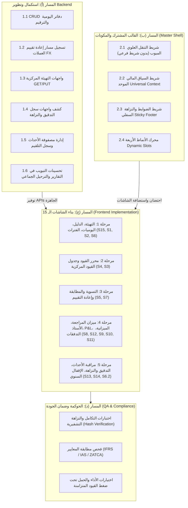
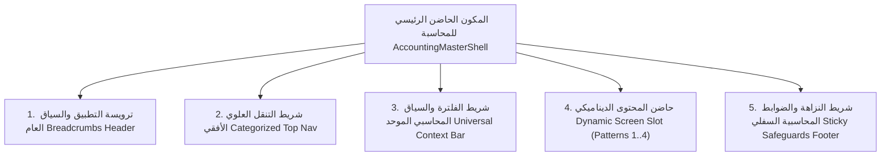

# الخطة التنفيذية الشاملة والمفصلة لتطوير وبناء منظومة شاشات ومحرك المحاسبة المالية

## (Comprehensive Financial Accounting Engine & UI/UX Master Execution Plan)

> **المشروع:** Cashflow System (`cashflow_backend`)  
> **النطاق:** هندسة المحاسبة المالية المجرّدة وتطوير الشاشات الـ 15 (`Pure Accounting Core & UI`)  
> **المرجعيات:**
>
> - [`docs/accounting_screens_comprehensive_analysis.md`](file:///home/osm/StudioProjects/cashflow_system/cashflow_backend/docs/accounting_screens_comprehensive_analysis.md)
> - [`docs/accounting_master_layout_analysis.md`](file:///home/osm/StudioProjects/cashflow_system/cashflow_backend/docs/accounting_master_layout_analysis.md)
> - [`docs/accounting_screens_implementation_roadmap.md`](file:///home/osm/StudioProjects/cashflow_system/cashflow_backend/docs/accounting_screens_implementation_roadmap.md)  
> **المعايير الحاكمة:** **IFRS / IAS (1, 7, 8, 21) / ZATCA Phase 2 / OECD SAF-T / SOC 1 & 2**  
> **حالة الخطة:** معتمدة للتنفيذ الفوري

---

## فهرس الخطة التنفيذية

1. [الملخص التنفيذي واستراتيجية التنفيذ المتوازي (Dual-Track Strategy)](#1-الملخص-التنفيذي-واستراتيجية-التنفيذ-المتوازي)
2. [المسار (أ): استكمال وسد فجوات النظام الخلفي (Backend Engineering Track)](#2-المسار-أ-استكمال-وسد-فجوات-النظام-الخلفي)
   - [2.1. حزمة إدارة دفاتر اليومية والترقيم (Journals Management CRUD)](#21-حزمة-إدارة-دفاتر-اليومية-والترقيم)
   - [2.2. حزمة إعادة تقييم العملات الأجنبية (FX Revaluation HTTP Wiring)](#22-حزمة-إعادة-تقييم-العملات-الأجنبية)
   - [2.3. حزمة التهيئة المحاسبية المركزية (Central Configuration Port & Handlers)](#23-حزمة-التهيئة-المحاسبية-المركزية)
   - [2.4. حزمة الرقابة والنزاهة التشفيرية (Forensic Audit & Hash Verification APIs)](#24-حزمة-الرقابة-والنزاهة-التشفيرية)
   - [2.5. حزمة مصفوفة وسجل أحداث الدفاتر المساعدة (Subledger Ingestion Matrix & Log)](#25-حزمة-مصفوفة-وسجل-أحداث-الدفاتر-المساعدة)
   - [2.6. تحسينات التبويب في التقارير المالية والعمليات الجماعية (Batch Moves & Reporting Enhancements)](#26-تحسينات-التبويب-في-التقارير-المالية-والعمليات-الجماعية)
3. [المسار (ب): بناء القالب الرئيسي المشترك (Master Shell & Layout Framework)](#3-المسار-ب-بناء-القالب-الرئيسي-المشترك)
4. [المسار (ج): البناء المرحلي لشاشات المحاسبة الـ 15 (Frontend Screens Phased Construction)](#4-المسار-ج-البناء-المرحلي-لشاشات-المحاسبة-الـ-15)
   - [المرحلة 1: البيانات التأسيسية والتهيئة المحاسبية (الشاشات: 15، 1، 2، 6)](#المرحلة-1-البيانات-التأسيسية-والتهيئة-المحاسبية)
   - [المرحلة 2: محرر ونماذج العمليات والقيود اليومية (الشاشات: 4، 3)](#المرحلة-2-محرر-ونماذج-العمليات-والقيود-اليومية)
   - [المرحلة 3: التسويات والمطابقات وفروق الصرف (الشاشات: 5، 7)](#المرحلة-3-التسويات-والمطابقات-وفروق-الصرف)
   - [المرحلة 4: منظومة التقارير المالية القياسية (الشاشات: 8، 12، 9، 10، 11)](#المرحلة-4-منظومة-التقارير-المالية-القياسية)
   - [المرحلة 5: التكامل والحوكمة والإقفال السنوي (الشاشات: 13، 14، معالج 6.2)](#المرحلة-5-التكامل-والحوكمة-والإقفال-السنوي)
5. [المسار (د): الحوكمة وضمان الجودة واختبارات القبول (QA, Compliance & Verification)](#5-المسار-د-الحوكمة-وضمان-الجودة-واختبارات-القبول)
6. [مصفوفة إدارة المخاطر وخطط الطوارئ (Risk Matrix & Mitigation)](#6-مصفوفة-إدارة-المخاطر-وخطط-الطوارئ)
7. [جدول التسليم الزمني والمعالم الرئيسية (Milestones & Timeline)](#7-جدول-التسليم-الزمني-والمعالم-الرئيسية)

---

## 1. الملخص التنفيذي واستراتيجية التنفيذ المتوازي

تعتمد هذه الخطة التنفيذية على معالجة نتائج التدقيق الفني الشامل؛ حيث تهدف إلى سد الفجوات التقنية المكتشفة في النظام الخلفي بالتوازي مع تأسيس القالب المشترك وتشييد واجهات المستخدم الـ 15، بما يضمن أن كل شاشة لا تؤدي دورها البصري فحسب، بل تحقق هدفها المحاسبي والتنفيذي بنسبة 100%.



---

## 2. المسار (أ): استكمال وسد فجوات النظام الخلفي (Backend Engineering Track)

يهدف هذا المسار إلى تزويد طبقة النطاق (`domain`) ومستودع البيانات (`repository`) ومسارات المعالجة (`handlers`) بجميع العمليات الناقصة التي تتطلبها الشاشات:

### 2.1. حزمة إدارة دفاتر اليومية والترقيم (Journals Management CRUD)

- **المشكلة الحالية:** توفر دالتي قراءة فقط (`GetJournalByID`, `ListJournals`) دون وجود إمكانية لإنشاء أو تعديل دفاتر اليومية أو ضبط بادئات الترقيم برمجياً.
- **المهام التنفيذية:**
  1. تحديث `AccountingRepository` في [`ports.go`](file:///home/osm/StudioProjects/cashflow_system/cashflow_backend/internal/features/accounting/ports.go) بإضافة:

     ```go
     CreateJournal(ctx context.Context, journal *Journal) error
     UpdateJournal(ctx context.Context, journal *Journal) error
     ```

  2. إنشاء كيانات الطلب والاستجابة في [`dto.go`](file:///home/osm/StudioProjects/cashflow_system/cashflow_backend/internal/features/accounting/dto.go):
     - `CreateJournalRequest` (الاسم، الكود، النوع، بادئة الترقيم `SequencePrefix`).
     - `UpdateJournalRequest` (تعديل الاسم، البادئة، تنشيط/تجميد `IsActive`).
  3. كتابة حالات الاستخدام الجديدة:
     - `usecase_create_journal.go`: فحص تفرد الكود والبادئة ومنع التكرار.
     - `usecase_update_journal.go`: منع تعديل كود اليومية إذا تضمنت قيوداً مرحلة.
  4. تسجيل المسارات في [`handlers.go`](file:///home/osm/StudioProjects/cashflow_system/cashflow_backend/internal/features/accounting/handlers.go):
     - `POST /api/v1/accounting/journals`
     - `PUT /api/v1/accounting/journals/{id}`

---

### 2.2. حزمة إعادة تقييم العملات الأجنبية (FX Revaluation HTTP Wiring)

- **المشكلة الحالية:** منطق إعادة التقييم مكتمل بنسبة 100% في [`usecase_revalue_fx.go`](file:///home/osm/StudioProjects/cashflow_system/cashflow_backend/internal/features/accounting/usecase_revalue_fx.go) لكنه غير مرتبط بـ HTTP Handler أو مسار مسجل في `handlers.go`.
- **المهام التنفيذية:**
  1. إنشاء معالج HTTP مخصص `HandleRevalueFX` داخل `handler_move.go` أو معالج جديد `handler_fx.go`.
  2. دعم تمرير التاريخ المرجعي `as_of` في الطلب JSON.
  3. تسجيل المسار في [`RegisterRoutes`](file:///home/osm/StudioProjects/cashflow_system/cashflow_backend/internal/features/accounting/handlers.go):
     - `POST /api/v1/accounting/fx/revalue`
  4. إضافة حقل توجيهي `AutoReverseNextPeriod` إلى مسودة القيد الناتجة لتمكين المحاسب من جدولتها أو تفعيل خاصية العكس التلقائي عند بداية الفترة التالية.

---

### 2.3. حزمة التهيئة المحاسبية المركزية (Central Configuration Port & Handlers)

- **المشكلة الحالية:** دالة `GetAccountingConfiguration` متوفرة داخلياً في المستودع لكنها غير معروضة عبر واجهة REST، كما لا توجد دالة لحفظ وتحديث التهيئة من شاشة الإعدادات.
- **المهام التنفيذية:**
  1. إضافة دالة التحديث إلى [`ports.go`](file:///home/osm/StudioProjects/cashflow_system/cashflow_backend/internal/features/accounting/ports.go):

     ```go
     UpdateAccountingConfiguration(ctx context.Context, config *AccountingConfiguration) error
     ```

  2. تنفيذ التحديث في `internal/repository.go` بالتعامل مع جدول `accounting_configurations`.
  3. إنشاء `usecase_get_configuration.go` و `usecase_update_configuration.go` مع التحقق الصارم من أن حساب الأرباح المحتجزة ينتمي لحقوق الملكية (`Equity`)، وحسابات فروق العملات تنتمي للإيرادات والمصروفات.
  4. تسجيل المسارات في `handlers.go`:
     - `GET /api/v1/accounting/configurations`
     - `PUT /api/v1/accounting/configurations`

---

### 2.4. حزمة الرقابة والنزاهة التشفيرية (Forensic Audit & Hash Verification APIs)

- **المشكلة الحالية:** خوارزمية فحص النزاهة التشفيرية مكتوبة في [`audit_chain.go`](file:///home/osm/StudioProjects/cashflow_system/cashflow_backend/internal/features/accounting/internal/audit_chain.go) (`VerifyAuditIntegrity`) ولكنها حبيسة المستودع غير معرّفة في المنفذ (`ports.go`) ولا تملك واجهة ويب أو جدول استعراض للسجلات.
- **المهام التنفيذية:**
  1. إضافة توقيع الدالتين في `AccountingRepository`:

     ```go
     VerifyAuditIntegrity(ctx context.Context) (bool, error)
     ListFinancialAuditLogs(ctx context.Context, filter AuditLogFilter) ([]*FinancialAuditLog, int, error)
     ```

  2. إنشاء `dto.go`: `AuditIntegrityResponse` (الحالة: Valid/Tampered، تفاصيل أي سجل تالف)، و `AuditLogResponse` لعرض السلسلة التشفيرية.
  3. إنشاء كائن الاستخدام: `usecase_verify_audit_integrity.go` و `usecase_list_audit_logs.go`.
  4. تسجيل المسارات في `handlers.go`:
     - `GET /api/v1/accounting/governance/verify-integrity`
     - `GET /api/v1/accounting/governance/audit-logs`

---

### 2.5. حزمة مصفوفة وسجل أحداث الدفاتر المساعدة (Subledger Ingestion Matrix & Log)

- **المشكلة الحالية:** النواة الحالية تقبل تلقيم الحدث فقط (`POST /subledger/events`) دون تمكين إدارة مصفوفة التعيين أو مراقبة الأحداث المستلمة وحالاتها.
- **المهام التنفيذية:**
  1. إضافة دوال إدارة المصفوفة إلى `AccountingRepository`:

     ```go
     ListSubledgerEventMappings(ctx context.Context) ([]*SubledgerEventMapping, error)
     SaveSubledgerEventMapping(ctx context.Context, mapping *SubledgerEventMapping) error
     ListProcessedEvents(ctx context.Context, limit, offset int) ([]*ProcessedEventSummary, int, error)
     ```

  2. إنشاء DTOs وحالات الاستخدام لإنشاء وتعديل قواعد توجيه الأحداث (ربط كل `event_type` بحسابات المدين والدائن واليومية).
  3. تسجيل المسارات:
     - `GET /api/v1/accounting/subledger/mappings`
     - `POST /api/v1/accounting/subledger/mappings`
     - `GET /api/v1/accounting/subledger/events`

---

### 2.6. تحسينات التبويب في التقارير المالية والعمليات الجماعية

- **المهام التنفيذية:**
  1. **الترحيل الجماعي للقيود (Bulk Post Moves):** إضافة نقطة نهاية `POST /api/v1/accounting/moves/bulk-post` لقبول مصفوفة من معرفات القيود وترحيلها ذرياً في معاملة تضمن سلامة التدقيق وتحديث الأرصدة.
  2. **تحسين قائمة الدخل والميزانية العمومية:** تحديث استجابة كائن `StatementAccountLine` ليتضمن كود ونوع الحساب الأب (`ParentCode`, `ParentName`) ومستوى العمق الشجري (`HierarchyLevel`)؛ لتمكين واجهات قائمة الدخل من تجميع بنود تكلفة البضاعة المباعة (COGS) ومصروفات التشغيل (OPEX)، والميزانية العمومية من فصل الأصول والالتزامات المتداولة عن غير المتداولة وفق المعيار **IAS 1**.
  3. **توسيع دفتر الأستاذ العام:** دعم استعلام اختياري لجلب كشف الأستاذ العام لمجموعة حسابات أو لكافة الحسابات النشطة مع ترقيم الصفحات (Pagination) بدلاً من حصرها بحساب واحد فقط.

---

## 3. المسار (ب): بناء القالب الرئيسي المشترك (Master Shell & Layout Framework)

تطبيق المعمارية المعتمدة في وثيقة [`docs/accounting_master_layout_analysis.md`](file:///home/osm/StudioProjects/cashflow_system/cashflow_backend/docs/accounting_master_layout_analysis.md) دون أي شريط جانبي فرعي، واستثمار كامل عرض الشاشة (100% Width Canvas):



### تفاصيل مهام ومكونات القالب المشترك

1. **شريط التنقل العلوي المبوب (Categorized Top Nav):**
   - 4 تبويبات علوية رئيسية منسدلة:
     - **العمليات المالية (Operations):** محرر القيود، قائمة القيود المركزية، التسوية والمطابقة، إعادة تقييم العملات.
     - **البيانات التأسيسية (Master Data):** دليل الحسابات، دفاتر اليومية والترقيم، الفترات وإقفال السنة.
     - **التقارير المالية (Financial Reports):** ميزان المراجعة، قائمة الدخل، الميزانية العمومية، التدفقات النقدية، دفتر الأستاذ العام.
     - **الحوكمة والتكامل (Governance & Integration):** مراقبة أحداث الدفاتر المساعدة، سجل التدقيق الجنائي والنزاهة، التهيئة المركزية.
2. **شريط الفلترة والسياق الموحد (Universal Context Bar):**
   - محددات ثابتة: الشركة (`CompanyID`)، الفرع (`BranchID`)، الفترة المالية النشطة (`Active Fiscal Period`)، العملة الوظيفية (`Base Currency`)، وحقل البحث السريع الشامل.
3. **حاضن الأنماط البصرية الأربعة (The 4 UI Pattern Templates):**
   - **Pattern 1 (Split Master-Detail):** للشاشات التفاعلية كدليل الحسابات ودفاتر اليومية.
   - **Pattern 2 (Dense Data Grid):** لجداول البيانات المالية العريضة كدفتر الأستاذ والقيود المركزية.
   - **Pattern 3 (Structured Document Workspace):** لمحرر القيد المحاسبي ومعالج الإقفال السنوي.
   - **Pattern 4 (Financial Statement Canvas):** للقوائم المالية الرسمية (P&L، الميزانية، التدفقات النقدية).
4. **شريط النزاهة السفلي الثابت (Sticky Accounting Safeguards Footer):**
   - مؤشر حالة الفترة المختارة (مفتوحة 🟢 / إغلاق مؤقت 🟡 / إغلاق نهائي 🔴).
   - مؤشر التوازن التراكمي الحي ومقياس الاختلال ($\Delta$).
   - مؤشر النزاهة التشفيرية المباشر لسلسلة سجل التدقيق.

---

## 4. المسار (ج): البناء المرحلي لشاشات المحاسبة الـ 15 (Frontend Screens Phased Construction)

تنفيذ بناء شاشات النظام الـ 15 وفق جدول التبعيات المنطقية الصارم عبر 5 مراحل متتالية:


---

### المرحلة 1: البيانات التأسيسية والتهيئة المحاسبية (Foundation & Master Setup Phase)

#### 1.1. شاشة التهيئة المحاسبية المركزية (`AccountingConfigurationsScreen` - رقم 15)

- **الهدف:** تعيين الحسابات النظامية الحاكمة (الأرباح المحتجزة، أرباح/خسائر الصرف، فروق التقريب).
- **المكونات:** نموذج البطاقات التفاعلية لاختيار الحسابات الافتراضية مع التحقق الفوري من أنواعها.
- **الربط:** `GET /api/v1/accounting/configurations` و `PUT /api/v1/accounting/configurations`.
- **معيار القبول:** منع الحفظ في حال اختيار حساب لا يطابق نوعه المطلوب، والتأكد من تحميل الإعدادات تلقائياً عند فتح النظام.

#### 1.2. شاشة دليل الحسابات (`ChartOfAccountsScreen` - رقم 1)

- **الهدف:** بناء وإدارة شجرة دليل الحسابات الخماسية وتصنيف أنشطة التدفق النقدي.
- **المكونات:** العرض الشجري التفاعلي مع أزرار التوسيع/الطي، والجدول المسطح البديل، ودرج التفاصيل الجانبي (Drawer).
- **الميزات المضافة:** نموذج إدخال رصيد الفتح الأولي للحساب، ودعم استيراد وتصدير الدليل بصيغة Excel/CSV.
- **الربط:** `GET /accounts/tree`, `POST /accounts`, `PUT /accounts/{id}`.
- **معيار القبول:** حظر تعديل كود أو نوع أي حساب مرتبط بقيود مرحلة برمجياً وعرض رسالة خطأ واضحة.

#### 1.3. شاشة إدارة دفاتر اليومية والترقيم (`JournalsManagementScreen` - رقم 2)

- **الهدف:** إدارة دفاتر اليومية وتعيين بادئات الترقيم التسلسلي القانوني غير المنقطع.
- **المكونات:** جدول الدفاتر النشطة مع بطاقة الإحصائيات، ومحرر بادئة الترقيم والعدد التالي.
- **الربط:** `GET /journals`, `POST /journals`, `PUT /journals/{id}`.
- **معيار القبول:** منع تكرار بادئة الترقيم لنفس الفترة أو التغيير العشوائي الذي يكسر التسلسل المحاسبي.

#### 1.4. شاشة الفترات والسنوات المالية (`FiscalLifecycleCloseScreen` - رقم 6)

- **الهدف:** تعريف السنوات المحاسبية وجدولة الفترات والتحكم في حالات الإغلاق.
- **المكونات:** الخط الزمني للفترات (Timeline) مع شارات الألوان الصريحة (Open, Soft Closed, Hard Closed).
- **الربط:** `GET /fiscal-years`, `POST /fiscal-years`, `POST /fiscal-periods/{id}/state`.
- **معيار القبول:** التحقق من تعذر فتح فترات متداخلة زمنياً ونجاح تبديل الحالات بين مفتوحة ومغلقة مؤقتاً.

---

### المرحلة 2: محرر ونماذج العمليات والقيود اليومية (Data Entry & Move Operations Phase)

#### 2.1. شاشة محرر القيد المحاسبي والمسودة (`JournalEntryEditorScreen` - رقم 4)

- **الهدف:** واجهة العمل اليومية لتحرير القيود المركبة وتعديل المسودات وحفظها.
- **المكونات:**
  - هيدر القيد (التاريخ، دفتر اليومية، العملة، سعر الصرف، المرجع).
  - شبكة الأسطر المالية التفاعلية (الحساب، البيان، الشريك، مدين، دائن، العملة الأجنبية).
  - شريط التوازن الحي اللحظي ($\Delta = |\sum Dr - \sum Cr|$).
  - **محدد الضريبة التلقائي (Tax / VAT Selector):** أداة تتيح احتساب 15% ضريبة مدخلات/مخرجات وإدراج سطر الضريبة آلياً.
  - **درج المرفقات (Attachments Drawer):** لرفع المستندات الثبوتية المؤيدة للقيد.
- **الربط:** `POST /moves`, `PUT /moves/{id}`, `DELETE /moves/{id}`, `POST /moves/{id}/post`.
- **معيار القبول:** تعطيل زر الترحيل برمجياً عند وجود أي فارق اختلال ($\Delta \neq 0.00$)، ومنع الأرقام السالبة تماماً.

#### 2.2. شاشة جدول وقائمة القيود المركزية (`JournalEntriesMasterScreen` - رقم 3)

- **الهدف:** شاشة استعراض وبحث وفلترة كافة القيود المحاسبية مع التحكم في دورة حياة القيد.
- **المكونات:** شريط مؤشرات القيود (مسودات، مرحلة، معكوسة)، جدول القيود المركزية بألوان تمييز الحالة، أزرار الترحيل الفردي والجماعي، وزر العكس (Storno).
- **الربط:** `GET /moves`, `POST /moves/{id}/post`, `POST /moves/{id}/reverse`, `POST /moves/bulk-post`.
- **معيار القبول:** حظر أي تعديل أو حذف لأي قيد مرحل، واقتصار الإلغاء على إصدار قيد عكسي تلقائي ومقترن.

---

### المرحلة 3: التسويات والمطابقات وفروق الصرف (Reconciliations & FX Adjustments Phase)

#### 3.1. شاشة التسوية والمطابقة المحاسبية (`SubledgerReconciliationScreen` - رقم 5)

- **الهدف:** مطابقة الفواتير والسندات في الحسابات القابلة للتسوية واحتساب فروق الصرف المحققة.
- **المكونات:** محدد الحساب والشريك، العرض المتقابل المقسم (أسطر مدينة يميناً وأسطر دائنة يساراً)، حاسبة التوزيع وفارق التسوية، وزر المطابقة الذكية.
- **الربط:** `GET /unreconciled-lines`, `POST /reconcile`, `POST /unreconcile`.
- **معيار القبول:** نجاح المطابقة الجزئية والكلية وتوليد قيد فروق الصرف المحققة آلياً في الخلفية دون أي تدخل يدوي، وإمكانية فك المطابقة وإلغاء أثر قيد الفروق.

#### 3.2. شاشة إعادة تقييم أصول والتزامات العملات الأجنبية (`FXRevaluationScreen` - رقم 7)

- **الهدف:** تطبيق معيار IAS 21 لإعادة تقييم الأرصدة النقدية والبنكية والديون بالعملات الأجنبية في نهاية الفترة.
- **المكونات:** جدول مركز العملات الأجنبية (الرصيد بالعملة الأجنبية، السعر التاريخي، سعر الإغلاق، الربح/الخسارة غير المحققة المتوقعة)، ونافذة معاينة مسودة قيد التسوية الناتجة.
- **الربط:** `POST /api/v1/accounting/fx/revalue`.
- **معيار القبول:** إنشاء مسودة قيد تسوية متوازنة تحتوي أسطر إعادة التقييم محملة على حسابات الأرباح والخسائر غير المحققة.

---

### المرحلة 4: منظومة التقارير المالية القياسية (Core Financial Reporting Engine Phase)

#### 4.1. شاشة ميزان المراجعة (`TrialBalanceWorkspaceScreen` - رقم 8)

- **الهدف:** التحقق من التوازن الشامل للدفاتر خلال نطاق زمني محدد.
- **المكونات:** جدول الأعمدة السداسي (افتتاحي مدين/دائن، حركات مدين/دائن، إغلاق مدين/دائن)، صف التدقيق الصفري السفلي، وأداة التعميق السريع (Drill-down).
- **الربط:** `GET /reports/trial-balance`.
- **معيار القبول:** تطابق إجمالي المدين والدائن في كل قطاع وظهور شارة خضراء تفيد بـ $\Delta = 0.00$.

#### 4.2. شاشة دفتر الأستاذ العام والتراكمي (`GeneralLedgerScreen` - رقم 12)

- **الهدف:** تتبع كشف الحساب التفصيلي مع الرصيد التراكمي المتحرك.
- **المكونات:** محدد الحساب ونطاق التاريخ، جدول الحركات متضمناً الرصيد المتحرك بعد كل قيد وشارة رقم المطابقة، وإمكانية فتح القيد المصدر مباشرة.
- **الربط:** `GET /reports/general-ledger`.
- **معيار القبول:** دقة حساب الرصيد التراكمي ومراعاته للرصيد الطبيعي للحساب (مدين أو دائن).

#### 4.3. شاشة قائمة الدخل والأرباح والخسائر (`ProfitAndLossScreen` - رقم 9)

- **الهدف:** عرض نتائج الأعمال المالية وفق المعيار الدولي IAS 1.
- **المكونات:** العرض المبوب الهرمي (إيرادات تشغيلية، تكلفة البضاعة المباعة COGS، مجمل الربح، المصروفات التشغيلية OPEX، صافي الربح)، وأداة المقارنة بالفترة السابقة.
- **الربط:** `GET /reports/income-statement`.
- **معيار القبول:** مطابقة صافي الربح بدقة مع التغير في حقوق الملكية الناتج عن الفترة.

#### 4.4. شاشة الميزانية العمومية والمركز المالي (`BalanceSheetScreen` - رقم 10)

- **الهدف:** عرض الأصول والالتزامات وحقوق الملكية في تاريخ محدد (As of Date).
- **المكونات:** التبويب الثنائي (الأصول المتداولة وغير المتداولة، الالتزامات المتداولة وغير المتداولة، حقوق الملكية)، ومؤشر التوازن الحي للمعادلة المحاسبية ($\text{Assets} = \text{Liabilities} + \text{Equity}$).
- **الربط:** `GET /reports/balance-sheet`.
- **معيار القبول:** الإدراج اللحظي لصافي دخل الفترة غير المقفل ضمن حقوق الملكية ليظل الميزان متوازناً تماماً.

#### 4.5. شاشة قائمة التدفقات النقدية بالطريقة غير المباشرة (`CashFlowStatementScreen` - رقم 11)

- **الهدف:** تحليل حركة السيولة النقدية وفق معيار IAS 7.
- **المكونات:** الأنشطة التشغيلية (صافي الدخل + التعديلات غير النقدية + تغيرات رأس المال العامل)، الأنشطة الاستثمارية، الأنشطة التمويلية، وشريط مطابقة النقدية مع رصيد أول وآخر الفترة.
- **الربط:** `GET /reports/cash-flow`.
- **معيار القبول:** تطابق صافي النقدية في نهاية الفترة مع مجموع حسابات النقدية وما في حكمها (`IsCashEquivalent`) في الميزانية العمومية، وتنبيه المستخدم لأي حركة غير مصنفة.

---

### المرحلة 5: التكامل والحوكمة والإقفال السنوي (Integration, Year-End Closing & Governance Phase)

#### 5.1. شاشة مراقبة أحداث الدفاتر المساعدة ومصفوفة التعيين (`SubledgerEventIngestionScreen` - رقم 13)

- **الهدف:** مراقبة الأحداث المالية الموجهة من الأنظمة التشغيلية وتعديل مصفوفة قواعد التوجيه المحاسبي.
- **المكونات:** جدول مصفوفة التعيين (`EventType -> Debit/Credit Accounts, Journal`)، وجدول سجل الأحداث المستلمة وحالاتها ومفاتيح عدم التكرار (`Idempotency Keys`).
- **الربط:** `GET /subledger/mappings`, `POST /subledger/mappings`, `GET /subledger/events`.
- **معيار القبول:** منع ازدواج القيود لنفس الحدث التشغيلي وإتاحة تعديل الحسابات الموجهة دون المساس بالقيود القديمة.

#### 5.2. نموذج معالج الإقفال السنوي (`CloseFiscalYearWizardForm` - تابع للشاشة 6)

- **الهدف:** تنفيذ الإقفال المحاسبي النهائي للسنة المالية ونقل النتائج للأرباح المحتجزة.
- **المكونات:** معالج متعدد الخطوات (Step Wizard): فحص المسودات المعلقة، اختيار دفتر الإغلاق، تأكيد حساب الأرباح المحتجزة، والإقرار القانوني بالإغلاق النهائي.
- **الربط:** `POST /fiscal-years/{id}/close`.
- **معيار القبول:** حظر الإغلاق بوجود أي مسودة قيد معلقة، ونجاح تصفير حسابات الإيرادات والمصروفات بالكامل في السنة الجديدة.

#### 5.3. شاشة النزاهة التشفيرية وسجل التدقيق الجنائي (`AuditTrailIntegrityScreen` - رقم 14)

- **الهدف:** فحص السلسلة التشفيرية (`Cryptographic Hash Chain`) واكتشاف أي تلاعب بقاعدة البيانات.
- **المكونات:** بطاقة حالة النزاهة (أخضر سليم / أحمر تلاعب)، وجدول سجل التدقيق الجنائي مع قيم الهاش المتسلسل (SHA-256) وهوية المنفذين والتوقيتات الدقيقة.
- **الربط:** `GET /governance/verify-integrity`, `GET /governance/audit-logs`.
- **معيار القبول:** كشف أي تعديل مباشر في قيم القيود أو سطورها وتحديد السجل المتلاعب به بدقة متناهية.

---

## 5. المسار (د): الحوكمة وضمان الجودة واختبارات القبول (QA, Compliance & Verification)

لضمان سلامة النواة المحاسبية ومطابقتها للمتطلبات العالمية، تشمل خطة الاختبار والامتثال الإجراءات التالية:

1. **اختبارات التكامل الشاملة (End-to-End Accounting Integration Tests):**
   - محاكاة دورة محاسبية كاملة: *إنشاء حسابات -> فتح سنة مالية -> تسجيل قيود مسودة -> ترحيل واعتماد -> تسوية فواتير واحتساب فروق صرف -> استخراج ميزان المراجعة والقوائم المالية -> تشغيل الإقفال السنوي*.
2. **اختبار التزامن والنزاهة الرقمية (Concurrency & Advisory Lock Tests):**
   - تشغيل اختبارات ضغط تزامني (Concurrent Move Postings) للتحقق من عدم تكرار أرقام القيود أو حدوث ثغرات تسلسلية بفضل آليات `Advisory Lock` المطبقة في النواة.
3. **فحص النزاهة واكتشاف التلاعب (Tamper Detection Verification):**
   - تعديل مباشر متعمد لسجل مالي في قاعدة بيانات الاختبار والتحقق من أن شاشة النزاهة التشفيرية ودالة `VerifyAuditIntegrity` تكتشف التلاعب فوراً وتحدد السجل بدقة.
4. **فحص الالتزام بمتطلبات المعايير (Compliance Sign-off):**
   - مطابقة القوائم المالية المنتجة مع معايير **IAS 1** و **IAS 7** و **IAS 21**.
   - مطابقة بنية البيانات والتسلسل وسجل التدقيق مع متطلبات **ZATCA Phase 2** و **OECD SAF-T**.

---

## 6. مصفوفة إدارة المخاطر وخطط الطوارئ (Risk Matrix & Mitigation)

| الخطر المحتمل | مستوى الأثر | الاحتمالية | استراتيجية الوقاية والمعالجة (Mitigation Strategy) |
| :--- | :---: | :---: | :--- |
| **تعارض وتكرار الترقيم التسلسلي للقيود تحت الضغط المتزامن** | مرتفع جداً | منخفضة | الاعتماد الحصري على آلية القفل الذري `GetNextSequenceWithLock` المدعومة بقفل Postgres Advisory Lock. |
| **ترحيل قيد غير متوازن نتيجة خلل في الواجهة الأمامية** | كارثي | نادرة | تطبيق فحص التوازن المزدوج؛ منع الواجهة أولاً، ثم رفض الحفظ نهائياً في محرك الباك إند عبر `ValidateBalance`. |
| **محاولة ترحيل قيود في فترات مغلقة** | مرتفع | متوسطة | الفحص المسبق لحالة الفترة في واجهة المستخدم، يليه حظر الترحيل الصارم في الباك إند عبر `ErrPeriodClosed`. |
| **بطء تحميل التقارير المالية عند تضخم القيود التاريخية** | متوسط | متوسطة | استخدام فهارس قاعدة بيانات مخصصة على حقول `(journal_id, date, state)` وحساب أرصدة المجاميع بصورة تجميعية في SQL. |
| **عدم توازن الميزانية العمومية بسبب أرباح الفترة غير المقفلة** | مرتفع | منخفضة | استخدام محرك الحساب اللحظي المدمج في `usecase_generate_balance_sheet` الذي يدمج أثر الدخل تلقائياً في حقوق الملكية. |

---

## 7. جدول التسليم الزمني والمعالم الرئيسية (Milestones & Timeline)

تم تقسيم خطة التنفيذ إلى **6 معالم رئيسية (Milestones)** تضمن التسليم التراكمي والاختبار المستمر:

```text
الجدول الزمني التتابعي لتنفيذ المنظومة:
========================================================================================
[M1: Backend Endpoints & Core Wiring]      ██████ (الأسبوع 1)
[M2: Master Shell & Foundation Screens]           ██████ (الأسبوع 2)
[M3: Move Operations & Editor]                           ██████ (الأسبوع 3)
[M4: Reconciliations & FX Adjustments]                          ██████ (الأسبوع 4)
[M5: Financial Reports & Analytics]                                    ██████ (الأسبوع 5)
[M6: Governance, Year-End Close & QA]                                         ██████ (الأسبوع 6)
========================================================================================
```

### معالم التسليم التنفيذية

- **المعلم 1 (M1): اكتمال وسد كافة فجوات النظام الخلفي (Backend Readiness)**
  - تسليم نقاط نهاية دفاتر اليومية، التهيئة، فحص النزاهة التشفيرية، ومسار إعادة تقييم الصرف.
  - نجاح كافة اختبارات الوحدات والتكامل للـ Handlers والـ UseCases.

- **المعلم 2 (M2): القالب المشترك وشاشات التأسيس (Foundation Phase)**
  - تسليم القالب الرئيسي المشترك `AccountingMasterShell` بكافة شرائطه (A, B, C, E).
  - تسليم وتشغيل الشاشات الأساسية: التهيئة (15)، دليل الحسابات (1)، دفاتر اليومية (2)، والفترات المالية (6).

- **المعلم 3 (M3): بيئة العمل اليومية والقيود (Daily Operations Phase)**
  - تسليم محرر القيد المحاسبي المتقدم (4) مع محدد الضريبة وشريط التوازن الحي.
  - تسليم شاشة إدارة القيود المركزية (3) مع عمليات الترحيل الفردي والجماعي والعكس.

- **المعلم 4 (M4): التسويات وفروق الصرف (Reconciliation Phase)**
  - تسليم شاشة التسوية والمطابقة (5) مع توليد قيود فروق الصرف المحققة آلياً.
  - تسليم شاشة إعادة تقييم العملات الأجنبية (7) ومعاينة مسودات القيود الدورية.

- **المعلم 5 (M5): منظومة التقارير المالية القياسية (Reporting Suite)**
  - تسليم ميزان المراجعة (8) ودفتر الأستاذ العام (12) مع ميزة التعميق الفوري (Drill-Down).
  - تسليم القوائم المالية الرسمية: قائمة الدخل (9)، الميزانية العمومية (10)، وقائمة التدفقات النقدية (11) وفق المعايير الدولية.

- **المعلم 6 (M6): الحوكمة والإقفال النهائي والاعتماد (Governance & Launch)**
  - تسليم شاشة مراقبة أحداث الدفاتر المساعدة (13)، وشاشة سجل التدقيق الجنائي والنزاهة (14)، ومعالج الإقفال السنوي (6.2).
  - إجراء الفحص الجنائي الشامل، واختبارات القبول النهائية، واعتماد جاهزية المنظومة للإطلاق والإنتاج.

---
> **الخلاصة التنفيذية:** تمثل هذه الخطة خريطة طريق متكاملة، هندسية ومفصلة، تربط البرمجة الخلفية بواجهات المستخدم بانسجام تام، وتضمن تحقيق كل شاشة من الشاشات الـ 15 لأهدافها الوظيفية والمعيارية بكل دقة وكفاءة.
