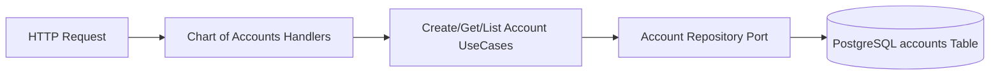
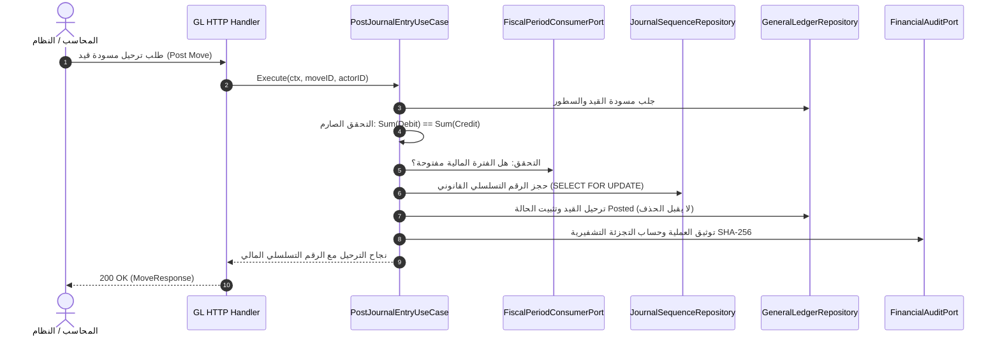
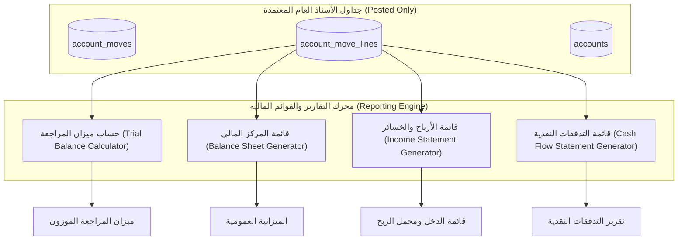

# الخطة التنفيذية الشاملة والمفصلة لبناء وحدة المحاسبة المالية للنظام المالي

## (Financial Accounting Engine Implementation Plan)

> **طبيعة الوثيقة:** خطة تنفيذية هندسية متسلسلة وفق معايير المشروعات الكبرى (Phased Engineering Execution Plan)  
> **المرجع التحليلي الأساسي:** [التحليل الشامل والمعماري لوحدة المحاسبة وفق المعايير العالمية](file:///home/osm/StudioProjects/cashflow_system/cashflow_backend/docs/analysis/financial_accounting_system_architecture_standards.md)  
> **دليل البناء المعتمد:** [دليل وتوصيات إنشاء ميزة جديدة في Cashflow Backend](file:///home/osm/StudioProjects/cashflow_system/cashflow_backend/docs/new_feature_guidelines.md)  
> **المعمارية المعتمدة:** نمط الشرائح العمودية المنفصلة (Package-by-Feature / Ports and Adapters) في بيئة Modular Monolith  
> **تاريخ التخطيط:** نوفمبر 2026

---

## فهرس المحتويات

1. [الرؤية التنفيذية واستراتيجية المعمارية (Architectural & Execution Strategy)](#1-الرؤية-التنفيذية-واستراتيجية-المعمارية)
2. [هيكلية الميزات وتقسيم النطاق (Feature Boundaries & Directory Map)](#2-هيكلية-الميزات-وتقسيم-النطاق)
3. [المراحل التنفيذية المتسلسلة (Phased Execution Roadmap)](#3-المراحل-التنفيذية-المتسلسلة)
   - [المرحلة 0: البنية التحتية المشتركة ونماذج التخزين والأنواع الدقيقة (Platform & Foundation)](#المرحلة-0-البنية-التحتية-المشتركة-ونماذج-التخزين-والأنواع-الدقيقة)
   - [المرحلة 1: ميزة دليل الحسابات والأبعاد التحليلية (Feature: Chart of Accounts)](#المرحلة-1-ميزة-دليل-الحسابات-والأبعاد-التحليلية)
   - [المرحلة 2: ميزة الفترات المالية والإقفال المحاسبي (Feature: Fiscal Periods)](#المرحلة-2-ميزة-الفترات-المالية-والإقفال-المحاسبي)
   - [المرحلة 3: ميزة محرك القيد المزدوج والأستاذ العام (Feature: General Ledger Core)](#المرحلة-3-ميزة-محرك-القيد-المزدوج-والأستاذ-العام)
   - [المرحلة 4: محرك العملات المتعددة وتقييم فروق الصرف (Multi-Currency & FX Engine - IAS 21)](#المرحلة-4-محرك-العملات-المتعددة-وتقييم-فروق-الصرف)
   - [المرحلة 5: ميزة التقارير والقوائم المالية الرسمية (Feature: Financial Reporting - IAS 1)](#المرحلة-5-ميزة-التقارير-والقوائم-المالية-الرسمية)
   - [المرحلة 6: ميزة محرك المحاسبة الفرعية وعزل العمليات التجارية (Feature: Subledger SLA Engine)](#المرحلة-6-ميزة-محرك-المحاسبة-الفرعية-وعزل-العمليات-التجارية)
   - [المرحلة 7: الرقابة الصارمة وسلاسل التدقيق والاعتماد المزدوج (Governance, SOX & Security)](#المرحلة-7-الرقابة-الصارمة-وسلاسل-التدقيق-والاعتماد-المزدوج)
4. [مصفوفة فحص الجودة واختبارات التحقق الصارم (Testing & Verification Matrix)](#4-مصفوفة-فحص-الجودة-واختبارات-التحقق-الصارم)
5. [ربط المكونات في نقطة التجميع (Composition Root Wiring & Registration)](#5-ربط-المكونات-في-نقطة-التجميع)
6. [قائمة التحقق النهائية للإطلاق التشغيلي (Go-Live Pre-Flight Checklist)](#6-قائمة-التحقق-النهائية-للإطلاق-التشغيلي)

---

## 1. الرؤية التنفيذية واستراتيجية المعمارية

تهدف هذه الخطة إلى تحويل كافة المعايير والأنماط المعمارية الموثقة في وثيقة التحليل المرجعي إلى شيفرة برمجية إنتاجية فائقة الاعتمادية في مشروع `cashflow_backend`، مع الالتزام التام بالقواعد الصارمة الواردة في [دليل وتوصيات إنشاء ميزة جديدة](file:///home/osm/StudioProjects/cashflow_system/cashflow_backend/docs/new_feature_guidelines.md):

1. **التقسيم العمودي المستقل (Vertical Slice Architecture):** تقسيم وحدة المحاسبة المالية إلى حزم ميزات مستقلة (`internal/features/<feature>`)، لكل منها وثيقة نطاق (`doc.go`)، ومنافذ تجريدية (`ports.go`)، ونماذج نطاق (`entity.go`)، وعقود نقل (`dto.go`)، وحالات استخدام منفردة (`<action>_usecase.go`)، ومعالجات HTTP منفصلة (`<action>_handler.go`)، ومستودعات بيانات مغلفة (`internal/repository.go`).
2. **العزل التام عن العمليات التجارية (No Commercial Sprawl):** لا وجود لأي جداول أو حقول تتعلق بأوامر البيع، الشحن، أو المخزون المادي داخل محرك المحاسبة. يتم التفاعل حصرياً عبر طبقة ترجمة الأحداث المالية (Subledger Accounting / SLA).
3. **الدقة الحسابية اللانهائية وتفادي الكسور العائمة:** استخدام `github.com/shopspring/decimal` في Go ونوع `NUMERIC(28, 4)` في PostgreSQL مع احترام معيار ISO 4217.
4. **حصانة السجلات المحاسبية (Zero Mutation):** لا توجد عمليات `UPDATE` أو `DELETE` على القيود المرحلة، والاعتماد الحصري على القيود العكسية (Reversals / Storno).
5. **منع الفجوات في الترقيم التسلسلي القانوني (Gapless Sequences):** استخدام أقفال المعاملات الحصرية (`SELECT ... FOR UPDATE`) على مستوى دفتر اليومية لحماية سلامة التسلسل المالي القانوني.

---

## 2. هيكلية الميزات وتقسيم النطاق

تنقسم منظومة المحاسبة المالية في `internal/features/` إلى 5 ميزات معيارية متكاملة تعمل بنظام Modular Monolith:

```text
internal/features/
├── chart_of_accounts/          # ميزة دليل الحسابات، الأنواع، والتصنيف المالي
├── fiscal_periods/             # ميزة الفترات المالية والإقفال المرحلي والسنوي
├── general_ledger/             # ميزة دفاتر اليومية، القيود، الترحيل، والحصانة
├── financial_reporting/        # ميزة ميزان المراجعة والقوائم المالية (IAS 1 & IAS 7)
└── subledger_engine/           # ميزة محرك ترجمة الأحداث الاقتصادية إلى قيود مالية
```

### البنية الداخلية النموذجية لكل ميزة (طبقا لدليل الميزات)

```text
internal/features/<feature_name>/
├── doc.go                      # التوثيق المعماري وحدود النطاق
├── ports.go                    # الواجهات والمنافذ المجردة (Repository, EventPublisher)
├── entity.go                   # كائنات النطاق وقواعد التحقق الصلبة (Pure Domain Entities)
├── dto.go                      # كائنات نقل البيانات وعقود الـ API ودوال التحويل ToResponse()
├── usecases.go                 # الحاوية المجمعة لحالات الاستخدام ومصنع NewUseCases()
├── <action>_usecase.go         # ملف مستقل لكل حالة استخدام منفردة
├── <action>_usecase_test.go    # اختبارات الوحدة المعزولة لحالة الاستخدام
├── handler.go                  # تسجيل المسارات (chi.Router) والبنية العامة للمعالج
├── <action>_handler.go         # معالج HTTP مستقل لكل نقطة نهاية API
└── internal/                   # تغليف طبقة الوصول إلى البيانات (Unexported)
    ├── repository.go           # تنفيذ الـ Port باستخدام pgxpool
    └── queries.go              # استعلامات SQL الصريحة والمفهرسة
```

---

## 3. المراحل التنفيذية المتسلسلة (Phased Execution Roadmap)

---

### المرحلة 0: البنية التحتية المشتركة ونماذج التخزين والأنواع الدقيقة (Platform & Foundation)

- **الهدف:** تجهيز البنية التحتية للأنواع المشتركة، العملات، الترقيم الدقيق، وملفات الترحيل الأولي لقاعدة البيانات.
- **المدة المقدرة:** 2 يوم عمل.

#### المهام التنفيذية التفصيلية

1. **الاعتماديات والمكتبات المشتركة:**
   - إضافة مكتبة الحسابات المالية العشرية فائقة الدقة: `github.com/shopspring/decimal`.
   - إضافة مكتبة توليد المعرفات الموحدة: `github.com/google/uuid`.
2. **إنشاء ملفات الترحيل المجمعة في `migrations/`:**
   - إنشاء `000002_create_chart_of_accounts.up.sql` و `down.sql`.
   - إنشاء `000003_create_fiscal_periods.up.sql` و `down.sql`.
   - إنشاء `000004_create_journals_and_moves.up.sql` و `down.sql`.
   - إنشاء `000005_create_financial_audit_logs.up.sql` و `down.sql`.
3. **تأسيس معايير العملات وفق ISO 4217 في حزمة منصة مساعدة (`internal/platform/money`):**
   - كود العملة الثلاثي، عدد الخانات الكسرية (Minor Unit Exponent)، ودوال تحويل المبالغ بأمان.

#### مخرجات المرحلة 0

- [x] سكربتات ترحيل قاعدة البيانات قابلة للتطبيق العكسي بنجاح (`migrate up` / `migrate down`).

- [x] حزمة الحسابات العشرية الموحدة لضمان الدقة وتفادي أي استخدام للأعداد العائمة `float64`.

---

### المرحلة 1: ميزة دليل الحسابات والأبعاد التحليلية (Feature: Chart of Accounts)

- **مسار الحزمة:** `internal/features/chart_of_accounts`
- **المرجع المعياري:** إطار IFRS المفاهيمي وتصنيفات الأصول والخصوم وحقوق الملكية والإيرادات والمصروفات.
- **المدة المقدرة:** 3 أيام عمل.



#### المهام التنفيذية التفصيلية

1. **`doc.go`:** توثيق نطاق الحسابات المالية، طبيعة الحساب (طبيعة مدينة/دائنة)، والتعامل الهرمي (Parent-Child).
2. **`ports.go`:**
   - واجهة `AccountRepository`:
     - `Create(ctx context.Context, acc *Account) error`
     - `GetByID(ctx context.Context, id uuid.UUID) (*Account, error)`
     - `GetByCode(ctx context.Context, code string) (*Account, error)`
     - `List(ctx context.Context, filter AccountFilter) ([]*Account, error)`
     - `Update(ctx context.Context, acc *Account) error`
3. **`entity.go`:**
   - كيان `Account`: كود الحساب، الاسم، النوع (`Asset`, `Liability`, `Equity`, `Income`, `Expense`)، الرصيد الافتراضي (`Debit` / `Credit`)، كود العملة، الحساب الأب، وإمكانية التسوية والمطابقة (`IsReconcilable`).
   - دوال التحقق الصارمة من صحة تكويد الحساب وشجرته.
4. **`dto.go`:**
   - `CreateAccountRequest`, `AccountResponse`, `AccountTreeResponse`, `ToAccountResponse()`.
5. **حالات الاستخدام (`usecases.go`):**
   - `create_account_usecase.go`: التحقق من عدم تكرار كود الحساب ومطابقة نوع الحساب للرصيد الطبيعي.
   - `get_account_usecase.go`: جلب تفاصيل الحساب برقم المعرف أو الكود.
   - `list_accounts_tree_usecase.go`: بناء شجرة الحسابات المالية وتنسيقها هرمياً.
6. **طبقة التخزين (`internal/repository.go` & `internal/queries.go`):**
   - تنفيذ الاستعلامات عبر `pgxpool` باستخدام استعلامات SQL ذات كفاءة مع فهارس على `code` و `account_type`.
7. **طبقة النقل (`handler.go` & `*_handler.go`):**
   - `POST /api/v1/accounting/accounts`
   - `GET /api/v1/accounting/accounts`
   - `GET /api/v1/accounting/accounts/{id}`
   - `GET /api/v1/accounting/accounts/tree`

#### مخرجات المرحلة 1

- [x] حزمة كاملة لـ `chart_of_accounts` مع اختبارات تغطية لا تقل عن 85%.

---

### المرحلة 2: ميزة الفترات المالية والإقفال المحاسبي (Feature: Fiscal Periods)

- **مسار الحزمة:** `internal/features/fiscal_periods`
- **المرجع المعياري:** معيار IAS 1 (سنوية وقاطعية الفترات المحاسبية) وضوابط SOX لقفل السجلات.
- **المدة المقدرة:** 3 أيام عمل.

#### المهام التنفيذية التفصيلية

1. **`doc.go` و `ports.go`:**
   - واجهة `FiscalPeriodRepository`:
     - `Create(ctx context.Context, period *FiscalPeriod) error`
     - `GetByID(ctx context.Context, id uuid.UUID) (*FiscalPeriod, error)`
     - `GetByDate(ctx context.Context, date time.Time) (*FiscalPeriod, error)`
     - `ListByYear(ctx context.Context, year int) ([]*FiscalPeriod, error)`
     - `UpdateState(ctx context.Context, id uuid.UUID, state PeriodState, actorID uuid.UUID) error`
2. **`entity.go`:**
   - كيان `FiscalPeriod`: السنة المالية، رقم الفترة (1-12)، تاريخ البدء، تاريخ النهاية، والحالة (`open`, `soft_closed`, `hard_closed`).
   - قواعد آلة الحالة (Period State Machine): منع الانتقال من `hard_closed` إلى `open` إلا بإجراء استثنائي موثق رقابياً.
3. **`dto.go`:**
   - `CreateFiscalYearRequest`, `FiscalPeriodResponse`, `ChangePeriodStateRequest`.
4. **حالات الاستخدام (`usecases.go`):**
   - `create_fiscal_year_usecase.go`: توليد تلقائي للـ 12 شهراً/فترة متتابعة دون تداخل أو فجوات زمنية.
   - `get_period_by_date_usecase.go`: تحديد الفترة المالية المفتوحة الخاصة بأي تاريخ قيد معروض للترحيل.
   - `lock_period_usecase.go`: تنفيذ الإقفال الناعم أو الإقفال الصلب مع تسجيل المستخدم وتاريخ الإقفال.
5. **طبقة النقل والتخزين (`internal/repository.go` & `handler.go`):**
   - `POST /api/v1/accounting/fiscal-years`
   - `GET /api/v1/accounting/fiscal-years/{year}/periods`
   - `POST /api/v1/accounting/fiscal-periods/{id}/state`

#### مخرجات المرحلة 2

- [x] محرك إدارة الفترات المالية مع منع أي ترحيل مستقبلي في فترات مغلقة.

---

### المرحلة 3: ميزة محرك القيد المزدوج والأستاذ العام (Feature: General Ledger Core)

- **مسار الحزمة:** `internal/features/general_ledger`
- **المرجع المعياري:** Luca Pacioli Double-Entry, IAS 1, IAS 8, SOX 404 Immutability, Martin Fowler Accounting Patterns.
- **المدة المقدرة:** 5 أيام عمل.



#### المهام التنفيذية التفصيلية

1. **`ports.go`:**
   - `JournalRepository`: إدارة دفاتر اليومية وسلاسل الترقيم الحصرية (`GetNextSequenceNumberWithLock`).
   - `MoveRepository`: إدارة المسودات والترحيل الذري (`SaveDraft`, `PostMoveAtomic`, `GetMoveByID`).
   - `FiscalPeriodChecker`: منفذ استهلاك للتحقق من حالة الفترة المالية دون استيراد مباشر لحزمة الفترات.
   - `AuditLoggerPort`: منفذ إرسال سجلات التدقيق التشفيرية.
2. **`entity.go`:**
   - كيان `Journal`: الكود، النوع (`general`, `bank`, `cash`, `sale`, `purchase`)، بادئة الترقيم، والرقم التالي.
   - كيان `AccountMove`: المعرف، الرقم القانوني، اليومية، التاريخ المحاسبي، الحالة (`draft`, `posted`, `reversed`)، التجزئة التشفيرية.
   - كيان `AccountMoveLine`: معرف القيد، معرف الحساب، المدين، الدائن، المبلغ بالعملة المصدرية، العملة، مركز التكلفة، ومفتاح التسوية والمطابقة.
   - **القواعد الرياضية الصلبة (Invariants):**
     - دالة `ValidateBalance()`: التأكد المطلق من $\sum Debit - \sum Credit = 0$.
     - دالة `ValidateLines()`: وجود سطرين على الأقل، عدم وجود مبالغ سالبة في حقول المدين والدائن القياسية.
3. **حالات الاستخدام (`usecases.go`):**
   - `create_draft_move_usecase.go`: إنشاء مسودة قيد مالي مع التحقق الأولي.
   - `post_move_usecase.go`: العملية الجوهرية (The Core Atomic Post):
     - فحص التوازن الصفري.
     - التحقق من أن الفترة المالية مفتوحة (`PeriodState == open`).
     - بدء معاملة قاعدة بيانات (`pgx.Tx`).
     - قفل سجل دفتر اليومية بـ `SELECT ... FOR UPDATE` لمنع أي تنازع وحجز الرقم التسلسلي التالي بدون فجوات (`Gapless Sequential Numbering`).
     - تثبيت حالة القيد إلى `posted` وتسجيل التوقيت وهوية المستخدم.
     - توليد التوقيع التشفيري (SHA-256 Signature) وتوثيقه.
   - `reverse_move_usecase.go`: إلغاء أثر قيد مرحل عبر توليد قيد عكسي مطابق ومكتمل التوازن (Reversal Move / Storno) مع ربطه بالمرجع الأصلي.
4. **طبقة النقل والمسارات (`handler.go` & `*_handler.go`):**
   - `POST /api/v1/accounting/journals`
   - `POST /api/v1/accounting/moves`
   - `POST /api/v1/accounting/moves/{id}/post`
   - `POST /api/v1/accounting/moves/{id}/reverse`
   - `GET /api/v1/accounting/moves/{id}`

#### مخرجات المرحلة 3

- [x] محرك الأستاذ العام المتزن رياضياً، المحمي بالكامل ضد التعديل أو الحذف، والمزود بترقيم قانوني غير منقطع.

---

### المرحلة 4: محرك العملات المتعددة وتقييم فروق الصرف (Multi-Currency & FX Engine - IAS 21)

- **المرجع المعياري:** معيار IAS 21 (آثار التغيرات في أسعار صرف العملات الأجنبية).
- **المدة المقدرة:** 3 أيام عمل.

#### المهام التنفيذية التفصيلية

1. **جداول أسعار الصرف التاريخية (`currency_rates`):**
   - العملة المصدر، العملة المستهدفة (العملة الوظيفية للنظام)، تاريخ الصرف، وسعر الإغلاق اليومي.
2. **محرك التسجيل ثلاثي العملة في سطور القيود:**
   - تسجيل السطر بالعملة الأصلية للمعاملة (`AmountCurrency` و `CurrencyID`).
   - تسجيل السطر بالعملة المحلية للنظام (`Debit` و `Credit`) محسوباً بسعر الصرف المعتمد في تاريخ القيد.
3. **حالة استخدام إعادة تقييم العملات الأجنبية في نهاية الفترة (`revalue_fx_monetary_items_usecase.go`):**
   - فحص كافة الحسابات النقدية (Monetary Items: كأرصدة البنوك والعملاء والموردين بالعملات الأجنبية).
   - حساب الفرق بين الرصيد التاريخي المسجل والرصيد مقوماً بسعر إغلاق نهاية الفترة المالية.
   - التوليد الآلي لقيد تسوية فروق تقلبات أسعار الصرف غير المحققة (Unrealized FX Gain/Loss Entry) المقفل في قائمة الدخل.

#### مخرجات المرحلة 4

- [x] توافق تام مع معيار IAS 21 في إدارة العملات الأجنبية وإعادة التقييم الدوري.

---

### المرحلة 5: ميزة التقارير والقوائم المالية الرسمية (Feature: Financial Reporting - IAS 1)

- **مسار الحزمة:** `internal/features/financial_reporting`
- **المرجع المعياري:** IAS 1 (عرض القوائم المالية)، IAS 7 (قائمة التدفقات النقدية)، IFRS 8 (التقارير القطاعية).
- **المدة المقدرة:** 4 أيام عمل.



#### المهام التنفيذية التفصيلية

1. **`ports.go`:**
   - واجهة `FinancialReportingRepository`:
     - `GetTrialBalance(ctx context.Context, fromDate, toDate time.Time) (*TrialBalanceReport, error)`
     - `GetGeneralLedger(ctx context.Context, accountID uuid.UUID, fromDate, toDate time.Time) (*GeneralLedgerReport, error)`
     - `GetBalanceSheet(ctx context.Context, asOfDate time.Time) (*BalanceSheetReport, error)`
     - `GetIncomeStatement(ctx context.Context, fromDate, toDate time.Time) (*IncomeStatementReport, error)`
2. **حالات الاستخدام (`usecases.go`):**
   - `generate_trial_balance_usecase.go`:
     - استخراج الرصيد الافتتاحي، إجمالي الحركات المدينة، إجمالي الحركات الدائنة، والرصيد الختامي لكل حساب مالي.
     - التحقق الآلي من توازن ميزان المراجعة: $\sum \text{Closing Debit} == \sum \text{Closing Credit}$.
   - `generate_balance_sheet_usecase.go`:
     - تجميع الأصول (المتداولة وغير المتداولة)، الالتزامات (المتداولة وغير المتداولة)، وحقوق الملكية.
     - دمج صافي ربح الفترة الحالية من قائمة الدخل ضمن حقوق الملكية ليتحقق التوازن: $\text{Assets} == \text{Liabilities} + \text{Equity}$.
   - `generate_income_statement_usecase.go`:
     - احتساب إجمالي الإيرادات، تكلفة النشاط، المصروفات الإدارية والعمومية، وصافي الربح التشغيلي والنهائي للفترة المحددة.
   - `generate_general_ledger_report_usecase.go`:
     - كشف حساب تفصيلي لدفتر الأستاذ يوضح كافة السطور المرحلة ورقم القيد والتاريخ والرصيد المتحرك التراكمي (Running Balance).
3. **طبقة النقل والمسارات (`handler.go` & `*_handler.go`):**
   - `GET /api/v1/accounting/reports/trial-balance?from=...&to=...`
   - `GET /api/v1/accounting/reports/general-ledger?account_id=...&from=...&to=...`
   - `GET /api/v1/accounting/reports/balance-sheet?date=...`
   - `GET /api/v1/accounting/reports/income-statement?from=...&to=...`

#### مخرجات المرحلة 5

- [x] منظومة تقارير مالية رسمية مطابقة للمواصفات المحاسبية الدولية تدعم التصدير بصيغ JSON و CSV.

---

### المرحلة 6: ميزة محرك المحاسبة الفرعية وعزل العمليات التجارية (Feature: Subledger SLA Engine)

- **مسار الحزمة:** `internal/features/subledger_engine`
- **الهدف المحوري:** بناء جدار الحماية والعزل التام بين العمليات التجارية ومحرك المحاسبة.
- **المدة المقدرة:** 3 أيام عمل.

#### المهام التنفيذية التفصيلية

1. **تصميم ناقل الأحداث الاقتصادية (Economic Event Bus / Ingestion Port):**
   - استقبال أحداث من الأنظمة الخارجية أو الوحدات التجارية كأحداث مجردة:
     - `EconomicEvent`: معرف فريد، مفتاح منع التكرار (`IdempotencyKey`)، نوع الحدث (`EventType`)، التاريخ، والمبلغ والبيانات الوصفية.
2. **محرك مطابقة القواعد المحاسبية (SLA Rules Engine):**
   - جدول وقواعد `subledger_mapping_rules`:
     - تحديد الطرف المدين، الطرف الدائن، ودفتر اليومية المناسب لكل نوع حدث (مثال: حدث استلام نقدية -> مدين: حساب البنك، دائن: حساب وسيط المقبوضات).
3. **ضمان المعالجة مرة واحدة فقط (Exactly-Once Semantics):**
   - فحص `IdempotencyKey` المخزن مسبقاً قبل المعالجة؛ في حال تكرار استلام نفس الحدث التجاري، يتم إرجاع معرف القيد المرحل سابقاً فوراً دون تكرار القيد.
4. **حالة استخدام ترجمة وترحيل الحدث (`ingest_economic_event_usecase.go`):**
   - فك تشفير الحدث، تطبيق القواعد، إنشاء مسودة قيد، واستدعاء محرك الأستاذ العام لترحيلها دون أن يدري الأستاذ العام بأي تفاصيل تجارية.

#### مخرجات المرحلة 6

- [x] حاجز عازل يضمن بقاء وحدة المحاسبة نقية بنسبة 100% دون أي شوائب تجارية.

---

### المرحلة 7: الرقابة الصارمة وسلاسل التدقيق والاعتماد المزدوج (Governance, SOX & Security)

- **المرجع المعياري:** Sarbanes-Oxley Act (SOX Section 404 / 302), AICPA SOC 1 Type II.
- **المدة المقدرة:** 2 يوم عمل.

#### المهام التنفيذية التفصيلية

1. **تشفير سجل التدقيق بسلاسل الهاش (Cryptographic Merkle/Hash Chaining):**
   - احتساب الهاش لكل سجل تدقيق في جدول `financial_audit_logs`:
     $$\text{Hash}_n = \text{SHA256}(\text{Hash}_{n-1} + \text{EntityID} + \text{Action} + \text{Payload} + \text{Timestamp})$$
   - توفير مهمة فحص دورية (Verification Worker) تكشف أي تلاعب مادي في السجلات في أجزاء من الثانية.
2. **تطبيق قاعدة الاعتماد المزدوج وفصل المهام (Maker-Checker / SoD Enforcement):**
   - التحقق البرمجي الصارم من أن `posted_by` لا يساوي `created_by` في القيود اليدوية التي تتجاوز سقفاً مالياً محدداً في الإعدادات.

---

## 4. مصفوفة فحص الجودة واختبارات التحقق الصارم (Testing & Verification Matrix)

امتثالاً لقسم "استراتيجية الاختبارات الآلية" في [دليل الميزات](file:///home/osm/StudioProjects/cashflow_system/cashflow_backend/docs/new_feature_guidelines.md)، تلتزم وحدة المحاسبة بالمصفوفة التالية:

| نوع الاختبار | النطاق المغطى | الأدوات المستخدمة | معيار النجاح الإلزامي |
| :--- | :--- | :--- | :--- |
| **اختبارات الوحدة لنماذج النطاق (Entity Unit Tests)** | التحقق من توازن القيد، منع المبالغ السالبة، فحص طبيعة الحساب. | Go `testing`, `testify/assert` | تغطية 100% لكافة دوال الـ Invariants والتحقق الرياضي. |
| **اختبارات الوحدة لحالات الاستخدام (UseCase Unit Tests)** | التحقق من منطق الترحيل، فحص حالات الفترات المغلقة، محاكاة المستودعات عبر Mocks. | Mock Repositories (`ports.go`) | اختبار كل مسار نجاح وكل مسار فشل متوقع (`Table-Driven Tests`). |
| **اختبارات التكامل وقاعدة البيانات (Integration Tests)** | فحص أقفال المعاملات (`SELECT FOR UPDATE`)، منع التنازع في الترقيم التسلسلي، وفهارس الأداء. | Testcontainers / Postgres Local Test DB | عدم حدوث أي تكرار أو فجوة في الترقيم تحت ضغط 50 طلب ترحيل متزامن. |
| **اختبارات الامتثال المحاسبي (Accounting Compliance Tests)** | ميزان المراجعة، توازن الميزانية العمومية، تقييم فروق الصرف وفق IAS 21. | سيناريوهات قيود محاسبية حقيقية مسبقة الحساب | تطابق تام للنتائج مع المعادلات المحاسبية المعتمدة بنسبة خطأ 0.00%. |

---

## 5. ربط المكونات في نقطة التجميع (Composition Root Wiring & Registration)

في نهاية تنفيذ الميزات، يتم ربط المحركات في نقطة التجميع المركزية داخل `internal/platform/app/router.go` و `app.go`:

```go
// في ملف internal/platform/app/app.go أو router.go
func (a *App) registerAccountingFeatures(r chi.Router) {
    // 1. المستودعات وقواعد البيانات
    coaRepo := coarepo.NewPostgresRepository(a.db)
    periodRepo := periodrepo.NewPostgresRepository(a.db)
    glRepo := glrepo.NewPostgresRepository(a.db)
    auditRepo := auditrepo.NewPostgresRepository(a.db)
    reportsRepo := reportsrepo.NewPostgresRepository(a.db)

    // 2. حالات الاستخدام
    coaUseCases := chart_of_accounts.NewUseCases(coaRepo, a.logger)
    periodUseCases := fiscal_periods.NewUseCases(periodRepo, a.logger)
    glUseCases := general_ledger.NewUseCases(glRepo, periodRepo, auditRepo, a.logger)
    reportsUseCases := financial_reporting.NewUseCases(reportsRepo, a.logger)

    // 3. المعالجات وتسجيل المسارات المحمية
    r.Route("/api/v1/accounting", func(sub chi.Router) {
        chart_of_accounts.RegisterRoutes(sub, coaUseCases, a.logger)
        fiscal_periods.RegisterRoutes(sub, periodUseCases, a.logger)
        general_ledger.RegisterRoutes(sub, glUseCases, a.logger)
        financial_reporting.RegisterRoutes(sub, reportsUseCases, a.logger)
    })
}
```

---

## 6. قائمة التحقق النهائية للإطلاق التشغيلي (Go-Live Pre-Flight Checklist)

تطبيقاً لـ [قائمة التحقق الذهبية في دليل الميزات](file:///home/osm/StudioProjects/cashflow_system/cashflow_backend/docs/new_feature_guidelines.md#7-قائمة-التحقق-الذهبية-pre-flight-feature-checklist):

- [ ] **توثيق النطاق:** وجود ملف `doc.go` في كل ميزة يشرح مسؤولياتها وحدودها بدقة.
- [ ] **عزل الواجهات:** جميع الـ Ports معرّفة داخل `ports.go` كعقود مجردة صريحة.
- [ ] **نقاء النماذج:** خلو ملفات `entity.go` تماماً من أي وسوم `json` أو مكتبات `net/http`.
- [ ] **عقود النقل المستقلة:** وجود دوال `Validate()` لكل DTO في `dto.go` ودوال تحويل آمنة `ToResponse()`.
- [ ] **تجريد حالات الاستخدام والمعالجات:** وجود ملف مستقل لكل حالة استخدام (`<action>_usecase.go`) ولكل معالج HTTP (`<action>_handler.go`).
- [ ] **تغليف التخزين:** وضع مستودعات الـ pgxpool واستعلامات SQL داخل مجلدات `internal/` الخاصة بكل ميزة.
- [ ] **الدقة الحسابية:** حظر تام لأي استخدام للأرقام العشرية العائمة (`float32` / `float64`) في تخزين أو احتساب المبالغ المالية.
- [ ] **الحصانة والتوازن:** التحقق من عدم وجود أوامر SQL لتعديل أو حذف القيود المرحلة (`UPDATE account_moves WHERE state = 'posted'` أو `DELETE`).
- [ ] **سلامة الفهارس والقيود:** فهارس على مفاتيح البحث (`code`, `name`, `date`, `state`) وقيود فريدة على تسلسل القيود المرحلة.
- [ ] **اختبارات شاملة وموثقة:** نجاح كافة اختبارات الوحدة والتكامل مع تقرير تغطية يتجاوز 85% وتنفيذ `go test ./...` دون أي خطأ.

---
> **تم إعداد هذه الخطة التنفيذية لتكون المرجع الإرشادي الإلزامي لمهندسي البرمجيات في تنفيذ وحدة المحاسبة المالية.**
