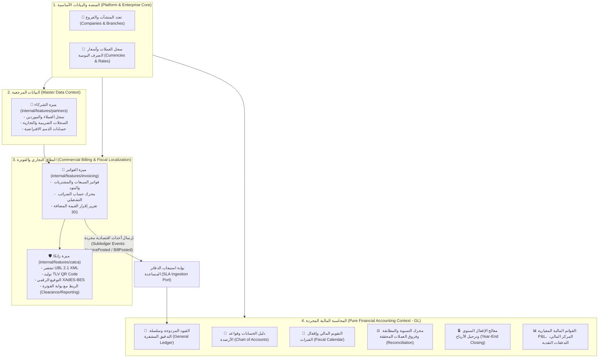
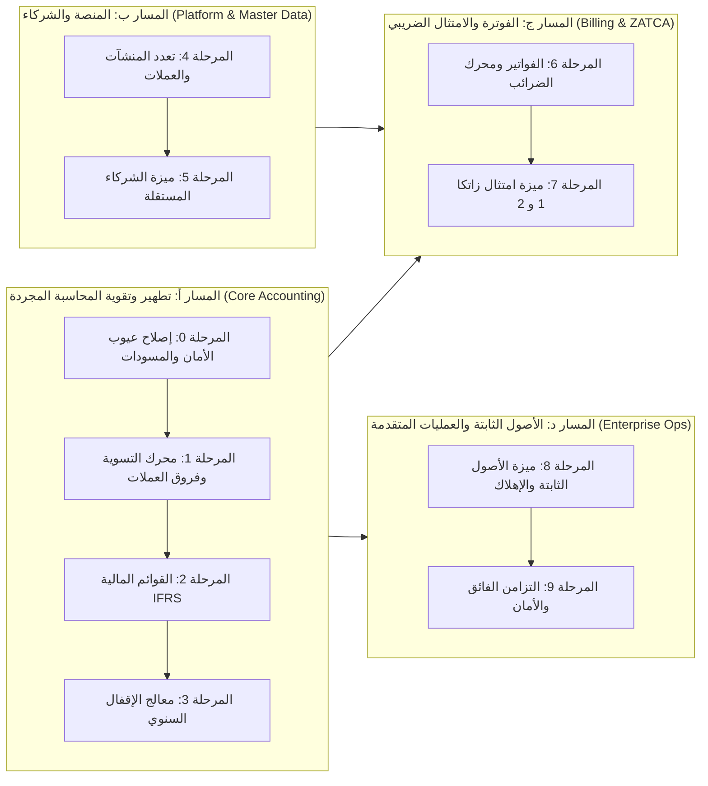

# الخطة التنفيذية الشاملة لمنظومة المحاسبة والفوترة المؤسسية (Enterprise Accounting & Financial Systems Master Plan)

> **مسار الوثيقة:** `docs/accounting_master_implementation_plan.md`  
> **تاريخ التحديث:** نوفمبر 2026  
> **المعمارية المعتمدة:** المعمارية النمطية المبنية على الميزات (Modular Monolith / Package-by-Feature) القائمة على عزل السياقات المحاطة (**Domain-Driven Design - Bounded Contexts**).  
> **المرجعيات العالمية:** معايير SAP S/4HANA (FI-GL vs CA-BP vs DRC)، معايير Oracle Cloud (GL vs TCA vs SLA)، أنماط مارتن فاولر المحاسبية (Martin Fowler Accounting Patterns)، معايير IFRS الدولية، ومواصفات هيئة الزكاة والضريبة والجمارك السعودية (ZATCA Phase 1 & 2).

---

## 1. التأسيس المعماري وفصل السياقات المحاطة (Architectural Bounded Contexts)

بناءً على الأصول العلمية للمحاسبة ومعايير هندسة البرمجيات المؤسسية، **تُعرَّف ميزة المحاسبة (`accounting`) كنظام مالي نقي ومجرد (Pure Financial General Ledger)**؛ مهمته الوحيدة هي إثبات الأثر المالي المتزن وغير القابل للتعديل ($\sum \text{Debit} = \sum \text{Credit}$) وإعداد القوائم الختامية، **بمعزل تام عن المنطق التجاري التشغيلي**.

وعليه، تم إعادة هيكلة الخطة التنفيذية لفصل المنظومة المالية إلى **4 نطاقات معمارية مستقلة (4 Distinct Bounded Contexts)**:



### مقارنة المسؤوليات والحدود المعمارية بين الميزات

| الميزة البرمجية (Package) | النطاق الوظيفي (Domain Scope) | ما تحتويه الميزة | ما يُحظر دخوله في الميزة (Out of Scope) |
| :--- | :--- | :--- | :--- |
| **`internal/features/accounting`** | **محرك المحاسبة المالية المجرد (General Ledger Engine)** | • دليل الحسابات (CoA)<br>• القيود المزدوجة المتزنة<br>• الفترات والسنوات المالية<br>• محرك المطابقة والتسوية المالية<br>• القوائم المالية الختامية (IFRS)<br>• بوابة استيعاب الدفاتر المساعدة (SLA) | • تفاصيل عناوين أو هواتف العملاء.<br>• بنود الفواتير، الكميات، والأسعار.<br>• حسابات الخصومات التجارية والضرائب.<br>• ملفات XML أو أكواد QR الخاصة بزاتكا. |
| **`internal/features/partners`** | **سجل الشركاء والعملاء والموردين (Business Partners)** | • سجلات العملاء والموردين<br>• الأرقام الضريبية والسجلات التجارية<br>• شروط الائتمان والدفع<br>• ربط حسابات الذمم المدينة والدائنة | • تسجيل قيود المحاسبة المزدوجة.<br>• إصدار الفواتير.<br>• حساب العملات. |
| **`internal/features/invoicing`** | **الفواتير والعمليات التجارية ومحرك الضرائب (Commercial Billing & Taxes)** | • فواتير المبيعات وفواتير الشراء<br>• إشعارات المدين والدائن<br>• الأصناف، الكميات، والأسعار<br>• محرك حساب ضريبة القيمة المضافة<br>• إقرار ضريبة القيمة المضافة (ZATCA 301) | • تخزين القيود العامة الدائمة.<br>• ميزان المراجعة أو القوائم المالية.<br>• توقيعات X.509 المشفرة لزاتكا. |
| **`internal/features/zatca`** | **الامتثال للفوترة الإلكترونية السعودية (Fiscal EDI)** | • معايير UBL 2.1 XML<br>• توليد كود الاستجابة السريعة TLV QR<br>• توقيع الفاتورة الرقمي (XAdES-BES)<br>• سلسلة التجزئة المشفرة للفواتير<br>• عميل الربط مع بوابة هيئة الزكاة والجمارك | • أي منطق تجاري أو تسعيري.<br>• قيود محاسبية أو أستاذ عام. |

---

## 2. المسارات التنفيذية المتسلسلة (The 4 Sequential Implementation Tracks)

تم تنظيم العمل في **4 مسارات متوازية ومتسلسلة**، كل مسار يحافظ على النقاء الكامل لميزته.



---

## 3. تفاصيل المراحل التنفيذية (Detailed Phase Specifications)

---

### المسار (أ): تطهير وتطوير محرك المحاسبة المالية المجرد (`internal/features/accounting`)

#### المرحلة 0: تصحيح العيوب الهندسية الفورية وإكمال أساسات التحكم (Foundation & Bug Fixes)
>
> **الهدف:** معالجة المشاكل المكتشفة في الكود الحالي للمحاسبة دون إقحام أي منطق تجاري.

1. **معالجة سباق التزامن في سلسلة التدقيق (Fix Audit Log Race Condition):**
   - **الخلل:** دالة `saveAuditLog` تستعلم عن الـ Hash السابق بـ `SELECT ... ORDER BY id DESC LIMIT 1` دون قفل تزامني، مما يكسر السلسلة عند ترحيل قيدين في نفس اللحظة.
   - **الحل الهرمي:** حماية الاستعلام بقفل استشاري Postgres (`pg_advisory_xact_lock`) خاص بسلسلة التدقيق لضمان التسلسل الأحادي المطلق لكتابة الـ Hash دون تكسير السلسلة.
2. **تقوية توقيع أمان القيد المحاسبي (`hashMove` Hardening):**
   - **الخلل:** دالة `hashMove` تشفر المعرف والتاريخ واسم القيد واليومية فقط وتتجاهل الأسطر والمبالغ.
   - **الحل:** إعادة بناء التجزئة المشفرة لتشمل: الحسابات، المبالغ (المدين والدائن بدقة 4 خانات)، والـ Hash الخاص بالقيد المرحل السابق لنفس اليومية (`Move Cryptographic Hash Chaining`).
3. **استكمال دورة حياة مسودات القيود والحسابات (CRUD Completeness):**
   - تنفيذ `UpdateDraftMoveUseCase`: تعديل أسطر وبيان القيد طالما في حالة `draft`.
   - تنفيذ `DeleteDraftMoveUseCase`: حذف مسودة القيد غير المرحل.
   - تنفيذ `UpdateAccountUseCase`: تعديل اسم الحساب، حالته، وقابليته للتسوية.
   - إضافة واجهات الاستعلام الناقصة: `GET /journals`, `GET /fiscal-periods`, `GET /fiscal-years`.
4. **تصحيح استيعاب أحداث الدفاتر المساعدة (Fix Subledger FX Handling):**
   - منع مساواة المبالغ الأجنبية بالريال السعودي تلقائياً؛ وإلزام `IngestSubledgerEventUseCase` بتحويل المبالغ عبر مزود أسعار الصرف.

---

#### المرحلة 1: محرك التسوية والمطابقة وفروق العملات المحققة (Reconciliation & Realized FX Engine)
>
> **الهدف:** بناء محرك محاسبي نقي لمطابقة أسطر القيود المالية (مثل مطابقة سطر ذمة مدينة بسطر مقبوضات دائنة) واحتساب فروق أسعار الصرف.

1. **هيكل بيانات التسوية المحاسبية:**
   - جدول `account_reconciliations`:

     ```sql
     CREATE TABLE IF NOT EXISTS account_reconciliations (
         id UUID PRIMARY KEY DEFAULT gen_random_uuid(),
         date DATE NOT NULL,
         created_by UUID,
         created_at TIMESTAMPTZ NOT NULL DEFAULT NOW()
     );
     ```

   - جدول بنود التسوية `account_reconciliation_lines`:

     ```sql
     CREATE TABLE IF NOT EXISTS account_reconciliation_lines (
         id UUID PRIMARY KEY DEFAULT gen_random_uuid(),
         reconciliation_id UUID NOT NULL REFERENCES account_reconciliations(id) ON DELETE CASCADE,
         move_line_id UUID NOT NULL REFERENCES account_move_lines(id) ON DELETE RESTRICT,
         allocated_amount NUMERIC(28, 4) NOT NULL,
         currency_id VARCHAR(3) NOT NULL,
         created_at TIMESTAMPTZ NOT NULL DEFAULT NOW()
     );
     ```

2. **محرك احتساب فروق أسعار الصرف المحققة (Realized FX Calculation):**
   - إذا تم إنشاء قيد ذمة بقيمة 1,000 USD بسعر صرف (1 USD = 3.75 SAR = 3,750 SAR).
   - وتم سداد القيد لاحقاً بسعر صرف (1 USD = 3.80 SAR = 3,800 SAR).
   - يقوم محرك التسوية تلقائياً بتوليد قيد تسوية مالي مزدوج يثبت فارق الـ 50 SAR في حساب "أرباح/خسائر فروق أسعار الصرف المحققة" دون تدخل يدوي.
3. **حالات الاستخدام والمسارات:**
   - `ReconcileMoveLinesUseCase` و `UnreconcileMoveLinesUseCase`.
   - `POST /api/v1/accounting/reconcile`
   - `POST /api/v1/accounting/unreconcile`
   - `GET /api/v1/accounting/unreconciled-lines?account_id={uuid}&partner_id={uuid}`

---

#### المرحلة 2: القوائم والتقارير المالية المعيارية (IFRS Financial Statements)
>
> **الهدف:** توفير القوائم المالية الختامية وفق معايير المحاسبة الدولية (IAS 1 & IAS 7) من واقع دفتر الأستاذ العام المجرد.

1. **قائمة الدخل والأرباح والخسائر (Income Statement / P&L):**
   - تجميع الإيرادات والمصروفات حسب الشجرة وتحديد مجمل وصافي الربح.
   - `GenerateIncomeStatementUseCase` $\rightarrow$ `GET /api/v1/accounting/reports/income-statement`.
2. **الميزانية العمومية والمركز المالي (Balance Sheet):**
   - الأصول، الخصوم، حقوق الملكية، وصافي أرباح الفترة غير الموزعة مع التحقق من الاتزان ($\text{Assets} = \text{Liabilities} + \text{Equity}$).
   - `GenerateBalanceSheetUseCase` $\rightarrow$ `GET /api/v1/accounting/reports/balance-sheet`.
3. **قائمة التدفقات النقدية (Cash Flow Statement):**
   - تصنيف التدفقات النقدية إلى: أنشطة تشغيلية، استثمارية، وتمويلية وفق معيار المحاسبة الدولي (IAS 7).
   - `GenerateCashFlowStatementUseCase` $\rightarrow$ `GET /api/v1/accounting/reports/cash-flow`.
4. **دفتر الأستاذ العام التفاعلي (General Ledger Drill-Down):**
   - بناء الـ UseCase والـ Handler لنقطة النهاية المطلوبة في الشاشات:
   - `GenerateGeneralLedgerUseCase` $\rightarrow$ `GET /api/v1/accounting/reports/general-ledger`.

---

#### المرحلة 3: دورة حياة الإقفال السنوي وترحيل الأرباح (Year-End Closing Wizard)
>
> **الهدف:** أتمتة الإقفال السنوي وتدوير الأرصدة للسنة الجديدة.

1. **حالة الاستخدام `CloseFiscalYearUseCase`:**
   - التأكد من إقفال جميع الفترات الشهرية الـ 12.
   - تصفير جميع حسابات الإيرادات والمصروفات وتوليد قيد إقفال الأرباح والخسائر الآلي ونقل الصافي إلى **حساب الأرباح المحتجزة (Retained Earnings)**.
   - توليد قيد الافتتاح للسنة المالية الجديدة (`Opening Balance Move`) بحسابات الأصول والخصوم وحقوق الملكية.
   - تحويل حالة السنة المالية إلى `hard_closed`.
2. **المسار:** `POST /api/v1/accounting/fiscal-years/{id}/close`.

---

### المسار (ب): المنصة والبيانات المرجعية (Platform & Master Data)

#### المرحلة 4: بنية تعدد المنشآت والعملات المؤسسية (Enterprise Platform Core)
>
> **الهدف:** توفير البنية الأساسية لتعدد الشركات والفروع وأسعار الصرف كطبقة منصة عابرة لجميع الميزات.

1. **تعدد الشركات والفروع (Multi-Company Core):**
   - في حزمة المنصة الأساسية أو حزمة مستقلة `internal/platform/company`:
   - تعريف جداول `companies` و `branches`.
   - إضافة عمود `company_id UUID` وعمود `branch_id UUID` لجداول القيود والحسابات واليوميات والشركاء، مع تطبيق سياسات العزل (Isolation Filters).
2. **سجل العملات وأسعار الصرف المركزية (Currencies & Rates Hub):**
   - جدول `currencies` (رمز العملة، الاسم، عدد الخانات العشرية).
   - جدول `currency_exchange_rates` (سعر الصرف اليومي مقابل العملة الأساسية SAR).
   - مزود خدمة مركزي للعملات تستخدمه ميزات المحاسبة والفوترة.

---

#### المرحلة 5: ميزة الشركاء المستقلة (`internal/features/partners`)
>
> **الهدف:** بناء ميزة مستقلة تماماً للبيانات المرجعية للعملاء والموردين، طبقاً لمعيار SAP CA-BP و Oracle TCA.

1. **هيكل الميزة المستقلة وفق معايير المشروع:**

   ```text
   internal/features/partners/
   ├── doc.go
   ├── ports.go
   ├── entity.go
   ├── dto.go
   ├── usecases.go
   ├── create_partner_usecase.go
   ├── update_partner_usecase.go
   ├── get_partner_usecase.go
   ├── list_partners_usecase.go
   ├── handler.go
   └── internal/
       ├── repository.go
       └── queries.go
   ```

2. **كيان الشريك (`Partner Entity`):**
   - المعرف، الاسم التجاري، نوع الشريك (`customer`, `vendor`, `both`).
   - الرقم الضريبي (`Tax ID`) والسجل التجاري (`CR Number`).
   - العنوان الوطني وتفاصيل الاتصال.
   - الحساب المحاسبي الافتراضي للمدينين (`receivable_account_id`).
   - الحساب المحاسبي الافتراضي للدائنين (`payable_account_id`).
3. **التكامل مع المحاسبة:**
   - ميزة المحاسبة تحتفظ فقط بـ `partner_id UUID` داخل سطر القيد كمعرف تتبع فرعي، دون أي معرفة بتفاصيل الشريك الداخلية.

---

### المسار (ج): النطاق التجاري والفوترة والامتثال لزاتكا (Commercial Billing & ZATCA)

#### المرحلة 6: ميزة الفوترة ومحرك الضرائب التشغيلي (`internal/features/invoicing`)
>
> **الهدف:** إدارة فواتير المبيعات والمشتريات التشغيلية ومحرك احتساب الضرائب وإرسال الأحداث المالية للمحاسبة.

1. **هيكل الميزة (`internal/features/invoicing`):**
   - تتبع نمط المعمارية العمودية المستقلة (`doc.go`, `ports.go`, `entity.go`, إلخ).
2. **محرك احتساب الضرائب التشغيلي (Tax Engine):**
   - جداول `taxes`: كود الضريبة، نسبتها (15% الأساسية، 0%، معفاة)، ونوعها.
   - خدمة احتساب الضريبة لسطور الفاتورة (حساب المبلغ الخاضع للضريبة، والخصومات، والتقريب).
3. **دورة حياة الفاتورة:**
   - فواتير المبيعات (`out_invoice`)، فواتير الشراء (`in_invoice`)، إشعارات الدائن والمدين.
   - تتضمن الأصناف، الكميات، أسعار الوحدات، والضرائب.
4. **التكامل مع المحاسبة عبر نمط Subledger Accounting (SLA):**
   - عند ترحيل الفاتورة في ميزة `invoicing`، تطلق الميزة حدثاً اقتصادياً:
     `InvoicePostedEvent` $\rightarrow$ تستقبله ميزة `accounting` عبر `IngestSubledgerEventUseCase`.
   - تقوم ميزة `accounting` بتوليد القيد المزدوج المتزن:
     - مدين: العميل (الإجمالي).
     - دائن: الإيرادات (الصافي).
     - دائن: ضريبة القيمة المضافة للمخرجات (الضريبة).
5. **تقرير إقرار ضريبة القيمة المضافة (ZATCA VAT Return 301):**
   - استخراج وتجميع الإقرار الضريبي الرسمي للمبيعات والمشتريات من واقع الفواتير والضرائب.

---

#### المرحلة 7: ميزة الامتثال والفوترة الإلكترونية لزاتكا (`internal/features/zatca`)
>
> **الهدف:** بناء ميزة الامتثال الخاصة بالفاتورة الإلكترونية السعودية (المرحلتين الأولى والثانية) دون تلويث المحاسبة أو الفوترة بكود التشفير الحكومي.

1. **مسؤوليات ميزة `zatca`:**
   - **المرحلة الأولى:** توليد كود الاستجابة السريعة المشفر بصيغة TLV Base64 من واقع بيانات فاتورة المبيعات.
   - **المرحلة الثانية:**
     - بناء ملف الفاتورة القياسي وفق مواصفات **UBL 2.1 XML**.
     - إنشاء التوقيع الرقمي المشفر معيارياً (**XAdES-BES**) باستخدام خوارزمية `ECDSA secp256k1` وشهادة الختم المشفر X.509.
     - تطبيق سلسلة التجزئة المشفرة للفواتير (**Cryptographic Invoice Hash Chaining**) بربط كل فاتورة بـ `Previous Invoice Hash` لضمان عدم التلاعب.
     - عميل الربط عبر بروتوكول REST/JSON مع منصة هيئة الزكاة (بوابة فاتورة):
       - خدمة الاعتماد المسبق للفواتير الضريبية (Clearance API).
       - خدمة الإبلاغ الفوري للفواتير المبسطة (Reporting API).
2. **العلاقة المعمارية:**
   - تستدعى ميزة `zatca` بواسطة ميزة `invoicing` كخدمة امتثال (Compliance Adapter) عند الرغبة في اعتماد الفاتورة أو إرسالها للعميل. لا توجد أي علاقة مباشرة بين `zatca` وميزة `accounting`.

---

### المسار (د): المحاسبة الرأسمالية والعمليات المصرفية والتزامن المؤسسي

#### المرحلة 8: ميزة الأصول الثابتة والإهلاك الآلي (`internal/features/fixed_assets`)
>
> **الهدف:** إدارة الأصول الرأسمالية وجداول إهلاكها وتوليد القيود الدورية آلياً.

1. **سجل الأصول وجدول الإهلاك:**
   - إدارة الأصول، تكلفة الشراء، القيمة التخريدية، والعمر الإنتاجي.
   - خوارزميات الإهلاك: القسط الثابت (Straight-Line) والقسط المتناقص (Declining Balance).
2. **التكامل المحاسبي:**
   - عامل خلفي مجدول (Scheduled Background Worker) يستدعي محرك المحاسبة شهرياً لإنشاء قيود الإهلاك (مدين: مصروف الإهلاك / دائن: مجمع الإهلاك).

---

#### المرحلة 9: استيراد كشوف البنوك، التزامن الفائق، والأمان المؤسسي
>
> **الهدف:** استيراد الكشوف المصرفية، وفك اختناقات التزامن في الأستاذ العام، وإحكام الرقابة والأمان.

1. **استيراد كشوف الحسابات البنكية ومطابقتها:**
   - بناء محولات استيراد صيغ البنوك القياسية: `MT940`، و `CAMT.053 XML`، و `CSV`.
   - تفعيل خوارزمية المطابقة الآلية في محرك التسوية المحاسبي لمطابقة بنود الكشف البنكي مع القيود المفتوحة.
2. **فك اختناق ترقيم القيود اليومية (High-Throughput Sequence Engine):**
   - استبدال قفل `SELECT ... FOR UPDATE` الثقيل على جداول اليوميات بخوارزمية حجز الكتل المسبقة (Block Allocation) أو متسلسلات Postgres المنفصلة لكل دفتر لضمان تنفيذ آلاف الحركات في الثانية دون تجميد قاعدة البيانات.
3. **إحكام الرقابة والمصادقة المؤسسية:**
   - تطبيق طبقة التحقق من الصلاحيات والأدوار المالية (RBAC Middleware).
   - تشديد تفعيل نظام الرقابة الثنائية **Maker-Checker** في ترحيل القيود ذات المبالغ الحرجة.

---

## 4. مصفوفة الحزم البرمجية والجداول المستهدفة (Architecture Mapping)

```
internal/features/
├── accounting/             # النطاق المحاسبي النقي (GL, CoA, Moves, Reports, Reconciliation)
├── partners/               # النطاق المرجعي للعملاء والموردين (Customers & Vendors Master Data)
├── invoicing/              # النطاق التجاري (Invoices, Bills, Items, Tax Calculation Engine)
├── zatca/                  # نطاق الامتثال الضريبي السعودي (UBL 2.1 XML, QR, XAdES, API Gateway)
└── fixed_assets/           # نطاق الأصول الرأسمالية والإهلاك الدوري
```

| النطاق / الميزة | الجداول المملوكة حصرياً في Postgres | المخرجات ونقاط النهاية (APIs) |
| :--- | :--- | :--- |
| **`accounting`** | `accounts`, `fiscal_years`, `fiscal_periods`, `journals`, `account_moves`, `account_move_lines`, `financial_audit_logs`, `account_reconciliations`, `subledger_processed_events` | • إدارة الدليل والقيود والفترات<br>• ميزان المراجعة، P&L، المركز المالي، التدفقات النقدية<br>• محرك التسوية وفروق العملات المحققة<br>• بوابة استيعاب الأحداث الاقتصادية (`/subledger/events`) |
| **`partners`** | `partners`, `partner_addresses`, `partner_categories` | • CRUD الشركاء (عملاء وموردين)<br>• التحقق من السجلات والضرائب |
| **`invoicing`** | `invoices`, `invoice_lines`, `taxes`, `tax_groups` | • إنشاء واعتماد الفواتير التجارية وإشعارات الدائن/المدين<br>• تقرير إقرار ضريبة القيمة المضافة 301 |
| **`zatca`** | `zatca_compliance_logs`, `zatca_certificates`, `zatca_invoice_hashes` | • توليد TLV QR Base64<br>• توليد وتوقيع UBL 2.1 XML<br>• الربط المباشر مع منصة فاتورة |
| **`fixed_assets`** | `fixed_assets`, `fixed_asset_depreciation_lines` | • إدارة بطاقات الأصول وجدول الإهلاك الدوري |

---

## 5. مصفوفة المخاطر التشغيلية واستراتيجية التخفيف (Risk Mitigation)

| الخطر التشغيلي أو الفني | مستوى التأثير | استراتيجية التخفيف والوقاية |
| :--- | :---: | :--- |
| **اختراق الحدود المعمارية (Coupling)** | **حرج** | منع أي `JOIN` بين جداول الفواتير أو الشركاء وجداول المحاسبة في SQL، وإلزام جميع العمليات بالمرور عبر أحداث الـ Subledger والمنافذ الرسمية (`ports.go`). |
| **فقدان التسلسل القانوني للقيود** | **حرج** | اعتماد مولد تسلسلات غير قابلة للثغرات (Gapless Sequence Engine) يضمن استمرارية الترقيم القانوني لليوميات حتى تحت التزامن العالي. |
| **انكسار سلسلة التدقيق عند التزامن** | **حرج** | حماية حساب الـ Hash السابق بقفل استشاري Postgres (`pg_advisory_xact_lock`) لضمان خطية السلسلة تماماً. |
| **رفض الفواتير من بوابة زاتكا** | **متوسط** | بناء بيئة محاكاة واختبار داخل ميزة `zatca` للتحقق من شروط الـ Schematron و XAdES محلياً قبل الإرسال الفعلي. |

---

## 6. الخاتمة وخارطة البدء الفوري

بهذه المعمارية المحكمة، يحقق نظام **Cashflow**:

1. **النقاء المحاسبي الأكاديمي والمهني:** وحدة محاسبة مالية نقية تلبي متطلبات IFRS/GAAP ويسهل تدقيقها من أي مكتب مراجعة خارجي.
2. **المرونة والنمو المستقبلي:** القدرة على إضافة طرق دفع جديدة، أو أنظمة فوترة، أو بوابات امتثال لدول أخرى (مثل مصر أو الإمارات) دون المساس بسطر واحد من كود المحاسبة.
3. **الأداء الفائق وقابلية التوسع:** عزل أقفال البيانات والتخزين حسب طبيعة العمليات التشغيلية والمالية.

> [!TIP]
> **نقطة الانطلاق الموصى بها:** البدء فوراً بـ **المسار (أ) - المرحلة 0** لتصحيح العيوب الهندسية الحالية في `internal/features/accounting` (سباق الـ Audit Hash، وتقوية `hashMove`، وإكمال مسودات القيود) لضمان متانة المحرك الأساسي قبل بناء الميزات المحيطة به.
