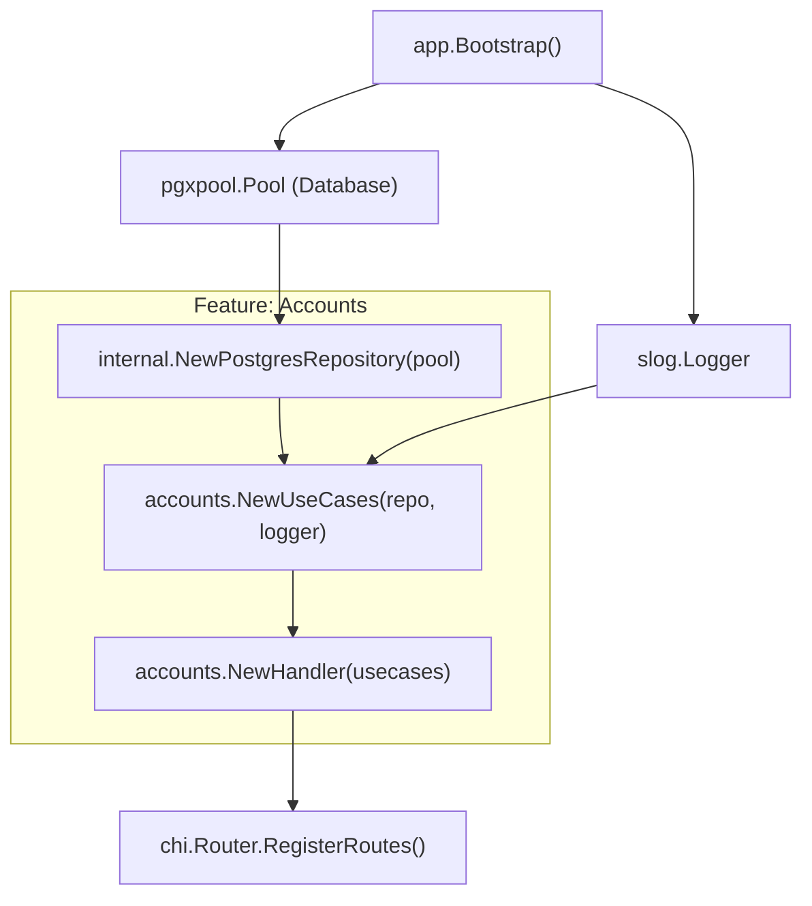

# دليل وتوصيات إنشاء ميزة جديدة (Feature Creation Guidelines)

## مشروع Cashflow Backend — معمارية Modular Monolith المبنية على الميزات (Package-by-Feature & Ports/Adapters)

> **الحالة:** وثيقة توجيهية وهندسية معتمدة  
> **المرجع الأساسي:** [تحليل معمارية Package-by-Feature في Go](file:///home/osm/StudioProjects/cashflow_system/cashflow_backend/docs/analysis/feature_based_architecture_in_go.md)  
> **تاريخ التحديث:** نوفمبر 2026

---

## فهرس المحتويات

1. [المبادئ الهندسية الأساسية (Core Architecture Principles)](#1-المبادئ-الهندسية-الأساسية-core-architecture-principles)
2. [الهيكل المعياري الشامل للميزة (Modular Feature Architecture Layout)](#2-الهيكل-المعياري-الشامل-للميزة-modular-feature-architecture-layout)
3. [دليل البناء خطوة بخطوة (Step-by-Step Blueprint)](#3-دليل-البناء-خطوة-بخطوة-step-by-step-blueprint)
   - [الخطوة 1: ملف التوثيق المرجعي (doc.go)](#الخطوة-1-ملف-التوثيق-المرجعي-docgo)
   - [الخطوة 2: المنافذ والأنواع المجردة (ports.go)](#الخطوة-2-المنافذ-والأنواع-المجردة-portsgo)
   - [الخطوة 3: كائنات النطاق وقواعد الكيان (entity.go)](#الخطوة-3-كائنات-النطاق-وقواعد-الكيان-entitygo)
   - [الخطوة 4: كائنات نقل البيانات وعقود الـ API والتحويل (dto.go)](#الخطوة-4-كائنات-نقل-البيانات-وعقود-الـ-api-والتحويل-dtogo)
   - [الخطوة 5: حالات الاستخدام المستقلة (usecases.go & <action>_usecase.go)](#الخطوة-5-حالات-الاستخدام-المستقلة-usecasesgo--action_usecasego)
   - [الخطوة 6: طبقة البيانات والمستودع (internal/repository.go)](#الخطوة-6-طبقة-البيانات-والمستودع-internalrepositorygo)
   - [الخطوة 7: معالجات الـ HTTP المستقلة (handler.go & <action>_handler.go)](#الخطوة-7-معالجات-الـ-http-المستقلة-handlergo--action_handlergo)
   - [الخطوة 8: ربط الميزة في نقطة التجميع (Composition Root / App Wiring)](#الخطوة-8-ربط-الميزة-في-نقطة-التجميع-composition-root--app-wiring)
4. [قواعد الاتصال بين الميزات وحظر الاعتماديات الدائرية (Inter-Feature Communication)](#4-قواعد-الاتصال-بين-الميزات-وحظر-الاعتماديات-الدائرية-inter-feature-communication)
5. [معايير التعامل مع الأخطاء والتسجيل والأمان (Platform Standards)](#5-معايير-التعامل-مع-الأخطاء-والتسجيل-والأمان-platform-standards)
6. [استراتيجية الاختبارات الآلية (Testing Strategy)](#6-استراتيجية-الاختبارات-الآلية-testing-strategy)
7. [قائمة التحقق الذهبية (Pre-Flight Feature Checklist)](#7-قائمة-التحقق-الذهبية-pre-flight-feature-checklist)

---

## 1. المبادئ الهندسية الأساسية (Core Architecture Principles)

عند بناء أي ميزة جديدة في `cashflow_backend`، يجب الالتزام الصارم بالمبادئ التالية:

1. **التقسيم العمودي المتكامل (Vertical Slice):**  
   كل ميزة تُبنى كشريحة عمودية مستقلة بذاتها تحتوي على نموذجها ونطقها وتخزينها وواجهات نقلها الخاصة، وليست طبقات أفقية مبعثرة.
2. **فصل كائنات النطاق (Entities) عن كائنات النقل (DTOs):**  
   كائنات النطاق تمثل جوهر النظام وقواعده الخالدة، بينما الـ DTOs تمثل هياكل الإدخال والإخراج للشبكة (عقود الـ API). يُحظر خلطهما في نفس الملف.
3. **تجريد المنافذ في `ports.go` (Ports & Adapters):**  
   تُعرف جميع الواجهات المجردة (Interfaces) التي تتطلبها الميزة (مثل مستودع البيانات، وناقل الأحداث، وعقود الخدمات الخارجية) في ملف `ports.go` كعقود صريحة.
4. **مبدأ المسؤولية الواحدة لكل حالة استخدام (Single Responsibility per Use Case):**  
   بدلاً من وضع كل حالات الاستخدام داخل ملف ضخم، تُجمع البنية العامة في `usecases.go`، بينما تُفرد كل حالة استخدام وظيفية بملف مستقل يحمل اللاحقة `_usecase.go`.
5. **معالج مستقل لكل طلب API (Dedicated Request Handler):**  
   الملف الرئيسي `handler.go` مسؤول عن تعريف البنية العامة للراوتر وتسجيل المسارات، بينما يُفرد معالج كل طلب بنقطة نهاية مستقلة في ملف ينتهي بـ `_handler.go`.
6. **التوثيق الإلزامي للميزة عبر `doc.go`:**  
   تتضمن كل ميزة ملف `doc.go` يشرح نطاقها الوظيفي، مسؤولياتها، وحدودها المعمارية.
7. **عزل التخزين وحظر الاستعلام المباشر عبر الجداول:**  
   جداول الميزة في قاعدة البيانات ملك خاص لها؛ يُحظر عمل `SQL JOIN` مباشر بين جداول ميزات مختلفة.

---

## 2. الهيكل المعياري الشامل للميزة (Modular Feature Architecture Layout)

كل ميزة جديدة يتم إنشاؤها داخل مجلد `internal/features/<feature_name>/` وفق هذا الهيكل الهندسي الدقيق:

```text
internal/features/<feature_name>/
├── doc.go                         # التوثيق المعماري للحزمة وحدود النطاق (Package Documentation)
├── ports.go                       # جميع الأنواع المجردة والواجهات (Repository Ports & Outgoing Interfaces)
├── entity.go                      # كائنات النطاق وقواعد الأعمال وحالات الكيان (Domain Entities & Invariants)
├── dto.go                         # كائنات نقل البيانات (Requests / Responses) والتحقق ودوال التحويل (Mappers)
├── usecases.go                    # البنية المركزية المجمعة لحالات الاستخدام ومصنع التهيئة (UseCases Coordinator)
├── <action>_usecase.go            # ملف مستقل لكل حالة استخدام (مثال: open_account_usecase.go)
├── <action>_usecase_test.go       # اختبارات الوحدة المعزولة لكل حالة استخدام
├── handler.go                     # البنية الرئيسية للـ HTTP Handler وتسجيل المسارات (Chi Router)
├── <action>_handler.go            # معالج مستقل لكل طلب API محدد (مثال: create_account_handler.go)
└── internal/                      # تغليف كامل لتفاصيل الوصول للبيانات (محمي من الاستيراد الخارجي)
    ├── repository.go              # تنفيذ الـ Port المعرف في ports.go باستخدام pgxpool
    └── queries.go                 # استعلامات SQL وتعيين صفوف قاعدة البيانات
```

### مقارنة المسؤوليات بين ملفات الميزة

| الملف | المسؤولية المعمارية |
| :--- | :--- |
| `doc.go` | توثيق سياق الميزة، حدود النطاق، والقدرات التي تتيحها للنظام. |
| `ports.go` | الأنواع المجردة (`Interfaces`) التي تطلبها الميزة من العالم الخارجي (Database, Event Bus, 3rd party). |
| `entity.go` | نماذج النطاق النقية وقواعد العمل الصلبة (Invariants) دون أي وسوم JSON أو تبعيات HTTP. |
| `dto.go` | هياكل الإدخال والإخراج الخاصة ببروتوكول الـ API، وسوم الـ JSON، ودوال التحقق `Validate()`. |
| `usecases.go` | الحاوية المجمعة لجميع حالات الاستخدام ومصنع التهيئة المركزي `NewUseCases()`. |
| `*_usecase.go` | تنفيذ حالة استخدام واحدة محددة (`Execute`) مع كامل منطق الأعمال والتنسيق. |
| `handler.go` | البنية المركزية لطبقة النقل، وتعريف الراوتر، ودالة `RegisterRoutes(r chi.Router)`. |
| `*_handler.go` | معالجة طلب HTTP محدد: قراءة المدخلات، التحقق، استدعاء الـ UseCase، وتنسيق كود الاستجابة. |
| `internal/repository.go` | المحول الواقعي (Adapter) الذي ينفذ واجهة الـ Port في قاعدة البيانات Postgres. |

---

## 3. دليل البناء خطوة بخطوة (Step-by-Step Blueprint)

نستعرض هنا التطبيق العملي الكامل لبناء ميزة الحسابات: `internal/features/accounts`.

### الخطوة 1: ملف التوثيق المرجعي (`doc.go`)

يوضح الغرض من الحزمة والحدود الوظيفية للميزة:

```go
// Package accounts provides domain models, use cases, and HTTP transport handlers
// for managing financial accounts in the Cashflow system.
//
// Responsibilities:
//   - Account lifecycle management (opening, status changes, querying).
//   - In-memory domain invariants enforcement (currencies, balance checks).
//   - Isolated storage using PostgreSQL with strict schema ownership.
//
// Cross-Feature Boundary:
//   External features must interact with accounts through consumer-driven
//   interfaces or the central event bus; direct database or internal package access
//   is strictly prohibited.
package accounts
```

---

### الخطوة 2: المنافذ والأنواع المجردة (`ports.go`)

يجمع كل الواجهات المجردة التي تحتاجها الميزة للقيام بعملها:

```go
package accounts

import (
 "context"

 "github.com/google/uuid"
)

// AccountRepository المنفذ الأساسي للوصول إلى بيانات الحسابات
type AccountRepository interface {
 Create(ctx context.Context, acc *Account) error
 GetByID(ctx context.Context, id uuid.UUID) (*Account, error)
 GetByNumber(ctx context.Context, accountNumber string) (*Account, error)
 UpdateBalance(ctx context.Context, id uuid.UUID, delta float64) error
}

// EventPublisher منفذ اختياري لبث أحداث النطاق خارج حدود الميزة
type EventPublisher interface {
 Publish(ctx context.Context, eventName string, payload any) error
}
```

---

### الخطوة 3: كائنات النطاق وقواعد الكيان (`entity.go`)

نماذج نقية مع قواعد تحقق داخلية لحماية حالة الكيان:

```go
package accounts

import (
 "errors"
 "time"

 "github.com/google/uuid"
)

const (
 StatusActive    = "active"
 StatusSuspended = "suspended"
 StatusClosed    = "closed"
)

var (
 ErrInsufficientBalance = errors.New("insufficient account balance")
 ErrAccountNotActive    = errors.New("account is not active")
)

// Account يمثل الكيان الجوهري للنطاق النقي
type Account struct {
 ID            uuid.UUID
 UserID        uuid.UUID
 AccountNumber string
 Currency      string
 Balance       float64
 Status        string
 CreatedAt     time.Time
 UpdatedAt     time.Time
}

// CanDebit يتحقق من مطابقة عملية الخصم لقواعد النطاق
func (a *Account) CanDebit(amount float64) error {
 if a.Status != StatusActive {
  return ErrAccountNotActive
 }
 if a.Balance < amount {
  return ErrInsufficientBalance
 }
 return nil
}

// Debit ينفذ الخصم في حالة الكيان
func (a *Account) Debit(amount float64) error {
 if err := a.CanDebit(amount); err != nil {
  return err
 }
 a.Balance -= amount
 a.UpdatedAt = time.Now().UTC()
 return nil
}

// Credit ينفذ الإيداع في حالة الكيان
func (a *Account) Credit(amount float64) error {
 if a.Status != StatusActive {
  return ErrAccountNotActive
 }
 a.Balance += amount
 a.UpdatedAt = time.Now().UTC()
 return nil
}
```

---

### الخطوة 4: كائنات نقل البيانات وعقود الـ API والتحويل (`dto.go`)

تمثل عقود الإدخال والإخراج عبر الشبكة، مع وسوم التنسيق ودوال التحقق والتحويل:

```go
package accounts

import (
 "errors"
 "strings"

 "github.com/google/uuid"
)

// CreateAccountRequest DTO لطلب إنشاء حساب جديد
type CreateAccountRequest struct {
 UserID   uuid.UUID `json:"user_id"`
 Currency string    `json:"currency"`
}

func (r *CreateAccountRequest) Validate() error {
 if r.UserID == uuid.Nil {
  return errors.New("user_id is required")
 }
 cur := strings.ToUpper(strings.TrimSpace(r.Currency))
 if cur != "USD" && cur != "EUR" && cur != "SAR" {
  return errors.New("currency must be USD, EUR, or SAR")
 }
 r.Currency = cur
 return nil
}

// AccountResponse DTO لإرجاع بيانات الحساب للمستهلك الخارجي
type AccountResponse struct {
 ID            uuid.UUID `json:"id"`
 UserID        uuid.UUID `json:"user_id"`
 AccountNumber string    `json:"account_number"`
 Currency      string    `json:"currency"`
 Balance       float64   `json:"balance"`
 Status        string    `json:"status"`
}

// ToResponse دالة تحويل آمنة من كيان النطاق (Entity) إلى كائن النقل (DTO)
func ToResponse(a *Account) AccountResponse {
 return AccountResponse{
  ID:            a.ID,
  UserID:        a.UserID,
  AccountNumber: a.AccountNumber,
  Currency:      a.Currency,
  Balance:       a.Balance,
  Status:        a.Status,
 }
}
```

---

### الخطوة 5: حالات الاستخدام المستقلة (`usecases.go` & `<action>_usecase.go`)

#### 1. الملف الرئيسي المجمع (`usecases.go`)

يحتوي على البنية المجمعة لجميع حالات الاستخدام ومصنع التهيئة:

```go
package accounts

import "log/slog"

// UseCases حاوية تجمع كافة حالات الاستخدام للميزة
type UseCases struct {
 OpenAccount *OpenAccountUseCase
 GetAccount  *GetAccountUseCase
}

// NewUseCases ينشئ ويحقن الاعتماديات لجميع حالات الاستخدام
func NewUseCases(repo AccountRepository, logger *slog.Logger) *UseCases {
 subLogger := logger.With(slog.String("feature", "accounts"))
 return &UseCases{
  OpenAccount: NewOpenAccountUseCase(repo, subLogger),
  GetAccount:  NewGetAccountUseCase(repo, subLogger),
 }
}
```

#### 2. حالة استخدام فتح حساب (`open_account_usecase.go`)

```go
package accounts

import (
 "context"
 "crypto/rand"
 "fmt"
 "log/slog"
 "time"

 "cashflow_backend/internal/platform/errors"

 "github.com/google/uuid"
)

type OpenAccountUseCase struct {
 repo   AccountRepository
 logger *slog.Logger
}

func NewOpenAccountUseCase(repo AccountRepository, logger *slog.Logger) *OpenAccountUseCase {
 return &OpenAccountUseCase{
  repo:   repo,
  logger: logger.With(slog.String("usecase", "OpenAccount")),
 }
}

func (uc *OpenAccountUseCase) Execute(ctx context.Context, req CreateAccountRequest) (*AccountResponse, error) {
 if err := req.Validate(); err != nil {
  return nil, errors.NewValidationError("VALIDATION_ERROR", err.Error())
 }

 acc := &Account{
  ID:            uuid.New(),
  UserID:        req.UserID,
  AccountNumber: generateAccountNumber(),
  Currency:      req.Currency,
  Balance:       0.0,
  Status:        StatusActive,
  CreatedAt:     time.Now().UTC(),
  UpdatedAt:     time.Now().UTC(),
 }

 if err := uc.repo.Create(ctx, acc); err != nil {
  uc.logger.ErrorContext(ctx, "failed to persist account", "error", err, "user_id", req.UserID)
  return nil, err
 }

 resp := ToResponse(acc)
 return &resp, nil
}

func generateAccountNumber() string {
 b := make([]byte, 5)
 _, _ = rand.Read(b)
 return fmt.Sprintf("ACC-%X", b)
}
```

#### 3. حالة استخدام الاستعلام عن حساب (`get_account_usecase.go`)

```go
package accounts

import (
 "context"
 "log/slog"

 "cashflow_backend/internal/platform/errors"

 "github.com/google/uuid"
)

var ErrAccountNotFound = errors.NewNotFoundError("ACCOUNT_NOT_FOUND", "account not found")

type GetAccountUseCase struct {
 repo   AccountRepository
 logger *slog.Logger
}

func NewGetAccountUseCase(repo AccountRepository, logger *slog.Logger) *GetAccountUseCase {
 return &GetAccountUseCase{
  repo:   repo,
  logger: logger.With(slog.String("usecase", "GetAccount")),
 }
}

func (uc *GetAccountUseCase) Execute(ctx context.Context, id uuid.UUID) (*AccountResponse, error) {
 acc, err := uc.repo.GetByID(ctx, id)
 if err != nil {
  return nil, err
 }
 if acc == nil {
  return nil, ErrAccountNotFound
 }

 resp := ToResponse(acc)
 return &resp, nil
}
```

---

### الخطوة 6: طبقة البيانات والمستودع (`internal/repository.go`)

توضع داخل المجلد الداخلي للميزة `internal/` لتنفيذ الـ Port المحدد في `ports.go`:

```go
package internal

import (
 "context"
 "errors"
 "fmt"

 "cashflow_backend/internal/features/accounts"

 "github.com/google/uuid"
 "github.com/jackc/pgx/v5"
 "github.com/jackc/pgx/v5/pgxpool"
)

type postgresRepo struct {
 pool *pgxpool.Pool
}

func NewPostgresRepository(pool *pgxpool.Pool) accounts.AccountRepository {
 return &postgresRepo{pool: pool}
}

func (r *postgresRepo) Create(ctx context.Context, acc *accounts.Account) error {
 query := `
  INSERT INTO accounts (id, user_id, account_number, currency, balance, status, created_at, updated_at)
  VALUES ($1, $2, $3, $4, $5, $6, $7, $8)
 `
 _, err := r.pool.Exec(ctx, query,
  acc.ID, acc.UserID, acc.AccountNumber, acc.Currency,
  acc.Balance, acc.Status, acc.CreatedAt, acc.UpdatedAt,
 )
 if err != nil {
  return fmt.Errorf("insert account: %w", err)
 }
 return nil
}

func (r *postgresRepo) GetByID(ctx context.Context, id uuid.UUID) (*accounts.Account, error) {
 query := `
  SELECT id, user_id, account_number, currency, balance, status, created_at, updated_at
  FROM accounts
  WHERE id = $1
 `
 var acc accounts.Account
 err := r.pool.QueryRow(ctx, query, id).Scan(
  &acc.ID, &acc.UserID, &acc.AccountNumber, &acc.Currency,
  &acc.Balance, &acc.Status, &acc.CreatedAt, &acc.UpdatedAt,
 )
 if errors.Is(err, pgx.ErrNoRows) {
  return nil, accounts.ErrAccountNotFound
 }
 if err != nil {
  return nil, fmt.Errorf("query account by id: %w", err)
 }
 return &acc, nil
}

func (r *postgresRepo) GetByNumber(ctx context.Context, accountNumber string) (*accounts.Account, error) {
 query := `
  SELECT id, user_id, account_number, currency, balance, status, created_at, updated_at
  FROM accounts
  WHERE account_number = $1
 `
 var acc accounts.Account
 err := r.pool.QueryRow(ctx, query, accountNumber).Scan(
  &acc.ID, &acc.UserID, &acc.AccountNumber, &acc.Currency,
  &acc.Balance, &acc.Status, &acc.CreatedAt, &acc.UpdatedAt,
 )
 if errors.Is(err, pgx.ErrNoRows) {
  return nil, accounts.ErrAccountNotFound
 }
 if err != nil {
  return nil, fmt.Errorf("query account by number: %w", err)
 }
 return &acc, nil
}

func (r *postgresRepo) UpdateBalance(ctx context.Context, id uuid.UUID, delta float64) error {
 query := `
  UPDATE accounts
  SET balance = balance + $1, updated_at = NOW()
  WHERE id = $2 AND status = 'active'
 `
 res, err := r.pool.Exec(ctx, query, delta, id)
 if err != nil {
  return fmt.Errorf("update account balance: %w", err)
 }
 if res.RowsAffected() == 0 {
  return accounts.ErrAccountNotFound
 }
 return nil
}
```

---

### الخطوة 7: معالجات الـ HTTP المستقلة (`handler.go` & `<action>_handler.go`)

#### 1. الهيكل الرئيسي للراوتر (`handler.go`)

مسؤول عن استقبال الـ `UseCases` وتسجيل المسارات العامة للميزة:

```go
package accounts

import "github.com/go-chi/chi/v5"

// Handler يمثل نقطة الدخول لطبقة الـ HTTP الخاصة بالميزة
type Handler struct {
 usecases *UseCases
}

func NewHandler(usecases *UseCases) *Handler {
 return &Handler{usecases: usecases}
}

// RegisterRoutes تسجل جميع مسارات الميزة في الراوتر المركزي
func (h *Handler) RegisterRoutes(r chi.Router) {
 r.Route("/api/v1/accounts", func(r chi.Router) {
  r.Post("/", h.handleCreateAccount)
  r.Get("/{id}", h.handleGetAccount)
 })
}
```

#### 2. معالج إنشاء حساب (`create_account_handler.go`)

ملف مخصص بالكامل لمعالجة هذا الطلب:

```go
package accounts

import (
 "encoding/json"
 "net/http"

 platformerr "cashflow_backend/internal/platform/errors"
)

func (h *Handler) handleCreateAccount(w http.ResponseWriter, r *http.Request) {
 var req CreateAccountRequest
 if err := json.NewDecoder(r.Body).Decode(&req); err != nil {
  platformerr.RespondHTTP(w, platformerr.NewValidationError("INVALID_JSON", "malformed request payload"))
  return
 }

 res, err := h.usecases.OpenAccount.Execute(r.Context(), req)
 if err != nil {
  platformerr.RespondHTTP(w, err)
  return
 }

 w.Header().Set("Content-Type", "application/json")
 w.WriteHeader(http.StatusCreated)
 _ = json.NewEncoder(w).Encode(res)
}
```

#### 3. معالج استعلام الحساب (`get_account_handler.go`)

ملف مخصص بالكامل لمعالجة طلب الاستعلام:

```go
package accounts

import (
 "encoding/json"
 "net/http"

 platformerr "cashflow_backend/internal/platform/errors"

 "github.com/go-chi/chi/v5"
 "github.com/google/uuid"
)

func (h *Handler) handleGetAccount(w http.ResponseWriter, r *http.Request) {
 idStr := chi.URLParam(r, "id")
 id, err := uuid.Parse(idStr)
 if err != nil {
  platformerr.RespondHTTP(w, platformerr.NewValidationError("INVALID_ID", "account id must be a valid uuid"))
  return
 }

 res, err := h.usecases.GetAccount.Execute(r.Context(), id)
 if err != nil {
  platformerr.RespondHTTP(w, err)
  return
 }

 w.Header().Set("Content-Type", "application/json")
 w.WriteHeader(http.StatusOK)
 _ = json.NewEncoder(w).Encode(res)
}
```

---

### الخطوة 8: ربط الميزة في نقطة التجميع (Composition Root / App Wiring)

يتم تجميع كافة المنافذ والـ UseCases والـ Handler وحقن التبعيات حصراً داخل [internal/platform/app/app.go](file:///home/osm/StudioProjects/cashflow_system/cashflow_backend/internal/platform/app/app.go) في مرحلة `Bootstrap`:



#### نموذج الكود في `app.go`

```go
// داخل Phase 3 في internal/platform/app/app.go:

// 1. تهيئة المستودع (Adapter) من المنفذ (Port)
accountsRepo := accountsInternal.NewPostgresRepository(a.pool)

// 2. تهيئة حالات الاستخدام المجمعة
accountsUseCases := accounts.NewUseCases(accountsRepo, a.logger)

// 3. تهيئة معالج الـ HTTP وتسجيل المسارات
accountsHandler := accounts.NewHandler(accountsUseCases)
accountsHandler.RegisterRoutes(router)
```

---

## 4. قواعد الاتصال بين الميزات وحظر الاعتماديات الدائرية (Inter-Feature Communication)

ماذا لو أرادت ميزة أخرى (مثل المعاملات `transactions`) استدعاء ميزة الحسابات `accounts` لتعديل الرصيد؟

### القاعدة الذهبية: Consumer-Driven Interface

1. **لا تقم باستيراد حزمة `accounts` داخل `transactions`!**
2. تقوم `transactions` بتعريف واجهة محلية في `ports.go` الخاص بها تحتوي **فقط** الدالة التي تحتاجها:

```go
// داخل internal/features/transactions/ports.go
package transactions

import (
 "context"
 "github.com/google/uuid"
)

// AccountBalanceModifier منفذ محلي يملكه المستهلك (transactions)
type AccountBalanceModifier interface {
 UpdateBalance(ctx context.Context, id uuid.UUID, delta float64) error
}
```

1. في نقطة التجميع [app.go](file:///home/osm/StudioProjects/cashflow_system/cashflow_backend/internal/platform/app/app.go)، نقوم بتمرير المنفذ المناسب أو الـ UseCase مباشرة:

```go
// يتم التحقق والتطابق في وقت الترجمة (Compile Time) بفضل Structural Typing في Go
txUseCases := transactions.NewUseCases(txRepo, accountsRepo, a.logger)
```

> [!IMPORTANT]
> **ممنوع قطيعاً:** استيراد أي ملفات من داخل مجلد `internal` الخاص بميزة أخرى. لا يجوز لحزمة `transactions` أن تستورد `accounts/internal` أبداً! المترجم في Go سيمنع ذلك تلقائياً بفضل خصوصية حزم `internal`.

---

## 5. معايير التعامل مع الأخطاء والتسجيل والأمان (Platform Standards)

يجب أن تتكامل كل ميزة مع المنظومة الموجودة في المشروع:

### 1. تصنيف الأخطاء عبر `internal/platform/errors`

- أخطاء التحقق من المدخلات: `errors.NewValidationError(code, message)`
- عدم العثور على المورد: `errors.NewNotFoundError(code, message)`
- تعارض البيانات: `errors.NewConflictError(code, message)`
- أخطاء منطق الأعمال وقواعد النطاق: `errors.NewBusinessError(code, message)`
- تفادي تسريب رسائل الخطأ الداخلية أو تفاصيل الـ SQL للعميل.

### 2. التسجيل المنظم (Structured Logging)

- استخدم دائماً `logger.InfoContext(ctx, ...)` و `logger.ErrorContext(ctx, ...)`.
- مرر الـ Context لضمان تتبع `request_id` و `client_ip` آلياً عبر الـ Middleware.
- **حماية البيانات الحساسة:** لا تسجل في الـ Log أي كلمات مرور، رموز Tokens، أو أرقام بطاقات ائتمانية (نظام الـ Logger الحالي في `internal/platform/logger` مزود بـ Redacting Handler لحجب الحقول الحساسة تلقائياً).

---

## 6. استراتيجية الاختبارات الآلية (Testing Strategy)

لكل حالة استخدام، يتم كتابة اختبار وحدة مستقل يحمل اللاحقة `_usecase_test.go` يعزل المستودع عبر Mock محلي يطابق الـ Port:

```go
// internal/features/accounts/open_account_usecase_test.go
package accounts_test

import (
 "context"
 "io"
 "log/slog"
 "testing"

 "cashflow_backend/internal/features/accounts"

 "github.com/google/uuid"
)

type mockRepo struct {
 createFunc func(ctx context.Context, acc *accounts.Account) error
}

func (m *mockRepo) Create(ctx context.Context, acc *accounts.Account) error {
 return m.createFunc(ctx, acc)
}
func (m *mockRepo) GetByID(ctx context.Context, id uuid.UUID) (*accounts.Account, error) {
 return nil, nil
}
func (m *mockRepo) GetByNumber(ctx context.Context, num string) (*accounts.Account, error) {
 return nil, nil
}
func (m *mockRepo) UpdateBalance(ctx context.Context, id uuid.UUID, delta float64) error {
 return nil
}

func TestOpenAccountUseCase_InvalidCurrency(t *testing.T) {
 logger := slog.New(slog.NewTextHandler(io.Discard, nil))
 repo := &mockRepo{}
 uc := accounts.NewOpenAccountUseCase(repo, logger)

 req := accounts.CreateAccountRequest{
  UserID:   uuid.New(),
  Currency: "INVALID",
 }

 _, err := uc.Execute(context.Background(), req)
 if err == nil {
  t.Fatal("expected error for invalid currency, got nil")
 }
}
```

---

## 7. قائمة التحقق الذهبية (Pre-Flight Feature Checklist)

قبل اعتماد أي ميزة جديدة أو دمجها في الفرع الرئيسي، تأكد من مطابقة البنود التالية:

- [ ] **ملف التوثيق:** توفر ملف `doc.go` يوثق حدود ومسؤوليات الميزة.
- [ ] **المنافذ:** توفر ملف `ports.go` يحتوي على جميع الأنواع والواجهات المجردة (`Interfaces`).
- [ ] **عزل كائنات النطاق والـ DTOs:** كائنات النطاق في `entity.go` معزولة تماماً عن كائنات الـ DTO في `dto.go`.
- [ ] **تنسيق حالات الاستخدام:** تجميع الحالات في `usecases.go` مع تخصيص ملف مستقل لكل حالة ينتهي بـ `_usecase.go`.
- [ ] **معالجات الطلبات:** تنظيم موجه الراوتر في `handler.go` مع تخصيص ملف مستقل لكل طلب ينتهي بـ `_handler.go`.
- [ ] **عزل طبقة البيانات:** وضع استعلامات قاعدة البيانات و `pgxpool` داخل مجلد `internal/` الخاص بالميزة.
- [ ] **قاعدة البيانات:** لا توجد استعلامات `JOIN` مباشرة مع جداول تابعة لميزات أخرى؛ الربط يتم عبر المعرفات UUID.
- [ ] **واجهات المستهلك:** الالتزام بقاعدة `Accept interfaces, return structs` لمنع أي Import Cycle.
- [ ] **نقطة التجميع:** تم حقن كافة الاعتماديات في `internal/platform/app/app.go` وتسجيل المسارات على راوتر Chi.
- [ ] **الاختبارات:** تغطية حالات الاستخدام باختبارات وحدة `*_usecase_test.go` مستندة على Mocks للـ Ports.
- [ ] **الفحص الثابت:** تنفيذ `go test ./...` و `go vet ./...` بنجاح تام دون أخطاء.
